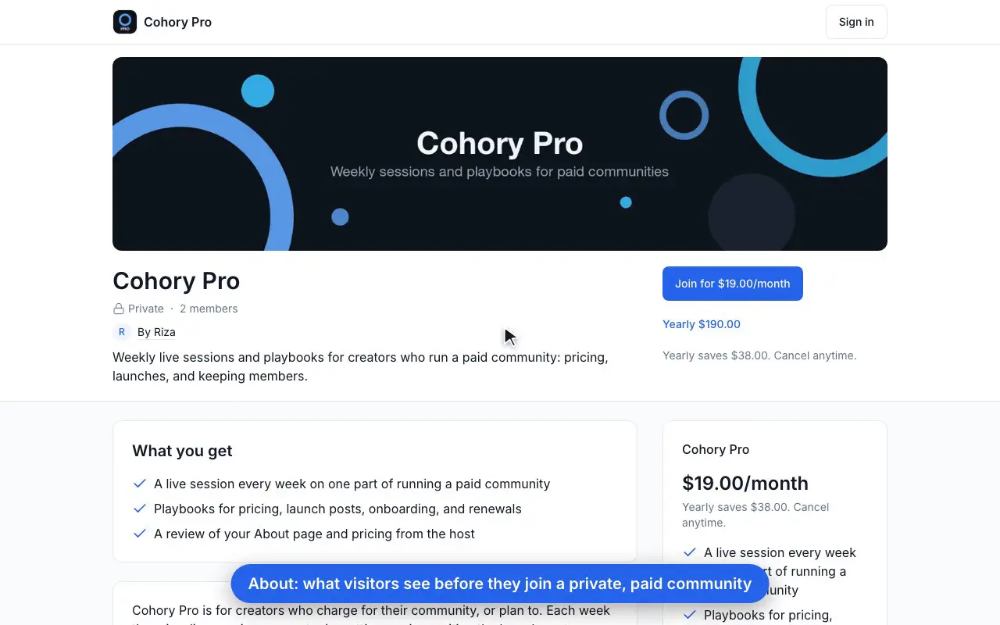
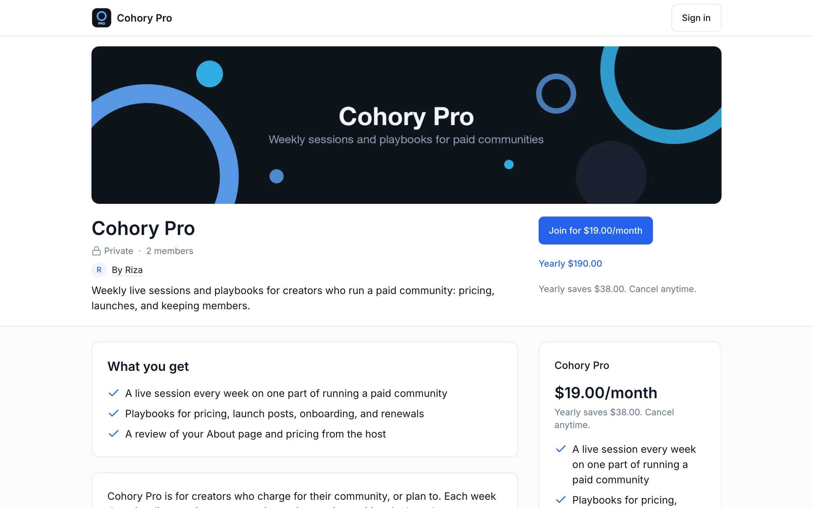
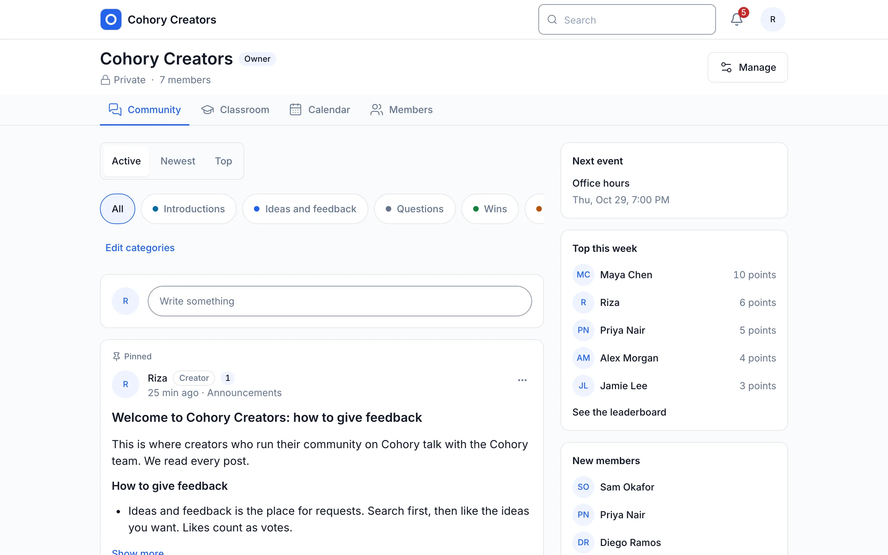
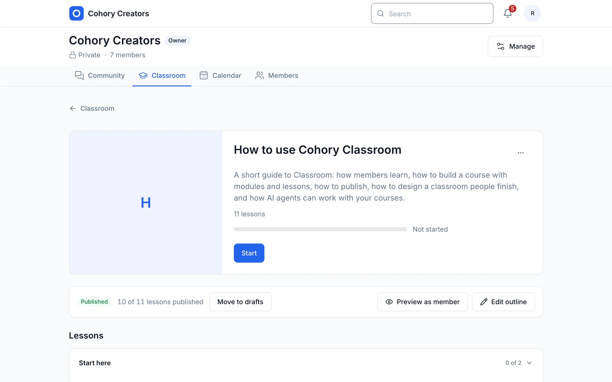
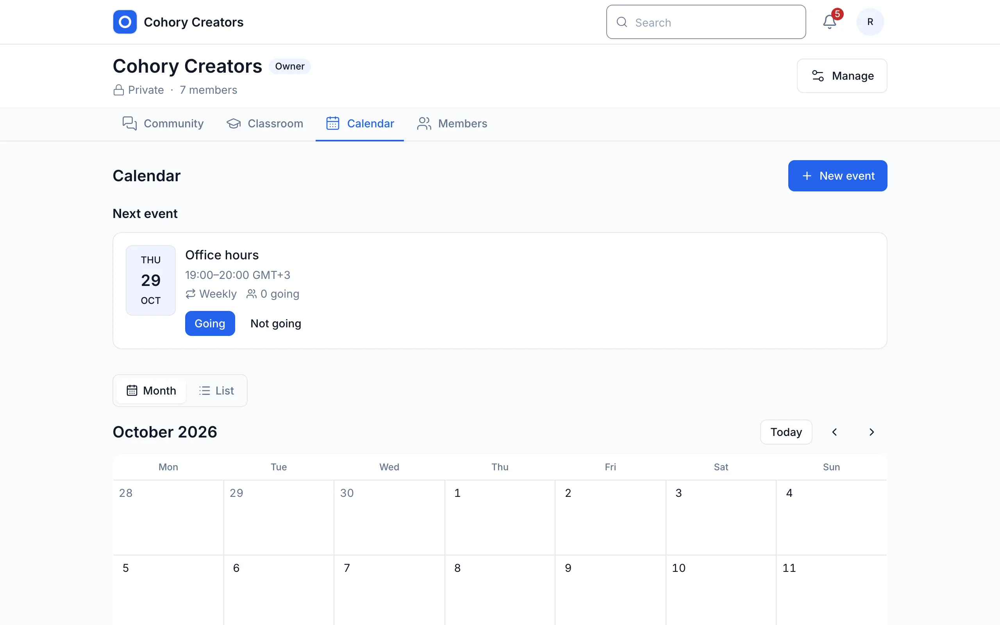
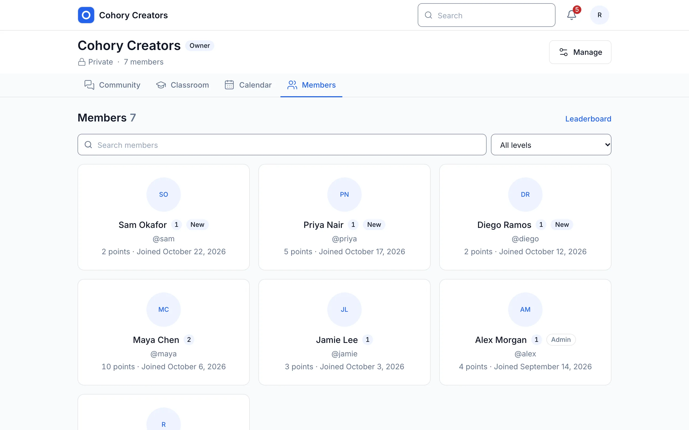
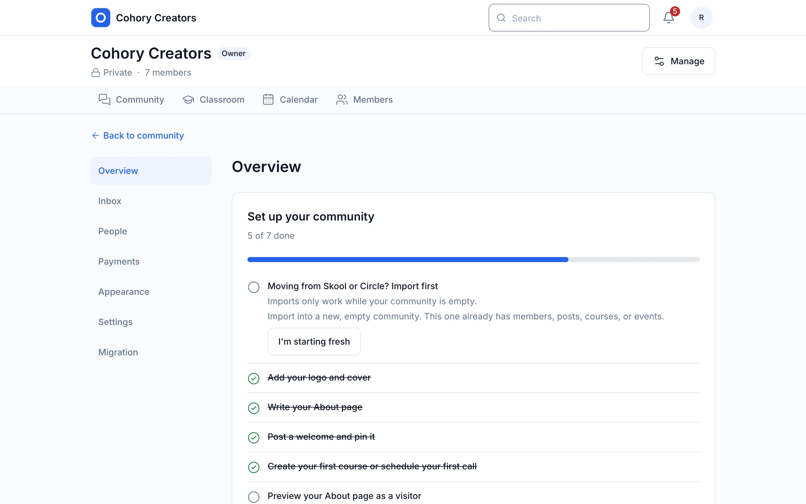

# Cohory

The open source alternative to Skool. Run your community, courses, events, and paid memberships on software you own.

<picture>
  <source media="(prefers-color-scheme: dark)" srcset="assets/screenshots/tour-dark.webp">
  
</picture>

Cohory gives a creator one calm place for a community, courses, events, and paid memberships. Members see four tabs (Community, Classroom, Calendar, Members), and the creator runs everything from Manage. Members pay through the creator's own Stripe account, so the subscriptions stay with the creator, and the whole community exports as an archive that another Cohory server imports. You can run it yourself for free, or use the hosted Cloud Edition, which takes 2% of each successful payment and no monthly fee.

> **Version 0.12.0.** [CHANGELOG.md](CHANGELOG.md) lists what each release contains, and the [feature inventory](docs/product/feature-inventory.md) marks every feature as Built, Partly built, or planned. No image has been published yet, so the quickstart builds the image from source.

## Quickstart with Docker (about 5 minutes)

You need Docker Engine 24 or newer with the Compose plugin, 2 CPUs, and 4 GB of RAM. The first build takes most of the time.

```sh
git clone https://github.com/cohory/cohory.git
cd cohory
cp .env.example .env
docker compose --profile mail up -d --build
```

This starts PostgreSQL, a one-shot `migrations` container, the web app, the worker, and Mailpit (the `mail` profile) with the defaults from `.env.example`. Check that it is up:

```sh
docker compose ps
curl -s localhost:3000/api/v1/health
```

`migrations` shows `Exited (0)`, the other services are running, and the health check answers `{"status":"ok",...}`. Then:

1. Open http://localhost:3000 and create an account.
2. Open the Mailpit inbox at http://localhost:8025 and click the confirmation link.
3. Create your first community.

The app listens on `127.0.0.1` only. Before anyone else uses the server, change every value marked `CHANGE FOR PRODUCTION` in `.env`. For a public domain with HTTPS, follow the [install guide](docs/operations/install.md), which uses `.env.production.example` and the Caddy overlay.

## Editions

| | Community Edition (self-hosted) | Cloud Edition (hosted) |
|---|---|---|
| Who runs it | You, on your own server | The Cohory team |
| Code | This repository | The same core |
| Monthly subscription | None | None |
| Platform fee | 0% | 2% of each successful payment |
| Payment processing fees | Charged by your payment provider | Charged by your payment provider, separate from the platform fee |

Self-hosted creators connect their own Stripe keys. The Cloud Edition uses Stripe Connect with direct charges on the creator's account. The [business model](docs/foundation/business-model.md) has the fee rules.

## What is built

| Area | Features |
|------|----------|
| Community | Posts with formatting, images, video embeds, and mentions; likes, pins, comments with one level of replies; categories, search, and moderation |
| Classroom | Courses with modules and lessons, drafts, attachments, progress, and a Continue card |
| Calendar | Single and weekly events, RSVP, reminders, and calendar downloads |
| Members | Directory, profiles, points and levels, leaderboards, and member reviews |
| Joining | Public or private communities, open join, approval with join questions, and invite links |
| Payments | One plan with monthly and yearly prices, Stripe Checkout and the customer portal, a platform fee ledger, and a safe exit that changes paying members' subscriptions before a community is archived, deleted, transferred, or disconnected |
| Portability | Member CSV export and import, a versioned community archive, Skool and Circle importers, and moving existing Stripe subscribers |
| Agents and API | A REST API under `/api/v1` with an OpenAPI document, scoped API tokens, agent identities with an approval queue, outgoing webhooks, an MCP server at `/mcp`, and agent ready courses |
| Operations | Docker Compose with a production overlay, backups and restores, fair use limits, rate limits, legal page settings, and a worker healthcheck |

<table>
  <tr>
    <td width="50%">
      <picture>
        <source media="(prefers-color-scheme: dark)" srcset="assets/screenshots/about-dark.webp">
        
      </picture>
      <p align="center"><b>About.</b> What visitors see before they join a private, paid community.</p>
    </td>
    <td width="50%">
      <picture>
        <source media="(prefers-color-scheme: dark)" srcset="assets/screenshots/feed-dark.webp">
        
      </picture>
      <p align="center"><b>Community.</b> Posts, categories, likes, and comments, with the next event and the week's top members.</p>
    </td>
  </tr>
  <tr>
    <td width="50%">
      <picture>
        <source media="(prefers-color-scheme: dark)" srcset="assets/screenshots/classroom-dark.webp">
        
      </picture>
      <p align="center"><b>Classroom.</b> Courses with modules, lessons, and progress.</p>
    </td>
    <td width="50%">
      <picture>
        <source media="(prefers-color-scheme: dark)" srcset="assets/screenshots/calendar-dark.webp">
        
      </picture>
      <p align="center"><b>Calendar.</b> Weekly events with RSVP and reminders.</p>
    </td>
  </tr>
  <tr>
    <td width="50%">
      <picture>
        <source media="(prefers-color-scheme: dark)" srcset="assets/screenshots/members-dark.webp">
        
      </picture>
      <p align="center"><b>Members.</b> Directory, levels, and points.</p>
    </td>
    <td width="50%">
      <picture>
        <source media="(prefers-color-scheme: dark)" srcset="assets/screenshots/manage-dark.webp">
        
      </picture>
      <p align="center"><b>Manage.</b> A setup checklist and every creator setting in one place.</p>
    </td>
  </tr>
</table>

## Documentation

- [Self-hosting guide](docs/self-hosting.md): configuration, data, backups, upgrades, email, and limits.
- [Install guide](docs/operations/install.md) and [operator guide](docs/operations/operator-guide.md) for a public server.
- API: reference pages at `/docs/api` and the OpenAPI 3.1 document at `/api/openapi.json` on any server, plus [API tokens](docs/operations/api-tokens.md) and [webhooks](docs/operations/webhooks.md).
- [MCP server](docs/operations/mcp.md) for AI assistants and agents.
- [Documentation index](docs/README.md) for product, architecture, and decision records.

## Development

You need Node.js 22 (see `.nvmrc`), pnpm 12 (`corepack enable`), and Docker for PostgreSQL.

```sh
pnpm install
cp .env.example .env
docker compose --profile mail up -d postgres mailpit
pnpm db:migrate
pnpm db:seed
pnpm dev
```

`pnpm db:seed` creates development accounts such as `owner@cohory.local` and `member@cohory.local` with the password `cohory-dev-password`, and two sample communities. It refuses to run in production. The [local workflow](docs/open-source/local-workflow.md) covers the development stack, resets, and the checks to run (`pnpm verify:changed`, `pnpm e2e:host`, `pnpm verify`). The [testing guide](docs/open-source/testing.md) explains the test layers.

The stack is TypeScript, Next.js, Hono, PostgreSQL with Drizzle, Better Auth, and pg-boss, in a pnpm and Turborepo monorepo. The [architecture overview](docs/architecture/overview.md) describes the modules and where code lives.

## Contributing

Contributions are welcome. Read [CONTRIBUTING.md](CONTRIBUTING.md) first, open an issue before a large change, and sign off every commit with `git commit -s` (Developer Certificate of Origin, no CLA). Architectural changes need a [decision record](docs/decisions/README.md). Coding agents follow [AGENTS.md](AGENTS.md).

Please follow the [Code of Conduct](CODE_OF_CONDUCT.md). Report security issues privately as described in [SECURITY.md](SECURITY.md). Governance is in [GOVERNANCE.md](GOVERNANCE.md).

## License

Cohory is licensed under the [GNU Affero General Public License, version 3](LICENSE) (`AGPL-3.0-only`). The SDK and generated API client (`packages/sdk`) and the agent runner (`packages/agent-runner`) are MIT. A draft plugin exception, awaiting legal review, lets code that talks to Cohory only through its public API, MCP server, webhooks, or the MIT packages use any license. Third party agent skills in `.claude/skills` keep their own licenses. Details are in [LICENSING.md](LICENSING.md).
