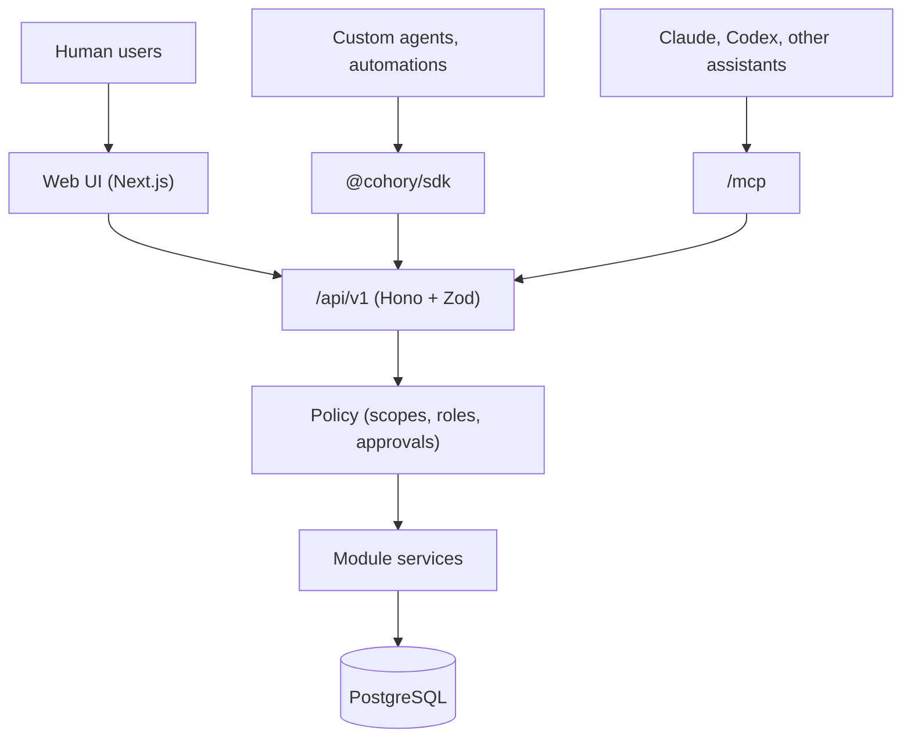
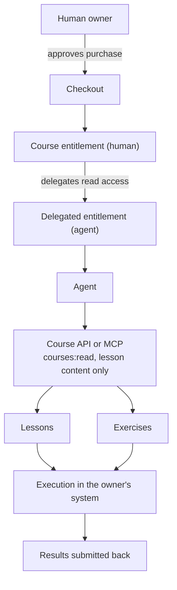

# Agent integrations

How agents and integrations use Cohory: the REST API and OpenAPI, the MCP server, agent identities and audit, webhooks, the SDK, untrusted input rules, rate limits, and the separate long-term design for agent-ready courses.

Permissions, scopes, and approvals are defined in [authorization.md](authorization.md). Phase numbers refer to [../foundation/roadmap.md](../foundation/roadmap.md). **Confirmed** from the brief: usable by humans and agents, REST APIs, OpenAPI, MCP, scoped agent permissions, audit logs, human approval workflows, agent identities, and no unrestricted financial or admin permissions for agents. External course content and downloaded skills are untrusted input.

## 1. What ships when

| Capability | Phase | Label |
|---|---|---|
| Hono API at `/api/v1` with Zod schemas, used by the web client with session auth | 1 (MVP) | Recommendation |
| Generated `/api/openapi.json` (OpenAPI 3.1) | 1 (MVP), published as stable in 6 | Recommendation |
| Audit log of sensitive actions | MVP (admin actions), 6 (API and agent actions) | Confirmed (REQ-AGT-003) |
| API reference at `/docs/api` | 6 | Recommendation |
| Scoped API tokens for external use | 6 | Recommendation (REQ-AGT-001, 002, aligned with the roadmap) |
| Agent identities, grants, approval queue | 6 | Recommendation (REQ-AGT-004, 006) |
| MCP server at `/mcp` | 6 | Recommendation (REQ-AGT-005) |
| Outbound webhooks | 6 | Recommendation (REQ-AGT-007) |
| `@cohory/sdk` typed client | 6 | Recommendation |
| `definePlugin` hooks | Long-term | Recommendation |
| Agent-ready courses, SKILL.md generation, delegated entitlements | 7, Long-term | Recommendation (REQ-AGT-008, REQ-ENT-004) |

Nothing in this document beyond the first three rows is part of the MVP.

Implementation: scoped personal and agent API tokens, agent identities with an owning human, the Agent badge, agent drafts, audit of API and agent writes, the token and agent rate limits, the approval queue, outbound webhooks, and the SDK are built since 0.6.0; the MCP server since 0.7.0; agent ready courses since 0.8.0. Guide: [../operations/api-tokens.md](../operations/api-tokens.md).

## 2. API-first design

**Recommendation.** "Every UI action should be available to agents" (founder notes) will be met by making the web client a consumer of the same API.



| Path | Content |
|---|---|
| `/api/v1/...` | REST resources, JSON, cursor pagination, typed errors |
| `/api/openapi.json` | Generated OpenAPI 3.1 document |
| `/docs/api` | Rendered reference from the OpenAPI document |
| `/mcp` | MCP server (Streamable HTTP) |

API conventions (**Recommendation**):

- Resources nest under the community: `/api/v1/communities/{communityId}/posts`. Platform resources (`/api/v1/me`) are few.
- Every list returns `{ data, nextCursor }` (since the review fixes, 0.11.0, [0032](../decisions/0032-error-catalog-and-list-shape.md)). Paged lists take `?cursor=&limit=` from the shared `cursorQuery()` in `packages/api/src/pagination.ts`; pass `nextCursor` as `cursor` until it is null. Lists that always fit in one page (a hard cap, or one person's own items) answer `nextCursor: null` and take no cursor. Reviews use a `(created_at, id)` keyset cursor, 10 per page by default and at most 50. The gallery is one document, not a list, and returns `{ data }` only.
- Writes accept `Idempotency-Key` headers. The server stores the key with the response for 24 hours and replays it on retry. Not built as of 0.12.0.
- Errors return `{ error: { code, message, details } }` with stable codes (`not_found`, `forbidden`, `validation_failed`, `rate_limited`, `approval_required`). Codes and messages come from one catalog per module in `packages/api/src/error-catalog`, keyed by code, with a kind that sets the status. Web server actions read the same catalog through `@cohory/api/errors`, so the API and the UI show the same message for the same code; an entry adds a creator or member variant only where one audience must not see the default text ([0032](../decisions/0032-error-catalog-and-list-shape.md)).
- Status codes (since the review fixes, 0.11.0): 422 `validation_failed` for invalid input (documented on every operation with path, query, or body input), 413 `payload_too_large` when a body is larger than the operation accepts (every operation with a body has a limit and documents the 413), and 308 with a `Location` header when a community URL changed (documented on every route under `/communities/{slug}`). One root error handler in `packages/api/src/app.ts` maps every domain error, answers the 308, and logs every 500; sub routers come from `createRouter()` and set no error handler of their own. The OAuth endpoints cap bodies at 16 KB and answer 413 `invalid_request` above that.
- The OpenAPI document is built once per process, lists `APP_URL` as its server, and is rendered for people at `/docs/api` with a quickstart (since the review fixes, 0.11.0). The page is server rendered and loads nothing from a third party.
- Version in the path. Within `v1`, changes are additive only. The committed `openapi.json` snapshot must match the generated one in CI, so every change is reviewed.

## 3. One definition generates validation, OpenAPI, and MCP tools

**Recommendation.** Each route is defined once with `@hono/zod-openapi`. The same definition yields runtime validation, TypeScript types, the OpenAPI operation, the SDK method, and (if marked) an MCP tool.

```ts
// packages/api/routes/posts.ts (sketch)
export const createPost = createRoute({
  method: "post",
  path: "/communities/{communityId}/posts",
  request: { params: CommunityParams, body: { content: { "application/json": { schema: posts.CreatePostInput } } } },
  responses: { 201: { content: { "application/json": { schema: posts.Post } }, description: "Created" } },
  "x-cohory": {
    action: "post.create",              // policy action
    scope: "posts:write",
    mcp: { tool: "create_post", annotations: { readOnlyHint: false, destructiveHint: false } },
  },
});

app.openapi(createPost, async (c) => {
  const ctx = c.get("ctx");
  return c.json(await posts.create(ctx, c.req.valid("json")), 201);
});
```

Implementation (since 0.6.0): every route passes `"x-cohory": routeMeta("<operationId>")` to `createRoute`, which resolves to `{ operationId, scope, action }` from the `routeScopes` table in `packages/api/src/route-meta.ts` (`action` is a typed `PolicyAction` such as `post.create`, `scope` is a `Scope` or `null` for session only). The bearer middleware (`packages/api/src/middleware/bearer.ts`) reads it from the OpenAPI registry for the matched route, and `src/route-meta.test.ts` fails when an operation lacks it. Since 0.7.0 the same object also carries the `mcp` key (section 3).

The MCP registry walks routes that have `x-cohory.mcp`, builds tool definitions with JSON Schema from the Zod input and output schemas, and dispatches calls to the same handler with the agent's context. No MCP tool has logic of its own.

## 4. MCP server

**Recommendation** (Phase 6). Precedents: Formbricks, Cal.com, Payload, Discourse (see [../research/comparable-projects.md](../research/comparable-projects.md) section d).

- **Location and transport.** In process at `/mcp`, Streamable HTTP transport, sharing auth and services with the API. No separate MCP backend.
- **Authorization.** OAuth 2.1 with PKCE as required by the MCP authorization specification, with dynamic client registration so assistants can connect without manual setup. Fallback: an agent API token as a bearer token for clients that do not support OAuth. **Assumption:** the MCP authorization spec at implementation time still requires OAuth 2.1 with protected resource metadata; check the current spec version.
- **Consent screen.** When an assistant connects, the human picks the community, names the agent (creating an agent identity), and selects scopes. Read-only scopes are preselected. Write scopes are unchecked by default.
- **Per-tool scope checks.** Each tool requires one scope from [authorization.md](authorization.md) section 6. The tool list returned to a client contains only tools its token can call.
- **Tool annotations.** `readOnlyHint`, `destructiveHint`, `idempotentHint` set from route metadata so clients can warn users.
- **Human approval.** Tools that map to actions requiring approval (money, settings, roles, removals, bulk actions) return a `pending_approval` result with an approval id and a plain-language summary, never an error that invites retries.
- **Limits.** Request body size caps, result size caps (paginate rather than return whole feeds), per-agent rate limits (section 8).
- **Observability.** Every tool call is logged with agent id, tool, scope, latency, and outcome, and every write is in the audit log.

Implementation (since 0.7.0): the authorization server follows the MCP authorization specification revision 2026-07-28 and is described in [ADR 0020](../decisions/0020-oauth-authorization-server.md) and [../operations/mcp.md](../operations/mcp.md#signing-in-with-oauth). `/.well-known/oauth-protected-resource` (also at `/.well-known/oauth-protected-resource/mcp`) names the resource `<APP_URL>/mcp` and the issuer (the origin of `APP_URL`); `/.well-known/oauth-authorization-server` publishes RFC 8414 metadata with `code_challenge_methods_supported: ["S256"]` and `authorization_response_iss_parameter_supported: true`. Clients register at `/oauth/register` (RFC 7591, public clients only, `https` or loopback redirect URIs), send people to `/oauth/authorize`, and exchange codes and refresh tokens at `/oauth/token`; `/oauth/revoke` follows RFC 7009. The consent screen at `/oauth/authorize` is for signed in people and lists only communities where they may create agents (owner or admin); members are told "Only owners and admins can connect apps. Members can create an agent by hand." with a link to Account, Agents (founder, 2026-10-22: no member OAuth now, backlog). It shows the instance brand, the app name, its website host when registered, the host the browser returns to, and a warning that the app is not verified, then asks for the community (with its logo), a new agent name or one of the person's active agents (the agent an earlier connection of the same app used is preselected; the same app means the same client, or a client with the same name that returns to the same host), and permissions as plain "It can", "It also asked to", and "It cannot" lines with the full picker under "Change permissions" (requested read scopes preselected, write scopes unchecked, limited to what the role can give). The button reads "Allow access to" and the community name, with a line on how access renews and where to disconnect. Approving creates the agent if needed (with only the chosen permissions the role can give) and an `oauth_grants` row, and returns a 60 second single use code with `state` and `iss`. Access tokens are `api_tokens` rows of kind agent with `oauth_grant_id`, 1 hour expiry, authorized by the same bearer middleware as every token (limited to `/mcp`, see below; **Confirmed** by the founder, 2026-10-19); their scopes are the agent's current scopes intersected with the grant's. Refresh tokens last 30 days and rotate on use; a reused refresh token or code ends the grant and revokes all its tokens. Connected apps with Disconnect are in Account (`/account/connected-apps`, grouped by app with the return host) and inside each agent's card in Account, Agents and Manage, Settings, Agents ("Connected through" the app); the hourly access tokens are not listed. A "Connect an AI assistant" card on both Agents pages shows the MCP address and client steps. After Disconnect, `/mcp` answers OAuth tokens with "This connection was ended. Connect the app again." Registered clients have no owner, so there is no screen to delete one; instead the daily worker job `agents.oauth_clients_prune` (03:55 UTC, `createOAuthClientPrune` in `packages/agents/src/oauth/prune.ts`) deletes up to 500 clients per run that have no active grant, no unexpired access or refresh token, and no grant or token created in the last 30 days, which also covers clients never used and registered more than 30 days ago (product owner decision P18, 2026-10-23). Last use is the newest grant, access token, or refresh token row, so no column was added. The foreign key cascades remove the client's ended grants, codes, and tokens. Usage is read one community at a time under row level security, and candidate rows stay locked during the check so a consent racing the job fails instead of losing its grant. Client ID Metadata Documents, which the 2026-07-28 revision recommends over dynamic registration, are not supported yet.

Initial tool set (Phase 6), from the founder's capability table: `get_community`, `list_posts`, `search_community`, `create_post` (draft by default), `create_comment`, `list_members`, `find_inactive_members`, `list_courses`, `get_lesson`, `create_course_draft`, `list_events`, `create_event`, `list_failed_renewals`.

Implementation (since 0.7.0), see [ADR 0019](../decisions/0019-mcp-dispatch-through-http-handlers.md) and the guide [../operations/mcp.md](../operations/mcp.md):

- **Package and route.** `packages/mcp` (`@cohory/mcp`) with `@modelcontextprotocol/sdk` 1.32.1 (protocol revision `2025-11-25`), served by `apps/web/app/mcp/route.ts`. Stateless Streamable HTTP in JSON mode: a new server and transport per `POST`, no session id, `GET` answers 405. Resources and prompts are not offered.
- **Tools from route metadata.** `routeMeta()` adds `mcp: [{ tool, title, description, annotations, userContent, omit?, require?, agentProposal? }]` from the table in `packages/api/src/mcp-tools.ts`. The registry reads the generated OpenAPI document and builds each input schema from path and query parameters plus the flattened JSON body (components under `$defs`; `slug` and `communityId` are filled from the token) and an output schema `{ status, result, untrusted_content }`, where `result` is the REST success body or `ApprovalPending`. 25 tools ship: community (`get_community`, `get_community_settings`, `propose_settings_change`), publishing (`list_posts`, `get_post`, `list_comments`, `create_draft_post`, `schedule_post`, `list_scheduled_posts`, `list_post_drafts`), members (`list_members`, `find_inactive_members`, `get_member`, `remove_member`, `ban_member`), `search_community`, events (`list_events`, `get_event`, `get_event_occurrence`, `list_event_rsvps`, `create_event`, `cancel_event_series`), approvals (`get_approval_status`, `list_my_approval_requests`), and `get_payments_summary`. Step 17 added `list_reviews` and `get_review_summary` to the same table. Course tools came in 0.8.0 (section 11.5), and `list_courses`, `get_course`, and `get_lesson` in the review fixes (0.11.0); a `create_comment` tool is not built. `list_event_rsvps` (added in 0.9.0) lists who is going to one date through `GET .../calendar/occurrences/{occurrenceId}/rsvps`, for owners and admins with `events:read` (policy action `event.read_rsvps`).
- **Dispatch.** A call becomes the REST request with the caller's bearer token and goes through `api.fetch(request, mcpBindings)`, so authentication, scope, approval, community, rate limit, validation, policy, and audit run exactly as for `/api/v1`. The binding makes the middleware record `via = mcp` in the credential, so audit entries and approval request entries say MCP.
- **Authorization.** `/mcp` accepts agent and personal API tokens and OAuth access tokens. A missing or invalid token answers 401 with `WWW-Authenticate: Bearer resource_metadata="<APP_URL>/.well-known/oauth-protected-resource/mcp", scope="<default read scopes>"` (path form). `tools/list` keeps tools whose `tokenDecision` (the middleware's own function) is not a refusal and, for direct actions, whose action the owner's role could ever perform; token authentication now returns the owner's role for this.
- **Results.** Success is `structuredContent` plus the same JSON as text. Approval answers are normal results with `status` 202 and `pending_approval`, never errors. REST errors are tool errors with the same code. A rate limited call is JSON-RPC error `-32029` with `retryAfterSeconds`.
- **Limits and logs.** 256 KiB request bodies, 100,000 byte results (`result_too_large` asks for a smaller `limit`), the existing per token and per agent limits with RateLimit headers on the HTTP response, and one log line per tool call with tool, operation, agent, token, status, and time.

Hardening verified for 0.7.0:

- **Protocol revisions.** The current MCP revision is `2026-07-28`, which drops the `initialize` handshake and sessions for per request metadata. No official SDK (TypeScript 1.32.1 or 2.3.1) speaks it yet, and Claude, Codex, and the Inspector still use the handshake. `/mcp` therefore serves both eras on one address (`packages/mcp/src/modern.ts`): requests carrying `MCP-Protocol-Version: 2026-07-28` get `server/discover`, `tools/list` (sorted, `ttlMs`, `cacheScope: "private"`), and `tools/call` with `resultType` and `serverInfo` in `_meta`, `Mcp-Method` and `Mcp-Name` header validation (`-32020`), and `UnsupportedProtocolVersion` (`-32022`) for unknown versions; `initialize` and older revisions go to the SDK. The authorization side already followed `2026-07-28`.
- **Resource binding.** OAuth access tokens are issued for the resource `<APP_URL>/mcp` and the MCP specification requires a server to accept only tokens issued for it. The bearer middleware now refuses a token with `oauth_grant_id` unless the request comes from the MCP dispatch (401 `invalid_token`, `details.reason` `wrong_resource`). Agent and personal tokens keep working on both surfaces.
- **Scope challenges.** For OAuth access tokens, a `tools/call` the token lacks a scope for answers HTTP 403 with `WWW-Authenticate: Bearer error="insufficient_scope", scope="...", resource_metadata="..."` naming every scope the call needs, so clients can step up. Pasted tokens keep the tool error. A browser `Origin` other than `APP_URL` gets 403.
- **One authentication per call.** `/mcp` authenticates the token once and hands the result to the bearer middleware through an in process binding (`mcpBindingsFor`, a `WeakMap` keyed by the binding object), which also marks the call `via = mcp`.
- **Proposal scopes.** An agent needs the route scope plus `proposals:write` to propose; session only routes have no route scope, so `proposalScope` in `@cohory/authz` maps their approval category to an area scope (`settings:read` for settings, appearance, exports, and imports; `payments:read` for money and payment connections). Before, `proposals:write` alone let an agent propose those, and `propose_settings_change` appeared for such a token. **Confirmed** (founder decision, 2026-10-19), built in 0.9.0: archiving, restoring, or deleting the community and transferring ownership cannot be proposed at all: agents get 403 `not_allowed_for_agents`.
- **Tests.** `packages/mcp/src/parity.integration.test.ts` calls every tool through MCP and its REST operation for five callers (allowed, missing scope, role denied, objects of another community, approval without `proposals:write`) and checks equal outcomes and that hidden tools are refused by REST; `packages/mcp/src/oauth.integration.test.ts` covers revocation of OAuth grants, refresh families, access tokens, agents, and personal tokens on the next MCP call; `apps/e2e/tests/step14-mcp.spec.ts` drives the official SDK client through OAuth and with an agent token.

## 5. Agent identities and audit

**Recommendation** (REQ-AGT-004). Details of permissions are in [authorization.md](authorization.md) section 7.

- An agent identity belongs to one human owner in one community, has a name and description, and is shown with an "Agent" badge on anything it creates.
- Effective permissions are the intersection of its grants and the owner's current permissions.
- Owners see all their agents in Account (personal) and owners and admins see community agents in Manage, Settings, with last activity, scopes, and a revoke button.
- Revoking an agent revokes all its tokens immediately.
- Every agent write and every approval request is in the audit log with `actorType = agent`, `via = mcp | api`, the token id, and the owning human. Approval decisions and the actions they run are recorded with the deciding person as the actor (`actorType = user`, `via = web`) and the agent id as the subject; the audit screen renders them as "{person} approved a request from {agent}".
- Since 0.11.0, a member reads their own agents' and tokens' entries through `listOwnActivity` in the Communities manage service: rows where they are the actor and a token was used, optionally narrowed to one agent or token. It refuses API tokens and people who are not active members, and it is called only from Account, Agents, Activity in the web app (no REST or MCP route).
- Content created by agents defaults to draft for posts and announcements (**Recommendation**), so a human publishes. The owner can lift this per agent for low-risk categories.

Implementation (since 0.6.0): owners and admins manage agents in Manage, Settings, Agents (`/c/{slug}/manage/settings/agents`): create with scopes and plain language descriptions, issue tokens (shown once), see last activity, pause, resume, and revoke. Only the agent's own person issues its tokens, adds scopes, or resumes it; the owner and admins may only narrow, pause, or revoke an agent someone else owns ([authorization](authorization.md) section 7, founder decision 2026-10-21). Members list and manage their own agents on Account, Agents (`/account/agents`, with Activity at `/account/agents/activity`); the Manage page shows every agent with its owner. Every agent write is in the audit log with `actor_type = agent`, `via = api`, the token id, the agent id, and the owning human as actor. An agent's `POST /communities/{slug}/posts` answers 201 with `status: "draft"`; drafts live in `post_drafts`, are listed with `GET /communities/{slug}/post-drafts` (an agent sees only its own), and a person publishes or discards them on the Agents page or with the session only `POST .../post-drafts/{draftId}/publish` and `DELETE .../post-drafts/{draftId}`. Published posts keep `agent_id`, and posts and comments return `agent: { id, name }`, which the UI shows as an Agent badge. Comments by agents publish at once. Lifting the draft default per category is not built and stays in the [backlog](../product/backlog.md) (founder decision 18, 2026-10-19).

Implementation (since 0.6.0): actions that need approval become approval requests instead of refusals when the agent holds `proposals:write`. The agent gets 202 `pending_approval` with an `approvalId` and polls `GET /communities/{slug}/approvals/{id}`; the owning human and every owner and admin get an in app notification "{Agent} asks to {summary}" (email follows their notification preferences, type `approval_request`) linking to Manage, Inbox, Agent approvals (`/c/{slug}/manage/inbox?tab=approvals`; the old `/c/{slug}/manage/approvals` redirects there). Approving runs the recorded request once as the approving person; see [authorization.md](authorization.md) section 8 and [ADR 0018](../decisions/0018-approvals-replay-recorded-requests.md). The request, the decision, and the execution are audit entries with the agent id and the owning human. Since 0.11.0 the queue shows a category chip per request, asks for a confirm before money, role, removal, and deletion requests run, lists the agent's last 3 actions, and marks the decider's own approval alert read once they decide. Agent drafts still go through Drafts waiting for you on the Agents page, not through the approval queue, so the two flows are not duplicated.

## 6. Webhooks and event subscriptions

**Recommendation** (Phase 6, REQ-AGT-007). Outbound webhooks reuse the outbox ([overview.md](overview.md) section 8).

- Owners and admins register endpoints per community with a list of event types (`post.created`, `comment.created`, `member.joined`, `member.removed`, `lesson.completed`, `event.rsvp_changed`, `subscription.activated`, `subscription.ended`, and since Step 17 `review.created`, `review.updated`, `review.deleted`, `review.hidden`). Review payloads carry ids and the rating, never the review text. Reviews are readable with `community:read` (`listReviews`, `getReviewSummary`, MCP `list_reviews` and `get_review_summary`); writing, replying, reporting, and hiding are session only. Listing and accepting comped access offers (`listMyCompOffers`, `acceptCompOffer`) are session only as well, so an agent never accepts free access, and with it a membership, on a person's behalf ([payments](payments.md) section 5.2).
- Payloads follow the Standard Webhooks conventions (`webhook-id`, `webhook-timestamp`, `webhook-signature` headers, HMAC SHA-256 with a per-endpoint secret). Payloads carry ids and minimal fields. Receivers fetch details through the API with their own token, which keeps permission checks in one place.
- Delivery: at least once, retries with exponential backoff for up to 3 days, endpoint disabled after repeated failures with an email to the owner. Receivers must deduplicate on `webhook-id`.
- Payment events to webhooks never include payment method details, only status and ids.
- Outbound requests go through the egress helper (private ranges blocked).

Implementation (since 0.6.0):

- Tables `webhook_endpoints` and `webhook_deliveries` (migration 0020, forced row level security: request code needs `app.community_id` plus `app.webhooks_manager`, jobs use `app.webhook_jobs`). Deliveries are unique per endpoint and event id, so a repeated fan out never sends twice. Migration 0034 adds `webhook_delivery_attempts` (one row per attempt with the request headers and body, the response status, a response excerpt of up to 2048 characters, the error, and the duration; same policies) and the previous secret columns used during a roll.
- Events come from the outbox. `post.created` and `comment.created` ride the existing `post_events` rows; the six others are appended by database triggers to `domain_events` rows ([ADR 0016](../decisions/0016-database-triggers-append-domain-events.md), Accepted). After a row's own publisher succeeds, the relay sends a `webhooks.fanout` job keyed by the outbox row id.
- `@cohory/webhooks` holds the service (endpoints, test events, delivery log and detail, resend one or every failed delivery since a time, rotation with an optional 24 hour overlap), the signature helpers, and the jobs: fan out, deliver (claim with a short lock, sign with the current secret and, during an overlap, the previous one, send through `@cohory/egress`, record the delivery and the attempt), and sweep. A resend keeps the event id, so receivers deduplicate it like a retry. Event ids are `evt_<outbox id>_<index>` and travel as `webhook-id`. Retries follow a fixed schedule of 10 attempts over just under 3 days. An endpoint is turned off, with an owner email (`webhookEndpointDisabledEmail`), when a delivery fails every attempt and the endpoint had no success since that event.
- Secrets are `whsec_` plus 24 random bytes, shown once, stored with AES-256-GCM under `WEBHOOKS_ENCRYPTION_KEY` or a key derived from `BETTER_AUTH_SECRET`.
- `@cohory/egress` blocks loopback, private, link local, carrier grade NAT, metadata, multicast, and reserved ranges (including IPv4 mapped and NAT64 forms) for every resolved address, pins the connection to the checked address, re-checks every redirect hop, and bounds time and size. `EGRESS_ALLOW_PRIVATE_HOSTS` exempts named hosts for tests and trusted internal receivers.
- REST under `/api/v1/communities/{slug}/manage/webhooks`, UI in Manage, Settings, Webhooks. Receiver guide: [../operations/webhooks.md](../operations/webhooks.md).
- Scopes for API tokens (section 4 of [authorization.md](authorization.md)): reading endpoints and deliveries `webhooks:read`, every change and test event `webhooks:write`; both stay owner and admin only through the policy (`webhook.manage`).

## 7. SDK and plugins

**Confirmed** (ADR 0009, accepted 2026-10-19). `@cohory/sdk` is MIT licensed so integrations and plugins can be proprietary; see [../../LICENSING.md](../../LICENSING.md).

Phase 6: a typed API client generated from the OpenAPI document.

Implementation (since 0.6.0): `packages/sdk` (`@cohory/sdk`, a workspace package, not published) generates `src/schema.ts` with openapi-typescript 7.13.0 from the in process OpenAPI document (`pnpm --filter @cohory/sdk generate`; `check` fails on drift) and wraps openapi-fetch 0.17.0. `createClient({ baseUrl, token })` takes the site origin and sends `Authorization: Bearer <token>`; paths keep their `/api/v1` prefix, so the example below reads `cohory.GET("/api/v1/communities/{slug}/posts", { params: { path: { slug } } })` today. See [packages/sdk/README.md](../../packages/sdk/README.md).

```ts
import { createClient } from "@cohory/sdk";
const cohory = createClient({ baseUrl: "https://learn.example.com", token: process.env.COHORY_TOKEN });
const { data } = await cohory.posts.list({ communityId, limit: 20 });
```

**Long-term:** an in-process plugin API, following the founder's example. Not in the MVP or Phase 6.

```ts
import { definePlugin } from "@cohory/sdk";

export default definePlugin({
  name: "custom-badges",
  hooks: {
    onMemberJoined: async ({ member }) => {
      await member.awardBadge("new-member");
    },
  },
});
```

Direction for plugins (**Recommendation**, Long-term):

- Hooks are named after domain events and receive the same versioned payloads, so the hook API is stable as long as events are.
- First-party features (gamification, notifications) should be built on the same event subscriptions, so the plugin API stays real (Discourse and Payload precedent).
- Plugins run in process and are trusted code installed by the operator. Sandboxed third-party plugins for a marketplace are a separate, later decision (research Appendix D, open question 5).
- Plugins act through a capability object scoped to their declared permissions, never through raw database access.

## 8. Rate limits

**Recommendation.**

| Caller | Default limit | Notes |
|---|---|---|
| Human session (web) | Per action limits (posting, invites) from [multi-tenancy.md](multi-tenancy.md) section 7 | Not per request |
| API token (human) | 60 requests per minute (no recent revenue) or 120 (with revenue) on Cloud, per business-model.md | Operator-configurable on Community Edition |
| Agent token or MCP session | Half of the human token limit, plus 30 writes per hour per agent | Owner can raise within the community cap |
| Approval requests | 20 pending per agent | Prevents approval flooding |
| Webhook deliveries | Per endpoint concurrency 4 | |

Responses include `RateLimit-Limit`, `RateLimit-Remaining`, and `RateLimit-Reset` headers, and 429 with `Retry-After`.

Implementation (since 0.6.0): an agent can have at most 20 pending approval requests; the next one answers 429 `limit_reached` until a person decides or a request expires (72 hours). Proposals also count as agent writes.

Implementation (since 0.6.0): personal tokens 60 per minute per token (`RATE_LIMIT_API_TOKENS`), agents 30 per minute (`RATE_LIMIT_AGENT_REQUESTS`) plus 30 writes per hour (`RATE_LIMIT_AGENT_WRITES`) per agent, through `@cohory/rate-limit` in process memory. The higher Cloud limit for communities with revenue and per agent raises by the owner are not built.

## 9. Untrusted input rules

**Confirmed.** External course content and downloaded skills are untrusted input. **Recommendation:** all member-generated content is treated the same way when it reaches an agent.

Untrusted sources: posts, comments, lesson bodies, attachments, event descriptions, imported data (Skool, Circle, CSV), link preview content, external course content, downloaded or generated skills, and webhook responses.

Rules:

1. **Data, not instructions.** MCP tool results put user content in clearly delimited fields (`content`, `body`) with a `source` and `author` attribution, and tool descriptions state that content fields are user data. The server never concatenates user content into tool descriptions, prompts, or system text.
2. **No action chaining from content.** No tool takes an instruction from returned content and executes it. Actions always come from the agent's explicit tool call, checked by scope and policy.
3. **Approval for impact.** Destructive or high-impact actions require human approval regardless of how the agent was prompted (section 4). This is the main defense against prompt injection: an injected instruction can at most create a pending approval that a human sees with a plain-language summary. Since 0.6.0 the summary and diff quote post titles and names as plain text (never rendered as HTML), and the approval runs exactly the recorded input, never something derived from content. Since the security audit fixes (0.11.0), the recorded input is the normalized request the route schemas produce, so unknown and look alike keys are dropped before the diff is built, and the diff lists every recorded field: a request that would need more than 12 diff lines is refused with 422 `validation_failed` instead of being shortened.
4. **Least privilege by default.** Read-only scopes by default. Agents that read untrusted content and also hold write scopes are shown with a warning on the consent screen.
5. **No server-side execution.** Cohory never executes code, scripts, or skills from content or imports on its servers. Imported HTML is sanitized with the same allowlist as posts. Markdown is rendered without raw HTML.
6. **No hidden content.** Content that is invisible to humans (zero-width characters, white text, HTML comments) is stripped or normalized before it is stored or returned to agents, so humans and agents see the same text. Built in 0.9.0: post and comment text, lesson markdown, course descriptions, and member bios drop zero width spaces, word joiners, byte order marks, soft hyphens, bidirectional controls, and Unicode tag characters when saved (`stripInvisible` in `@cohory/posts`), and the MCP server removes the same characters from every string in a result. Zero width joiners and non joiners stay because emoji and several scripts need them. Event descriptions are cleaned on the way out through MCP only. Every MCP result and error is wrapped in `untrusted_content`, and the OpenAPI document marks event and course descriptions and member bios as untrusted.
7. **Egress control.** Server-side fetches use the egress helper with private network blocking, timeouts, and size limits. There is no generic "fetch URL" tool.
8. **Provenance.** Agent-authored content carries the agent badge and audit entries, so humans can tell what an agent wrote.
9. **Skills and course packages** (Phase 7) are signed or checksummed artifacts produced by Cohory from course content, labeled with their source, and never presented as trusted instructions. A consuming agent harness decides what to run, under its own sandbox. Since 0.8.0, course material reaches agents inside `untrusted_content` with the source `Cohory course material`, skill zips are checksummed and served as sandboxed attachments, and nothing in Cohory or its reference runner runs scripts from them.

Implementation (since 0.7.0): MCP results that carry member written text (posts, comments, search hits, member profiles, community and event descriptions, approval summaries) wrap the REST body as `{ untrusted_content: { notice, source }, status, result }`. The notice comes first in the text, tool descriptions say that such fields are data, and the server instructions repeat it. User content is never placed in tool names, descriptions, or instructions.

## 10. Agent capabilities by phase

From the founder's table. Phases are **Recommendation**.

| Capability | Example instruction | Priority | Phase | Scopes | Approval |
|---|---|---|---|---|---|
| Community management | Create a community with these settings | High | 6 | settings (via proposal) | Yes, settings changes |
| Content publishing | Draft an announcement for Monday | High | 6 (scheduling needs REQ-POST-010) | `posts:write` | Publishing announcements and email to all members: yes |
| Course creation | Turn these documents into a course | High | 6 (drafts), 7 (structured) | `courses:write` | Publishing: yes (Recommendation) |
| Member management | Find members who have not participated | High | 6 | `members:read` | Removals and bans: yes |
| Community search | Summarize discussions about pricing | High | 6 | `posts:read` | No |
| Event management | Schedule next week's group call | High | 6 | `events:write` | No for creation, yes for cancellation of series |
| Moderation | Flag spam and suggest actions | Medium | 6 | `posts:read`, `proposals:write` | Deleting others' content: yes |
| Analytics | Explain why engagement dropped | Medium | Post-MVP, after basic metrics exist | `community:read` | No |
| Subscription management | Show failed membership renewals | Medium | 6 (read only) | `payments:read` | Any change: yes, always |
| Member onboarding | Prepare personalized welcome messages | Medium | 6 | `members:read`, `posts:write` | Bulk sends: yes |

Since 0.6.0, the high priority rows work through the REST API with agent tokens: community search (`posts:read`), drafting announcements (`posts:write`, saved as drafts), finding inactive members (`members:read` with `inactiveDays` on Manage people, when the agent's owner is a moderator, admin, or owner), creating events (`events:write`; deleting an event with all its dates is an approval request), reading payment summaries and subscriptions (`payments:read`; every change is an approval request), and proposing settings changes (`proposals:write`). Creating a whole community is not available to agents, because a token belongs to one community. Course drafts work with `courses:write`; publishing is an approval request. "Email to all members" is built (`post.email_all`, owners and admins) and sits in the `publishing` approval category, so an agent can only propose it. The table with routes is in [../operations/api-tokens.md](../operations/api-tokens.md).

## 11. Agent-ready courses (Phase 7, built since 0.8.0)

**None of this section is in the MVP or in Phase 6.** It is kept here so that earlier phases do not block it. It belongs to Phase 7 and later. As built since 0.8.0: the agent layer on lessons, the agent course format and skill export ([agent-course-format.md](agent-course-format.md)), delegated access, and self reported evaluation submissions ([evaluation-runner.md](evaluation-runner.md)) exist; the sketches below were the starting proposal. Verified capability reports are not built.

### 11.1 Goal

From the founder's notes: courses that agents can consume, so a human owner can buy a course and delegate access to their agent, which learns a workflow and applies it in the owner's system.

| Human course | Agent course |
|---|---|
| Video lessons | Markdown instructions |
| Presentations | Structured references |
| Exercises | Executable tasks |
| Downloads | Templates and code |
| Quizzes | Automated evaluations |
| Certificates | Verified capability reports |

### 11.2 Structured lessons

**Recommendation.** An optional structured layer on lessons, authored by the creator, stored separately from the human lesson body:

```ts
// Phase 7 sketch, not part of the MVP schema
type AgentLesson = {
  lessonId: string;
  objective: string;                 // what the agent should be able to do
  instructions: string;              // Markdown
  references: { title: string; path: string; mediaType: string }[];
  tasks: { id: string; prompt: string; inputs: JsonSchema; expectedOutputs: JsonSchema }[];
  evaluations: { taskId: string; kind: "schema" | "script" | "rubric"; spec: unknown }[];
  version: string;                   // semantic version of the agent material
};
```

Nothing in Phases 1 to 6 needs to change for this, as long as lessons keep stable ids and slugs and Markdown bodies (already planned).

### 11.3 SKILL.md generation and course to skill conversion

**Recommendation.** A course with structured lessons can be exported as an Agent Skills compatible folder: a `SKILL.md` with name, description, and usage instructions, plus `references/` and `templates/` from the course. The export is generated by Cohory, versioned, checksummed, and includes the course's license and source URL. Conversion from an unstructured course is assisted (a draft for the creator to review), never automatic publication. Compatibility with the Agent Skills format is an **Assumption** to verify against the format's current specification. Since 0.8.0, verified against revision 217be54 of the Agent Skills specification; the structured layer, immutable versions, Draft from lesson, the deterministic export, and the read API are specified in [agent-course-format.md](agent-course-format.md). Delegated access and submissions are separate units.

### 11.4 Evaluations

Evaluations run in the consuming agent's environment, not on Cohory servers (rule 5 in section 9). Cohory provides evaluation specs and accepts result submissions labeled self reported; the flow, the payload convention, and the reference runner are in [evaluation-runner.md](evaluation-runner.md). "Verified capability reports" would need a trustworthy execution environment, which Cohory does not provide. **Open question:** what "verified" can honestly mean without hosted execution (hosted agent execution is deferred in the brief).

### 11.5 Delegated entitlement

From the founder's diagram: a human owner approves a purchase, receives a course entitlement, delegates access to their agent, and the agent reads lessons and exercises through the course API or MCP.



Design constraints (**Recommendation**, REQ-ENT-004):

- The delegation is derived from the human's entitlement and ends when that ends.
- It grants read access to course content and exercises only, never purchase, community posting, or member data.
- It is revocable by the human at any time and expires by default (for example 30 days, renewable).
- The agent cannot re-delegate.
- The purchase itself is always a human action through Checkout. An agent may propose a purchase as an approval request, never complete one.
- Creators decide per course whether delegation is allowed, and the license terms of agent use are shown at purchase. **Confirmed** (founder decision, 2026-10-19): the presets stay personal (the default), team, and custom; they are revisited with counsel before the Cloud launch.

Implementation (since 0.8.0; [ADR 0022](../decisions/0022-delegated-entitlements.md), Accepted; details in [authorization.md](authorization.md) section 4.4 and [../operations/agent-courses-delegation.md](../operations/agent-courses-delegation.md)):

- **Creator opt in.** Owners and admins turn on Allow agent access per course in the course's Agent access card (off by default) and choose license terms from a short list: Personal use by the buyer's agents only (default), Use by agents of the buyer's own team, or Custom terms, with optional extra text. The terms show on the course page, in the delegation dialog, and on the membership page before checkout. The licensing question stays open for the founder; the list is a default.
- **Delegation.** A member with access to the course picks one of their own active agents and confirms the terms; the agent may read that course for 30 days. The member renews (another 30 days from now) or revokes it on the course page or in Account, Agents. Members and moderators can now create their own read only agents there.
- **Derived access.** Every course read by an agent token asks Entitlements, which recomputes the answer from the member's own access, the agent's status, the creator's setting, and the delegation. Nothing is copied, so access ends on the next request when any of them ends. Agents of owners and admins read without a delegation.
- **Read only, no re delegation.** Delegated agents read courses and lessons through the existing course routes (and the agent material routes) with `courses:read`; they cannot record progress, post, see members, or buy. Agents cannot create, renew, or revoke delegations.
- **Level locks fail closed.** A course locked until a level ([0045](../decisions/0045-levels-that-unlock-and-learning-points.md)) stays locked to every agent, whoever it acts for: agents have no level of their own, so through REST and MCP the course shows as locked with no lessons, `list_my_courses` leaves it out, and its lessons and agent material answer as not found, even when the member or creator behind the agent could open it. The lock does not apply while levels and points are turned off in the community.
- **Purchases.** An agent that calls checkout creates a purchase request (approval category `purchase`) that only its member can approve, in Account, Agents. Approving opens Stripe Checkout for the member; approval alone charges nothing and the agent never sees the checkout link.
- **Results.** `POST /communities/{slug}/courses/{courseId}/submissions` stores a result keyed by course, lesson id, task id, and agent material version (text, no foreign keys to the agent material tables), attributed to the agent, its member, and the agent's own run id, with a JSON payload up to 64 KiB and the label `self_reported`. One result per agent, run, and task (409 on repeats). Members see their agents' results with payloads on the course page; owners and admins see counts per lesson, task, and version only, never other members' payloads. Cohory never calls a result verified.
- **Audit and jobs.** Audit entries: `course.agent_access_updated`, `delegation.created`, `delegation.renewed`, `delegation.revoked`, `delegation.ended`, `submission.created`, and `purchase.proposed`. The worker job `entitlements.delegations_sweep` runs daily at 03:20 UTC.
- **Surfaces.** REST routes are listed in the operations guide; the MCP tools are described below.

Agent course delivery (since 0.8.0; [ADR 0023](../decisions/0023-agent-course-delivery.md), Accepted):

- **Tools.** `list_courses`, `get_course`, and `get_lesson` (review fixes, 0.11.0) read courses and lessons through the normal course routes, so a delegated agent can read a course before the creator publishes an agent version; the course's Agent access card says so. `list_my_courses`, `get_course_agent_material`, `get_agent_task`, `get_agent_material_file`, `get_skill_export`, `submit_task_result`, `list_my_submissions` (all `courses:read`), and `propose_course_purchase` (`proposals:write`, an approval request) run their REST routes, so MCP and REST answer the same.
- **Signed downloads.** Binary files and the Agent Skills zip are returned as links valid for 5 minutes that check the delegation again when used. People with course access may get the skill link when the creator allows agent access.
- **Untrusted content.** Course material results are wrapped in `untrusted_content` with the source `Cohory course material` and a notice to run scripts only in the agent's own sandbox.
- **Evaluations.** Results must name a published lesson, task, and version, and stay self reported; see [evaluation-runner.md](evaluation-runner.md) and the reference runner `@cohory/agent-runner`.
- **Lapsed agents.** When a person's membership ends, their personal agent with `proposals:write` keeps a lapsed standing that can only propose buying the membership and read its approval requests, so the person can approve, pay in Checkout, and delegate again. Course access is community membership, so buying a course means buying the membership.
- **License.** The course's agent access terms are the one source; versions copy them into the manifest (`personal-agent-use`, `team-agent-use`, `custom`).

## 12. Decisions and open questions

| Label | Item |
|---|---|
| Confirmed | REST API, OpenAPI, MCP, agent identities, scoped permissions, audit logs, human approval, no unrestricted financial or admin permissions for agents. |
| Confirmed | External course content and downloaded skills are untrusted input. |
| Recommendation | Hono + `@hono/zod-openapi` route definitions as the single source for validation, OpenAPI, SDK, and MCP tools. |
| Recommendation | MCP in process at `/mcp`, Streamable HTTP, OAuth 2.1 with PKCE and dynamic client registration, read-only default scopes, per-tool scope checks, approval results for sensitive tools. |
| Recommendation | Agent-authored posts default to draft. |
| Recommendation | Outbound webhooks following Standard Webhooks conventions, at-least-once delivery. |
| Confirmed | `@cohory/sdk` under MIT (ADR 0009, accepted 2026-10-19). |
| Recommendation | `definePlugin` as a long-term direction. |
| Recommendation | Untrusted input rules in section 9. |
| Assumption | Current MCP authorization spec requires OAuth 2.1 with protected resource metadata. |
| Assumption | The Agent Skills folder format is stable enough to target in Phase 7. |
| Open question | What "verified results" means without hosted execution. |
| Confirmed | Agent course license presets personal (default), team, and custom; legal review before the Cloud launch (founder decision, 2026-10-19). |
| Open question | Sandboxing model for third-party plugins. |
