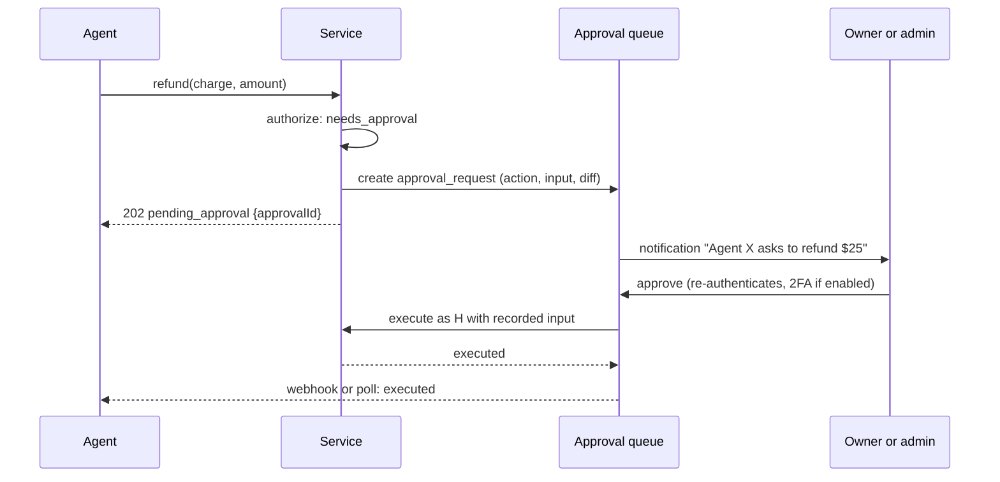

# Authorization

Who can do what: roles, the permission matrix, entitlements, how checks are enforced, API scopes, agent permissions, approval workflows, audit logging, sessions across domains, and testing.

Status: Draft, 2026-10-19

Tenant isolation is in [multi-tenancy.md](multi-tenancy.md). Agent surfaces are in [agent-integrations.md](agent-integrations.md). UI role descriptions are in [../product/information-architecture.md](../product/information-architecture.md) section 13.

## 1. Principles

1. **One policy module.** All authorization decisions go through `packages/policy`. No ad hoc role checks elsewhere.
2. **Checked in services, not in the UI.** The UI hides what you cannot do, but the service refuses it regardless of the caller (web, API, MCP, job).
3. **Deny by default.** An action not listed in the matrix is denied.
4. **Roles answer "may you manage this", entitlements answer "may you access this content".** Both are needed for most member actions.
5. **Agents never exceed their human.** An agent's effective permissions are the intersection of its grants and its owner's current permissions.
6. **Money and settings need a human.** Financial and sensitive settings actions by agents always go through approval.

## 2. Roles

| Role | Scope | Who | Label |
|---|---|---|---|
| Platform admin | Instance | Operator of a Community Edition instance, or Cohory staff on Cloud | Recommendation |
| Owner | Community | The creator. Exactly one per community. Owns the payment connection. | Confirmed (roles from mvp-scope) |
| Admin | Community | Trusted helpers. Manage access except payment changes, ownership transfer, deletion. | Confirmed role, Recommendation for limits |
| Moderator | Community | Content and member moderation. Manage shows People only. | Confirmed role |
| Member | Community | Active membership | Confirmed |
| Guest | Community | Signed out, or signed in without an active membership (includes pending and banned) | Confirmed |

"Creator" in product language means the owner. Roles are per community and stored on `memberships.role`. **Recommendation:** roles are ordered (owner > admin > moderator > member) for simple comparisons, but the matrix lists actions explicitly rather than relying on the order alone. No custom roles in MVP (mvp-scope 2.3). **Open question** (information-architecture.md): a Classroom-only teacher role.

Platform admins have no community role by virtue of being platform admins. They act through audited platform tools ([multi-tenancy.md](multi-tenancy.md) section 10).

## 3. Permission matrix

**Recommendation.** "Own" means the actor authored the item. "Entitled" means the actor has an entitlement for the community (and post-MVP, for the specific course or event). Public communities let guests read the feed preview (read-only). **Confirmed** (founder, 2026-10-19): a public community is readable by everyone, signed in or not, with a Join button; posting, commenting, and liking need membership.

### 3.1 Content

| Resource | Action | Guest | Member | Moderator | Admin | Owner |
|---|---|---|---|---|---|---|
| Posts | read | Public preview only | Entitled, or public community | Yes | Yes | Yes |
| Posts | create | No | Entitled, category permitting | Yes | Yes | Yes |
| Posts | edit | No | Own | Own | Own | Own |
| Posts | delete | No | Own | Any | Any | Any |
| Posts | open a deleted post (shows "Deleted by X", content hidden until revealed) | No | No | Yes | Yes | Yes |
| Posts | schedule, edit, or publish now a scheduled post (since 0.6.0) | No | Own, entitled | Own | Own | Own |
| Posts | see or cancel other members' scheduled posts (`post.read_scheduled`) | No | No | Yes | Yes | Yes |
| Posts | pin, move category | No | No | Move only | Yes | Yes |
| Posts | email to all members | No | No | No | Yes | Yes |
| Posts and comments | report (`report.create`; not your own content) | No | Yes | Yes | Yes | Yes |
| Reports | review the queue, dismiss, ban from it (`report.review`) | No | No | Yes | Yes | Yes |
| Comments | read | Public preview only | Entitled, or public community | Yes | Yes | Yes |
| Comments | create, like | No | Entitled | Yes | Yes | Yes |
| Comments | edit | No | Own | Own | Own | Own |
| Comments | delete | No | Own | Any | Any | Any |
| Comments | see deleted comments in the thread | No | No | Yes | Yes | Yes |
| Courses | read published | No | Entitled | Yes | Yes | Yes |
| Courses | read drafts | No | No | No | Yes | Yes |
| Courses | create, edit, reorder, publish, delete | No | No | No | Yes | Yes |
| Lessons | read published, mark complete | No | Entitled | Yes | Yes | Yes |
| Lessons | create, edit, reorder, publish, delete | No | No | No | Yes | Yes |
| Events | read, see join link | Title only on public About (Recommendation) | Entitled | Yes | Yes | Yes |
| Events | RSVP | No | Entitled | Yes | Yes | Yes |
| Events | create, edit, cancel occurrence | No | No | No | Yes | Yes |
| Reviews | read (`review.read`; About page, list, summary) | Yes | Yes | Yes | Yes | Yes |
| Reviews | write (`review.create`; the service also checks 30 days of paid recurring subscription, role does not matter) | No | Yes | Yes | Yes | Yes |
| Reviews | edit, delete (`review.edit`, `review.delete`) | No | Own | Own | Own | Own |
| Reviews | report (`review.report`; signed in, not your own review) | Signed in | Yes | Yes | Yes | Yes |
| Reviews | see reported reviews, dismiss reports (`report.review`) | No | No | Yes | Yes | Yes |
| Reviews | reply once per review (`review.reply`) | No | No | No | No | Yes |
| Reviews | hide a reported review with a reason (`review.hide`) | No | No | No | No | Yes |

Moderators "edit" means moderate: they cannot rewrite another person's words, only delete or move. Editing other people's posts is not offered to anyone (**Recommendation**).

### 3.2 People, money, settings

| Resource | Action | Member | Moderator | Admin | Owner |
|---|---|---|---|---|---|
| Members | view directory and profiles | Entitled | Yes | Yes | Yes |
| Members | approve join requests | No | Yes | Yes | Yes |
| Members | list and filter by last activity (`membership.manage`, since 0.6.0) | No | Yes | Yes | Yes |
| Members | see and filter each member's access (paying, free, past due, cancelling) in the people list, member drawer, and CSV (`payment.read`, Payments `listMemberAccess`) | No | No | Yes | Yes |
| Members | approve or decline several requests, remove or ban several members at once (each person goes through the single item check) | No | As for one | As for one | As for one |
| Members | remove member | No | Members only | Members and moderators | Anyone except self |
| Members | ban | No | Members only | Members and moderators | Anyone except self |
| Members | change role | No | No | To and from moderator | Any (except owner, see transfer) |
| Members | reset points | No | No | Yes | Yes |
| Members | grant or revoke comped access | No | No | Yes, with reason | Yes, with reason |
| Payments | view payments list and ledger | No | No | Read only (Recommendation) | Yes |
| Payments | connect or disconnect provider | No | No | No | Yes |
| Payments | edit plan and price | No | No | No (Open question in information-architecture.md) | Yes |
| Payments | refund | No | No | No | Yes |
| Payments | link existing Stripe subscriptions (`payment.link_subscriptions`) | No | No | Yes | Yes |
| Settings | appearance, categories, level names, join mode | No | No | Yes | Yes |
| Settings | custom domain | No | No | No | Yes |
| Settings | webhook endpoints, test events, delivery log (`webhook.manage`, since 0.6.0) | No | No | Yes | Yes |
| Settings | transfer ownership, delete community | No | No | No | Yes |
| Settings | change the community URL (`community.change_slug`, founder decision S1, 2026-10-21; at most once every 30 days; admins see it read only) | No | No | No | Yes |
| Settings | API tokens and agents (Phase 6) | Own personal tokens (Recommendation) | Own | Own, community-wide read | All |
| Exports | members CSV, full bundle | No | No | No | Yes |
| Migration | export or import an archive, import members from CSV (`migration.export`, `migration.import`, `migration.import_members`) | No | No | No | Yes |
| Audit log | view | No | No | Yes, except payment entries | Yes |
| Audit log | download as CSV (`audit_log.export`) | No | No | No | Yes |

### 3.3 Communities and memberships as implemented

**Recommendation** (0.1.0, 2026-10-18). The matrix lives in `packages/authz/src/matrix.ts` and differs from this document in four ways:

1. The package is `packages/authz` instead of `packages/policy`, and the API is `can(actor, action, resource, context)` returning a boolean plus `assertCan`, which throws `ForbiddenError`. Services decide between 404 and 403 themselves, since `can` has no `hideExistence` result.
2. The matrix adds rows for the community itself (create, read, update, delete, transfer ownership) and for memberships (read own, list, join, leave, approve, remove, ban, change role, reset points, grant comp). Join is allowed for a signed in guest only on a public community. Leave is allowed for every role except the owner. Leaving makes the person a plain member again, and every path that makes a membership active again (joining again, paid rejoin, payment activation) keeps the role only when the row is already active, so a moderator or admin who leaves never gets the role back without a new role change (security audit run 1, 2026-10-21). Personal API tokens issued before someone leaves never work again: the next use revokes them, and Account, API tokens lists them as revoked.
3. A platform admin gets only community create and read from the platform admin column. Everything else needs a community role, consistent with section 2.
4. Superseded by the decision below: a guest no longer gets a 404 for an existing private community.

**Decision** (2026-10-18), following [mvp-scope](../product/mvp-scope.md) and journey 3 in [user-journeys](../product/user-journeys.md):

- `getCommunityBySlug` returns a discriminated result. Anyone allowed `community.read` (anyone on a public community, active members of a private one) gets the full `CommunityView` (`access: "full"`). Everyone else on a private community, including signed out guests and pending, removed, or banned people, gets a `CommunityPublicView` (`access: "limited"`) with only id, slug, name, description, cover, member count, and privacy. Unknown slugs still answer 404.
- The limited view grants nothing else. Join, leave, membership reads, and member lists on a private community still answer 404 to non members, because they go through `community.read`.
- The About page shows "Request to join" disabled with "Invitations only for now", since invitations and approvals were out of scope for 0.1.0. Superseded in 0.3.0: see the join modes decision below.
- `listMembers` checks `membership.list`. Until the Entitlements module exists, an active membership counts as `entitled`, which matches section 4.1 for free communities.
- **Open question:** whether the limited view should become a separate `community.read_about` matrix row so the rule lives in `packages/authz` instead of the service.

**Decision** (0.3.0, 2026-10-18): join modes. `membership.join` is now `signed_in` for anyone without a role, on private and public communities, and the service enforces the community's join mode: `open` creates an active membership, `approval` refuses open join with `approval_required` (HTTP 409) and accepts a join request instead, and `invite` refuses with `invite_only` (HTTP 403) and accepts only invite links. Join requests live in `membership_requests` (RLS: managers with the `app.community_manager` flag, plus the requester reading and inserting only their own pending row). `membership.approve` (moderators, admins, owner) lists, approves, and declines them; answers are returned only through that check, and email addresses only with `membership.read_email`. A new matrix resource `category` adds `manage` (admins and owner) and `post_restricted` (moderators, admins, owner), which the posts service checks before a post goes into a staff only category. Search reuses existing rows: posts and comments need `post.read`, lessons need `lesson.read` and appear only when the lesson and its course are published, and members need `membership.list`.

**Decision** (0.1.0, 2026-10-18): the matrix adds `membership.read_profile` (entitled members and staff), `membership.update_own_profile` (every community role, and the service only writes the caller's own membership row), `leaderboard.read` (entitled members and staff), and `account.update_own` (any signed in user, used for the username). Guests and non members of a public community get no directory, profile, or leaderboard. The web pages check the same rules with `can()` before calling the services.

**Decision** (Step 17, 2026-10-20, [ADR 0025](../decisions/0025-reviews-module-boundary.md)): the matrix has a `review` resource. `read` is open to everyone who can see the About page; `create` is open to every community role and the reviews service then applies the paid tenure rule (members who have paid for at least 30 days can leave a review). Owners and admins cannot edit or delete other people's reviews, and the owner can hide a review only while it has an open report. Every review write (`create`, `edit`, `delete`, `report`, `reply`, `hide`) is in `nonGrantableActions`, so API and agent tokens get `token_not_allowed`; `listReviews` and `getReviewSummary` need `community:read`. Turning reviews on or off uses `settings.update`.

**Decision** (r65, 2026-10-23, [ADR 0049](../decisions/0049-creator-feedback.md)): the matrix has `creator_feedback.answer`, allowed only to the owner. The creator feedback service checks it before showing or answering a moment question and before storing a reason for archiving, deleting, or disconnecting Stripe in a community; a reason for deleting the account needs only a signed in person (`account.update_own`). The action is in `nonGrantableActions` and `agentForbiddenActions`, so tokens and agents get nothing, and no REST or MCP operation exists.

**Decision** (0.1.0, 2026-10-18): the matrix has a `notification` resource with `read` and `mark_read`. Both are allowed for every community role and for any signed in user without a community role, because a notification belongs to its recipient rather than to a community role. The routes under `/api/v1/notifications` call `assertCan` with it, and the service filters rows to communities where the recipient is still an active member.

## 4. Entitlements

**Recommendation.** The Entitlements module answers `hasAccess(userId, resource)` with one function (REQ-ENT-001).

**As built** ([0031](../decisions/0031-community-access-module.md)). Community access has one helper, `communityAccessIn(queries, userId, now)` from `@cohory/entitlements/access` (with `getCommunityAccess(scope, userId, now)` for callers without a transaction). It returns `{ role, entitled }`: no role and no entitlement without an active membership; otherwise the active role, and `entitled` from the paid access rule `resolveMembershipAccess` (`packages/entitlements/src/community-access/membership-access.ts`) applied to the subscription mirror, the closed connection date, open comps, and whether a plan is on sale. Posts, calendar, courses, payments, members, gamification, communities, the agent delegation read, and the web page loader all build their `PolicyContext` from it, so `entitled` is never derived from the role alone. It is derived on every check; the `entitlements` table in section 4.2 is not built. `@cohory/entitlements` depends only on `authz` and `db`, so content modules import it without a package cycle; the agent directory and the notifier are ports, and the default delegation service is built by `getEntitlementsService` in `@cohory/api/services` for the web app and the API, and in `apps/worker/src/services.ts` for the worker ([0044](../decisions/0044-composition-roots-and-shared-infrastructure.md)).

| Viewer | `role` | `entitled` |
|---|---|---|
| No membership, or a pending, removed, or banned one | none | no |
| Owner, admin, or moderator | their role | yes |
| Member of a free community | member | yes |
| Member whose subscription is granted, past due in grace, or cancelled but before the period end | member | yes |
| Member with an open comp | member | yes |
| Member whose creator closed billing, after their stored period end, without an open comp | member | no, until `payments.closed-billing-sweep` removes the membership |

A member who is not entitled is never allowed less than a signed out visitor: `post.read` and `comment.read` use the rule `entitled_or_public_community` for members, so they still read a public community's feed like anyone else, and a test in `packages/authz/src/policy.test.ts` checks this for every action in the matrix.

### 4.1 Derivation

| Source | Grants | MVP |
|---|---|---|
| Free community, active membership | Community access while membership is active | Yes |
| Paid community, subscription access state `granted` or `grace` | Community access until revoked | Yes |
| Comped grant by owner or admin, with reason | Community access until `ends_at` or revocation | Yes |
| One-time purchase | Specific course or event | Post-MVP |
| Membership tier | Specific courses or events | Post-MVP |
| Minimum level | Specific course | Post-MVP |
| Delegation to an agent | Read access to purchased course content for that agent | Built in 0.8.0 (REQ-ENT-004), section 4.4 |

Owners, admins, and moderators have implicit access to all content of their community. This is a role rule in the policy module, not an entitlement row.

Subscription status to access state mapping is defined in [payments.md](payments.md) section 5.1.

### 4.2 Materialization and caching

- Entitlements are rows in `entitlements` ([data-model.md](data-model.md) section 10), written by the Entitlements module when it receives `member.joined`, `subscription.*`, `member.removed`, comp grants, and revocations.
- `hasAccess` reads rows with an index on `(community_id, user_id, resource_type)`. A per-request memo avoids repeated reads. **Recommendation:** no cross-request cache in MVP; the query is cheap. If a cache is added (Redis), its TTL is at most 60 seconds and revocations delete keys explicitly.
- A reconciliation job recomputes entitlements per community daily and after webhook backlogs, and logs any corrections (REQ-ENT-003: changes take effect within one minute of a payment event).

### 4.3 Revocation

- Revocation sets `revoked_at` (never deletes), emits `entitlement.revoked`, and takes effect on the next request.
- Open sessions are not terminated by revocation. Pages re-check access on each request. Long-lived surfaces (the iCalendar feed post-MVP, API tokens) re-check on use.
- Removing or banning a member revokes all their entitlements in that community and ends their subscription now ([0029](../decisions/0029-remove-or-ban-ends-billing.md)).

### 4.4 Delegated entitlements

See [ADR 0022](../decisions/0022-delegated-entitlements.md) (Accepted) and [../operations/agent-courses-delegation.md](../operations/agent-courses-delegation.md).

- **Module.** `@cohory/entitlements` (`packages/entitlements`) owns `course_agent_settings`, `course_delegations`, and `agent_submissions` (migration 0024, forced row level security, every index starts with `community_id` except foreign key and job indexes). It is the only place that answers whether an agent may read a course.
- **Contract for other modules.** `agentCourseAccess(actor, communityId, courseId): Promise<AgentCourseAccess>` returns `not_agent` for people and personal tokens (callers apply their usual rules), `staff` for agents of owners and admins, `delegated` with the agent, the person, the delegation, its end, and the license terms, or `denied` with a reason (`no_delegation`, `expired`, `revoked`, `human_access_ended`, `agent_inactive`, `agent_access_off`, `wrong_community`). `assertAgentCourseAccess(actor, communityId, courseId): Promise<AgentCourseGrant | null>` throws `DelegationRequiredError` (403 `delegation_required` with the reason) instead of returning `denied`, and returns null for `not_agent`. `delegatedCourseIds(actor, communityId)` returns the course ids an agent may read, or null when it is not restricted. The courses service calls these from `withAccess`, `requireCourse`, `listCourses`, and lesson search.
- **Derived on every check, nothing copied.** An agent may read a course when all of these hold at request time: the agent is active and owned by the person, the person's own access (`getMembershipAccess` from Payments, the same answer the person gets) is staff or member, the creator's setting for the course is on, and a delegation for that course, agent, and person exists, is not revoked, and has not passed `expires_at` (30 days, renewable). A past due subscription keeps access during grace for both; a subscription that ended, a removal, a ban, or an expired comp ends it for both.
- **Agents of owners and admins** keep reading every course without a delegation, because their person has implicit access and they author courses. Agents of moderators and members need a delegation.
- **Read only.** Delegated agents read courses, lessons, and search results of delegated courses. They cannot record progress (403), and delegation never grants posting, member data, settings, or purchases; those stay governed by the agent's scopes and the person's role.
- **No re delegation.** `delegation.create`, `delegation.manage`, `delegation.read_all`, and `course.manage_agent_access` are non grantable, and the service refuses any credential (agents get `redelegation_refused`).
- **Ending.** Revocation by the person (or an owner or admin) and turning agent access off for a course set `revoked_at` with a reason at once. The daily `entitlements.delegations_sweep` job records `expired`, `access_ended`, `agent_inactive`, or `agent_access_off` for delegations whose check now fails, and notifies the person once, 3 days before a delegation ends. The check never waits for the job.

## 5. How authorization is enforced

```ts
// packages/policy (sketch)
type Actor =
  | { kind: "user"; userId: string }
  | { kind: "agent"; agentId: string; ownerUserId: string; scopes: Scope[] }
  | { kind: "token"; tokenId: string; ownerUserId: string; scopes: Scope[] }
  | { kind: "system"; job: string }
  | { kind: "platform_admin"; userId: string };

type Action = "post.create" | "post.delete" | "member.ban" | "payments.refund" | /* ... */ string;

export async function authorize(ctx: Ctx, action: Action, resource?: ResourceRef): Promise<void> {
  const decision = await decide(ctx, action, resource);   // role + entitlement + scope + ownership
  if (decision.kind === "deny") throw decision.hideExistence ? new NotFound() : new Forbidden(decision.reason);
  if (decision.kind === "needs_approval") throw new ApprovalRequired(decision.approvalAction);
}
```

Rules:

1. Every service method that reads non-public data or changes anything calls `authorize` first, with the loaded resource when ownership matters.
2. List queries apply policy as a filter (for example "published only" for members) inside the scoped query, not by filtering after load.
3. Pages call the same services, so a page cannot show what the service would refuse.
4. `decide` is pure given its inputs (role, entitlement facts, scopes, resource attributes), which makes the matrix testable as a table.
5. Responses for resources the actor cannot know exist (another community, a draft lesson for a member) are 404. Responses for visible resources the actor cannot change are 403.
6. System jobs act as `system` with an explicit allowlist of actions per job, so a bug in a job cannot, for example, change roles.

## 6. API scopes

**Recommendation** (REQ-AGT-002: no wildcard scope). Tokens are bound to one community and carry explicit scopes. A token's effective permission is `scope allows action` AND `owner's role allows action`.

| Scope | Allows | Default for new tokens |
|---|---|---|
| `community:read` | Community profile, categories, About | Yes |
| `posts:read`, `comments:read` | Feed, posts, comments, search | Yes |
| `posts:write`, `comments:write` | Create, edit own, delete own, like | No |
| `courses:read` | Courses, modules, lessons, own progress | Yes |
| `courses:write` | Create and edit courses and lessons (owner or admin) | No |
| `events:read` | Events, occurrences, own RSVPs | Yes |
| `events:write` | Create and edit events, RSVP | No |
| `members:read` | Directory, profiles, levels | No |
| `members:moderate` | Approve, remove, ban (subject to role rules) | No |
| `notifications:read` | Own notifications | No |
| `payments:read` | Payments list, ledger, subscriptions summary (owner only) | No |
| `settings:read` | Settings (owner or admin) | No |
| `proposals:write` | Create approval requests for actions the token cannot perform directly | No |

Not grantable to any token: payment connection changes, refunds, plan and price changes, role changes to admin or owner, ownership transfer, community deletion, custom domain changes, and exports except the members CSV below. These are reachable only from an interactive session, or as an approval request (section 8).

**Confirmed** (founder, 2026-10-19): a personal token may hold `members:export` and download the members CSV when its own person may (the owner), because the token acts only for that person, who can already download the file signed in. The scope is never preselected and every download is audited. Agent tokens always need an approval for the export. The archive export, the audit log export, and the other exports stay non grantable.

**Confirmed** (founder, 2026-10-19): OAuth access tokens work only at `/mcp`; `/api/v1` refuses them with 401 `invalid_token` (`wrong_resource`). Personal and agent tokens work at both. OAuth clients may not register custom scheme redirect URIs; only `https`, or `http` on loopback, is accepted ([../operations/mcp.md](../operations/mcp.md)).

Mapping from scope to actions is a table in `packages/policy`, used by the API layer, the MCP tool registry, and the docs generator.

Implementation (since 0.6.0): the scope list is one Zod enum with plain language labels in `packages/authz/src/scopes.ts` (`scopes`, `scopeSchema`, `scopeDetails`, `defaultScopes`). Instead of a separate scope to action table, every `/api/v1` route declares `x-cohory: { operationId, scope, action }` on its definition (`packages/api/src/route-meta.ts`, the `routeScopes` table), which also appears in `/api/openapi.json`; `scope: null` means session only. Tokens are bound to one community. The non grantable list above is `nonGrantableActions` in `packages/authz/src/credentials.ts`; it also covers managing tokens and agents, invite links, settings and appearance changes, imports, and the audit log export. Personal tokens (Account, API tokens) and agent tokens (Manage, Settings, Agents) are described in [../operations/api-tokens.md](../operations/api-tokens.md) and [ADR 0017](../decisions/0017-bearer-api-tokens.md). `notifications:read` exists but no route uses it yet. Since 0.6.0, `proposals:write` lets an agent turn an approval classified action into an approval request (section 8) and read its own requests. Three scopes go beyond the table (since 0.6.0): `webhooks:read`, `webhooks:write`, and `members:export`. Since 0.7.0, the same scope names are the OAuth `scope` values: authorization server metadata lists all of them, protected resource metadata lists the default read scopes, and unknown values such as `offline_access` are ignored. A personal token with `members:export` may download the members CSV when its owner may (owner only), as confirmed above; the export stays approval only for agents.

Since 0.8.0 there is no separate delegation scope. Delegated reads and result submissions use `courses:read` plus a credential check in Entitlements: an agent token with `courses:read` reads a course only when section 4.4 allows it, and submits results to `POST /communities/{slug}/courses/{courseId}/submissions` (policy action `submission.create`). Reusing the scope keeps one permission for "read courses" in the consent screen and the token form, and the delegation, not the scope, is the grant that matters. The creator's result counts (`GET .../submissions/summary`) need `courses:write` and an owner or admin. Delegation management and course agent settings are session only.

## 7. Agent permissions

**Recommendation** (Phase 6, REQ-AGT-004). See [agent-integrations.md](agent-integrations.md) for surfaces.

- An agent is its own identity (`agent_identities`), owned by one human user in one community. It is not a user account and cannot sign in to the web UI.
- The owner (or a community owner or admin for community-wide agents) grants scopes from section 6. Grants can expire and be revoked at any time.
- **Effective permission** = grants ∩ owner's current permissions. If the owner is demoted from admin to member, the agent loses admin-level abilities immediately. If the owner leaves the community, the agent is suspended.
- Agents act through scoped OAuth access tokens (MCP) or API tokens tied to the agent. Tokens are short-lived (OAuth) or explicitly expiring (API tokens, default 90 days).
- **Never financial admin without human approval.** Agents can read payment summaries with `payments:read` but every action that moves money, changes prices, changes payment connections, or exports member data goes through an approval request.
- Agents' content is labeled as agent-authored in the UI ("Agent" badge, information-architecture.md section 13) and in the audit log.
- Rate limits for agents are separate from and lower than for humans by default ([agent-integrations.md](agent-integrations.md)).

Implementation (since 0.6.0): `agent_identities` and `api_tokens` (migration 0019, forced row level security) are owned by `@cohory/agents`. Only owners and admins create agents (`agent.create`); the owner manages every agent, an admin manages their own and community wide ones (`agent.manage`). An authenticated token becomes the actor `{ kind: "user", userId: <owner>, platformAdmin: false, credential: { type: "user" | "agent", tokenId, agentId, communityId, scopes, via: "api" } }` (`ApiCredential` and `ApiActor` in `packages/authz/src/types.ts`), so services check the owner's current role on every request and nothing is cached. Agent tokens carry the agent's current scopes. If the owner of an agent is no longer an active member, the next request pauses the agent and answers 401. Grants do not expire on their own; tokens do (90 days by default).

Since 0.8.0, members and moderators may create their own agents (`agent.create_own`) in Account, Agents or with `POST /communities/{slug}/agents`, limited to read scopes (`community:read`, `posts:read`, `comments:read`, `courses:read`, `events:read`) and `proposals:write`, never community wide. They manage only their own agents (`agent.manage` is `own` for them), and a community wide agent counts as owned only for owners and admins. Owners and admins create agents as before.

**Decision** (founder, 2026-10-21, security audit run 1): an agent acts only for the person who owns it, and only that person issues its tokens. "Manages" an agent someone else owns means narrowing it: the owner (every agent) and admins (community wide agents) may remove scopes, pause, revoke the agent, and revoke its tokens, but may not issue tokens, add scopes, change `communityWide`, rename it, or resume it (`AgentsValidationError` naming the field, 403 for token issue). So the limits on member agents above hold whoever edits them, and a token never carries a person's identity with grants that person did not choose. A token whose issuer is not the person it acts for is refused as revoked, which also ends any such token issued before this rule. Agent views carry `canIssueTokens`.

**Decision** (founder, 2026-10-21, security audit run 1): a password reset or change revokes every bearer credential of the person, not only sessions: personal tokens, agent tokens issued for them, and OAuth grants (the grant ends with reason `revoked`, its refresh tokens and access tokens are revoked). `@cohory/auth` calls `revokeAllCredentials` of the agents service from the `onPasswordReset` callback and an after hook on `/change-password`; it writes no agent tables itself. Each affected community gets an `account.credentials_revoked` audit entry.

Since 0.7.0, MCP clients get scoped OAuth access tokens through the consent screen ([ADR 0020](../decisions/0020-oauth-authorization-server.md)). The consent creates or reuses an agent owned by the signed in person, only in a community where `agent.create` is allowed for that person (owner or admin); reusing someone else's agent is refused. The access token is an agent `api_tokens` row with `oauth_grant_id`, valid for 1 hour, and the actor it produces is the same as for any agent token, so effective permission stays the grant intersected with the agent's scopes and the owner's current role. A person disconnects their own connected apps; owners and admins disconnect others under the `agent.manage` rule, with the same check as managing the agent itself, so a community wide agent counts as owned only for owners and admins and members or moderators never disconnect someone else's app. Disconnecting, revoking, or reusing a refresh token ends the grant and revokes its tokens on the next request.

## 8. Approval workflows

**Recommendation** (REQ-AGT-006: money, roles, removals always need approval).

States: `draft` (agent prepares, optional), `pending` (proposed, waiting for a human), `approved` then `executed`, or `rejected`, or `expired` (default 72 hours).



Rules:

1. Approval executes the exact recorded input, re-validated and re-authorized as the approving human at execution time. If state changed (the charge was already refunded), execution fails safely.
2. Only humans with the permission to perform the action can approve it. An agent cannot approve, including its own requests.
3. Approval screens show a plain-language summary and the concrete diff (before and after for settings, amount and recipient for money).
4. Actions that always require approval when requested by an agent: everything listed as "not grantable" in section 6, plus removing or banning members, role changes, bulk emails, and bulk deletes over 10 items.
5. Human users acting through their own API tokens do not need approval for actions their scopes allow, but the non-grantable list still applies.

Implementation (since 0.6.0): the classification of what needs approval lives in one place, `approvalActions` in `packages/authz/src/credentials.ts`, with categories `money`, `payment_connection`, `role`, `removal`, `deletion`, `data_export`, `data_import`, `settings`, and `publishing` (course and lesson publishing and emailing all members). `can()` returns false and `assertCan()` throws `ApprovalRequiredError` for an agent credential on those actions, and, when the agent does not hold `proposals:write`, the bearer middleware answers 403 `approval_required` with the category before the service runs. Posts by agents are stored as drafts (`post_drafts`) that a person publishes; the owner cannot yet lift that per category. Per agent auto approval and lifting drafts per category are on the backlog (founder, 2026-10-19).

The approval queue (since 0.6.0), see [ADR 0018](../decisions/0018-approvals-replay-recorded-requests.md):

- **Request.** An agent token that holds `proposals:write` and calls a classified operation gets 202 `{ status: "pending_approval", approvalId, summary, expiresAt, statusUrl }` and nothing changes. The bearer middleware validates params, query, and body with the route's own schemas and stores an `approval_requests` row (migration 0021, forced row level security): community, agent, owning human, token, operation id, method and path, category, the recorded input, a plain language summary, a before and after diff, state, decider, decision time and note, execution time, result or error code, and expiry. Without `proposals:write` the agent still gets 403 `approval_required`. Since 0.6.0 the agent must also hold the route's own scope when the route has one (for example `members:moderate` to propose a removal); otherwise it gets 403 `insufficient_scope`, so a proposal never reveals or reaches more than the agent's grants. Session only operations need only `proposals:write`. Settings and appearance changes (`settings.update`, `appearance.update`) are classified as `settings`, so agents can propose them. Reads of classified data (for example webhook endpoints) and file uploads cannot be proposed and stay refused. The scheduled post refusal inside the posts service becomes a request the same way.
- **Recorded input.** Since the security audit fixes (0.11.0) the stored input is the parsed body and only the params and query keys the route schemas keep, so what the approver sees and what the replay runs come from the same object. The diff has a line for every recorded field; a proposal that would need more than 12 lines answers 422 `validation_failed`. Requests stored earlier with a raw body still go through the route schema when they are replayed, so no migration is needed.
- **Summary reads.** To write the summary, the gateway reads the named course, event, post, or member as the agent's owner. Since the security audit fixes (0.11.0) these reads stay inside the token's community: every path value is encoded, course, lesson, and event slugs accept only letters, digits, and hyphens, member ids must be user ids, and a read whose resolved path leaves the community answers nothing (`containedPath` in `packages/api/src/approvals/gateway.ts`).
- **Scope to propose.** Since 0.7.0 an agent needs the route's scope as well as `proposals:write` to propose it; for session only routes (`scope: null`) the area scope from `proposalScope` (`packages/authz/src/credentials.ts`) stands in: `settings:read` for settings, appearance, deletion, exports, and imports, `payments:read` for money and payment connections. Without it the agent gets 403 `insufficient_scope` and the MCP tool is not listed.
- **Limits.** At most 20 pending requests per agent (the 21st answers 429 `limit_reached`). Requests expire after 72 hours; the `approvals.expiry` worker job runs every 5 minutes and lists also expire due rows. A request stuck in approved for 15 minutes (a crash during execution) is marked failed with `interrupted`.
- **Decision.** Owners and admins (`approval.read`, `approval.decide`, never grantable to tokens) decide in Manage, Inbox, Agent approvals or with `POST /communities/{slug}/manage/approvals/{id}/approve` and `/reject` (session only). Approval needs a sign in from the last 10 minutes (`reauth_required` otherwise; the page offers Sign in again); two factor authentication does not exist yet. The approver must have a role that could ever perform the action (an admin cannot approve an owner only change), and the replay then re-checks the exact rule. The claim is a conditional update, so double clicks run once.
- **Execution.** The recorded request is replayed once through an in process copy of the API as the approver: re-validated, re-authorized with the approver's current role, and audited with the agent's id. A 403 puts the request back to pending; other errors mark it failed with the error code. Approved downloads (members CSV, audit log CSV) give the agent one download within 24 hours through `GET /communities/{slug}/approvals/{id}/download`, produced at that moment with the approver's permissions. Connecting Stripe and adding a platform billing card are recorded but reported as not supported yet; own Stripe keys cannot be proposed.
- **Changed circumstances.** If the agent is paused or revoked before approval, approving rejects the request with `agent_inactive` and runs nothing. If the agent's owner is demoted, a person with permission can still approve, because the approver's role is what the replay checks.
- **Agent side.** The agent polls `GET /communities/{slug}/approvals/{id}` (scope `proposals:write`) or lists its own requests with `GET /communities/{slug}/approvals`.

Since 0.8.0, purchases are a `purchase` category (`payment.purchase`, also non grantable to personal tokens). An agent with `proposals:write` that calls `POST /communities/{communityId}/payments/checkout` gets 202 `pending_approval`; nothing is created at Stripe. The request is decided only by the agent's own person, never by owners or admins: it is left out of Manage, Approvals, the person gets an `agent_access` notification, and `GET /communities/{slug}/purchase-requests` with `POST .../{approvalId}/approve` or `/reject` (session only) answer it. Approving replays the recorded checkout once as that person and returns the Stripe Checkout URL to the person only; the stored result says `{ checkout: "started" }` without the URL, so the agent never receives a payment link. No fresh sign in is required, because Checkout itself asks the person to pay and approving charges nothing. The audit log records `purchase.proposed`, then `approval.approved` and `approval.executed` or `approval.failed`.

**Confirmed** (founder decision, 2026-10-19). Agents can never archive, restore, or delete the community or transfer its ownership, not even as an approval request. These actions (`community.archive`, `community.delete`, `community.transfer_ownership`) are `agentForbiddenActions` in `packages/authz/src/credentials.ts`: `assertCan` throws `AgentNotAllowedError`, the bearer middleware answers 403 `not_allowed_for_agents` before any approval request is stored, and MCP `tools/list` never offers them. Personal tokens are unaffected by this rule; the routes are session only, so personal tokens get 403 `token_not_allowed`. The `ownership` approval category is gone.

**Confirmed** (founder decision S1, 2026-10-21). Changing the community URL (`community.change_slug`) follows the same rule and is stricter than an approval: it is in `agentForbiddenActions`, so an agent gets `not_allowed_for_agents`, and in `nonGrantableActions`, so a personal token is refused too. There is no REST or MCP operation for it; the owner changes it in Manage, Settings with a session.

## 9. Sessions across the platform domain and custom domains

Resolves the open question in [../product/information-architecture.md](../product/information-architecture.md) section 4.1. **Recommendation:**

- Sessions are host-bound cookies. A session for `cohory.app` is not sent to `learn.example.com`, and vice versa (browsers enforce this).
- A member on a custom domain signs in on that domain directly (password or magic link). The magic link email points to the domain where it was requested.
- When a member already signed in on the platform domain visits a custom domain, a silent handoff runs: redirect to the platform `/auth/handoff?return=<url>`, which, if signed in, issues a single-use code valid for 60 seconds bound to the target host and redirects back to `https://learn.example.com/auth/callback?code=...`. The custom domain exchanges the code server-side for a new session row with `host = learn.example.com`.
- Signing out everywhere revokes all session rows for the user across hosts (REQ-ID-006).
- The handoff only targets verified, active custom domains. Return URLs are validated against them to prevent open redirects.
- **Assumption:** Better Auth supports multiple trusted origins and custom session issuance for this flow. **Unverified**; a small custom plugin may be needed.

As of 0.12.0 custom domains are not built, so the handoff does not exist; every session lives on the instance's own host.

## 10. Two-factor authentication

Two-factor authentication (REQ-ID-008) is Post-MVP, per [../product/mvp-scope.md](../product/mvp-scope.md) section 2.1. **Recommendation:** in MVP, require re-authentication (password or magic link within the last 10 minutes) for payment actions such as "Connect your Stripe account", because a hijacked owner account can redirect a business's payment settings. When TOTP ships (Phase 5 or later), require it for owners with a connected payment account on Cloud.

## 11. Audit logging

**Recommendation** (REQ-AGT-003, mvp-scope 2.3).

Always logged, with actor, via (web, api, mcp, job), token id, target, and time:

- Role changes, removals, bans, join approvals.
- Ownership transfer, community deletion and restore.
- Payment connection, disconnection, plan and price changes, refunds, comped access grants and revocations.
- Exports (who, what, when).
- Settings changes with before and after values (never secrets).
- Token and agent creation, scope changes, revocation.
- Every write by an agent or token, and every approval decision.
- Platform admin access to community data.

Rules: append-only table, no update or delete for the application role, visible to the owner in Manage (admins see all but payment entries), included in neither member exports nor public APIs. Since 0.3.0, Manage, Settings, Audit log and `GET /api/v1/communities/{slug}/manage/audit-log` show every entry to admins and the owner, payment entries included (hiding them from admins is not built), and only the owner can download the CSV. Report decisions (`report.dismissed`, `report.resolved`), points resets (`points.reset`), comped access (`comp.granted`, `comp.revoked`, `comp.expired`), linked subscriptions (`subscription.linked`, `subscription.invited`, `subscription.claimed`), and audit log downloads (`export.audit_log_csv`) are logged too. Since 0.6.0, `audit_log` has `actor_type` (user, agent, system), `via` (web, api, mcp, job), `token_id`, and `agent_id`; for agent entries `actor_id` is the owning human. API requests set these through `runWithAuditSource` in `@cohory/db`, so every existing audit write records them; a token write that writes no entry of its own gets one `api.<operation>` entry. Approval requests are logged as `approval.requested` (actor type agent, the owning human as actor), `approval.approved`, `approval.executed`, `approval.failed`, `approval.rejected` (the deciding person, with the agent id), `approval.expired` (system), and `approval.downloaded`; each carries the agent id, the owning human, the operation, and the summary in its metadata, and the replayed action writes its own entry (for example `member.removed`) with the approver as actor and the agent id. Token and agent changes are logged as `api_token.created`, `api_token.revoked`, `agent.created`, `agent.updated`, `agent.suspended`, `agent.reactivated`, `agent.revoked`, `agent.token_created`, and `agent.token_revoked`. Reads through tokens are not logged. Server actions in the web app do not set `via` yet, so their entries show no via. Retention: **Open question** (proposed 2 years on Cloud, operator-defined on Community Edition).

## 12. Testing requirements

**Confirmed.** Tests for permissions and auth are required. **Recommendation:** merge-blocking.

1. **Matrix tests.** The permission matrix in section 3 is encoded once as data. A table-driven test runs every (role, action, ownership, entitlement) combination against `decide` and compares with the expected value.
2. **Service tests.** For each service method that changes data, one test per denied role proves the service refuses without UI involvement.
3. **Cross-tenant tests** per [multi-tenancy.md](multi-tenancy.md) section 3.5.
4. **Scope tests.** For every API route, a token without the required scope gets 403, and a token with the scope but whose owner lacks the role gets 403.
5. **Agent intersection tests.** Demoting the owner immediately reduces the agent's effective permissions. Removing the owner suspends the agent.
6. **Approval tests.** Agents cannot execute non-grantable actions, cannot approve, and approvals re-check permissions at execution.
7. **Entitlement tests.** Every subscription status transition grants or revokes as specified, comp grants expire on time, and revocation takes effect on the next request.
8. **Session tests.** Revocation signs out the device on the next request. Handoff codes are single use, expire after 60 seconds, and only target verified domains.
9. **Audit tests.** Each action in section 11 writes exactly one audit entry with the correct actor and via.

## 13. Decisions and open questions

| Label | Item |
|---|---|
| Confirmed | Community roles owner, admin, moderator, member, plus guest as non-member state. |
| Confirmed | Agents never get unrestricted financial or admin permissions. Human approval workflows. |
| Recommendation | One policy module with `authorize(ctx, action, resource)` called inside services. |
| Recommendation | Permission matrix in section 3, deny by default, 404 for hidden resources. |
| Recommendation | Entitlements materialized as rows, derived from memberships, subscriptions, and comp grants in MVP. |
| Recommendation | Scopes in section 6, no wildcard, a list of actions no token can perform directly. |
| Recommendation | Agent effective permission is grants intersected with the owner's current permissions. |
| Recommendation | Host-bound sessions with a single-use handoff code for custom domains. |
| Recommendation | Append-only audit log with the event list in section 11. |
| Assumption | Better Auth supports the cross-domain handoff with little custom code. |
| Recommendation | Two-factor authentication Post-MVP. Recent re-authentication for payment actions in MVP. |
| Confirmed | Agents can never archive, restore, delete, or transfer the community, not even through an approval (founder, 2026-10-19). |
| Confirmed | Personal tokens may hold `members:export` for their own person; agents need approval (founder, 2026-10-19). |
| Confirmed | OAuth access tokens only at `/mcp`; custom scheme redirects refused (founder, 2026-10-19). |
| Confirmed | Public communities are readable by everyone with Join; export, import, and the members CSV stay owner only (founder, 2026-10-19). |
| Open question | Whether admins may edit pricing (proposed: no). |
| Open question | Classroom-only teacher role. |
| Open question | Audit log retention. |
