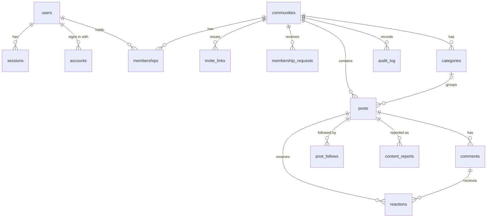
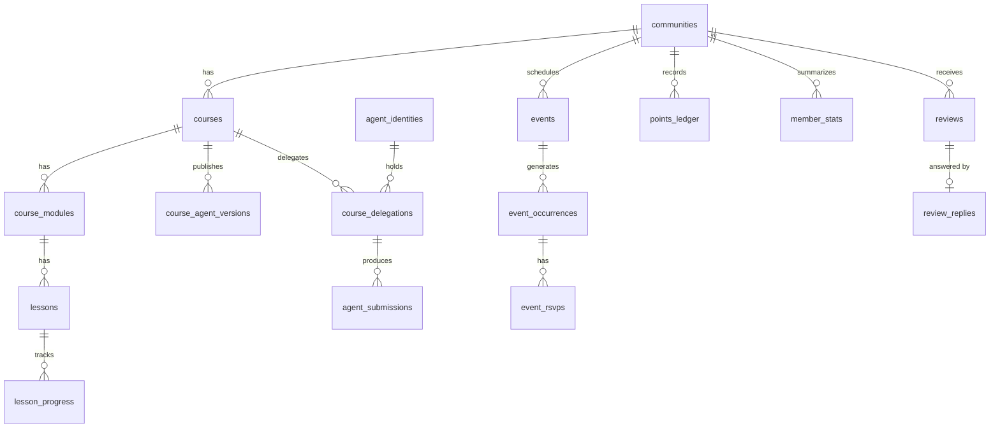
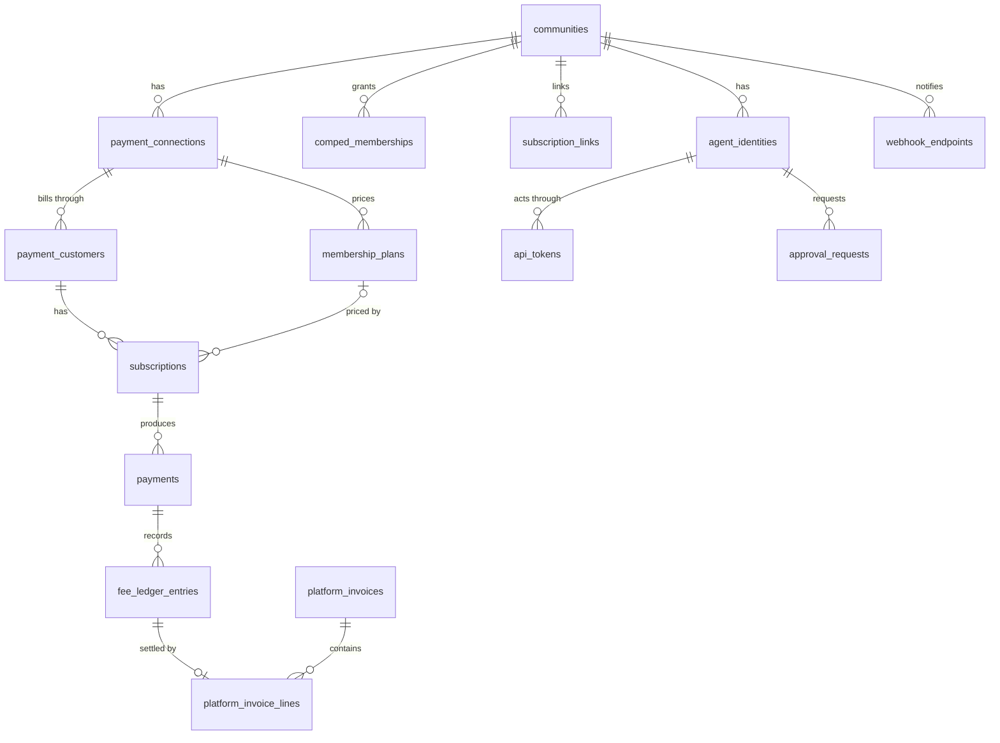

# Data model

The tables of Cohory 0.12.0 by module, with their keys, constraints, row level security policies, and the rules for ids, tenancy, money, indexing, migrations, seeds, and export.

Every table, column, enum value, and constraint named here exists in `packages/db/src/schema` and `packages/db/migrations` unless it is labeled **Not built** or **Recommendation**. Module ownership follows [overview.md](overview.md). Tenancy rules are in [multi-tenancy.md](multi-tenancy.md). Payment semantics are in [payments.md](payments.md). The archive format is in [archive-format.md](archive-format.md).

## 1. Conventions

| Rule | Detail | Label |
|---|---|---|
| Primary keys | UUIDv7, generated in the application (`packages/db/src/ids.ts`), stored as `uuid`. Better Auth leaves ids to the same column default (`advanced.database.generateId` is `"uuid"`, so the ids it derives itself are uuids too). | Confirmed ([0010](../decisions/0010-uuidv7-primary-keys.md)) |
| Tenant column | Every tenant scoped table has `community_id uuid not null` referencing `communities.id` with cascade, through the `tenant()` helper. Child tables carry it too, even when derivable through a parent. Financial tables use `detachedTenant()` (section 9.4). | Confirmed ([0006](../decisions/0006-shared-database-multi-tenancy.md)) |
| Timestamps | `created_at` and `updated_at` as `timestamptz`, UTC, database default `now()`; Drizzle sets `updated_at` on update. | Recommendation |
| Soft delete | Only where a requirement asks for it: posts and comments (`deleted_at`, `deleted_by`), communities (`deleted_at`, purged by a job), users (anonymized after a grace period). Everything else is hard deleted or status driven. | Recommendation |
| Money | Integer minor units (`bigint`, columns named `*_minor`) plus an ISO 4217 code in `currency char(3)`, lowercase to match Stripe, enforced by a check. Never floats, never `numeric`. | Recommendation |
| Rates | Basis points as integers (`application_fee_bps`, `rate_bps`, 0 to 10000). The Cloud platform fee is 200 (2%) by default; each subscription keeps the rate it was created with. | Recommendation |
| Enums | PostgreSQL enums for small fixed sets owned by one module (role, status, reason). Text with a check constraint when the set may grow often (`points_ledger.source_type`, `courses.access`). | Recommendation |
| Naming | snake_case tables in plural, snake_case columns, `<entity>_id` for foreign keys, `external_<object>_id` or `<provider>_<object>_id` for provider ids. | Recommendation |
| JSON | `jsonb` only for opaque payloads with a Zod schema next to the table (appearance, join questions, event payloads, snapshots). Never for fields we filter or join on. | Recommendation |
| Rich text | A sanitized JSON document (`body`) plus derived `body_html` and `body_text` columns, and a generated `search_vector` ([0012](../decisions/0012-post-content-format.md)). | Confirmed |

Shared column helpers live in `packages/db/src/schema/columns.ts` (`id`, `timestamps`, `citext`, `tsvector`) and `communities.ts` (`tenant`, `detachedTenant`, `formerCommunity`). `mode: "number"` on money columns is safe up to 2^53 minor units; aggregates are computed in SQL.

### 1.1 Tables by module

| Module | Schema file | Tables |
|---|---|---|
| Identity (Better Auth) | `auth.ts`, `identity.ts`, `legal.ts` | `users`, `sessions`, `accounts`, `verifications`, `account_audit_log`, `creator_terms_acceptances` |
| Communities and members | `communities.ts`, `joining.ts`, `manage.ts` | `communities`, `memberships`, `community_slug_history`, `community_gallery_items`, `membership_requests`, `pending_join_answers`, `invite_links`, `membership_holds`, `audit_log` |
| Posts and comments | `posts.ts`, `moderation.ts` | `categories`, `posts`, `post_images`, `post_drafts`, `comments`, `reactions`, `post_follows`, `content_reports` |
| Courses and lessons | `courses.ts` | `courses`, `course_modules`, `lessons`, `lesson_progress`, `lesson_agent_layers`, `course_agent_versions` |
| Events | `events.ts` | `events`, `event_occurrences`, `event_rsvps` |
| Gamification | `gamification.ts` | `points_ledger`, `member_stats`, `points_ledger_source_cleanup_0035` |
| Reviews | `reviews.ts` | `reviews`, `review_replies`, `review_reports` |
| Payments and subscriptions | `payments.ts`, `billing.ts`, `subscriber-moves.ts` | `payment_connections`, `membership_plans`, `payment_customers`, `subscriptions`, `payments`, `fee_ledger_entries`, `provider_events`, `comped_memberships`, `comp_invitations`, `subscription_links`, `payment_exit_runs`, `subscriber_moves`, `platform_billing_accounts`, `platform_invoices`, `platform_invoice_lines`, `platform_billing_issues` |
| Entitlements | `delegations.ts` | `course_agent_settings`, `course_delegations`, `agent_submissions` |
| Notifications and email | `notifications.ts`, `email.ts`, `feedback.ts` | `notifications`, `notification_preferences`, `notification_settings`, `notification_deliveries`, `notification_group_sources`, `email_log`, `email_suppressions`, `creator_feedback` |
| Agent integrations | `agents.ts`, `oauth.ts`, `approvals.ts`, `webhooks.ts` | `agent_identities`, `api_tokens`, `oauth_clients`, `oauth_grants`, `oauth_authorization_codes`, `oauth_refresh_tokens`, `approval_requests`, `webhook_endpoints`, `webhook_deliveries`, `webhook_delivery_attempts` |
| Migration and outbox | `migration.ts`, `outbox.ts` | `migration_jobs`, `migration_id_map`, `outbox` |

**Not built** as of 0.12.0, kept only as proposals in the sections below: `custom_domains`, `entitlements` (access is derived on read, section 10), and lesson comments. Sketched names that were built under another name: `post_reports` is `content_reports`, `community_slug_redirects` is `community_slug_history`, `join_questions` is the `communities.join_questions` column, `import_jobs` is `migration_jobs`, `customers` is `payment_customers`, `outbox_events` is `outbox`, and `agent_grants` became the `scopes` arrays on `agent_identities` and `api_tokens`.

### 1.2 Row level security

Row level security is enabled and forced on every table except `users`, `sessions`, `accounts`, `verifications` (Better Auth needs them without a tenant), and `oauth_clients` (a client registers anonymously before any community is chosen and the row holds only public client metadata). `points_ledger_source_cleanup_0035` has RLS enabled with no policy, so only the table owner reads it. The mechanism, the application role, and the allowed session settings are in [multi-tenancy.md](multi-tenancy.md) section 3.4. The sections below name each table's policies by the setting they read.

## 2. Entity relationship diagram

Identity, community, and content. Every box is a table; the diagram leaves out `post_drafts`, `post_images`, `pending_join_answers`, `membership_holds`, `community_slug_history`, and `community_gallery_items`, which hang off `posts`, `memberships`, or `communities` one to many.



Classroom, calendar, gamification, and reviews. `lesson_agent_layers` and `course_agent_settings` are one row per lesson or course and are left out.



Payments, platform billing, and agent integrations.



## 3. Identity (Better Auth)

**Confirmed** Better Auth with its Drizzle adapter, `usePlural` for table names, and extra columns on `users` ([0004](../decisions/0004-better-auth.md)). Users are platform level, not tenant scoped: one account across communities on the same instance (REQ-ID-004).

| Table | Columns and rules |
|---|---|
| `users` | `name`, `email` (citext, unique), `email_verified`, `image` (avatar storage key), `username` (citext, unique, nullable: email sign up does not collect one; members set it on the Account page, 3 to 30 lowercase letters, digits, or single hyphens, reserved names refused), `deletion_requested_at`, `deletion_scheduled_for`, `erased_at`, `terms_version` and `terms_accepted_at` (both set or both null, version 1 to 64 characters, check `users_terms_accepted`), timestamps. Indexes: `lower(name)` and `lower(username)` prefix, `users_search_idx` (GIN over name and username), `users_deletion_due_idx` (scheduled and not erased) |
| `sessions` | `user_id` (cascade), `token` (unique, stored as Better Auth writes it), `expires_at`, `ip_address` (text), `user_agent`, timestamps |
| `accounts` | `user_id` (cascade), `provider_id` and `account_id` (unique pair), `password`, OAuth token columns, `scope`, timestamps |
| `verifications` | `identifier` (indexed), `value`, `expires_at`, timestamps. Magic link and email verification tokens |
| `account_audit_log` | `user_id`, `action`, `metadata` jsonb, `created_at`. Own rows RLS on `app.user_id`. Records deletion requests, cancellations, erasures, session revocations, and account data export requests (the export needs no table of its own) |
| `creator_terms_acceptances` | Primary key `(community_id, user_id, version)`, `accepted_at`. Creator Terms accepted before a payment connection. Forced RLS: read in the community with `app.payments_manager`; insert only for the acting user (`app.user_id`) with the same setting; no update or delete |

Account deletion has a 14 day grace period before erasure. The `users` row stays after erasure with the name Former member and an `@erased.invalid` address so authored posts and comments keep a valid author. Account erasure runs under `app.account_purge`, which the `*_account_purge` policies on content, moderation, review, join, follow, and comp tables accept for the person's own rows.

A bio is per community (`memberships.bio`), not per user. Member search runs the name match (`users_search_idx`) and the bio match (`memberships_bio_search_idx`) as two branches of a `union`, so each can use its GIN index.

**Not built:** `users.links`, `users.time_zone`, `users.is_platform_admin`, and `sessions.host` (custom domain sessions, [authorization.md](authorization.md)). **Open question:** storing a hash of the session token instead of the token; the adapter reads and writes `token` as is, so hashing needs a Better Auth hook or plugin.

## 4. Communities and members

```ts
export const communityPrivacy = pgEnum("community_privacy", ["private", "public"]);
export const joinMode = pgEnum("join_mode", ["open", "approval", "invite"]);
export const memberRole = pgEnum("member_role", ["owner", "admin", "moderator", "member"]);
export const memberStatus = pgEnum("member_status", ["pending", "active", "removed", "banned"]);
export const memberRemovalReason = pgEnum("member_removal_reason", ["left", "removed", "hold_expired"]);
```

| Table | Columns and rules |
|---|---|
| `communities` | `slug` (citext, unique, 3 to 48 characters), `name`, `description`, `detailed_description` (jsonb, the post content document without images), `privacy`, `join_mode`, `join_questions` (jsonb, up to three `{ text, required }`, text up to 200 characters), `appearance` (jsonb, default `{}`: accent, logoKey, coverKey, font, cardStyle, theme) and the derived `appearance_tokens`, `gamification_enabled`, `reviews_enabled`, `level_names` (jsonb, nine names, default "Level 1" to "Level 9"), `currency` (set when a paid plan exists), `slug_changed_at` (one change per 30 days, enforced in the service), About page blocks `what_you_get` (up to 6 strings of 80 characters), `host_bio` (600), `host_credential` (120), `faq` (up to 8 `{ q, a }`, 200 and 1000 characters), setup checklist marks `setup_checklist_hidden_at`, `setup_import_skipped_at`, `about_previewed_at`, `invite_link_copied_at`, `test_checkout_succeeded_at`, `refund_policy` (1 to 280 characters, shown at checkout), `points_for_lessons` and `points_for_events` (default false), `member_email_sent_at` and `member_email_sent_by` (once per 24 hours rule; `sent_by` needs `sent_at`), `archived_at`, `deleted_at`, `purge_attempted_at`, timestamps. Checks enforce every length and count above. RLS: anyone may select (slugs resolve before a tenant is known); insert, update, and delete need `id = app.community_id` |
| `memberships` | `user_id`, `role`, `status`, `removal_reason` (only when `removed`; set by the trigger `memberships_removal_reason` from `app.member_removal_reason`), `join_answers` (jsonb: bare strings for imports, `{ question, answer }` pairs for answers given before checkout), `bio` (up to 500 characters, GIN search index), `banned_email` (citext, only when `banned`, so a ban survives the removal of the user), `joined_at`, `last_seen_at` (nightly activity measure), `last_feed_visit_at` (New markers), `onboarding_dismissed_at`, `welcome_email_sent_at` (set after the send, so delivery is at least once), timestamps. Unique `(community_id, user_id)`; one owner per community (partial unique on `role = 'owner'`). RLS: tenant isolation plus `memberships_own_rows` (a person reads their own memberships across communities under `app.user_id`) |
| `community_slug_history` | `slug` (citext, primary key, so an old slug belongs to one community forever), `community_id` (cascade), `changed_at`. No expiry. The trigger `communities_slug_history` (`BEFORE INSERT OR UPDATE OF slug`, security definer) takes transaction advisory locks on the old and new slug, refuses a slug another community used before with the `communities_slug_unique` violation, and inserts the old slug on a change; a community may return to one of its own old slugs. RLS: anyone reads (old URLs must redirect), inserts only in the community, no update or delete, so a held slug is released only when the community is deleted |
| `community_gallery_items` | `kind` (`image` or `video_embed`), `storage_key` (under `communities/{id}/gallery/`) or `embed_url` (normalized YouTube, Vimeo, or Loom URL; exactly one of the two, by check), `thumbnail_url` (video poster read once from the Vimeo or Loom oEmbed endpoint with fixed hosts, a 3 second timeout, and no redirects, kept only when served from the provider's image host; YouTube posters come from the video id), `position` (>= 0), `alt_text` (up to 250), timestamps. The service caps the gallery at 10 under a row lock on the community. RLS: anyone reads (the About page of a private community is public); writes need `app.community_manager` in the community |
| `membership_requests` | `user_id` (cascade), `status` (`pending`, `approved`, `declined`), `answers` (jsonb, up to three `{ question, answer }` paired at request time), `decision_note` (up to 500), `decided_by`, `decided_at`, timestamps. One pending row per person and community. RLS: managers (`app.community_manager`) read and write; a person inserts a pending row and reads their own; account purge |
| `pending_join_answers` | Primary key `(community_id, user_id)`, `answers` (jsonb, up to three), timestamps. Answers given before checkout, attached to the membership on activation. RLS: own rows, `app.payments_webhook` in the community, account purge |
| `invite_links` | `token` (unique, found by the `app.invite_token` setting), `created_by`, `expires_at`, `max_uses` (> 0), `use_count` (0 to `max_uses`), `requires_approval`, `revoked_at`, `label` (1 to 60), `created_at`. Unique `(community_id, id)` is the target of the composite foreign key from `membership_holds`. RLS: managers; a redeem may read and update the row whose token is in `app.invite_token` |
| `membership_holds` | Primary key `(community_id, user_id)`, `invite_id`, `expires_at`, `released_at`, `created_at`. The pending membership an invite to a paid community holds for 24 hours until Checkout ends; each Checkout Session pushes the hold out to its own expiry. Composite foreign keys to `memberships (community_id, user_id)` and `invite_links (community_id, id)` with cascade, so a hold cannot point at another community's invite. A table instead of columns on `memberships` kept the migration from taking `access exclusive` on `memberships`. RLS: tenant isolation plus a cross community select under `app.membership_hold_sweep` for the hourly `payments.holds-expiry` job, which moves an unpaid hold to `removed` (reason `hold_expired`) and gives the invite use back |

A guest is the absence of an active membership, not a row. Pending applicants have `status = 'pending'`. Banned people keep the row so rejoin is blocked (REQ-MEM-003). The trigger `memberships_domain_events` appends `member.*` domain events to the outbox on status changes ([0016](../decisions/0016-database-triggers-append-domain-events.md)).

Community deletion sets `deleted_at`; the `communities.purge-deleted` job orders communities by `purge_attempted_at nulls first` (`communities_purge_queue_idx`), sets `purge_attempted_at` on every attempt, and deletes comments, reactions, notifications, ledger rows, and posts in batches before the community row. The `*_community_purge` policies on `points_ledger` and `notifications` allow those deletes under `app.community_purge` in the community.

**Not built:** `custom_domains` (`hostname` unique and normalized, `status` pending_dns, verified, active, failed, `verification_token`, `verified_at`). **Recommendation** for when custom domains ship.

## 5. Posts, comments, reactions

```ts
export const categoryColor = pgEnum("category_color", ["neutral", "accent", "info", "success", "warning", "danger"]);
export const reactionSubjectType = pgEnum("reaction_subject_type", ["post", "comment"]);
export const reactionKind = pgEnum("reaction_kind", ["like"]);
export const reportReason = pgEnum("report_reason", ["spam", "harassment", "hate", "sexual", "violence", "other"]);
export const reportStatus = pgEnum("report_status", ["open", "dismissed", "content_removed", "member_banned"]);
```

| Table | Columns and rules |
|---|---|
| `categories` | `name` (1 to 40), `slug` (citext, unique per community), `color`, `position`, `staff_only` (instead of a posting role), timestamps |
| `posts` | `author_id`, `agent_id` (set null; the agent that wrote it), `category_id` (nullable, set null), `title` (up to 120), `body` jsonb, `body_html`, `body_text`, `excerpt`, `last_activity_at` (feeds the Active sort), `search_vector` (generated: title weight A, body weight B), `pinned_at`, `scheduled_at`, `edited_at`, `comment_count`, `like_count` (both >= 0), `deleted_at`, `deleted_by`, timestamps. Unique `(community_id, id)` is the target of the composite foreign key from `post_follows`. There is no slug; post URLs use the id. RLS: tenant isolation plus `posts_scheduler_read` (scheduled rows across communities under `app.posts_scheduler`) |
| `post_images` | `post_id` (cascade), `storage_key`, `width`, `height`, `position` (0 to 9, unique per post), timestamps |
| `post_drafts` | The content columns of `posts` plus `author_id`, `agent_id`, `category_id`, and timestamps; no counters, no search vector |
| `comments` | `post_id` (cascade; comments belong to posts only), `author_id`, `agent_id`, `parent_id` (cascade; one reply level, enforced in the service), `body`, `body_html`, `body_text`, `like_count`, `edited_at`, `deleted_at`, `deleted_by`, `search_vector` (generated), timestamps |
| `reactions` | `user_id`, `subject_type`, `subject_id`, `subject_author_id` (denormalized for points and the self like check), `kind`, timestamps. Unique `(subject_type, subject_id, user_id, kind)`, so a repeated like inserts nothing |
| `post_follows` | Primary key `(post_id, user_id)`, `community_id`, `created_at`; composite foreign key `(community_id, post_id)` to `posts` with cascade. RLS: own rows in the community, a select under `app.notification_jobs`, account purge |
| `content_reports` | `post_id` (cascade), `comment_id` (null for a post report, cascade), `reporter_id` (cascade), `reason`, `note` (up to 500), `status`, `resolved_by`, `resolved_at` (set exactly when not `open`), timestamps. One open report per person and item (two partial unique indexes). RLS: a reporter inserts open reports and reads their own; reading and resolving need `app.community_manager`, which the service sets for moderators, admins, and the owner; account purge |

Counters (`like_count`, `comment_count`) are updated in the same transaction as the reaction or comment and recomputed by a repair job if they drift. Soft deleted posts and comments keep `deleted_by` so moderators see who deleted an item. The `posts_activity`, `comments_activity`, and `reactions_activity` triggers touch `memberships.last_seen_at`.

## 6. Courses and lessons

```ts
export const courseStatus = pgEnum("course_status", ["draft", "published", "archived"]);
export const lessonStatus = pgEnum("lesson_status", ["draft", "published"]);
```

| Table | Columns and rules |
|---|---|
| `courses` | `slug` (citext, unique per community), `title` (1 to 120), `description` (up to 2000), `cover_key`, `status` (archived when deleted with progress), `position`, `access` (check: only `all_members`), `required_level` (1 to 9; null means no lock, [0045](../decisions/0045-levels-that-unlock-and-learning-points.md)), timestamps. Unique `(community_id, id)` is the target of the composite foreign keys from the delegation tables |
| `course_modules` | `course_id` (cascade), `title` (1 to 120), `position`, timestamps |
| `lessons` | `module_id` (cascade), `course_id` (cascade, denormalized for slug uniqueness), `slug` (citext, unique per course), `title` (1 to 120), `body_markdown` (up to 100,000 characters), `video_url` (allowlisted host), `attachments` (jsonb, up to 10: key, name, size, content type), `status`, `position`, `search_vector` (generated), timestamps |
| `lesson_progress` | Primary key `(lesson_id, user_id)`, `community_id`, `course_id`, `completed_at`, `last_viewed_at`. The trigger `lesson_progress_activity` touches `last_seen_at` and feeds learning points |
| `lesson_agent_layers` | `lesson_id` (primary key, cascade), `community_id`, `course_id`, `layer` (jsonb up to 1 MB), `updated_by`, timestamps. One agent layer draft per lesson |
| `course_agent_versions` | `course_id`, `version` with `major`, `minor`, `patch` (check: `version` equals the three parts joined, unique per course), `changelog` (up to 2000), `snapshot` (jsonb up to 3 MB), `checksum` (SHA-256 hex), `published_by`, `created_at`. The trigger `course_agent_versions_immutable` refuses updates even for the table owner |

Positions are integers with gaps (steps of 1024) so reordering touches one row in the common case; a compaction runs when gaps run out. RLS: members read published courses and lessons and every module; drafts, layers, and version inserts need `app.course_manager`, which the service sets for admins and owners; progress rows need the matching `app.user_id`, and managers may read them; versions have no update or delete policy. The layer and snapshot format is [agent-course-format.md](agent-course-format.md).

## 7. Events

| Table | Columns and rules |
|---|---|
| `events` | `slug` (citext, unique per community), `title` (1 to 120), `description` (up to 5000), `starts_at_local` (wall clock, no zone), `time_zone` (IANA), `duration_minutes` (5 to 1440), `recurrence` (null or `weekly`), `recurrence_until` (date), `location` (up to 500, hidden without access), `recording_url` (up to 2000), `cover_key`, timestamps |
| `event_occurrences` | `event_id` (cascade), `starts_at` and `ends_at` (UTC, computed from the local time and zone; `ends_at > starts_at`), `canceled_at`. Unique `(event_id, starts_at)` |
| `event_rsvps` | Primary key `(occurrence_id, user_id)`, `community_id`, `status` (`going`, `not_going`), `reminder_sent_at` (idempotent reminders), timestamps |

Storing the wall clock time plus the zone and computing UTC per occurrence keeps a weekly 18:00 call at 18:00 across daylight saving changes. The worker generates occurrences 26 weeks ahead. RLS: event and occurrence writes need `app.calendar_manager`; RSVP writes need the matching `app.user_id`; the worker's `app.calendar_jobs` setting allows only the occurrence scan and the reminder claim. RSVPs of people whose membership is no longer active stay stored but count for nothing: the reminder claim, the going list, and the going count read only RSVPs of active members, so a removed or banned member gets no reminder and an RSVP comes back only if the person becomes a member again. The trigger `event_rsvps_activity` touches `last_seen_at` and feeds attendance points.

## 8. Gamification

```ts
export const pointsReason = pgEnum("points_reason", [
  "like_received", "like_removed", "post_deleted", "comment_deleted", "admin_reset", "lesson_completed", "event_attended",
]);
export const pointsSourceTypes = ["reaction", "points_reset", "points_reset_member", "lesson", "event_occurrence"] as const;
```

| Table | Columns and rules |
|---|---|
| `points_ledger` | Append only: `user_id`, `delta` (never zero), `reason`, `source_type` (null or one of `pointsSourceTypes`, check `points_ledger_source_type_known`), `source_id`, `occurred_at`. One entry per source and reason for reactions and resets (`points_ledger_source_reason_v2_unique`), one entry per member, source, and reason for lessons and occurrences (`points_ledger_learning_unique`), and one reversal per source. RLS: select and insert in the community, delete only under `app.community_purge` |
| `member_stats` | Primary key `(community_id, user_id)`, `points_total`, `level` (1 to 9), `updated_at`. A projection, rebuildable from the ledger |
| `points_ledger_source_cleanup_0035` | `ledger_id`, `community_id`, `source_type`, `source_id`, `cleaned_at`. The source types migration 0035 cleared from ledger rows outside the known list. Global and admin only (RLS on, no policy). Kept for one release; **Recommendation:** drop it in a later migration |

The 7 day leaderboard sums `points_ledger` over the window with the `(community_id, occurred_at)` index and finds each member's last reset once (`points_ledger_admin_reset_idx`). Level names live on `communities.level_names`; thresholds are code constants. The archive import keeps ledger rows with any other source type but clears their `source_type` and `source_id`. Learning points (`lesson_completed`, `event_attended`) are written only when `communities.points_for_lessons` or `points_for_events` is on.

### 8.1 Reviews

Owned by `@cohory/reviews` ([0025](../decisions/0025-reviews-module-boundary.md)).

| Table | Columns and rules |
|---|---|
| `reviews` | `author_id` (set null), `membership_id` (set null), `rating` (1 to 5), `body` (20 to 2000 characters), `edited_at`, `hidden_at` with `hidden_reason` (`spam`, `abuse`, `personal_data`, `off_topic`; both set or both null) and `hidden_by` (the owner), `author_removed_at`, `anonymized_at` (set by account erasure; a row has an author or is anonymized), timestamps. One review per member per community (unique `(community_id, author_id)`) |
| `review_replies` | `review_id` (cascade, unique: one public owner reply per review), `author_id`, `body` (1 to 2000), `edited_at`, timestamps |
| `review_reports` | `review_id` (cascade), `reporter_id` (cascade), `reason` (`report_reason`), `note` (up to 500), `status` (`open`, `dismissed`, `hidden`), `resolved_by`, `resolved_at`, timestamps. One open report per person and review |

All three have tenant isolation; `reviews` and `review_reports` also accept `app.account_purge` for the person's own rows. The trigger `memberships_review_standing` (function `cohory_reviews_author_standing`, security definer so callers need no grant on `reviews`) sets `author_removed_at` when a membership becomes `banned`, or `removed` while `app.member_removal_reason` is `removed` (a staff removal), and clears it when the membership becomes `active` again. A visible review has no `hidden_at` and no `author_removed_at`. The reviewer status ("Paying member for N months" or "Former member") is computed on read from Payments, not stored.

## 9. Payments, subscriptions, ledger

Semantics are in [payments.md](payments.md); the table map is in its section 12.1. Money columns are `bigint` minor units named `*_minor`; currency columns are three lowercase letters by check.

```ts
export const paymentProvider = pgEnum("payment_provider", ["stripe_connect", "stripe_own_keys", "polar"]);
export const paymentConnectionStatus = pgEnum("payment_connection_status", ["onboarding", "active", "restricted", "disconnected", "disconnecting"]);
export const subscriptionAccessState = pgEnum("subscription_access_state", ["none", "granted", "grace", "revoked"]);
export const planInterval = pgEnum("plan_interval", ["month", "year"]);
export const feeLedgerKind = pgEnum("fee_ledger_kind", ["fee_accrued", "fee_collected", "fee_refunded", "adjustment", "invoice_settled"]);
export const feeLedgerReason = pgEnum("fee_ledger_reason", ["dispute_lost"]);
export const feeCollectionMethod = pgEnum("fee_collection_method", ["automatic_split", "periodic_invoice"]);
export const paymentDisputeStatus = pgEnum("payment_dispute_status", ["open", "won", "lost"]);
export const compEndReason = pgEnum("comp_end_reason", ["revoked", "expired"]);
export const subscriptionLinkStatus = pgEnum("subscription_link_status", ["linked", "invited"]);
export const paymentExitKind = pgEnum("payment_exit_kind", ["archive", "disconnect", "delete"]);
export const paymentExitChoice = pgEnum("payment_exit_choice", ["stop_at_period_end", "keep_billing", "take_members", "wind_down", "cancel_now"]);
export const paymentExitStatus = pgEnum("payment_exit_status", ["pending", "running", "failed", "done"]);
```

### 9.1 Connections, plans, subscriptions

| Table | Columns and rules |
|---|---|
| `payment_connections` | `provider`, `external_account_id` (`acct_...` for Connect), `encrypted_secret` and `webhook_secret_encrypted` (own keys and Polar, AES-256-GCM with key ids; required by check unless disconnected), `status`, `charges_enabled`, `details_submitted`, `livemode`, `disconnected_at`, `accepted_owner_id` (which owner accepted the connection), `last_webhook_at`, timestamps. One open connection per community and one per external account (partial unique indexes on `status <> 'disconnected'`, so `disconnecting` still counts as open) |
| `membership_plans` | `connection_id` (nullable: a draft plan saved before a connection exists), `name` (1 to 80), `currency`, `monthly_price_minor` (> 0), `annual_price_minor` (null or > 0), `provider_product_id`, `provider_monthly_price_id`, `provider_annual_price_id`, `archived_at`, timestamps. One active (not archived) plan per community; a price change archives the plan and creates a new one, so existing subscribers keep their price (REQ-SUB-005) |
| `payment_customers` | `user_id`, `connection_id`, `external_customer_id` (`cus_...` on the creator's account; unique per connection), timestamps |
| `subscriptions` | Mirror of the provider object: `user_id`, `customer_id`, `connection_id`, `plan_id`, `external_subscription_id` (unique), `provider_status` (raw), `access_state`, `interval`, `current_period_end`, `cancel_at_period_end`, `ended_at`, `application_fee_bps` (0 to 10000), `origin` (`created_by_cohory` or `linked_import`), `external_price_id` (Stripe price of the first item), `provider_fetched_at`, timestamps. The trigger `subscriptions_domain_events` appends `subscription.*` events on `access_state` changes |
| `comped_memberships` | Free access granted by an owner or admin: `user_id` (cascade), `granted_by`, `note` (up to 200), `expires_at`, `ended_at` with `end_reason` (both set or both null), `ended_by`, timestamps. One open grant per person and community |
| `comp_invitations` | A comp offered to an email before the person has an account: `email` (citext), `granted_by`, `note`, `expires_at`, `accepted_at` and `accepted_by`, `comp_id` (the grant once accepted), `withdrawn_at` and `withdrawn_by` (accepted or withdrawn, never both), timestamps. One open invitation per email and community |
| `subscription_links` | The ledger of "Bring your existing subscribers": one row per Stripe subscription (`external_subscription_id` unique) with `connection_id`, `external_customer_id`, `external_price_id`, `email` (citext), the `plan_id` and `interval` the creator mapped it to, `status`, `user_id` and `subscription_id` once linked (`linked_at` set exactly when `linked`), `application_fee_bps` (0 by default), `created_by`, timestamps |
| `payment_exit_runs` | One exit action on paid members: `connection_id`, `kind`, `choice`, `include_linked`, `status`, `attempts`, `target_count`, `done_count`, `failed_subscription_ids`, `portal_login_url`, `requested_by`, `manual_cancellation_confirmed_at`, `finished_at`, timestamps. One unfinished run per community (`payment_exit_runs_one_unfinished`) |
| `subscriber_moves` | Paying members to move, with the free time Checkout turns into a trial ([0042](../decisions/0042-moving-paying-members.md)): `email` (citext, unique per community), `was_paying`, `source` (`skool`, `circle`, `archive`, `csv`, `manual`), `free_until`, `status` (`pending`, `resubscribed`, `expired`), `job_id`, `subscription_id`, `resubscribed_at` (set exactly when resubscribed), `reminded_at`, `created_by`, timestamps. The service caps a community at 5,000 rows and a reminder at one per row per 7 days |

Policies: reads stay in the community (`payment_customers`, `subscriptions`, and `comped_memberships` only for the member's own rows or a manager; plans and connections for every member). Writes need `app.payments_manager`, which the service sets for owners and admins or for webhook processing. `app.payments_webhook` allows the inbox, the lookup of a connection by Stripe account, the comp expiry job, exit runs, pending join answers, and subscriber moves, and reads every subscription (`subscriptions_exit_jobs`) for exit and closed billing sweeps. `subscriptions_own_rows` lets a person read their own subscriptions across communities under `app.user_id` for the account billing page. `subscription_links` and `comp_invitations` are manager only; claims by invited people run in the service's system scope.

The `subscriber_moves` retention job (`payments.moves-retention`, daily) deletes a row 90 days after `free_until` or `resubscribed_at`, or 120 days after `created_at` when neither is set, switching the community scope inside one transaction per 500 communities because the policy needs one community at a time. Account erasure deletes the rows that match the person's email in each community they belong to, and replaces the email on their `subscription_links` rows with `erased-{link id}@erased.invalid`.

Entitlements are derived on read from the membership row, the subscription mirror, the comp grant, and whether a plan is active (section 10). A subscription on a `disconnected` connection grants access only until the later of its `current_period_end` and the connection's `disconnected_at`; the closed billing sweep then sets `access_state` to `revoked` ([payments.md](payments.md) section 12.8). Reconciliation and refunds started from Cohory are not built ([payments.md](payments.md) section 12.6).

### 9.2 Payments, ledger, inbox

| Table | Columns and rules |
|---|---|
| `payments` | One row per paid invoice: `subscription_id` (set null), `external_invoice_id` (unique), `external_payment_intent_id`, `currency`, `amount_minor`, `tax_minor`, `refunded_minor` (0 to the amount), `dispute_status` and `disputed_at` (both or neither, [0028](../decisions/0028-stripe-disputes.md)), `occurred_at`, timestamps |
| `fee_ledger_entries` | Append only: `payment_id`, `kind`, `reason` (only on `fee_refunded`), `provider`, `collection_method`, `currency`, `base_minor`, `rate_bps` (0 to 10000), `computed_fee_minor` (Cohory's calculation, <= 0 for `fee_refunded`, >= 0 for accrued and collected), `provider_fee_minor` (Stripe's figure), `external_ref`, `idempotency_key` (unique, for example `fee:collected:{feeId}`), `occurred_at`, `created_at` |
| `provider_events` | The webhook inbox, platform level: `provider`, `external_event_id` (unique with provider), `external_account_id`, `connection_id` and `community_id` (both set null), `type`, `livemode`, `payload_hash` (SHA-256 of the body, never the payload), `attempts`, `received_at`, `claimed_at` (two minute processing lease), `processed_at`, `error`. Only `app.payments_webhook` reads or writes it |

`payments` and `fee_ledger_entries` are readable by managers only. The ledger has an insert policy for managers, no delete policy, and one update policy that applies only under `app.payments_detach` (section 9.4), so in every other path the application role can only append.

### 9.3 Platform billing

Periodic invoices for ledger balances that the provider does not split automatically ([payments.md](payments.md) section 12.11).

| Table | Columns and rules |
|---|---|
| `platform_billing_accounts` | One per community: `stripe_customer_id` (unique), `billing_email` (citext), `payment_method_id`, `payment_method_label` (up to 80), `suspended_at`, timestamps |
| `platform_invoices` | `billing_account_id`, `currency`, `period_start` and `period_end` (ordered; unique per community, currency, and period start), `amount_minor` (> 0), `amount_paid_minor`, `status` (`draft`, `open`, `paid`, `void`, `uncollectible`), `collection_method` (`charge_automatically`, `send_invoice`), `stripe_invoice_id` (unique), `invoice_number`, `hosted_invoice_url`, `due_at`, `finalized_at`, `paid_at`, `voided_at`, `past_due_since`, `owner_notified_at`, timestamps |
| `platform_invoice_lines` | `invoice_id`, `ledger_entry_id` (unique: an entry is invoiced once), `amount_minor`, `created_at` |
| `platform_billing_issues` | `invoice_id`, `kind` (`stripe_amount_mismatch`, `ledger_amount_mismatch`, `provider_total_mismatch`, `stripe_invoice_missing`), `currency`, `period_start`, `expected_minor`, `actual_minor`, `detected_at`, `resolved_at`, timestamps. One open issue per community, currency, period, and kind. Cascades with the community |

Policies: a manager reads in the community, and `app.platform_billing` reads and writes across communities (managers may also write their billing account). `fee_ledger_entries_billing_read` gives the billing sweep the ledger.

### 9.4 Financial records outlive their community

`payments`, `fee_ledger_entries`, `platform_billing_accounts`, `platform_invoices`, and `platform_invoice_lines` use `detachedTenant()`: `community_id` is nullable with `on delete set null`, and each table has `former_community_id` and `former_community_name` with the checks `<table>_community_or_former` (one of the two ids is set) and `<table>_former_matches` (the snapshot names the row's own community). Deleting a community whose financial rows carry no snapshot fails on that check, so community deletion writes the snapshot in the same transaction as the delete (`prepareCommunityDeletion` in Payments, called by Communities); a violation that still happens there is reported as `deletion_conflict`.

Writing the snapshot needs `app.payments_detach`: each of the five tables has an update policy `<table>_detach` limited to the current community. A `before update` trigger (`<table>_detach_guard`, function `financial_record_guard`) also protects the rows for every role, the schema owner included: the snapshot can only go from null to a value, `community_id` can only become null, a detached row cannot change, and an update that writes the snapshot, runs under `app.payments_detach`, or touches the fee ledger may change nothing but the snapshot, `community_id`, `updated_at`, and a `subscription_id` set to null by its foreign key. Detached rows are invisible to tenant reads ([multi-tenancy.md](multi-tenancy.md) section 3.4).

## 10. Entitlements

**Confirmed** ([0031](../decisions/0031-community-access-module.md)): there is no `entitlements` table. `@cohory/entitlements/access` derives access on read from the membership row, the subscription mirror, comp grants, and the plan, and content modules ask it through `communityAccessIn`. **Not built**, kept as a proposal for per resource access: an `entitlements` table with `user_id`, `resource_type`, `resource_id`, `source`, `source_id`, `granted_by`, `reason`, `starts_at`, `ends_at`, `revoked_at`.

Delegated agent entitlements (REQ-ENT-004) were built without copying the person's entitlement ([0022](../decisions/0022-delegated-entitlements.md)). The course columns reference `courses (community_id, id)` through a composite foreign key, so a row can never point at another community's course.

| Table | Columns and rules |
|---|---|
| `course_agent_settings` | `course_id` (primary key), `community_id`, `allow_agent_access` (default false), `license_id` (`personal_agents` default, `team_agents`, or `custom`), `license_text` (1 to 2000 characters, required for `custom`), `updated_by`, timestamps |
| `course_delegations` | `course_id`, `human_id` (cascade), `agent_id` (cascade), `granted_at`, `expires_at` (default 30 days after creation, after `granted_at`), `renewed_at`, `revoked_at` with `revoked_reason` (`revoked`, `expired`, `access_ended`, `agent_inactive`, `agent_access_off`; both or neither) and `revoked_by`, `expiry_notice_at`, timestamps. One live delegation per course and agent (partial unique where `revoked_at` is null) |
| `agent_submissions` | `course_id`, `lesson_id`, `task_id`, and `version` (text, no foreign keys to agent material), `agent_id`, `human_id`, `delegation_id` (set null), `run_id`, `payload` (JSON up to 64 KiB), `label` (`self_reported`), `created_at`. Unique `(community_id, agent_id, run_id, task_id)` |

RLS: tenant isolation; settings and delegations are also readable (and delegations writable) under `app.delegation_jobs` for the expiry job.

## 11. Notifications

One row per recipient, type, subject, and actor. Text is rendered at read time from the type and the actor name; `detail` (up to 300 characters) carries the only stored fragment.

```ts
export const notificationType = pgEnum("notification_type", [
  "mention", "reply", "comment_on_post", "like_on_post", "like_on_comment",
  "join_request", "join_request_approved", "join_request_declined", "approval_request", "agent_access",
  "report_actioned", "report_dismissed", "review_created", "paid_membership_changed", "ownership_transferred",
  "payment_disputed", "member_joined", "report_created", "event_created", "event_reminder",
  "paid_member_joined", "paid_member_canceled", "member_payment_failed", "token_expiring", "comment_on_followed_post",
]);
export const notificationSubjectType = pgEnum("notification_subject_type", [
  "post", "comment", "membership_request", "approval_request", "course_delegation", "review",
  "community", "report", "event", "api_token", "agent_token",
]);
```

| Table | Columns and rules |
|---|---|
| `notifications` | `community_id`, `user_id` (recipient), `actor_id`, `type`, `subject_type`, `subject_id`, `post_id` (cascade; required for post and comment subjects by the check `notifications_post_subject`, which lists the other subject types), `detail`, `read_at`, `created_at`. One unread row per recipient, type, subject, and actor (`notifications_unread_dedupe`), so repeated job deliveries do not duplicate |
| `notification_preferences` | Primary key `(user_id, type)`, `in_app`, `email` (`immediate`, `daily`, `off`), `updated_at`. A missing row means the default in `packages/notifications/src/preferences.ts` |
| `notification_settings` | `user_id` (primary key), `digest_hour` (0 to 23), `time_zone` (IANA, 1 to 64), `last_digest_at`, `weekly_digest` (default true), `last_weekly_digest_at`, `creator_feedback_opted_out_at`, `updated_at` |
| `notification_deliveries` | `notification_id` (cascade), `user_id`, `channel` (`email`), `outcome` (`sent` or `skipped`), `created_at`. Unique `(notification_id, channel)` is the idempotency claim; a failed send deletes the row |
| `notification_group_sources` | Primary key `(notification_id, source_key)`, `community_id`; the source key is 1 to 64 characters. The report, like, or join already counted in a grouped notice, so a retry does not count it twice |

Policies: rows are inserted only inside `runInCommunity`, so the insert policy checks `community_id` like every tenant table. Reads, updates, and deletes use `user_id = app.user_id`, which lets the bell list one user's rows across communities in one query and lets account erasure delete them. The three per user tables are own rows on `app.user_id`. A select only policy behind `app.notification_jobs` on all of them lets the email job find recipients across users. The purge policies are in section 4.

Who writes what: the `notifications.fanout` job writes `mention`, `reply`, `comment_on_post`, and `comment_on_followed_post`; `like_on_post` and `like_on_comment` exist for grouped like notifications and are not created yet. The Calendar notifier writes `event_created` (one per active member with access when the creator asked to tell members) and `event_reminder` (one per RSVP'd member with access, subject is the occurrence, recorded in `notification_deliveries` as sent or skipped because the calendar job sends the email itself). The approvals notifier writes `approval_request`. `join_request` goes to moderators, admins, and the owner; `join_request_approved` and `join_request_declined` to the person who asked. Event reminders use the `event_reminder` preference row. The check `notifications_post_subject` was last replaced in migration 0036 as `NOT VALID`; every row passed the narrower check it replaced, and validating it is in the [backlog](../product/backlog.md).

### 11.1 Email delivery

Both tables are global, with forced RLS behind `app.email_delivery`, and are read and written only by `@cohory/email` ([0035](../decisions/0035-email-suppression-and-delivery-headers.md)).

| Table | Columns and rules |
|---|---|
| `email_log` | `template` (1 to 64), `recipient_hash` (SHA-256 hex), `status` (`sent`, `failed`, `suppressed`), `error_code` (up to 64), `created_at` |
| `email_suppressions` | `address_hash` (SHA-256 hex), optional `community_id` (cascade), `reason` (`hard_bounce`, `complaint`, `manual`, `opt_out`), `source` (`smtp`, `webhook`, `operator`, `member`), `created_at`. One instance wide row and one row per community per address (two partial unique indexes). The shared mailer checks it before every non security send |

### 11.2 Creator feedback

Creator feedback on the Cloud Edition ([0049](../decisions/0049-creator-feedback.md)). The Community Edition never writes these rows.

`creator_feedback`: `user_id` (cascade), `community_id` (`detachedTenant()`, set null when the community is deleted), `kind` (`moment`, `exit`), `topic` (`first_post`, `first_paid_member`, `first_course`, `archive_community`, `delete_community`, `disconnect_stripe`, `delete_account`), `status` (`pending`, `answered`, `dismissed`, `snoozed`), `score` (1 to 5), `reason` (`too_expensive`, `missing_feature`, `too_hard`, `moving_platform`, `not_enough_activity`, `only_testing`, `other`), `comment` (1 to 1000), `responded_at`, timestamps. Checks keep the shape: a moment has no reason, an exit has no score and is always `answered`, `responded_at` is set exactly when the row is not `pending`, and only an answered row has a score or comment. Each moment is asked once per community (partial unique `(community_id, topic)` where `kind = 'moment'`); `(user_id, responded_at)` serves the 30 day cap.

Policies: `creator_feedback_own_rows` (visible and writable when `user_id = app.user_id`; an insert or update must also have no community or the community in `app.community_id`) and `creator_feedback_retention_sweep` (under `app.feedback_retention`, rows older than 24 months are visible and deletable and nothing can be written; the daily `feedback.retention` job removes them). "Don't ask me again" sets `notification_settings.creator_feedback_opted_out_at`. Account erasure deletes the person's rows; the account data export includes them in `feedback.json` with the opt out in `profile.json`; a community archive or export does not.

## 12. Agent integrations and audit

Every table here is tenant scoped with forced RLS except `oauth_clients`. Semantics are in [agent-integrations.md](agent-integrations.md).

| Table | Columns and rules |
|---|---|
| `agent_identities` | `owner_id`, `name` (1 to 60), `description` (up to 280), `scopes` (text array, no wildcard), `status` (`active`, `suspended`, `revoked`), `community_wide`, `last_activity_at`, `suspended_at`, `revoked_at`, `created_by`, timestamps |
| `api_tokens` | `kind` (`personal` or `agent`; agent exactly when `agent_id` is set), `user_id`, `agent_id` (cascade), `name` (1 to 60), `token_hash` (unique SHA-256 hex; the token is shown once), `prefix` (for display), `scopes`, `expires_at` (required), `last_used_at`, `last_used_via` (`audit_via`), `expiry_notified_at` (the 7 day expiry notice), `revoked_at`, `revoked_by`, `created_by`, `created_at`, `oauth_grant_id` (cascade; agent tokens only). Policies: tenant isolation; a lookup by `app.api_token_hash`; the owner reads and revokes personal tokens by `app.api_token_owner` |
| `oauth_clients` | Global, no RLS: `client_name` (1 to 100), `redirect_uris` (1 to 10), `client_uri`, `software_id`, `software_version`, `created_at` |
| `oauth_grants` | `client_id` (cascade), `user_id`, `agent_id` (cascade), `scopes`, `resource`, `created_at`, `ended_at` with `end_reason` (`disconnected`, `revoked`, `refresh_reuse`, `code_reuse`; both or neither), `ended_by`. A person lists their own grants under `app.oauth_grant_owner` |
| `oauth_authorization_codes` | `grant_id` (cascade), `code_hash` (unique SHA-256 hex), `code_challenge` (43 characters), `redirect_uri`, `expires_at`, `used_at`, `created_at`. Found by hash under `app.oauth_secret_hash` |
| `oauth_refresh_tokens` | `grant_id` (cascade), `token_hash` (unique SHA-256 hex), `expires_at`, `rotated_at`, `revoked_at`, `created_at`. Found by hash under `app.oauth_secret_hash` |
| `approval_requests` | `agent_id` (cascade), `owner_id` (cascade), `token_id` (set null), `operation_id`, `method`, `path`, `category`, `input` (params, query, body), `summary` (1 to 300), `diff` (label, before, after lines), `state` (`pending`, `approved`, `executed`, `failed`, `rejected`, `expired`; `decided_at` is null exactly for pending and expired), `decided_by`, `decision_note` (up to 500), `executed_at`, `result`, `error_code`, `downloaded_at`, `expires_at`, timestamps. Readable and writable in the community or under `app.approval_jobs` |
| `webhook_endpoints` | `url` (8 to 2048), `description` (up to 200), `event_types` (at least one), `secret_ciphertext`, `previous_secret_ciphertext` and `previous_secret_expires_at` (the secret kept during a roll; both or neither), `status` (`active`, `disabled`) with `disabled_reason` (`manual`, `failures`) and `disabled_at`, `failing_since`, `consecutive_failures`, `last_success_at`, `created_by`, timestamps |
| `webhook_deliveries` | `endpoint_id` (cascade), `event_id` (unique per endpoint), `event_type`, `payload`, `status` (`pending`, `succeeded`, `failed`; pending rows need `next_attempt_at`), `attempts`, `next_attempt_at`, `locked_until`, `last_attempt_at`, `response_status`, `last_error` (up to 200), `completed_at`, timestamps |
| `webhook_delivery_attempts` | `delivery_id` (cascade), `attempted_at`, `request_headers`, `request_body`, `response_status`, `response_body_excerpt` (up to 2048), `error_code`, `duration_ms` |
| `audit_log` | Append only: `community_id`, `actor_id`, `actor_type` (`user`, `agent`, `system`), `via` (`web`, `api`, `mcp`, `job`), `token_id`, `agent_id`, `action` (for example `member.role_changed`), `target`, `metadata` (before and after for settings, never secrets), `created_at`. Policies: insert in the community; read needs `app.community_manager`. Indexes by community and time, by agent, and by token |

The three webhook tables share one policy: a manager in the community (`app.webhooks_manager`) or the delivery job (`app.webhook_jobs`). Posts and comments carry `agent_id` so content written by an agent is attributable.

## 13. Migration and import jobs

Owned by `@cohory/migration`, which sets `app.migration_manager` only after it checked that the caller owns the community ([0015](../decisions/0015-migration-module-direct-table-access.md)).

| Table | Columns and rules |
|---|---|
| `migration_jobs` | `kind` (`export`, `import`, `members_csv`), `status` (`ready`, `queued`, `running`, `succeeded`, `failed`), `requested_by`, `file_key`, `file_name`, `file_bytes`, `options`, `preview`, `progress` (`phase`, `done`, `total`), `summary`, `error_code`, `attempts`, `started_at`, `finished_at`, `email_choice` (`now`, `later`, `never`), `emails_sent_at`, `expires_at` (when the stored file should go: previews after 7 days, exports 30 days after they finish), `deleted_at` (once it is gone; the row stays as history), timestamps |
| `migration_id_map` | Primary key `(community_id, job_id, entity, source_id)`, `target_id`. Per import job, so a retried job skips what it already wrote and the same archive can be imported twice on one instance |

The Skool and Circle importers produce archive records and run through the same import path, so they reuse both tables. The daily `migration.files-expiry` job deletes an expired preview with its row and an expired export file while keeping its row with `deleted_at`; it walks the communities one by one because the policy needs the community scope, so it does not use `migration_jobs_expiry_idx` yet.

### 13.1 Outbox

`outbox` ([0014](../decisions/0014-transactional-outbox.md), [overview.md](overview.md) section 8): `community_id` (cascade, null for platform events), `topic` (for example `post_events`), `payload` (`{ events: [...] }`), `attempts`, `last_error` (error name only), `published_at`, `claimed_until`, `created_at`. Forced RLS: inserts must match `app.community_id` or carry a null `community_id`; reads, updates, and deletes need `app.outbox_relay`, which only the relay sets. The function `cohory_append_domain_event` lets triggers append events ([0016](../decisions/0016-database-triggers-append-domain-events.md)).

The relay claims up to 100 pending rows whose lease is empty or past in a short transaction (`for update skip locked`, lease set 60 seconds ahead), publishes outside any transaction, and then marks each row published or failed and clears the lease. That last update matches on the relay's own `claimed_until`, so a relay whose publish outlasted its lease leaves the row to the relay that took it over instead of overwriting its attempt count, and leaves that publish out of its own counts. A relay that dies leaves rows that another relay takes once the lease runs out, so delivery stays at least once.

## 14. Indexing rules

**Recommendation.**

1. Every tenant scoped index starts with `community_id`, unless the table is always reached through a unique external id or a per user policy.
2. Every foreign key has an index on the referencing column (PostgreSQL does not create one automatically). Nullable columns use a partial index `where col is not null`. Migration 0034 added the ones the first releases had missed.
3. Feed and list queries use cursor pagination on `(community_id, sort_column desc, id desc)` with a matching composite index. No `OFFSET` on large tables.
4. Partial indexes for soft deleted tables (`where deleted_at is null`) on the hot paths.
5. Full text search uses generated `tsvector` columns with GIN indexes on posts, comments, and lessons, and expression GIN indexes on `users` (name and username) and `memberships` (bio), all with the `simple` configuration.
6. Unique constraints express business rules instead of application checks.
7. An index that serves `order by x desc, id desc` must say `desc nulls first` (the PostgreSQL default for `desc`). Drizzle's `.desc()` alone emits `DESC NULLS LAST`, which the planner cannot use for that sort, so write `.desc().nullsFirst()`. An index whose query groups rows and sorts by an aggregate (`content_reports_queue_idx`, `review_reports_queue_idx`, `lesson_progress_recent_idx`) may keep a plain `desc`.
8. A replacement index is built under a new name (`*_v2_idx`) before the old one is dropped at the end of the migration (section 15).

The indexes and constraints that carry a business rule or a hot path as of 0.12.0. The migration column names the SQL file that gave each its current shape; foreign key indexes and plain length checks are left out.

| Table | Index or constraint | Columns and condition | Why | Migration |
|---|---|---|---|---|
| `memberships` | `memberships_one_owner_per_community` | `(community_id) where role = 'owner'` | One owner | 0001 |
| `memberships` | `memberships_community_user_unique` | `(community_id, user_id)` | One membership per person | 0001 |
| `memberships` | `memberships_community_directory_idx` | `(community_id, coalesce(joined_at, created_at) desc, id desc) where status = 'active'` | Member directory and Manage people list, keyset paged | 0034 |
| `memberships` | `memberships_community_banned_email_idx` | `(community_id, banned_email) where banned_email is not null` | Ban check on join | 0001 |
| `communities` | `communities_purge_queue_idx` | `(purge_attempted_at nulls first, deleted_at, id) where deleted_at is not null` | Purge job order | 0034 |
| `community_slug_history` | primary key | `(slug)` | An old slug belongs to one community forever | 0031 |
| `invite_links` | `invite_links_community_id_unique` | `(community_id, id)` | Target of the composite key from `membership_holds` | 0036 |
| `membership_holds` | `membership_holds_expires_idx` | `(expires_at) where released_at is null` | Hourly expiry sweep | 0036 |
| `membership_requests` | `membership_requests_one_pending` | `(community_id, user_id) where status = 'pending'` | One pending request per person | 0013 |
| `membership_requests` | `membership_requests_queue_v2_idx` | `(community_id, status, created_at desc nulls first, id desc nulls first)` | Join request queue, read backwards for oldest first | 0035 |
| `posts` | `posts_feed_v2_idx`, `posts_activity_v2_idx`, `posts_top_v2_idx`, `posts_category_feed_v2_idx` | `(community_id [, category_id], pinned_at desc nulls last, created_at or last_activity_at or (like_count + 2 * comment_count) desc, id desc nulls first) where deleted_at is null` | The New, Active, and Top feed sorts read one page from the index | 0035 |
| `posts` | `posts_community_id_unique` | `(community_id, id)` | Target of the composite key from `post_follows` | 0035 |
| `posts` | `posts_scheduled_idx`, `posts_scheduled_due_idx` | `(community_id, scheduled_at, id)` and `(scheduled_at)`, both where scheduled and not deleted | Scheduled list and the publish sweep | 0020 |
| `posts`, `comments`, `lessons` | `*_search_idx` | GIN on `search_vector` | Full text search | 0013 |
| `comments` | `comments_post_idx` | `(community_id, post_id, created_at, id)` | Comment thread | 0004 |
| `comments` | `comments_post_id_idx` | `(post_id)` | Cascade when a post is deleted | 0034 |
| `reactions` | `reactions_subject_user_kind_unique` | `(subject_type, subject_id, user_id, kind)` | One like per person and item | 0004 |
| `content_reports` | `content_reports_one_open_post`, `content_reports_one_open_comment` | `(community_id, post_id or comment_id, reporter_id) where status = 'open'` | One open report per person and item | 0014 |
| `courses` | `courses_community_id_unique` | `(community_id, id)` | Target of the composite keys from the delegation tables | 0024 |
| `courses`, `events` | `*_community_slug_unique` | `(community_id, slug)` | Slug per community | 0007, 0008 |
| `lessons` | `lessons_course_slug_unique` | `(course_id, slug)` | Slug per course | 0007 |
| `lesson_progress` | primary key | `(lesson_id, user_id)` | One progress row per person and lesson | 0007 |
| `course_agent_versions` | `course_agent_versions_course_version_unique` | `(community_id, course_id, major, minor, patch)` | One row per version | 0023 |
| `course_delegations` | `course_delegations_live_unique` | `(community_id, course_id, agent_id) where revoked_at is null` | One live delegation per course and agent | 0024 |
| `agent_submissions` | `agent_submissions_run_unique` | `(community_id, agent_id, run_id, task_id)` | Idempotent submissions | 0024 |
| `event_occurrences` | `event_occurrences_event_starts_unique` | `(event_id, starts_at)` | Occurrence generation is idempotent | 0008 |
| `event_rsvps` | primary key | `(occurrence_id, user_id)` | One RSVP per person and occurrence | 0008 |
| `points_ledger` | `points_ledger_source_reason_v2_unique` | `(source_type, source_id, reason) where source_type not in ('lesson', 'event_occurrence')` | One entry per reaction or reset event | 0035 |
| `points_ledger` | `points_ledger_learning_unique` | `(community_id, user_id, source_type, source_id, reason) where source_type in ('lesson', 'event_occurrence')` | One entry per member per lesson or occurrence | 0035 |
| `points_ledger` | `points_ledger_one_reversal_per_source` | `(source_type, source_id) where reason in ('like_removed', 'post_deleted', 'comment_deleted')` | One reversal per source | 0006 |
| `points_ledger` | `points_ledger_admin_reset_idx` | `(community_id, user_id, occurred_at desc) where reason = 'admin_reset'` | The 7 day leaderboard finds each member's last reset once | 0034 |
| `points_ledger` | `points_ledger_source_type_known` (check) | `source_type` null or in `pointsSourceTypes` | Unknown source types cannot enter the ledger | 0035 |
| `member_stats` | `member_stats_leaderboard_v2_idx` | `(community_id, points_total desc nulls first, updated_at, user_id)` | All time leaderboard streams from the index | 0035 |
| `reviews` | `reviews_one_per_member` | `(community_id, author_id)` | One review per member | 0027 |
| `reviews` | `reviews_community_created_v2_idx` | `(community_id, created_at desc nulls first, id desc nulls first)` | Reviews list | 0035 |
| `review_replies` | `review_replies_one_per_review` | `(review_id)` | One owner reply | 0027 |
| `payment_connections` | `payment_connections_one_open_per_community`, `payment_connections_open_account_unique` | `(community_id)` and `(external_account_id)`, both where `status <> 'disconnected'` | One open connection per community and per Stripe account | 0010 |
| `membership_plans` | `membership_plans_one_active_per_community` | `(community_id) where archived_at is null` | One active plan | 0010 |
| `payment_customers` | `payment_customers_connection_external_unique` | `(connection_id, external_customer_id)` | One mirror per Stripe customer | 0010 |
| `subscriptions`, `subscription_links` | `*_external_unique` | `(external_subscription_id)` | One mirror per Stripe subscription | 0010, 0016 |
| `subscriptions` | `subscriptions_user_idx` | `(user_id)` | Cross community own rows read | 0029 |
| `payments` | `payments_external_invoice_unique` | `(external_invoice_id)` | One row per invoice | 0010 |
| `fee_ledger_entries` | `fee_ledger_entries_idempotency_unique` | `(idempotency_key)` | Duplicate webhook deliveries append nothing | 0010 |
| `fee_ledger_entries` | `fee_ledger_entries_sign` (check) | Sign of the fee by kind | A refund is never positive | 0010 |
| `provider_events` | `provider_events_provider_event_unique` | `(provider, external_event_id)` | One inbox row per event | 0010 |
| `provider_events` | `provider_events_unprocessed_idx` | `(received_at) where processed_at is null` | Hourly `payments.webhook-sweep` and its abandoned event check | 0035 |
| `comped_memberships` | `comped_memberships_one_open` | `(community_id, user_id) where ended_at is null` | One open grant | 0014 |
| `comp_invitations` | `comp_invitations_one_open` | `(community_id, email) where accepted_at is null and withdrawn_at is null` | One open invitation per email | 0032 |
| `payment_exit_runs` | `payment_exit_runs_one_unfinished` | `(community_id) where status in ('pending', 'running')` | One exit at a time | 0029 |
| `subscriber_moves` | `subscriber_moves_community_email_unique` | `(community_id, email)` | One move per person | 0035 |
| Five financial tables | `*_community_or_former`, `*_former_matches` (checks) and `*_detach_guard` (triggers) | Section 9.4 | Records survive community deletion unchanged | 0029 |
| `platform_invoices` | `platform_invoices_period_unique` | `(community_id, currency, period_start)` | One invoice per period | 0018 |
| `platform_invoice_lines` | `platform_invoice_lines_entry_unique` | `(ledger_entry_id)` | A ledger entry is invoiced once | 0018 |
| `platform_billing_issues` | `platform_billing_issues_one_open` | `(community_id, currency, period_start, kind) where resolved_at is null` | One open issue per period and kind | 0018 |
| `notifications` | `notifications_unread_dedupe` | `(user_id, type, subject_id, actor_id) where read_at is null` | One unread row per event | 0005 |
| `notifications` | `notifications_user_created_idx` | `(user_id, created_at desc nulls first, id desc nulls first)` | Bell list and its keyset cursor; `notifications_user_unread_idx` serves the unread count | 0034 |
| `notifications` | `notifications_post_id_idx` | `(post_id) where post_id is not null` | Cascade when a post is deleted | 0034 |
| `notification_deliveries` | `notification_deliveries_once` | `(notification_id, channel)` | Idempotency claim for the email job | 0012 |
| `email_suppressions` | `email_suppressions_instance_unique`, `email_suppressions_community_unique` | `(address_hash) where community_id is null` and `(community_id, address_hash)` | One instance wide and one per community row per address | 0034 |
| `creator_feedback` | `creator_feedback_community_moment_unique` | `(community_id, topic) where kind = 'moment'` | Each moment asked once per community | 0037 |
| `api_tokens`, `oauth_authorization_codes`, `oauth_refresh_tokens` | `*_hash` unique | `(token_hash)` or `(code_hash)` | Lookup by hash, secrets never stored | 0019, 0022 |
| `approval_requests` | `approval_requests_community_state_v2_idx` | `(community_id, state, created_at desc nulls first, id desc nulls first)` | Pending approvals list | 0035 |
| `webhook_deliveries` | `webhook_deliveries_endpoint_event_unique` | `(endpoint_id, event_id)` | One delivery per event and endpoint | 0020 |
| `webhook_deliveries` | `webhook_deliveries_endpoint_idx` | `(community_id, endpoint_id, created_at desc nulls first, id desc nulls first)` | Delivery log | 0034 |
| `migration_jobs` | `migration_jobs_community_created_v2_idx` | `(community_id, created_at desc nulls first, id desc nulls first)` | Migration history | 0035 |
| `migration_id_map` | primary key | `(community_id, job_id, entity, source_id)` | Idempotent import retries | 0015 |
| `outbox` | `outbox_pending_idx` | `(created_at, id) where published_at is null` | Relay claim | 0011 |

## 15. Migration rules

**Recommendation** (REQ-NFR-HOST-004).

1. **Forward only.** Migrations are SQL files generated by drizzle-kit, reviewed, and committed. No down migrations. A bad migration is fixed by a new forward migration.
2. **Expand and contract** for breaking changes, across at least two releases: add the new column or table, write to both, backfill in a job, switch reads, stop writing the old shape, drop it in a later release. Old and new app versions must both run against the expanded schema.
3. **One-shot container.** The `migrations` service runs before `web` and `worker` start ([overview.md](overview.md) section 12). It takes a PostgreSQL advisory lock so two runs cannot overlap.
4. **Short locks.** The migrator applies every pending migration in one transaction, and each lock is held until that transaction commits. So:
   - `create index concurrently` is not available. `create index` takes a `share` lock: reads go on, writes to the table wait until commit. A large build belongs in a release note with its expected time.
   - `drop index`, `alter table ... add column`, `add constraint`, and `drop constraint` take `access exclusive`, which blocks reads too. Put them last in the migration so the lock is held only briefly before commit. Replace an index by building the new one under a new name and dropping the old one at the end.
   - Add columns as nullable or with constant defaults.
   - `not valid` followed by `validate constraint` in a later migration avoids blocking writes only when that validation runs in its own transaction. It does not when several pending migrations apply together (a self-hoster who skipped a version), or when the same migration also alters the table and so already holds `access exclusive` on it; there, add the constraint validated directly.
   - A new index that must not block writes on a very large table needs a separate step outside the migrator.
5. **Data migrations** that touch many rows run as idempotent background jobs, not inside the schema migration. A migration that must backfill (0029 filled `accepted_owner_id` from each community's owner) sets RLS to `no force` on the tables it reads for that statement, so it also works when the schema owner is not a superuser.
6. **Tested.** Enums only grow (removal follows expand and contract). CI applies all migrations to an empty database and to a snapshot of the previous release's seeded database, then runs the integration suite.

## 16. Seed data for development

`pnpm db:seed` runs the seeds of `@cohory/db`, `communities`, `posts`, `gamification`, `courses`, and `calendar` in turn, through the module services rather than raw inserts, so seeds exercise production rules. It creates the owner Riza (`owner@cohory.local`), an admin, a member, a user who joined nothing, and four more creators, then two communities. Cohory Creators (`/c/cohory-creators`) is private with approval, three join questions, a logo, cover, four gallery images, About text, six categories, pinned welcome and Roadmap posts, member posts and comments, likes that give points, two events, and the Classroom course. Cohory Pro (`/c/cohory-pro`) is private with approval, a logo, cover, About text, three categories, a pinned welcome post, and the dev member as an active member without a payment. The seed images are generated from the brand palette and live in `packages/communities/src/seed-assets`.

The separate `pnpm db:seed:paid` step connects Cohory Pro to a Stripe sandbox account and creates its USD 19.00 monthly and USD 190.00 yearly prices, which switches its join mode to open because payment is the approval ([payments.md](payments.md) section 12.18). Seeds never delete or rename data; `pnpm db:reset:local --yes` starts a local database over.

**Recommendation:** a `--profile=large` seed with 10,000 members and 50,000 posts for performance checks (REQ-MEM-005). Not built; the load test in [load-test.md](../operations/load-test.md) generates its own data.

## 17. Export format

The archive format is specified in [archive-format.md](archive-format.md) (a zip with a manifest, JSON lines per entity type, and an uploads folder, semantically versioned, built since 0.4.0). This doc adds only the tables behind it: `migration_jobs` and `migration_id_map` (section 13). The importer gives every row a new UUIDv7 and keeps the mapping per job, so the same archive can be imported twice on one instance and ids never collide with existing rows.

## 18. Decisions and open questions

| Label | Item |
|---|---|
| Confirmed | PostgreSQL, Drizzle ORM, Better Auth. |
| Confirmed | UUIDv7 keys generated in the application ([0010](../decisions/0010-uuidv7-primary-keys.md)). |
| Confirmed | `community_id` on every tenant scoped table, including children, with row level security forced on both editions ([0006](../decisions/0006-shared-database-multi-tenancy.md), [multi-tenancy.md](multi-tenancy.md) section 3.4). |
| Confirmed | Access is derived on read; there is no `entitlements` table ([0031](../decisions/0031-community-access-module.md)). |
| Confirmed | Usernames are global: `users.username` is unique across the instance. |
| Recommendation | Integer minor units plus currency code, fee rate in basis points (200). |
| Recommendation | Append only points ledger and fee ledger, with rebuildable projections. |
| Recommendation | Forward only migrations, expand and contract, one-shot migrate container with an advisory lock. |
| Recommendation | Drop `points_ledger_source_cleanup_0035` in a later migration. |
| Not built | `custom_domains`, `sessions.host`, `users.links`, `users.time_zone`, `users.is_platform_admin`, lesson comments (`comments.post_id` is required, so comments belong to posts only), the large seed profile. |
| Open question | Whether lesson comments, when built, share `comments` through a target column or get their own table. |
| Open question | Whether to prune processed `provider_events` rows. They hold no payload (only a hash), so the earlier concern about personal data in payloads does not apply. |
| Open question | Whether to store a hash of the session token instead of the token (Better Auth stores `token` as is). |
| Open question | Whether `notifications_post_subject` (added `NOT VALID` in 0036) should be validated by a migration or left as is ([backlog](../product/backlog.md)). |
