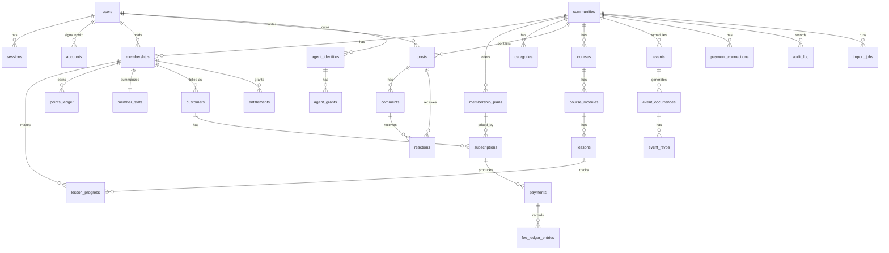

# Data model

Core entities, fields, relationships, and the rules for keys, tenancy, money, indexing, migrations, seeds, and export.

Status: Draft, 2026-10-19

Sketches below use Drizzle-style TypeScript to show shape and intent. They are not final code: helper names, exact column types, and some constraints will change during implementation. Module ownership follows [overview.md](overview.md). Tenancy rules are in [multi-tenancy.md](multi-tenancy.md). Payment semantics are in [payments.md](payments.md).

## 1. Conventions

| Rule | Detail | Label |
|---|---|---|
| Primary keys | UUIDv7, generated in the application (`kernel/ids.ts`), stored as `uuid`. Time ordered, so B-tree inserts stay local and ids sort by creation. | Recommendation (ADR 0010) |
| Tenant column | Every tenant-scoped table has `community_id uuid not null` referencing `communities.id`. Child tables carry it too, even when derivable through a parent. | Recommendation (ADR 0006) |
| Timestamps | `created_at` and `updated_at` as `timestamptz`, always UTC, set by the database default and the repository layer. | Recommendation |
| Soft delete | Only where a requirement asks for it: posts and comments (30 days, REQ-POST-005), communities (14 days, mvp-scope 2.2), users (anonymization flow). Column `deleted_at timestamptz`. Everything else is hard deleted or status driven. | Recommendation |
| Money | Integer minor units (`bigint`) plus ISO 4217 currency code (`char(3)`, lowercase to match Stripe). Never floats, never `numeric` for stored amounts. | Recommendation |
| Rates | Basis points as integers. The Cloud platform fee is `200` (2%) by default; each subscription keeps the rate it was created with. | Recommendation |
| Enums | PostgreSQL enums for small fixed sets owned by one module (role, status). Text with a check constraint when the set is expected to grow often. | Recommendation |
| Naming | snake_case tables in plural, snake_case columns, `<entity>_id` for foreign keys, `<provider>_<object>_id` for external ids (`stripe_subscription_id`). | Recommendation |
| JSON | `jsonb` only for opaque payloads (provider snapshots, event payloads, settings blobs with a Zod schema). Never for fields we filter or join on. | Recommendation |
| Rich text | Stored as sanitized JSON document (editor format) plus a derived plain text column for search and previews. | Recommendation |

```ts
// shared column helpers (sketch)
// packages/db/columns.ts
export const id = () => uuid("id").primaryKey().$defaultFn(uuidv7);
export const tenant = () => uuid("community_id").notNull().references(() => communities.id, { onDelete: "cascade" });
// financial records that outlive their community (migration 0029)
export const detachedTenant = () => uuid("community_id").references(() => communities.id, { onDelete: "set null" });
export const timestamps = {
  createdAt: timestamp("created_at", { withTimezone: true }).notNull().defaultNow(),
  updatedAt: timestamp("updated_at", { withTimezone: true }).notNull().defaultNow(),
};
export const money = (name: string) => bigint(`${name}_minor`, { mode: "number" });
```

`mode: "number"` is safe up to 2^53 minor units. Aggregates are computed in SQL and returned as `bigint` strings.

### 1.1 As built in 0.1.0

Migrations `0000` to `0011` in `packages/db/migrations` create these 30 tables (schema files in `packages/db/src/schema`):

| Module | Tables | Migration |
|---|---|---|
| Identity (Better Auth) | `users`, `sessions`, `accounts`, `verifications` | 0001 |
| Communities and members | `communities`, `memberships`, `invite_links`, `audit_log`, `community_gallery_items` | 0001, 0002, 0003, 0009, 0026, 0028, 0030 |
| Posts and comments | `posts`, `post_images`, `comments`, `reactions` | 0004, 0011 |
| Notifications | `notifications` | 0005 |
| Gamification | `points_ledger`, `member_stats` | 0006 |
| Courses | `courses`, `course_modules`, `lessons`, `lesson_progress` | 0007 |
| Agent material | `lesson_agent_layers`, `course_agent_versions` | 0023 |
| Events | `events`, `event_occurrences`, `event_rsvps` | 0008 |
| Payments | `payment_connections`, `membership_plans`, `payment_customers`, `subscriptions`, `payments`, `fee_ledger_entries`, `provider_events` | 0010 |
| Outbox | `outbox` | 0011 |
| Joining, categories, search | `membership_requests`, `categories` | 0013 |
| Moderation and comped access | `content_reports`, `comped_memberships` | 0014 |
| Linking existing subscriptions | `subscription_links`, `subscriptions.external_price_id` | 0016 |
| Safe exit for paid communities | `payment_exit_runs`, `payment_connections.accepted_owner_id`, `former_community_id` and `former_community_name` on the five financial tables | 0029 |
| OAuth for MCP clients (agents module) | `oauth_clients`, `oauth_grants`, `oauth_authorization_codes`, `oauth_refresh_tokens`, `api_tokens.oauth_grant_id` | 0022 |

Tables that appear only in the sketches below are not built as of 0.12.0: `post_reports` (built as `content_reports`), `custom_domains`, `community_slug_redirects` (built as `community_slug_history`), `join_questions` (built as the `communities.join_questions` jsonb column instead), `entitlements`, `agent_grants` (scopes live on `agent_identities` and `api_tokens`), `import_jobs` (built as `migration_jobs`), and `instance_settings`. The other sketched tables, such as `post_follows`, `notification_preferences`, `api_tokens`, `agent_identities`, `approval_requests`, `webhook_endpoints`, `platform_invoices`, and `platform_invoice_lines`, are built; later sections describe them as built. Sketches keep their shape as the proposal for later phases.

Row level security is enabled and forced on every community scoped table from its first migration (see [multi-tenancy.md](multi-tenancy.md) section 3.4). The platform tables `users`, `sessions`, `accounts`, and `verifications` have no RLS, and neither does `oauth_clients` (0022): a client registers anonymously before any community is chosen, and the row holds only public client metadata (name, redirect URIs, client URI). `oauth_grants`, `oauth_authorization_codes`, and `oauth_refresh_tokens` are community scoped with forced RLS; codes and refresh tokens are found by hash under `app.oauth_secret_hash`, and a person lists their own grants under `app.oauth_grant_owner`. `notifications` and `provider_events` are platform level and use `app.user_id` and `app.payments_webhook` policies instead of `app.community_id`. The application role (`DATABASE_URL`) has neither superuser nor `BYPASSRLS` rights.

## 2. Entity relationship diagram



## 3. Identity (Better Auth)

**Confirmed** Better Auth. **Recommendation:** keep Better Auth's core tables (`user`, `session`, `account`, `verification`) under its expected names but map them to our plural naming through its schema configuration, and add our profile fields to `users`. Exact column names follow the Better Auth Drizzle adapter at implementation time (**Assumption**: the adapter supports custom table names and extra columns).

```ts
export const users = pgTable("users", {
  id: id(),
  email: citext("email").notNull().unique(),
  emailVerified: boolean("email_verified").notNull().default(false),
  name: text("name").notNull(),
  username: citext("username").notNull().unique(),   // global, used in /members/{username}
  image: text("image"),                                // avatar storage key
  bio: text("bio"),
  links: jsonb("links").$type<string[]>(),            // up to 3
  timeZone: text("time_zone").notNull().default("UTC"),// IANA name
  isPlatformAdmin: boolean("is_platform_admin").notNull().default(false),
  deletedAt: timestamp("deleted_at", { withTimezone: true }),
  ...timestamps,
});

export const sessions = pgTable("sessions", {
  id: id(),
  userId: uuid("user_id").notNull().references(() => users.id, { onDelete: "cascade" }),
  tokenHash: text("token_hash").notNull().unique(),
  expiresAt: timestamp("expires_at", { withTimezone: true }).notNull(),
  host: text("host").notNull(),            // platform domain or custom domain, see authorization.md
  ipAddress: inet("ip_address"), userAgent: text("user_agent"),
  ...timestamps,
});
```

`accounts` links credentials and OAuth identities to a user (`provider_id`, `account_id`, `password_hash`, unique on the provider pair). `verification` stores magic link and email verification tokens.

Users are platform-level (not tenant scoped): one account across communities on the same instance (REQ-ID-004).

Implemented first migration (2026-10-18). The tables follow the Better Auth 1.7 Drizzle adapter, so a few fields differ from the sketch above:

| Sketch | Implemented | Why |
|---|---|---|
| `users.username` | Nullable `citext`, unique, with a `lower(username)` prefix index (since 0.1.0) | Email sign up does not collect a username. Members set one on the Account page. Usernames are 3 to 30 lowercase letters, digits, or single hyphens, and a reserved list is refused. |
| `users.bio` | `memberships.bio`, `text`, at most 500 characters (since 0.1.0) | A bio is per community, edited on the member's own profile in that community. |
| `users.links`, `time_zone`, `is_platform_admin` | Not yet created | These columns arrive with the remaining profile and account work. |
| `users.deleted_at` | `deletion_requested_at`, `deletion_scheduled_for`, `erased_at` (migration 0012) | Account deletion has a 14 day grace period before erasure. The row stays after erasure with the name Former member and an `@erased.invalid` address so authored posts and comments keep a valid author. `account_audit_log` (own rows RLS) records deletion requests, cancellations, erasures, and session revocations |
| `sessions.token_hash` | `sessions.token` | The adapter reads and writes the field `token`. Hashing it needs a Better Auth hook or plugin, tracked as an open question below. |
| `sessions.host` | Not yet created | Arrives with custom domain session handling in [authorization.md](authorization.md). |
| `sessions.ip_address inet` | `text` | The adapter stores the address as a string. |
| `verification` | `verifications` | The adapter runs with `usePlural`, matching the plural naming rule. |
| `kernel/ids.ts` | `packages/db/src/ids.ts` | `packages/kernel` does not exist yet. Better Auth uses the same generator through `advanced.database.generateId`, so auth ids are UUIDv7 too. |

`communities.appearance` defaults to `{}` and `communities.level_names` defaults to nine generic names (`Level 1` to `Level 9`) in application code until the default ladder is written.

## 4. Communities and members

```ts
export const communities = pgTable("communities", {
  id: id(),
  slug: citext("slug").notNull().unique(),        // 3 to 48 chars, see information-architecture.md
  name: text("name").notNull(),
  description: text("description"),
  privacy: communityPrivacy("privacy").notNull().default("private"), // private | public
  joinMode: joinMode("join_mode").notNull().default("open"),           // open | approval | invite
  joinQuestions: jsonb("join_questions").$type<string[]>(),   // up to 3
  appearance: jsonb("appearance").$type<Appearance>().notNull(), // accent, logo, cover, font, cardStyle, mode
  gamificationEnabled: boolean("gamification_enabled").notNull().default(true),
  reviewsEnabled: boolean("reviews_enabled").notNull().default(false), // Step 17, migration 0027
  levelNames: jsonb("level_names").$type<string[]>().notNull(), // 9 names
  currency: char("currency", { length: 3 }),       // set when paid, one per community in MVP
  deletedAt: timestamp("deleted_at", { withTimezone: true }),
  ...timestamps,
});

export const memberRole = pgEnum("member_role", ["owner", "admin", "moderator", "member"]);
export const memberStatus = pgEnum("member_status", ["pending", "active", "removed", "banned"]);

export const memberships = pgTable("memberships", {
  id: id(), communityId: tenant(),
  userId: uuid("user_id").notNull().references(() => users.id),
  role: memberRole("role").notNull().default("member"),
  status: memberStatus("status").notNull(),
  joinAnswers: jsonb("join_answers").$type<string[]>(),
  joinedAt: timestamp("joined_at", { withTimezone: true }),
  lastSeenAt: timestamp("last_seen_at", { withTimezone: true }),
  ...timestamps,
}, (t) => [
  unique().on(t.communityId, t.userId),
  uniqueIndex("one_owner_per_community").on(t.communityId).where(sql`role = 'owner'`),
]);
```

Smaller Communities and Members tables:

| Table | Key fields |
|---|---|
| `community_slug_redirects` | `old_slug` (primary key), `community_id`, `expires_at` (at least 12 months) |
| `custom_domains` | `hostname` (unique, normalized), `status` (pending_dns, verified, active, failed), `verification_token`, `verified_at` |
| `invite_links` | `token_hash` (unique), `created_by`, `expires_at`, `revoked_at` |

A guest is the absence of an active membership, not a row. Pending applicants have `status = 'pending'`. Banned people keep the row so rejoin is blocked (REQ-MEM-003).

Membership plans (owned by Subscriptions):

```ts
export const membershipPlans = pgTable("membership_plans", {
  id: id(), communityId: tenant(),
  kind: text("kind").notNull(),                   // "free" | "paid"
  name: text("name").notNull(),
  currency: char("currency", { length: 3 }),
  monthlyPriceMinor: money("monthly_price"),
  annualPriceMinor: money("annual_price"),
  providerProductId: text("provider_product_id"), // Stripe Product on the creator's account
  providerMonthlyPriceId: text("provider_monthly_price_id"),
  providerAnnualPriceId: text("provider_annual_price_id"),
  archivedAt: timestamp("archived_at", { withTimezone: true }), // price changes create a new plan version
  ...timestamps,
});
```

MVP allows one active paid plan per community (partial unique index on `community_id where kind = 'paid' and archived_at is null`). Price changes archive the old plan and create a new one, so existing subscribers keep their price (REQ-SUB-005).

As built: `communities` (migration 0001, RLS in 0003) carries `privacy`, `join_mode`, `currency` (set when a paid plan exists), `appearance` and `appearance_tokens` (jsonb, migration 0009), `archived_at`, and `level_names`; `memberships` (0001, forced RLS in 0002) carries `banned_email` so a ban survives the removal of the row; `invite_links` and the append only `audit_log` arrive in 0009. Migration 0013 adds `invite_links.requires_approval`, stores join questions as `communities.join_questions` (jsonb, up to three `{ text, required }` objects), and adds `membership_requests` (one pending row per person and community, answers paired with the question text at request time, decision note, decider, and time). The `custom_domains` sketch is not built. Migration 0031 builds the slug redirect table as `community_slug_history` instead of the `community_slug_redirects` sketch, without an expiry: `slug` (citext, primary key, so an old slug belongs to one community forever), `community_id` (foreign key with cascade, index on `community_id, changed_at`), and `changed_at`. It also adds `communities.slug_changed_at`, which the communities service uses for the one change per 30 days limit. A `BEFORE INSERT OR UPDATE OF slug` trigger on `communities` takes transaction advisory locks on the old and new slug, refuses a slug that another community used before with the `communities_slug_unique` unique violation, and on a change inserts the old slug into the history. A community may return to one of its own old slugs. Forced RLS lets anyone read the history (old URLs are public addresses that must redirect) and allows inserts only for `app.community_id`; there are no update or delete policies, so a held slug is released only when the community itself is deleted. Migration 0026 (Step 17) adds `communities.detailed_description` (jsonb, the post content document of [ADR 0012](../decisions/0012-post-content-format.md) without images, validated by the communities service) and `community_gallery_items`, owned by the communities module: `community_id` (foreign key with cascade, index on `community_id, position`), `kind` (`image` or `video_embed`), `storage_key` (images, under `communities/{id}/gallery/`) or `embed_url` (the normalized YouTube, Vimeo, or Loom embed URL), `position`, `alt_text` (up to 250 characters), and timestamps. A check constraint allows exactly one of `storage_key` and `embed_url` for the kind. Forced RLS lets anyone read rows (the About page of a private community is public) and allows writes only inside the community with `app.community_manager`. The service caps the gallery at 10 items under a row lock on the community and rewrites every position in one transaction when it reorders. Migration 0028 (Step 17b) adds `community_gallery_items.thumbnail_url` (nullable): the video poster, read once from the Vimeo or Loom oEmbed endpoint when the video is added (fixed hosts, a 3 second timeout, no redirects) and kept only when it is served from the provider's image host. YouTube posters are built from the video id, so older YouTube rows need no backfill; Vimeo and Loom rows without a poster show a provider tile.

Migration 0014 adds `content_reports`, owned by the Posts module: one row per reporter and post or comment (`comment_id` is null for a post report), with `reason` (`spam`, `harassment`, `hate`, `sexual`, `violence`, `other`), an optional note of up to 500 characters, and `status` (`open`, `dismissed`, `content_removed`, `member_banned`) with `resolved_by` and `resolved_at`. Partial unique indexes allow one open report per person and item. Forced RLS lets a reporter insert open reports and read their own rows; reading and resolving needs `app.community_manager`, which the service sets for moderators, admins, and the owner.

As built for posts (0013): `categories` has `name`, `slug` (unique per community), `color` (one of the semantic tokens neutral, accent, info, success, warning, danger), `position`, and `staff_only` instead of the sketched `posting_role`; `posts.category_id` is nullable with `on delete set null`; `posts.last_activity_at` feeds the Active sort; `posts`, `comments`, and `lessons` carry generated `search_vector` columns (`simple` configuration, title weighted above body) with GIN indexes; member search uses expression GIN indexes on `users` (name and username) and `memberships` (bio). There is no `posts.slug` yet; post URLs use the id.

## 5. Posts, comments, reactions

```ts
export const categories = pgTable("categories", {
  id: id(), communityId: tenant(),
  slug: citext("slug").notNull(), name: text("name").notNull(),
  postingRole: memberRole("posting_role").notNull().default("member"), // "admin" for Announcements
  position: integer("position").notNull(),
  ...timestamps,
}, (t) => [unique().on(t.communityId, t.slug)]);

export const posts = pgTable("posts", {
  id: id(), communityId: tenant(),
  categoryId: uuid("category_id").notNull().references(() => categories.id),
  authorId: uuid("author_id").notNull().references(() => users.id),
  slug: text("slug").notNull(),                   // title slug + short random suffix
  title: text("title"),
  body: jsonb("body").notNull(),                  // sanitized editor document
  bodyText: text("body_text").notNull(),          // derived, for search and previews
  media: jsonb("media").$type<MediaRef[]>(),      // up to 10 images, embed refs
  pinnedAt: timestamp("pinned_at", { withTimezone: true }),
  editedAt: timestamp("edited_at", { withTimezone: true }),
  lastActivityAt: timestamp("last_activity_at", { withTimezone: true }).notNull(),
  likeCount: integer("like_count").notNull().default(0),
  commentCount: integer("comment_count").notNull().default(0),
  searchVector: tsvector("search_vector"),        // generated column
  deletedAt: timestamp("deleted_at", { withTimezone: true }),
  ...timestamps,
}, (t) => [
  unique().on(t.communityId, t.slug),
  index().on(t.communityId, t.lastActivityAt.desc(), t.id),
  index().on(t.communityId, t.categoryId, t.lastActivityAt.desc()),
  index().using("gin", t.searchVector),
]);

export const comments = pgTable("comments", {
  id: id(), communityId: tenant(),
  targetType: text("target_type").notNull(),      // "post" now, "lesson" post-MVP
  targetId: uuid("target_id").notNull(),
  parentId: uuid("parent_id"),                    // one reply level, enforced in service
  authorId: uuid("author_id").notNull().references(() => users.id),
  body: jsonb("body").notNull(), bodyText: text("body_text").notNull(),
  likeCount: integer("like_count").notNull().default(0),
  editedAt: timestamp("edited_at", { withTimezone: true }),
  deletedAt: timestamp("deleted_at", { withTimezone: true }),
  ...timestamps,
}, (t) => [index().on(t.communityId, t.targetType, t.targetId, t.createdAt)]);

export const reactions = pgTable("reactions", {   // "like" only in MVP
  id: id(), communityId: tenant(),
  subjectType: text("subject_type").notNull(),    // "post" | "comment"
  subjectId: uuid("subject_id").notNull(),
  userId: uuid("user_id").notNull().references(() => users.id),
  subjectAuthorId: uuid("subject_author_id").notNull(), // denormalized for points and self-like check
  kind: text("kind").notNull().default("like"),
  ...timestamps,
}, (t) => [unique().on(t.subjectType, t.subjectId, t.userId, t.kind)]);
```

As built, `posts` and `comments` also carry `deleted_by` (nullable foreign key to `users`, set null on delete, migration 0011) next to `deleted_at`, so moderators can see who deleted an item.

Also owned by Posts: `post_reports`, `post_follows`, `mentions` (subject, mentioned user). Counters (`like_count`, `comment_count`) are updated in the same transaction as the reaction or comment and recomputed by a repair job if they drift.

## 6. Courses and lessons

```ts
export const courses = pgTable("courses", {
  id: id(), communityId: tenant(),
  slug: citext("slug").notNull(), title: text("title").notNull(),
  description: text("description"), coverKey: text("cover_key"),
  status: text("status").notNull().default("draft"),   // draft | published | archived (archived when deleted with progress)
  position: integer("position").notNull(),
  access: text("access").notNull().default("all_members"), // MVP value only, see mvp-scope 2.5
  ...timestamps,
}, (t) => [unique().on(t.communityId, t.slug)]);

export const courseModules = pgTable("course_modules", {
  id: id(), communityId: tenant(),
  courseId: uuid("course_id").notNull().references(() => courses.id, { onDelete: "cascade" }),
  title: text("title").notNull(), position: integer("position").notNull(),
  ...timestamps,
});

export const lessons = pgTable("lessons", {
  id: id(), communityId: tenant(),
  moduleId: uuid("module_id").notNull().references(() => courseModules.id, { onDelete: "cascade" }),
  courseId: uuid("course_id").notNull(),          // denormalized for slug uniqueness and queries
  slug: citext("slug").notNull(), title: text("title").notNull(),
  bodyMarkdown: text("body_markdown"),
  videoUrl: text("video_url"),                    // allowlisted host
  attachments: jsonb("attachments").$type<AttachmentRef[]>(), // up to 10, 25 MB each
  status: text("status").notNull().default("draft"),
  position: integer("position").notNull(),
  ...timestamps,
}, (t) => [unique().on(t.courseId, t.slug)]);

export const lessonProgress = pgTable("lesson_progress", {
  communityId: tenant(),
  lessonId: uuid("lesson_id").notNull().references(() => lessons.id, { onDelete: "cascade" }),
  courseId: uuid("course_id").notNull(),
  userId: uuid("user_id").notNull().references(() => users.id),
  completedAt: timestamp("completed_at", { withTimezone: true }),
  lastViewedAt: timestamp("last_viewed_at", { withTimezone: true }).notNull(),
}, (t) => [primaryKey({ columns: [t.lessonId, t.userId] }), index().on(t.communityId, t.userId, t.lastViewedAt.desc())]);
```

Positions are integers with gaps (steps of 1024) so reordering touches one row in the common case. A compaction runs when gaps run out.

As built (migration 0007, `packages/db/src/schema/courses.ts`): `courses`, `course_modules`, `lessons`, and `lesson_progress`. Attachments are a jsonb column on `lessons` (storage key, stored filename, size, content type), not a table. RLS lets members read published rows; drafts need the `app.course_manager` setting the service sets for admins and owners, and progress rows need the matching `app.user_id`.

Implementation (migration 0023, since 0.8.0): `lesson_agent_layers` holds one agent layer draft per lesson (`lesson_id` primary key, `community_id`, `course_id`, `layer` jsonb up to 1 MB, `updated_by`), readable and writable only with `app.course_manager`. `course_agent_versions` holds immutable published versions (`id`, `community_id`, `course_id`, `version` with `major`, `minor`, `patch`, unique per course, `changelog`, `snapshot` jsonb up to 3 MB, `checksum` SHA-256 hex, `published_by`, `created_at`). Its RLS allows reads in the community scope and inserts with `app.course_manager`, has no update or delete policy, and the trigger `course_agent_versions_immutable` refuses updates even for the table owner. Both tables have forced RLS and indexes that start with `community_id`. The layer and snapshot format is [agent-course-format.md](agent-course-format.md).

## 7. Events

```ts
export const events = pgTable("events", {
  id: id(), communityId: tenant(),
  slug: citext("slug").notNull(), title: text("title").notNull(),
  description: text("description"),
  startsAtLocal: timestamp("starts_at_local", { withTimezone: false }).notNull(), // wall clock
  timeZone: text("time_zone").notNull(),          // IANA
  durationMinutes: integer("duration_minutes").notNull(),
  recurrence: text("recurrence"),                 // null | "weekly"
  recurrenceUntil: date("recurrence_until"),
  location: text("location"),                     // URL or text, hidden without access
  recordingUrl: text("recording_url"),
  ...timestamps,
}, (t) => [unique().on(t.communityId, t.slug)]);

export const eventOccurrences = pgTable("event_occurrences", {
  id: id(), communityId: tenant(),
  eventId: uuid("event_id").notNull().references(() => events.id, { onDelete: "cascade" }),
  startsAt: timestamp("starts_at", { withTimezone: true }).notNull(), // UTC, computed from local + tz
  endsAt: timestamp("ends_at", { withTimezone: true }).notNull(),
  canceledAt: timestamp("canceled_at", { withTimezone: true }),
}, (t) => [unique().on(t.eventId, t.startsAt), index().on(t.communityId, t.startsAt)]);

export const eventRsvps = pgTable("event_rsvps", {
  communityId: tenant(),
  occurrenceId: uuid("occurrence_id").notNull().references(() => eventOccurrences.id, { onDelete: "cascade" }),
  userId: uuid("user_id").notNull().references(() => users.id),
  status: text("status").notNull(),               // going | not_going
  reminderSentAt: timestamp("reminder_sent_at", { withTimezone: true }), // idempotent reminders
  ...timestamps,
}, (t) => [primaryKey({ columns: [t.occurrenceId, t.userId] })]);
```

Storing the wall clock time plus IANA zone, and computing UTC per occurrence, is what keeps a weekly 18:00 call at 18:00 across daylight saving changes (mvp-scope acceptance criteria).

As built (migration 0008, `packages/db/src/schema/events.ts`): `events`, `event_occurrences`, and `event_rsvps`. An event stores a wall clock start plus an IANA zone, occurrences store UTC, and the worker generates occurrences 26 weeks ahead. Event and occurrence writes need the `app.calendar_manager` setting, RSVP writes need the matching `app.user_id`, and the worker's `app.calendar_jobs` setting allows only the occurrence scan and the reminder claim. RSVPs of people whose membership is no longer active stay stored but count for nothing: the reminder claim, the going list, and the going count read only RSVPs of active members (security audit run 1, 2026-10-21), so a removed or banned member gets no reminder and an RSVP comes back only if the person becomes a member again.

## 8. Gamification

```ts
export const pointsLedger = pgTable("points_ledger", {   // append-only
  id: id(), communityId: tenant(),
  userId: uuid("user_id").notNull().references(() => users.id),
  delta: integer("delta").notNull(),               // +1 like, -1 unlike or delete, -N admin reset
  reason: text("reason").notNull(),                // like_received | like_removed | admin_reset
  sourceType: text("source_type"), sourceId: uuid("source_id"),
  occurredAt: timestamp("occurred_at", { withTimezone: true }).notNull(),
}, (t) => [
  index().on(t.communityId, t.occurredAt),
  uniqueIndex().on(t.sourceType, t.sourceId, t.reason),  // one entry per reaction event
]);

export const memberStats = pgTable("member_stats", {    // projection, rebuildable from the ledger
  communityId: tenant(),
  userId: uuid("user_id").notNull().references(() => users.id),
  pointsTotal: integer("points_total").notNull().default(0),
  level: smallint("level").notNull().default(1),   // 1 to 9, thresholds in code (mvp-scope 2.7)
  updatedAt: timestamp("updated_at", { withTimezone: true }).notNull(),
}, (t) => [primaryKey({ columns: [t.communityId, t.userId] }), index().on(t.communityId, t.pointsTotal.desc())]);
```

The 7-day leaderboard sums `points_ledger` over the window with the `(community_id, occurred_at)` index. Level names live on `communities.level_names`. Thresholds are code constants in MVP.

Implemented in 0.1.0 (migration `0006_gamification_and_member_profiles.sql`). `points_ledger.reason` is the enum `points_reason` (`like_received`, `like_removed`, `post_deleted`, `comment_deleted`, `admin_reset`), the delta is never zero, and a partial unique index allows one reversal per source. `member_stats` has a `(community_id, points_total desc, updated_at, user_id)` leaderboard index, a `(community_id, level)` index for the level filter, and a level check of 1 to 9. Both tables have forced RLS on `app.community_id`. Default level names are "Level 1" to "Level 9" until a creator renames them.

### 8.1 Reviews

Added in Step 17 (migration `0027_reviews.sql`, owned by `@cohory/reviews`, [ADR 0025](../decisions/0025-reviews-module-boundary.md)).

```ts
export const reviews = pgTable("reviews", {
  id: id(), communityId: tenant(),
  authorId: uuid("author_id").references(() => users.id, { onDelete: "set null" }),
  membershipId: uuid("membership_id").references(() => memberships.id, { onDelete: "set null" }),
  rating: smallint("rating").notNull(),            // check 1 to 5
  body: text("body").notNull(),                    // check 20 to 2000 characters
  editedAt, hiddenAt, hiddenReason,                // review_hidden_reason: spam | abuse | personal_data | off_topic
  hiddenBy: uuid("hidden_by"),                     // the owner
  authorRemovedAt,                                 // set by the membership trigger on a staff removal or ban
  anonymizedAt,                                    // set by account erasure
  ...timestamps,
}, (t) => [
  unique().on(t.communityId, t.authorId),          // one review per member per community
  index().on(t.communityId, t.createdAt.desc(), t.id.desc()),
  index().on(t.communityId, t.rating),
]);

export const reviewReplies = pgTable("review_replies", {  // one public owner reply per review
  id: id(), communityId: tenant(),
  reviewId: uuid("review_id").notNull().references(() => reviews.id, { onDelete: "cascade" }), // unique
  authorId: uuid("author_id"), body: text("body").notNull(), editedAt, ...timestamps,
});

export const reviewReports = pgTable("review_reports", {
  id: id(), communityId: tenant(),
  reviewId, reporterId, reason: reportReason("reason"), note,   // note up to 500 characters
  status: reviewReportStatus("status"),            // open | dismissed | hidden
  resolvedBy, resolvedAt, ...timestamps,
});
```

All three tables have forced RLS on `app.community_id`. `reviews_account_purge` and `review_reports_account_purge` let account erasure, under `app.account_purge`, mark the person's reviews anonymized and clear the notes on their reports in every community. The trigger `memberships_review_standing` (function `cohory_reviews_author_standing`, security definer so callers need no grant on `reviews`) sets `author_removed_at` when a membership becomes `banned`, or `removed` while `app.member_removal_reason` is `removed` (staff removal), and clears it when the membership becomes `active` again. A visible review has no `hidden_at` and no `author_removed_at`. The reviewer status ("Paying member for N months" or "Former member") is not stored; it is computed on read from Payments.

## 9. Payments, subscriptions, ledger

Semantics are in [payments.md](payments.md). The shapes below are as built in migration 0010 (`packages/db/src/schema/payments.ts`, see [payments.md](payments.md) section 13); the earlier sketch is replaced. Money columns are `bigint` minor units named `*_minor`, and currency columns are three lowercase letters.

```ts
export const paymentProvider = pgEnum("payment_provider", ["stripe_connect", "stripe_own_keys"]);
export const paymentConnectionStatus = pgEnum("payment_connection_status", ["onboarding", "active", "restricted", "disconnected"]);
export const subscriptionAccessState = pgEnum("subscription_access_state", ["none", "granted", "grace", "revoked"]);
export const planInterval = pgEnum("plan_interval", ["month", "year"]);
export const feeLedgerKind = pgEnum("fee_ledger_kind", ["fee_accrued", "fee_collected", "fee_refunded", "adjustment", "invoice_settled"]);
export const feeCollectionMethod = pgEnum("fee_collection_method", ["automatic_split", "periodic_invoice"]);

export const paymentConnections = pgTable("payment_connections", {
  id: id(), communityId: tenant(),
  provider: paymentProvider("provider").notNull(),
  externalAccountId: text("external_account_id"),           // acct_... for Connect
  encryptedSecret: text("encrypted_secret"),                // own keys only, AES-256-GCM
  webhookSecretEncrypted: text("webhook_secret_encrypted"), // own keys only
  status: paymentConnectionStatus("status").notNull(),
  chargesEnabled: boolean("charges_enabled").notNull().default(false),
  detailsSubmitted: boolean("details_submitted").notNull().default(false),
  livemode: boolean("livemode").notNull().default(false),
  disconnectedAt: timestamp("disconnected_at", { withTimezone: true }),
  ...timestamps,
}); // one open connection per community, one open connection per external account

export const membershipPlans = pgTable("membership_plans", {
  id: id(), communityId: tenant(),
  connectionId: uuid("connection_id").notNull().references(() => paymentConnections.id),
  name: text("name").notNull(),                             // 1 to 80 characters
  currency: char("currency", { length: 3 }).notNull(),
  monthlyPriceMinor: bigint("monthly_price_minor").notNull(), // > 0
  annualPriceMinor: bigint("annual_price_minor"),             // null or > 0
  providerProductId: text("provider_product_id"),
  providerMonthlyPriceId: text("provider_monthly_price_id"),
  providerAnnualPriceId: text("provider_annual_price_id"),
  archivedAt: timestamp("archived_at", { withTimezone: true }), // a price change archives and versions the plan
  ...timestamps,
}); // one active (not archived) plan per community

export const paymentCustomers = pgTable("payment_customers", {
  id: id(), communityId: tenant(),
  userId: uuid("user_id").notNull().references(() => users.id),
  connectionId: uuid("connection_id").notNull().references(() => paymentConnections.id),
  externalCustomerId: text("external_customer_id").notNull(), // cus_... on the creator's account
  ...timestamps,
}); // unique (connection_id, external_customer_id)

export const subscriptions = pgTable("subscriptions", {      // mirror of provider objects
  id: id(), communityId: tenant(),
  userId: uuid("user_id").notNull().references(() => users.id),
  customerId: uuid("customer_id").notNull().references(() => paymentCustomers.id),
  connectionId: uuid("connection_id").notNull().references(() => paymentConnections.id),
  planId: uuid("plan_id").references(() => membershipPlans.id),
  externalSubscriptionId: text("external_subscription_id").notNull(), // unique
  providerStatus: text("provider_status").notNull(),        // raw Stripe status
  accessState: subscriptionAccessState("access_state").notNull(),
  interval: planInterval("interval"),
  currentPeriodEnd: timestamp("current_period_end", { withTimezone: true }),
  cancelAtPeriodEnd: boolean("cancel_at_period_end").notNull().default(false),
  endedAt: timestamp("ended_at", { withTimezone: true }),
  applicationFeeBps: integer("application_fee_bps").notNull(), // 0 to 10000
  origin: text("origin").notNull().default("created_by_cohory"), // or linked_import
  externalPriceId: text("external_price_id"),                // 0016, Stripe price of the first item
  providerFetchedAt: timestamp("provider_fetched_at", { withTimezone: true }).notNull(),
  ...timestamps,
});

export const payments = pgTable("payments", {              // one row per paid invoice
  id: id(), communityId: tenant(),
  subscriptionId: uuid("subscription_id").references(() => subscriptions.id),
  externalInvoiceId: text("external_invoice_id").notNull(), // unique
  externalPaymentIntentId: text("external_payment_intent_id"),
  currency: char("currency", { length: 3 }).notNull(),
  amountMinor: bigint("amount_minor").notNull(),
  taxMinor: bigint("tax_minor").notNull().default(0),
  refundedMinor: bigint("refunded_minor").notNull().default(0), // between 0 and amount
  occurredAt: timestamp("occurred_at", { withTimezone: true }).notNull(),
  ...timestamps,
});

export const feeLedgerEntries = pgTable("fee_ledger_entries", { // append only
  id: id(), communityId: tenant(),
  paymentId: uuid("payment_id").references(() => payments.id),
  kind: feeLedgerKind("kind").notNull(),
  provider: paymentProvider("provider").notNull(),
  collectionMethod: feeCollectionMethod("collection_method").notNull(),
  currency: char("currency", { length: 3 }).notNull(),
  baseMinor: bigint("base_minor").notNull(),
  rateBps: integer("rate_bps").notNull(),                  // 0 to 10000
  computedFeeMinor: bigint("computed_fee_minor").notNull(), // cohory's calculation, negative for fee_refunded
  providerFeeMinor: bigint("provider_fee_minor"),          // Stripe's figure
  externalRef: text("external_ref"),
  idempotencyKey: text("idempotency_key").notNull(),       // unique, for example fee:collected:{feeId}
  occurredAt: timestamp("occurred_at", { withTimezone: true }).notNull(),
  createdAt: timestamp("created_at", { withTimezone: true }).notNull().defaultNow(),
});

export const providerEvents = pgTable("provider_events", {  // platform level webhook inbox
  id: id(),
  provider: paymentProvider("provider").notNull(),
  externalEventId: text("external_event_id").notNull(),    // unique with provider
  externalAccountId: text("external_account_id"),
  connectionId: uuid("connection_id").references(() => paymentConnections.id, { onDelete: "set null" }),
  communityId: uuid("community_id").references(() => communities.id, { onDelete: "set null" }),
  type: text("type").notNull(),
  livemode: boolean("livemode").notNull(),
  payloadHash: text("payload_hash").notNull(),             // SHA-256 of the body, never the payload
  attempts: integer("attempts").notNull().default(0),
  receivedAt: timestamp("received_at", { withTimezone: true }).notNull().defaultNow(),
  claimedAt: timestamp("claimed_at", { withTimezone: true }), // two minute processing lease
  processedAt: timestamp("processed_at", { withTimezone: true }),
  error: text("error"),
});
```

Tables: `payment_connections`, `membership_plans`, `payment_customers` (the `customers` table of the earlier sketch), `subscriptions`, `payments` (one row per paid invoice, keyed by invoice id), `fee_ledger_entries`, and `provider_events`. The webhook inbox stores the event id, type, account, mode, and a SHA-256 hash of the body, never the payload. The ledger has no delete policy and, since migration 0029, one update policy that applies only under `app.payments_detach` (the snapshot written before a community is deleted), so in every other path the application role can only append.

Migration 0014 adds `comped_memberships`: free access granted by an owner or admin, with an optional note, optional `expires_at`, and `ended_at`, `end_reason` (`revoked` or `expired`), and `ended_by`. A partial unique index keeps one open grant per person and community. Reads follow `subscriptions` (own rows or a manager), writes need `app.payments_manager`, and the hourly expiry job uses `app.payments_webhook`.

Migration 0016 adds `subscriptions.external_price_id` and `subscription_links`, the ledger of "Bring your existing subscribers": one row per Stripe subscription (unique `external_subscription_id`) with the connection, Stripe customer and price ids, the customer email (`citext`), the plan and interval the creator mapped it to, `status` (`linked` or `invited`), the member and mirror row once linked, the platform fee the creator chose (`application_fee_bps`, 0 by default), `created_by`, and `linked_at`. Linked subscriptions keep `origin = linked_import` on the mirror. Only managers read or write it (`app.payments_manager`); claims by invited people run in the service's system scope.

Row level security is forced on every table. Reads stay in the community (`payment_customers` and `subscriptions` only for the member's own rows or a manager; `payments` and `fee_ledger_entries` only for managers). Writes need the `app.payments_manager` setting, which the service sets for owners and admins or for webhook processing. The `app.payments_webhook` setting allows only the inbox and the lookup of a connection by Stripe account.

The subscription mirror stores `access_state` (`none`, `granted`, `grace`, `revoked`). Entitlements are derived on read from the membership row, the subscription mirror, and whether a plan is active; there is no `entitlements` table yet (section 10). Reconciliation and refunds started from cohory are not built ([payments.md](payments.md) section 13.6); comp grants are built as `comped_memberships` (migration 0014). Since [0028](../decisions/0028-stripe-disputes.md) `payments` carries `dispute_status` (`open`, `won`, `lost`) and `disputed_at`, and a `fee_refunded` ledger entry can carry `reason = dispute_lost`. Since Step 18 a subscription on a `disconnected` connection grants access only until the later of its `current_period_end` and the connection's `disconnected_at`; the closed billing sweep then sets its `access_state` to `revoked` ([payments.md](payments.md) section 13.8).

Platform billing for BYO ledger balances (built in 0.5.0, migration 0018) adds `platform_invoices` (community, period, currency, total, status, external invoice id) and `platform_invoice_lines` (invoice, ledger entry).

Migration 0029 (Step 18) prepares safe exits for paid communities. It added the schema first; the exit engine, dialogs, and deletion flow that use it are built in the same step ([payments.md](payments.md)).

- `payment_connection_status` gains `disconnecting`. The partial unique indexes on `status <> 'disconnected'` treat it as open, so a community still has one open connection while a disconnect runs.
- `payment_connections.accepted_owner_id` (foreign key to `users`, set null) records which owner accepted the connection. The migration backfills it from each community's active owner, with row level security set to `no force` on `payment_connections` and `memberships` for that statement so the backfill also works when the schema owner is not a superuser.
- `payment_exit_runs` (owned by Payments) holds one exit action on paid members: `kind` (`archive`, `disconnect`, `delete`), `choice` (`stop_at_period_end`, `keep_billing`, `take_members`, `wind_down`, `cancel_now`), `include_linked`, `status` (`pending`, `running`, `failed`, `done`), `attempts`, `target_count`, `done_count`, `failed_subscription_ids`, the optional `portal_login_url`, `requested_by`, `manual_cancellation_confirmed_at`, and `finished_at`. The partial unique index `payment_exit_runs_one_unfinished` on `community_id` where the status is `pending` or `running` allows one unfinished run per community. Forced RLS: only `app.payments_manager` (owners and admins) reads and writes in the community, because a run holds failed subscription ids, the requester, and the portal login link, and `app.payments_webhook` lets the exit job read and update runs.
- `subscriptions` gains `subscriptions_own_rows` (a person reads their own subscriptions in every community when `app.user_id` is set, for the account billing page) and `subscriptions_exit_jobs` (`app.payments_webhook` reads every subscription, for exit and closed billing sweeps). Neither policy allows writes. The index `subscriptions_user_idx` serves the cross community read.
- Financial records outlive their community. `payments`, `fee_ledger_entries`, `platform_billing_accounts`, `platform_invoices`, and `platform_invoice_lines` use `detachedTenant()`: `community_id` is nullable with `on delete set null`, and each table has `former_community_id` and `former_community_name` with the check `<table>_community_or_former` (`community_id is not null or former_community_id is not null`) and the check `<table>_former_matches` (the snapshot names the row's own community). Deleting a community whose financial rows carry no snapshot fails on that check, so the snapshot must be written first. Community deletion writes it in the same transaction as the delete (payments `prepareCommunityDeletion`, called by communities), and a check violation that still happens there is reported as `deletion_conflict` instead of an internal error. `payments.subscription_id` becomes `on delete set null` because subscriptions still cascade. `platform_billing_issues` keeps cascading.
- Writing the snapshot needs the `app.payments_detach` setting: each of the five tables has an update policy `<table>_detach` limited to the current community. The fee ledger keeps no other update policy. A `before update` trigger (`<table>_detach_guard`, function `financial_record_guard`) also protects the records for every role, the schema owner included: the snapshot can only go from null to a value, `community_id` can only become null (the foreign key action), a detached row cannot change, and an update that writes the snapshot, runs under `app.payments_detach`, or touches the fee ledger may change nothing but the snapshot, `community_id`, `updated_at`, and a `subscription_id` set to null by its foreign key.
- `notification_type` gains `paid_membership_changed` and `ownership_transferred`, `notification_subject_type` gains `community`, and `notifications_post_subject` accepts `community` subjects without a post.

## 10. Entitlements

```ts
export const entitlements = pgTable("entitlements", {
  id: id(), communityId: tenant(),
  userId: uuid("user_id").notNull().references(() => users.id),
  resourceType: text("resource_type").notNull(),  // "community" in MVP; "course", "event" post-MVP
  resourceId: uuid("resource_id"),                // null means the whole community
  source: text("source").notNull(),               // free_membership | subscription | comp | purchase | level
  sourceId: uuid("source_id"),
  grantedBy: uuid("granted_by"),                  // comp grants: who and why
  reason: text("reason"),
  startsAt: timestamp("starts_at", { withTimezone: true }).notNull(),
  endsAt: timestamp("ends_at", { withTimezone: true }),          // null = open-ended
  revokedAt: timestamp("revoked_at", { withTimezone: true }),
  ...timestamps,
}, (t) => [index().on(t.communityId, t.userId, t.resourceType), unique().on(t.source, t.sourceId, t.resourceType, t.resourceId)]);
```

Delegated agent entitlements (REQ-ENT-004) were built in 0.8.0 without this table and without copying the person's entitlement ([ADR 0022](../decisions/0022-delegated-entitlements.md)). Migration 0024, in `packages/db/src/schema/delegations.ts`, owned by `@cohory/entitlements`, all with forced row level security:

- `course_agent_settings`: `course_id` (primary key), `community_id`, `allow_agent_access` (default false), `license_id` (`personal_agents` default, `team_agents`, or `custom`), `license_text` (up to 2,000 characters, required for `custom`), `updated_by`, timestamps.
- `course_delegations`: `community_id`, `course_id`, `human_id`, `agent_id`, `granted_at`, `expires_at` (default 30 days after creation), `renewed_at`, `revoked_at` with `revoked_reason` (`revoked`, `expired`, `access_ended`, `agent_inactive`, `agent_access_off`) and `revoked_by`, `expiry_notice_at`, timestamps. One live delegation per course and agent (partial unique index where `revoked_at` is null).
- `agent_submissions`: `community_id`, `course_id`, `lesson_id`, `task_id`, and `version` (text, no foreign keys to agent material tables), `agent_id`, `human_id`, `delegation_id`, `run_id`, `payload` (JSON up to 64 KiB), `label` (`self_reported`), `created_at`; unique on `(community_id, agent_id, run_id, task_id)`.

The course columns reference `courses (community_id, id)` through a composite foreign key (the migration adds that unique key to `courses`), so a row can never point at another community's course.

## 11. Notifications

Implemented in 0.1.0 in `packages/db/src/schema/notifications.ts`. The sketch with a `group_key` and a `data` JSON column was replaced by one row per recipient, type, subject, and actor. Text is rendered at read time from the type and the actor name, so nothing user visible is stored.

```ts
export const notificationType = pgEnum("notification_type", [
  "mention", "reply", "comment_on_post", "like_on_post", "like_on_comment",
]);
export const notificationSubjectType = pgEnum("notification_subject_type", ["post", "comment"]);

export const notifications = pgTable("notifications", {
  id: id(), communityId: tenant(),
  userId: uuid("user_id").notNull().references(() => users.id),       // recipient
  actorId: uuid("actor_id").notNull().references(() => users.id),     // who commented, replied, or mentioned
  type: notificationType("type").notNull(),
  subjectType: notificationSubjectType("subject_type").notNull(),
  subjectId: uuid("subject_id").notNull(),                            // the comment or post itself
  postId: uuid("post_id").notNull().references(() => posts.id, { onDelete: "cascade" }), // where a click lands
  readAt: timestamp("read_at", { withTimezone: true }),
  createdAt: timestamp("created_at", { withTimezone: true }).notNull().defaultNow(),
}, (t) => [
  index().on(t.userId, t.readAt, t.createdAt.desc()),
  index().on(t.communityId, t.postId),
  uniqueIndex().on(t.userId, t.type, t.subjectId, t.actorId).where(sql`${t.readAt} is null`),
]);
```

Rules:

- Rows are written only by the `notifications.fanout` job inside `runInCommunity`, so the insert policy checks `community_id` like every tenant table. Reads and updates use a second policy on `user_id = current_setting('app.user_id')`, which lets the bell list one user's rows across communities in one query.
- The partial unique index keeps one unread row per recipient, type, subject, and actor, so repeated job deliveries do not duplicate.
- The `like_on_post` and `like_on_comment` values exist in the enum for grouped like notifications later. The fan-out does not create them yet, and the list and unread count only return `mention`, `reply`, and `comment_on_post`.
- `event_created` and `event_reminder` rows are written by the Calendar notifier (`createCalendarNotifier` in `@cohory/notifications`), not by the fan-out: one per active member with access (`communityAccessIn`) for a new event when the creator asked to tell members, and one per RSVP'd member with access for the one hour reminder (subject is the occurrence). Neither row is written for a member who turned the type off in the app. The reminder email is sent by the calendar job itself, so the notifier records an email row in `notification_deliveries` as sent or skipped and the generic email pipeline never sends it again. `approval` is not built.

Migration 0012 (0.3.0) added email delivery and preferences, all with forced RLS:

| Table | Key | Purpose |
|---|---|---|
| `notification_preferences` | `(user_id, type)` | `in_app` boolean and `email` (`immediate`, `daily`, `off`) per notification type. A missing row means the default in `packages/notifications/src/preferences.ts` |
| `notification_settings` | `user_id` | `digest_hour` (0 to 23), `time_zone` (IANA name), `last_digest_at` |
| `notification_deliveries` | unique `(notification_id, channel)` | One row per notification and channel (`email`) with outcome `sent` or `skipped`. The unique index is the idempotency claim; a failed send deletes the row |

Policies: own rows on `user_id = app.user_id` for all three, plus a select only policy behind `app.notification_jobs = 'on'` (also on `notifications`) so the email job can find recipients across users. `notifications` also gained an own rows delete policy for account erasure.

Migration 0014 adds the subject type `membership_request` and the types `join_request` (sent to moderators, admins, and the owner), `join_request_approved`, and `join_request_declined` (sent to the person who asked). `notifications.post_id` became nullable; the check `notifications_post_subject` keeps it required for post and comment subjects.

## 12. Agent integrations and audit

```ts
export const apiTokens = pgTable("api_tokens", {        // Phase 6 for external use
  id: id(), communityId: tenant(),
  ownerUserId: uuid("owner_user_id").notNull().references(() => users.id),
  agentId: uuid("agent_id").references(() => agentIdentities.id),
  name: text("name").notNull(),
  tokenHash: text("token_hash").notNull().unique(),  // shown once, stored hashed
  prefix: text("prefix").notNull(),                  // "chy_live_ab12" for display
  scopes: text("scopes").array().notNull(),          // no wildcard
  expiresAt: timestamp("expires_at", { withTimezone: true }),
  lastUsedAt: timestamp("last_used_at", { withTimezone: true }),
  revokedAt: timestamp("revoked_at", { withTimezone: true }),
  ...timestamps,
});

export const auditLog = pgTable("audit_log", {         // append-only
  id: id(),
  communityId: uuid("community_id"),               // null for platform actions
  actorType: text("actor_type").notNull(),         // user | agent | system | platform_admin
  actorUserId: uuid("actor_user_id"), actorAgentId: uuid("actor_agent_id"),
  tokenId: uuid("token_id"), via: text("via").notNull(),  // web | api | mcp | job
  action: text("action").notNull(),                // "member.role_changed"
  targetType: text("target_type"), targetId: uuid("target_id"),
  metadata: jsonb("metadata"),                     // before and after for settings, never secrets
  ipHash: text("ip_hash"),
  occurredAt: timestamp("occurred_at", { withTimezone: true }).notNull().defaultNow(),
}, (t) => [index().on(t.communityId, t.occurredAt.desc())]);
```

Phase 6 tables, all tenant scoped:

| Table | Key fields |
|---|---|
| `agent_identities` | `owner_user_id`, `name`, `description`, `client_id` (OAuth client for MCP), `status` (active, suspended, revoked) |
| `agent_grants` | `agent_id`, `scope`, `requires_approval`, `granted_by`, `expires_at`. Unique `(agent_id, scope)`. |
| `approval_requests` | `requested_by_agent_id` or `requested_by_user_id`, `action`, `input` (jsonb), `status` (pending, approved, rejected, expired, executed), `decided_by`, `decided_at`, `expires_at` |
| `webhook_endpoints` | `url`, `event_types`, `secret_encrypted`, `status`, `failure_count` |

## 13. Migration and import jobs

```ts
export const importJobs = pgTable("import_jobs", {    // post-MVP; exports reuse it with kind
  id: id(), communityId: tenant(),
  kind: text("kind").notNull(),                    // export_bundle | import_bundle | csv_members | skool | circle | stripe_link
  status: text("status").notNull(),                // queued | running | needs_review | completed | failed | canceled
  requestedBy: uuid("requested_by").notNull(),
  sourceKey: text("source_key"), resultKey: text("result_key"),  // storage keys
  progress: jsonb("progress").$type<{ done: number; total: number }>(),
  report: jsonb("report"),                         // counts, skipped rows, mapping decisions
  ...timestamps,
});
```

`import_id_map` (`community_id`, `source_type`, `source_id`, `target_id`, primary key on the first three) makes re-running an import idempotent. Also platform-level: `outbox_events` (built as `outbox`, see below and [overview.md](overview.md) section 8), `instance_settings`, and the queue's own tables (pg-boss schema).

As built (migration 0011, [ADR 0014](../decisions/0014-transactional-outbox.md)):

```ts
export const outbox = pgTable("outbox", {
  id: id(),
  communityId: uuid("community_id").references(() => communities.id, { onDelete: "cascade" }), // null for platform events
  topic: text("topic").notNull(),                 // "post_events"
  payload: jsonb("payload").notNull(),            // { events: PostEvent[] }
  attempts: integer("attempts").notNull().default(0),
  lastError: text("last_error"),                  // error name only
  publishedAt: timestamp("published_at", { withTimezone: true }),
  createdAt: timestamp("created_at", { withTimezone: true }).notNull().defaultNow(),
}, (t) => [
  index("outbox_community_idx").on(t.communityId, t.createdAt),
  index("outbox_pending_idx").on(t.createdAt, t.id).where(sql`published_at is null`),
  index("outbox_published_idx").on(t.publishedAt).where(sql`published_at is not null`),
]);
```

Row level security is forced. Inserts must match `app.community_id` or carry a null `community_id`. Reads, updates, and deletes need `app.outbox_relay = 'on'`, which only the relay sets.

## 14. Indexing rules

**Recommendation.**

1. Every tenant-scoped index starts with `community_id`, unless the table is always reached through a unique external id (`external_charge_id`).
2. Every foreign key has an index on the referencing column (PostgreSQL does not create one automatically).
3. Feed and list queries use cursor pagination on `(community_id, sort_column desc, id)` with a matching composite index. No `OFFSET` on large tables.
4. Partial indexes for soft-deleted tables (`where deleted_at is null`) on the hot paths.
5. Full-text search uses generated `tsvector` columns with GIN indexes on posts, comments, lessons (title), and members (name, username).
6. Unique constraints express business rules (one owner, one membership per user per community, one points entry per reaction, one provider event per id) instead of relying on application checks.
7. An index that serves an `order by x desc` must say `desc nulls first` (the PostgreSQL default for `desc`). Drizzle's `.desc()` alone emits `DESC NULLS LAST`, which the planner cannot use for `order by x desc`, so write `.desc().nullsFirst()`.

### 14.1 As built in migration 0034

Indexes from the Postgres review (2026-10-21):

| Index | Serves |
|---|---|
| `comments_post_id_idx` on `comments (post_id)`, `notifications_post_id_idx` on `notifications (post_id) where post_id is not null` | The cascade when a post is deleted. Before, each deleted post scanned both tables |
| `notifications_user_created_idx` on `notifications (user_id, created_at desc, id desc)` | The bell list and its keyset cursor. `notifications_user_unread_idx` stays for the unread count |
| `memberships_community_directory_idx` on `memberships (community_id, coalesce(joined_at, created_at) desc, id desc) where status = 'active'` | The member directory and the Manage members list, both keyset paged on that expression |
| `points_ledger_admin_reset_idx` on `points_ledger (community_id, user_id, occurred_at desc) where reason = 'admin_reset'` | The 7 day leaderboard, which now finds each member's last reset once in a CTE instead of once per ledger row |
| Foreign key indexes: `payments (subscription_id)`, `subscriptions (customer_id)`, `(connection_id)`, `(plan_id)`, `fee_ledger_entries (payment_id)`, `membership_plans (connection_id)`, `provider_events (connection_id)`, `notifications (actor_id)`, `audit_log (actor_id)`, `invite_links (created_by)` | Deleting or detaching the parent row without a scan of the child table. Nullable columns use a partial index `where col is not null` |
| `webhook_deliveries_endpoint_idx` rebuilt as `(community_id, endpoint_id, created_at desc nulls first, id desc nulls first)` | The delivery log, which sorts `created_at desc, id desc`. The old index said `nulls last` and could not serve that sort |
| `communities_purge_queue_idx` on `communities (purge_attempted_at nulls first, deleted_at, id) where deleted_at is not null` | Ordering the `communities.purge-deleted` job by its last attempt |

Member full text search runs the name match (`users_search_idx`) and the bio match (`memberships_bio_search_idx`) as two branches of a `union`, so each can use its GIN index. `points_ledger.source_type` has the check `points_ledger_source_type_known` (null, `reaction`, `points_reset`, or `points_reset_member`, from `pointsSourceTypes` in the schema). The archive import keeps ledger rows with any other source type but clears their `source_type` and `source_id`.

Policies: `points_ledger_community_purge` (delete) and `notifications_community_purge` with `notifications_community_purge_scan` (delete and select) allow the purge job to remove a community's ledger and notification rows in batches when `app.community_id` matches and `app.community_purge = 'on'`. The job sets `purge_attempted_at` on every attempt, picks communities by oldest attempt first (never tried first), and deletes comments, reactions, notifications, ledger rows, and posts in batches before the community row.

The relay lease: `outbox.claimed_until`. The relay claims up to 100 pending rows whose lease is empty or past in a short transaction (`for update skip locked`, then sets the lease to 60 seconds ahead), publishes outside any transaction, and then marks each row published or failed and clears the lease. Since 0035 that last update matches on the relay's own `claimed_until`, so a relay whose publish outlasted its lease leaves the row to the relay that took it over instead of clearing that relay's lease or overwriting its attempt count, and leaves that publish out of its published and failed counts. A relay that dies leaves rows that another relay takes once the lease runs out, so delivery stays at least once.

Added as expand schema ahead of the features that use them. As of 0.12.0 the application reads and writes all of them:

| Table or column | Shape |
|---|---|
| `communities.what_you_get` (jsonb, up to 6 strings), `host_bio` (up to 600 characters), `host_credential` (up to 120), `faq` (jsonb, up to 8 `{ q, a }`) | About page blocks. Zod schemas `whatYouGetSchema` and `faqSchema` live next to the table |
| `communities.setup_checklist_hidden_at`, `setup_import_skipped_at`, `about_previewed_at`, `invite_link_copied_at`, `test_checkout_succeeded_at` | Setup checklist steps that real data cannot answer |
| `communities.purge_attempted_at` | Last attempt of the purge job |
| `invite_links.label` | Optional name of up to 60 characters |
| `membership_plans.connection_id` nullable | A draft plan saved before a payment connection exists |
| `pending_join_answers` | `(community_id, user_id)` primary key, `answers` (jsonb, up to three `{ question, answer }`), timestamps. Answers given before checkout, to attach to the membership on activation. Forced RLS: the person's own rows in the community, the payments webhook setting in the community, and account purge |
| `webhook_endpoints.previous_secret_ciphertext`, `previous_secret_expires_at` | The secret kept during a roll; both set or both null |
| `webhook_delivery_attempts` | `community_id`, `delivery_id` (cascade), `attempted_at`, `request_headers`, `request_body`, `response_status`, `response_body_excerpt` (up to 2048 characters), `error_code`, `duration_ms`. Indexes on `(community_id, delivery_id, attempted_at desc)` and `(delivery_id)`. Forced RLS like the other webhook tables |
| `api_tokens.last_used_via` (`audit_via`), `expiry_notified_at` | How a token was last used, and when the 7 day expiry notice went out |
| `notification_type` values `member_joined`, `report_created`, `event_created`, `event_reminder`, `paid_member_joined`, `paid_member_canceled`, `member_payment_failed`, `token_expiring`; `notification_subject_type` values `report`, `event`, `api_token` | New notifications. `notifications_post_subject` accepts the new subject types without a post |
| `notification_settings.weekly_digest` (default true), `last_weekly_digest_at` | The weekly digest switch. Event reminders use the `event_reminder` preference row |
| `email_log` | Global: `template`, `recipient_hash` (sha256 hex), `status` (`sent`, `failed`, `suppressed`), `error_code`, `created_at` |
| `email_suppressions` | `address_hash`, optional `community_id` (cascade), `reason` (`hard_bounce`, `complaint`, `manual`, `opt_out`), `source` (`smtp`, `webhook`, `operator`, `member`). One instance wide row and one row per community per address. Read and written only by `@cohory/email` (`createDbSuppressionList`), which the shared mailer checks before every non security send ([0035](../decisions/0035-email-suppression-and-delivery-headers.md)) |

Both email tables have forced RLS behind `app.email_delivery = 'on'`. New check constraints on existing tables are added `NOT VALID`; a later migration validates them. Indexes are built without `CONCURRENTLY`, because the migrator runs all pending migrations in one transaction.

### 14.2 As built in migration 0035

Index fixes, each checked with `EXPLAIN ANALYZE` on 2,000 communities with 400,000 posts (150,000 in one community), 1,000,000 points ledger rows, notifications, and provider events:

| Index | Serves |
|---|---|
| `posts_feed_v2_idx`, `posts_activity_v2_idx`, `posts_top_v2_idx`, `posts_category_feed_v2_idx` replace the indexes without `v2`, with `created_at`, `last_activity_at`, and `id` as `desc nulls first` (`pinned_at` stays `desc nulls last`) | The feed sorts New, Active, and Top. Before, the planner read every post of the community and sorted them (about 390 ms for the largest community); now it reads one page from the index (under 1 ms) |
| `reviews_community_created_v2_idx`, `migration_jobs_community_created_v2_idx` on `(community_id, created_at desc nulls first, id desc nulls first)` | The reviews list and the migration history, which sort `created_at desc, id desc` |
| `membership_requests_queue_v2_idx`, `approval_requests_community_state_v2_idx` on `(community_id, status or state, created_at desc nulls first, id desc nulls first)` | The join request queue (read backwards for its oldest first sort) and the pending approvals list |
| `member_stats_leaderboard_v2_idx` on `(community_id, points_total desc nulls first, updated_at, user_id)` | The all time leaderboard window, which now streams from the index instead of sorting every member |
| `posts_community_id_unique` on `posts (community_id, id)` | The target of the composite foreign key from `post_follows`, so a follow cannot pair a post with another community |
| `provider_events_unprocessed_idx` on `provider_events (received_at) where processed_at is null` | The hourly `payments.webhook-sweep` and its abandoned event check, which scanned the whole table before |

Each replacement is built under a new name before the old index is dropped. Statement order follows lock strength, because the whole migration is one transaction and every lock is held until commit: new tables, index builds on other tables, `validate constraint`, the posts index builds (a `share` lock, so posts stay readable and only writes wait), then everything that takes `access exclusive` on an existing table (new columns and checks, the points ledger cleanup, the checks on `communities`), ending with the drops of the replaced indexes. Measured on the data above: about 4 seconds in all, posts writes wait about 2.4 seconds, the `access exclusive` part takes about 0.5 seconds, and posts reads wait about 0.1 seconds.

`content_reports_queue_idx`, `review_reports_queue_idx`, and `lesson_progress_recent_idx` keep their `desc` column: their queries group rows and sort by an aggregate, so the column order of the index does not matter to them.

All check constraints that 0034 added `NOT VALID` are validated, including `notifications_post_subject`. The four on `communities` are dropped and added again validated, because the same migration adds columns to `communities` and already holds `access exclusive` on it. `points_ledger_source_type_known` is replaced; before it is added again, any ledger row with a source type outside the list loses its `source_type` and `source_id`, the same rule the archive import applies. The old values are copied first to `points_ledger_source_cleanup_0035` (`ledger_id`, `community_id`, `source_type`, `source_id`, `cleaned_at`). That table is global and admin only: row level security is on with no policy, so the app role reads nothing and only the table owner can. It is kept for one release and dropped by a later migration.

Added as expand schema ahead of the features that use them. As of 0.12.0 the application reads and writes all of them:

| Table or column | Shape |
|---|---|
| `users.terms_version`, `terms_accepted_at` | The Terms version a person accepted at sign up and when. Both set or both null; the version is 1 to 64 characters |
| `creator_terms_acceptances` | Primary key `(community_id, user_id, version)`, `accepted_at`. Creator Terms accepted before a payment connection. Forced RLS: read in the community with `app.payments_manager = 'on'`; insert only for the acting user (`app.user_id`) with the same setting; no update or delete |
| `communities.refund_policy` | The creator's refund line shown at checkout, 1 to 280 characters |
| `communities.points_for_lessons`, `points_for_events` (default false) | Whether finished lessons and attended events earn points |
| `communities.member_email_sent_at`, `member_email_sent_by` | When and by whom a post was last emailed to all members, for the once per 24 hours rule. `member_email_sent_by` needs `member_email_sent_at` |
| `memberships.last_feed_visit_at`, `onboarding_dismissed_at`, `welcome_email_sent_at` | The member's previous feed visit (for "New" markers), the dismissed welcome card, and when the welcome email was sent (set after the send, so a retry after a crash can send it twice; delivery is at least once). `last_seen_at` stays the nightly activity measure |
| `courses.required_level` | The level, 1 to 9, a member needs to open the course; null means no lock |
| `events.cover_key` | Storage key of the event cover |
| `points_reason` values `lesson_completed`, `event_attended`; source types `lesson` and `event_occurrence` | Points for learning. `points_ledger_source_reason_unique` now leaves out these two source types, and `points_ledger_learning_unique` on `(community_id, user_id, source_type, source_id, reason)` gives each member one entry per lesson or occurrence |
| `post_follows` | Primary key `(post_id, user_id)`, `community_id`, `created_at`; foreign key `(community_id, post_id)` to `posts (community_id, id)` with cascade; indexes `(community_id, user_id)` and `(user_id)`. Forced RLS: the person's own rows in the community, a select for `app.notification_jobs = 'on'` in the community, and account purge |
| `notification_type` value `comment_on_followed_post` | A new comment on a post the person follows |
| `subscriber_moves` | `email` (citext, unique per community), `was_paying`, `source` (`skool`, `circle`, `archive`, `csv`, `manual`), `free_until`, `status` (`pending`, `resubscribed`, `expired`), `job_id`, `subscription_id`, `resubscribed_at` (set exactly when resubscribed), `reminded_at`, `created_by`, timestamps. Paying members to move, with the free time Checkout turns into a trial. Forced RLS: the community with `app.payments_manager = 'on'` or `app.payments_webhook = 'on'`. Retention: the daily `payments.moves-retention` job deletes a row 90 days after `free_until` or `resubscribed_at`, or 120 days after `created_at` when neither is set, switching the community scope inside one transaction per 500 communities because the policy needs one community at a time. Account erasure deletes the rows that match the person's email in each community they belong to, and replaces the email on their `subscription_links` rows with `erased-{link id}@erased.invalid`. The service caps a community at 5,000 rows and a reminder at one per row per 7 days |
| `migration_jobs.email_choice` (`now`, `later`, `never`), `emails_sent_at`, `expires_at`, `deleted_at` | The import email decision and when emails went out, and the stored file lifecycle: `expires_at` when the file should go, `deleted_at` once it is gone (the row stays as history). `migration_jobs_expiry_idx` on `expires_at where deleted_at is null`. In use since r39 for `expires_at` and `deleted_at`: previews expire after 7 days, exports 30 days after they finish; the daily `migration.files-expiry` job deletes an expired preview with its row and an expired export file while keeping its row with `deleted_at`. It walks the communities one by one, because the row level security policy needs the community scope, so it does not use the index yet |

Account data export needs no table: the request can be recorded and rate limited in `account_audit_log`.

### 14.3 As built in migration 0036

| Table or column | Shape |
|---|---|
| `membership_holds` | Primary key `(community_id, user_id)`, `invite_id`, `expires_at`, `released_at` (set when the hold is released, so a late Checkout can take the invite use again), `created_at`. The pending membership an invite to a paid community holds until Checkout ends. Composite foreign keys to `memberships (community_id, user_id)` and `invite_links (community_id, id)`, both with cascade, so a hold cannot point at another community's invite. Indexes `(community_id, invite_id)` and `(expires_at) where released_at is null`. Forced RLS: tenant isolation, plus a select across communities when `app.membership_hold_sweep = 'on'` for the hourly `payments.holds-expiry` job. A table instead of two columns on `memberships` keeps the migration from taking `access exclusive` on `memberships` and keeps the payments rule out of the communities schema |
| `invite_links_community_id_unique` on `invite_links (community_id, id)` | The target of the composite foreign key from `membership_holds` |
| `notification_group_sources` | Primary key `(notification_id, source_key)`, `community_id` (no timestamps); index `(community_id, notification_id)`; foreign key to `notifications` with cascade; the source key is 1 to 64 characters. The report, like, or join already counted in a grouped notice, so a retry does not count it twice. Forced RLS like `notifications` |
| `notification_subject_type` value `agent_token`; `notifications_post_subject` replaced | Token expiry notices use their own subject instead of `community` with a token id. The replaced check is added `NOT VALID` as the last statement, the only one that takes `access exclusive` on `notifications`, so the lock is a catalog change and no scan. Every existing row passed the narrower check it replaces; validating it is left to a later migration (backlog) |
| `member_removal_reason` value `hold_expired`; `cohory_memberships_removal_reason` replaced | An invite hold release records why the pending membership was removed; the trigger function maps `app.member_removal_reason = 'hold_expired'` to it |

### 14.4 As built in migration 0037

Creator feedback on the Cloud Edition ([0049](../decisions/0049-creator-feedback.md)). The Community Edition never writes these rows.

| Table or column | Shape |
|---|---|
| `creator_feedback` | `id`, `user_id` (foreign key to `users` with cascade), `community_id` (nullable, foreign key to `communities` with `set null`), `kind` (`moment`, `exit`), `topic` (`first_post`, `first_paid_member`, `first_course`, `archive_community`, `delete_community`, `disconnect_stripe`, `delete_account`), `status` (`pending`, `answered`, `dismissed`, `snoozed`), `score` (1 to 5), `reason` (`too_expensive`, `missing_feature`, `too_hard`, `moving_platform`, `not_enough_activity`, `only_testing`, `other`), `comment` (1 to 1000 characters), `responded_at`, timestamps. One row per moment question or exit reason. Checks keep the shape: a moment has no reason, an exit has no score and is always `answered`, `responded_at` is set exactly when the row is not `pending`, and only an answered row has a score or comment. Partial unique index `(community_id, topic) where kind = 'moment'` asks each moment once per community; indexes `community_id` and `(user_id, responded_at)` for the 30 day cap |
| `creator_feedback` policies | Forced RLS. `creator_feedback_own_rows`: a row is visible and writable when `user_id = app.user_id`; an insert or update must also have no community or `community_id = app.community_id`. `creator_feedback_retention_sweep`: with `app.feedback_retention = 'on'`, rows older than 24 months are visible and deletable and nothing can be written. The daily `feedback.retention` job removes them |
| `notification_settings.creator_feedback_opted_out_at` | Set when the person chose "Don't ask me again"; cleared from Account, Notifications |

Account erasure deletes the person's rows. The account data export includes them in `feedback.json` with the opt out in `profile.json`; a community archive or export does not.

## 15. Migration rules

**Recommendation** (REQ-NFR-HOST-004).

1. **Forward only.** Migrations are SQL files generated by drizzle-kit, reviewed, and committed. No down migrations. A bad migration is fixed by a new forward migration.
2. **Expand and contract** for breaking changes, across at least two releases: add new column or table, write to both, backfill in a job, switch reads, stop writing old, drop old in a later release. Old and new app versions must both run against the expanded schema.
3. **One-shot container.** The `migrate` service runs before `web` and `worker` start (see [overview.md](overview.md) section 12). It takes a PostgreSQL advisory lock so two runs cannot overlap.
4. **Short locks.** The migrator applies every pending migration in one transaction, and each lock is held until that transaction commits. So:
   - `create index concurrently` is not available. `create index` takes a `share` lock: reads go on, writes to the table wait until commit. A large build belongs in a release note with its expected time.
   - `drop index`, `alter table ... add column`, `add constraint`, and `drop constraint` take `access exclusive`, which blocks reads too. Put them last in the migration so the lock is held only briefly before commit. Replace an index by building the new one under a new name and dropping the old one at the end.
   - Add columns as nullable or with constant defaults.
   - `not valid` followed by `validate constraint` in a later migration avoids blocking writes only when that validation runs in its own transaction. It does not when several pending migrations apply together (a self-hoster who skipped a version), or when the same migration also alters the table and so already holds `access exclusive` on it; there, add the constraint validated directly.
   - A new index that must not block writes on a very large table needs a separate step outside the migrator.
5. **Data migrations** that touch many rows run as idempotent background jobs, not inside the schema migration.
6. **Tested.** Enums only grow (removal follows expand and contract). CI applies all migrations to an empty database and to a snapshot of the previous release's seeded database, then runs the integration suite.

## 16. Seed data for development

**Recommendation.** `pnpm db:seed` creates a deterministic dataset (fixed random seed) through module services, not raw inserts, so seeds exercise production rules. Default profile: 1 platform admin, 3 creators, 200 members, and 3 communities (free public, private paid with fake Stripe test ids unless keys are present, single-community mode), each with default categories, 300 posts with comments and likes, 2 courses, a weekly event series across a daylight saving change, and a consistent points ledger. A `--profile=large` adds 10,000 members and 50,000 posts for performance checks (REQ-MEM-005).

As built (2026-10-23, replacing the Cohories seed of Step 18): `pnpm db:seed` creates the owner Riza (`owner@cohory.local`), an admin, a member, a user who joined nothing, and four more creators, then two communities through the module services. Cohory Creators (`/c/cohory-creators`) is private with approval, three join questions, a logo, cover, four gallery images, About text, six categories, pinned welcome and Roadmap posts, member posts and comments, likes that give points, two events, and the Classroom course. Cohory Pro (`/c/cohory-pro`) is private with approval, a logo, cover, About text, three categories, a pinned welcome post, and the dev member as an active member without a payment. The seed images are generated from the brand palette and live in `packages/communities/src/seed-assets`. The separate `pnpm db:seed:paid` step connects Cohory Pro to a Stripe sandbox account and creates its USD 19.00 monthly and USD 190.00 yearly prices, which switches its join mode to open because payment is the approval (see [payments.md](payments.md) section 13.18). Seeds never delete or rename data; `pnpm db:reset:local --yes` starts a local database over.

Implementation for archives and member imports (migration 0015, since 0.4.0): `migration_jobs` (`kind` export, import, or members_csv; `status` ready, queued, running, succeeded, or failed; `requested_by`, `file_key`, `file_name`, `file_bytes`, `options`, `preview`, `progress`, `summary`, `error_code`, `attempts`, `started_at`, `finished_at`) and `migration_id_map` (`community_id`, `job_id`, `entity`, `source_id`, `target_id`, primary key on the first four). Both have forced row level security that needs the community scope and `app.migration_manager = 'on'`, which `@cohory/migration` sets only after it checked that the caller owns the community. The id map is per import job, so a retried job skips what it already wrote. Since 0.4.0 the Skool and Circle importers produce archive records and run through the same import path, so they reuse both tables.

## 17. Export format sketch

The built format is specified in [archive-format.md](archive-format.md) (version 1.0.0) and replaces this sketch. One change from the sketch: the importer gives every row a new UUIDv7 and keeps a mapping, instead of keeping the archive ids, so the same archive can be imported twice on one instance and ids never collide with existing rows.

**Recommendation.** The format is designed alongside the data model and specified and versioned in Phase 5 (roadmap). The MVP user interface exposes only the members CSV (mvp-scope 2.3). The full bundle export and import ship in Phase 5 (REQ-MIG-001, REQ-MIG-002).

```
cohory-export-<community-slug>-<utc-timestamp>.zip
  manifest.json
  community.json
  members.jsonl            one JSON object per line
  categories.json
  posts.jsonl
  comments.jsonl
  reactions.jsonl
  courses.json             courses with modules and lesson metadata
  lessons/<course-slug>/<lesson-slug>.md   Markdown with front matter (REQ-CRS-007)
  events.json
  event_rsvps.jsonl
  points_ledger.jsonl
  memberships_billing.jsonl  plan, provider, external customer and subscription ids, status
  media/<sha256>.<ext>
  media-manifest.json      sha256, original name, content type, size, referenced by
```

```json
{
  "format": "cohory-export",
  "schemaVersion": "1.0.0",
  "exportedAt": "2026-10-17T12:00:00Z",
  "source": { "edition": "cloud", "appVersion": "0.4.0", "communityId": "0190f..." },
  "counts": { "members": 412, "posts": 1880, "comments": 9021, "lessons": 34 },
  "files": [{ "path": "posts.jsonl", "sha256": "...", "rows": 1880 }],
  "excluded": ["sessions", "api_tokens", "provider secrets", "audit_log"]
}
```

Rules: ids are preserved as UUIDs so an import into a self-hosted instance keeps references stable. User records include email and profile but never password hashes or sessions. Payment data is limited to provider ids and status (the payment methods themselves stay in the creator's Stripe account). Semantic versioning on `schemaVersion`: minor versions add fields, major versions need a converter shipped with the importer. A JSON Schema per file lives in the repository and is tested against real exports.

## 18. Decisions and open questions

| Label | Item |
|---|---|
| Confirmed | PostgreSQL, Drizzle ORM, Better Auth. |
| Recommendation | UUIDv7 keys generated in the application. |
| Recommendation | `community_id` on every tenant-scoped table, including children. |
| Recommendation | Integer minor units plus currency code, fee rate in basis points (100). |
| Recommendation | Append-only points ledger and fee ledger, with rebuildable projections. |
| Recommendation | Forward-only migrations, expand and contract, one-shot migrate container with an advisory lock. |
| Recommendation | Export bundle as ZIP with JSON, JSONL, Markdown lessons, media by hash, and a versioned manifest. |
| Assumption | Better Auth's Drizzle adapter supports custom table names and extra user columns. |
| Open question | Whether usernames are global (current sketch) or per community. Global matches one account across communities but forces uniqueness across an instance. |
| Open question | Whether lessons get their own comments table or share `comments` with `target_type` (sketch shares it). |
| Open question | Retention period for `provider_events` payloads, which may contain personal data. |
| Open question | Whether to store a hash of the session token instead of the token (Better Auth stores the token as is by default). |
