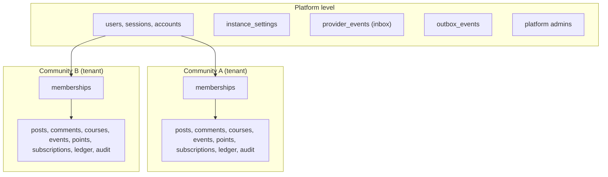
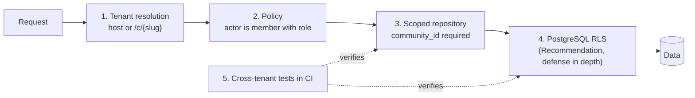

# Multi-tenancy

How communities are isolated from each other: the tenant model, enforcement layers, routing and custom domains, storage, limits, export and deletion, and self-hosted modes.

Related: [overview.md](overview.md), [data-model.md](data-model.md), [authorization.md](authorization.md). Requirement REQ-NFR-SEC-001 asks for tenant isolation in one data access layer with cross-tenant tests in CI.

## 1. The tenant

**Recommendation.** The tenant is the **community**. Every piece of community content, membership, payment record, and setting belongs to exactly one community.

People are not tenants. A user account is platform-level and can be a member of many communities on the same instance (REQ-ID-004). Their role, points, progress, notifications, and subscriptions are per community.



## 2. Shared database with `community_id` (chosen) versus schema per tenant (rejected)

**Recommendation** (ADR 0006): one PostgreSQL database, one schema, `community_id` on every tenant-scoped table.

| Criterion | Shared tables with `community_id` | Schema per tenant |
|---|---|---|
| Migrations | One run, seconds to minutes | One run per community. Thousands of schemas make every deploy slow and partial failures likely. |
| Cross-community features | Natural: one account across communities, My Communities, platform admin views | Requires cross-schema queries or a separate platform schema with duplicated data |
| Connection pooling | Simple | `search_path` per request, harder with poolers in transaction mode |
| Isolation strength | Logical, enforced by code and optionally RLS | Stronger by default, but still one database and one set of credentials |
| Per-tenant backup and restore | Through export (section 9) | Easier per schema |
| Self-hosted footprint | Same as single tenant | Same, plus operational surprise for operators |
| Precedent | Most comparable projects ([../research/comparable-projects.md](../research/comparable-projects.md)) | Twenty, because it lets users define their own schemas, which Cohory does not |

Schema per tenant is rejected because Cohory has no per-tenant schema customization, communities are small and numerous, and migration time would grow with the number of communities. Database per tenant is rejected for the same reasons, more strongly.

## 3. Enforcement layers

Isolation is defense in depth. Each layer catches what the previous one misses.



### 3.1 Tenant resolution

Middleware determines the community from the request:

1. Host is a verified custom domain: look up `custom_domains.hostname`, rewrite the path to `/c/{slug}/...`.
2. Path starts with `/c/{slug}`: look up `communities.slug`, follow `community_slug_redirects` with a 301 if it is an old slug.
3. Single-community mode: `COHORY_DEFAULT_COMMUNITY` maps `/` to that community (section 11).
4. API routes take the community as a path parameter (`/api/v1/communities/{communityId}/...`). Tokens are bound to one community, and a mismatch is rejected.

As built in 0.12.0: custom domains are not built; old slugs live in `community_slug_history` and redirect to the current slug; `HOME_COMMUNITY` sends signed out visitors who open `/` to that community's About page instead of the single community mode above; most API routes take `{slug}`, and payments routes take `{communityId}`.

The result is a `TenantContext { communityId, slug, source }` placed on the request context. **Recommendation**, not built: cache lookups in process for 60 seconds and invalidate them on a slug or domain change.

### 3.2 Policy

The policy module ([authorization.md](authorization.md)) checks that the actor has an active membership with a sufficient role in **this** community, or that the resource is public. A user who is an owner in community A has no rights in community B from that fact.

### 3.3 Scoped repositories

**Recommendation.** This is the primary enforcement point.

- Module services receive `ctx`, which carries `ctx.tenant.communityId`. They access data only through a scoped query helper.
- The helper adds `where community_id = $tenant` to every select, update, and delete, and sets `community_id` on every insert. Calling it without a tenant throws.
- Unscoped access exists only through a separate `platformDb` handle, importable only by an allowlist of files (platform admin, inbox processing, cross-community "My Communities" listing). Lint enforces the allowlist.
- Lookups by id always include the tenant: `findPost(ctx, postId)` is `where id = $1 and community_id = $2`. A row from another community is indistinguishable from a missing row, and the API answers 404.
- Foreign ids in input (for example `categoryId` in a new post) are verified to belong to the same community before use.

```ts
// packages/db/scoped.ts (sketch)
export function scoped(ctx: Ctx) {
  const communityId = ctx.tenant?.communityId ?? fail("tenant scope required");
  return {
    select: <T extends TenantTable>(t: T) => db.select().from(t).where(eq(t.communityId, communityId)).$dynamic(),
    insert: <T extends TenantTable>(t: T, v: Omit<InferInsert<T>, "communityId">) => db.insert(t).values({ ...v, communityId }),
    update: <T extends TenantTable>(t: T) => ({ set: (v: Partial<InferInsert<T>>) => ({ where: (w: SQL) => db.update(t).set(v).where(and(eq(t.communityId, communityId), w)) }) }),
    delete: <T extends TenantTable>(t: T, w: SQL) => db.delete(t).where(and(eq(t.communityId, communityId), w)),
  };
}
```

`TenantTable` is a type constraint satisfied only by tables that use the `tenant()` column helper, so a platform table cannot be passed by mistake.

### 3.4 PostgreSQL row level security (defense in depth)

**Decision (2026-10-18).** RLS is on and forced on every tenant-scoped table from its first migration, on both editions, with no switch. It costs little and the repository layer already sets the variable.

How it works:

- The application connects as a role without `BYPASSRLS` (`DATABASE_URL`). In Compose this is `POSTGRES_APP_USER`, created or updated by the `migrations` service from the `DATABASE_URL` credentials (`packages/db/src/app-role.ts`). Superusers bypass RLS, so the app must never run as one.
- Migrations and the seed connect as the schema owner (`DATABASE_ADMIN_URL`, falling back to `DATABASE_URL` in development).
- Each transaction runs `set local app.community_id = '<uuid>'` from `ctx`.
- Every session setting a policy reads (`app.community_id`, `app.user_id`, and the manager and job flags such as `app.payments_webhook`) is set through `packages/db/src/tenancy/session.ts` ([0044](../decisions/0044-composition-roots-and-shared-infrastructure.md)). Its `rlsFlags` and `rlsValues` lists are the only names allowed, a test checks them against the settings the migrations read, and no other source file calls `set_config`. `runInCommunity(scope, fn, { userId, flags })` sets the viewer and flags for one transaction.
- Policies: `using (community_id = current_setting('app.community_id', true)::uuid)` and the same `with check` for writes.
- Platform tables (`users`, `sessions`, `accounts`, `verifications`) have no RLS, so Better Auth works through the application role without `BYPASSRLS`.
- `communities` has RLS since migration `0003_communities_rls.sql`. Every role may select rows (slugs resolve before a tenant is known), while insert, update, and delete require `communities.id` to equal `app.community_id`. The same migration adds `memberships_own_rows`, which lets a person read their own memberships across communities when `app.user_id` is set, so My Communities works without `BYPASSRLS`.
- `creator_feedback` (migration 0037, [0049](../decisions/0049-creator-feedback.md)) belongs to a person, not a community. Its policy keys on `user_id = app.user_id`, and a write must also have no community or the community in `app.community_id`, so a creator cannot file feedback against another community. `community_id` is nullable and set to null when the community is deleted, because the operator keeps the answer for 24 months; a community archive or export never includes it, while the person's account data export does. The daily retention job reads and deletes across people only behind `app.feedback_retention = 'on'`, and that policy itself admits only rows older than 24 months.
- Financial records (`payments`, `fee_ledger_entries`, `platform_billing_accounts`, `platform_invoices`, `platform_invoice_lines`) keep their rows when a community is deleted (migration 0029). Their `community_id` becomes null and a `former_community_id` and `former_community_name` snapshot stays. Every tenant policy compares `community_id` with `app.community_id`, so detached rows are invisible to tenant reads and writes, including for managers of the former community. Only the `app.platform_billing` read policies and the schema owner still see them, and the billing sweeps filter out rows without a community.
- Platform paths that must read across communities will use a separate role with `BYPASSRLS`, reached only through `platformDb`. That role does not exist. Worker jobs that read across communities use narrow policies behind settings such as `app.calendar_jobs` or `app.payments_webhook` instead.

Session settings the policies read, all typed in `packages/db/src/tenancy/session.ts` (a policy that names a setting not in these lists fails typecheck):

| Kind | Settings | Who sets them |
|---|---|---|
| Values | `app.community_id`, `app.user_id` | Every scoped transaction (`runInCommunity`) |
| Values | `app.api_token_hash`, `app.api_token_owner`, `app.oauth_secret_hash`, `app.oauth_grant_owner`, `app.invite_token` | Token, OAuth, and invite lookups that run before a membership is known |
| Values | `app.member_removal_reason` | Membership removal, read by the trigger that records why a member left |
| Manager flags | `app.community_manager`, `app.course_manager`, `app.calendar_manager`, `app.payments_manager`, `app.migration_manager`, `app.webhooks_manager` | Services acting for an owner or admin on rows a plain member may not touch |
| Job flags | `app.approval_jobs`, `app.calendar_jobs`, `app.delegation_jobs`, `app.notification_jobs`, `app.webhook_jobs`, `app.posts_scheduler`, `app.outbox_relay`, `app.email_delivery`, `app.payments_webhook`, `app.platform_billing`, `app.membership_hold_sweep`, `app.feedback_retention` | Worker jobs that read across communities through narrow policies |
| Lifecycle flags | `app.account_purge`, `app.community_purge`, `app.payments_detach` | Account erasure, community deletion, and the safe exit that detaches payment records |

Tradeoffs:

| Benefit | Cost |
|---|---|
| A forgotten `where` in a hand-written query returns nothing instead of another community's data | Every query must run inside a transaction that sets the variable, which interacts with connection poolers (transaction mode is fine, statement mode is not) |
| Protects against bugs in read models that join across tables | Policies add a small planner cost; indexes must lead with `community_id` (already a rule) |
| Testable in isolation | Debugging "why is this empty" is harder; error messages do not mention RLS |
| | Background jobs must set the variable from the job's `community_id`, or use the platform role explicitly |

Resolved (2026-10-18): RLS is required on both editions, there is no `COHORY_RLS` switch. `packages/db/src/tenancy/app-role.integration.test.ts` proves that the application role sees zero membership rows without `app.community_id`.

### 3.5 Cross-tenant tests

**Recommendation.** Merge-blocking (mvp-scope acceptance criterion: a user in community A cannot read or change data in community B through the UI or by editing URLs or request bodies).

1. **Generated route tests.** For every `/api/v1` route in the OpenAPI registry, a test creates communities A and B, authenticates as an owner of A, and calls the route with B's ids in path, query, and body. Expected: 404 or 403, and no row in B changed. New routes are covered automatically.
2. **Repository tests.** For every tenant table, a test asserts that the scoped helper never returns another community's rows, and that inserting with a foreign id from another community fails.
3. **RLS tests.** With RLS on, a raw query without the variable set returns zero rows, and a write with a mismatched `community_id` fails.
4. **Page tests.** Playwright visits B's URLs signed in as A's owner and expects the guest or not-found view.
5. **Job tests.** Each job handler run with a payload whose ids belong to another community does nothing.
6. **Export tests.** An export of A contains no rows or media from B.

## 4. Platform-level versus community-level data

| Platform level (no `community_id`) | Community level (`community_id` required) |
|---|---|
| users, sessions, accounts, verification tokens | memberships, invite links, join requests |
| instance settings, platform admins | categories, posts, comments, reactions, reports, mentions |
| provider events inbox, outbox events, job queue tables | courses, course modules, lessons, lesson progress |
| platform billing account for the creator (post-MVP, keyed by user) | events, occurrences, RSVPs |
| global rate limit counters | points ledger, member stats |
| | membership plans, payment connections, customers, subscriptions, payments, fee ledger, entitlements |
| | notifications and preferences |
| | api tokens, agent identities, grants, approvals (Phase 6) |
| | audit log, migration jobs, custom domains (not built) |

Notifications are community-scoped even though they belong to a user, because the bell is scoped to the current community (information-architecture.md) and community deletion must remove them.

## 5. Custom domains and slug routing

**Recommendation** (from [../product/information-architecture.md](../product/information-architecture.md) section 4.1): a custom domain maps to one community root, and `/c/{slug}` redirects to it once verified.

Flow:

1. Owner adds `learn.example.com` in Manage, Settings. We store it as `pending_dns` with a verification token.
2. Owner creates a CNAME to the platform host (Cloud) or to the operator's server (self-hosted), plus a TXT record with the token.
3. A job checks DNS every few minutes for 72 hours, then daily. On success the status becomes `verified`.
4. **Cloud:** the edge proxy obtains a certificate on demand, after asking the app's internal endpoint `GET /internal/domains/allowed?host=` which answers yes only for verified domains. This prevents certificate issuance for arbitrary hosts. Status becomes `active`.
5. **Self-hosted:** the operator adds the host to their reverse proxy. The app treats the domain as active once verified and reachable.
6. Removal deactivates the domain immediately, and `/c/{slug}` stops redirecting.

Rules: one community per hostname, platform domains and their subdomains cannot be claimed, and hostnames are normalized (lowercase, punycode). Sessions across domains are handled in [authorization.md](authorization.md) section 9.

## 6. Storage path isolation

**Recommendation.**

- Object keys are prefixed by tenant: `communities/{communityId}/{kind}/{uuidv7}.{ext}`, where `kind` is `posts`, `lessons`, `branding`, `exports`, `imports`. User avatars use `users/{userId}/avatar/...`.
- Keys are never derived from user input (no original filenames in keys). The original name is stored in the database for download headers.
- Downloads go through the app: it checks policy (for example, lesson attachments need the entitlement) and returns a short-lived signed URL (S3) or streams the file (local disk). Buckets are private.
- Public branding assets (logo, cover) may be served through a public CDN path because they appear on public About pages.
- Exports are stored under the community prefix, expire after 7 days, and are downloadable only by the owner. As built, archives live under `migration/{communityId}/`, outside the community prefix, and an export is deleted 30 days after it finishes ([archive-format.md](archive-format.md) section 7).
- Community deletion enqueues deletion of the whole prefix.

## 7. Rate limits and fair use per community

**Recommendation.**

Two kinds of limits:

1. **Abuse rate limits** (both editions): per user and per IP for sign in, magic links, sign up, posting, comments, invitations, reports, and per token for the API (REQ-NFR-SEC-003). Sliding window counters in PostgreSQL by default, Redis when configured.

   Implementation (since 0.1.0): `@cohory/rate-limit` keeps fixed window counters in the memory of each web process (no table, no Redis). Sign up, sign in, and password reset are counted per client address in the Better Auth route; invite creation and redemption per member in the API routes and server actions; posts, comments, likes, and RSVPs per member inside the posts and calendar services. Limits come from `RATE_LIMIT_*` variables ([../self-hosting.md](../self-hosting.md)). A shared PostgreSQL or Redis store for several web containers is still open.
2. **Fair-use limits** (Cloud only, `fairUseLimits` capability): per community, from the table in [../foundation/business-model.md](../foundation/business-model.md) (members, storage, file size, bandwidth, announcement emails, API requests, communities per account), which differ for communities with and without paid transactions in the last 90 days.

Enforcement rules:

- Limits are checked in services at the moment of the action (upload, invite, send), never by hiding existing content.
- Usage counters (storage bytes, members, emails this month) are maintained per community and shown in Manage, Overview.
- Background work is fair-shared: per-community concurrency caps on queues so one large import or announcement cannot delay others.
- Self-hosted instances have no fair-use limits. Operators can set optional caps through instance settings.

## 8. Cloud resource limits

**Recommendation.** Beyond product-level fair use, protect shared infrastructure:

| Resource | Limit approach |
|---|---|
| Database | Statement timeout (5 s for web requests, longer for named jobs), per-request query count warning in development, pagination caps (100 items) |
| Request size | Body limit per route (JSON 1 MB, uploads per type) |
| Workers | Per-community concurrency caps per queue, global caps per job type |
| Email | Per-community daily send cap, separate from announcement limits, to protect sender reputation |
| Outbound fetches | Per-community rate for link previews and imports through the egress helper |
| Search | Query length cap and timeout |

## 9. Data export and deletion per tenant

**Export.** MVP: members CSV (owner only). Phase 5: full bundle per [data-model.md](data-model.md) section 17. Export jobs run with the tenant context and the export test asserts no foreign data.

**Deletion** (REQ-COM-009, mvp-scope 2.2):

1. Owner requests deletion. We offer an export first and show active paid subscriptions.
2. On Cloud, the offboarding fee removal job runs (see [payments.md](payments.md) section 10.3). We never cancel the creator's Stripe subscriptions automatically. The owner chooses to cancel them, or keep billing on their own Stripe account.
3. The community enters a 14-day soft-deleted state: hidden, not joinable, restorable by the owner.
4. After 14 days a job hard deletes all tenant rows (in dependency order, in batches), the storage prefix, custom domains, and tokens.
5. Kept after deletion: fee ledger entries, payments, platform billing accounts, platform invoices and their lines, and audit entries needed for financial and legal records, with personal fields minimized. The schema for this exists since migration 0029 (section 3.4), and community deletion writes the snapshot since Step 18. **Open question:** retention period, needs legal input.

As built (Step 18, [payments.md](payments.md)): only the owner can delete, and only an archived community. Deletion ends or hands over paid subscriptions through an exit run, sets `communities.deleted_at` at once (there is no 14 day restorable state), and the `communities.purge-deleted` job then deletes the rows in batches.

**Member deletion** (REQ-ID-007) is user-level: authored content is anonymized per community policy, memberships removed, financial records kept as required by law.

## 10. Platform administration

**Recommendation.** As of 0.12.0 no platform admin tooling exists: `platformAdmin` is always false and there is no `platformDb` ([threat-model](../security/threat-model.md) section 6). Platform admins (operators on Community Edition, Cohory staff on Cloud) act through `platformDb` and audited tools only. Every platform admin read of community content is written to the audit log of that community with `actorType = platform_admin`. Platform admins do not appear as community members. Support access to a community's private content on Cloud requires the owner's consent, recorded in the audit log (**Recommendation**).

## 11. Self-hosted single-community and multi-community modes

| Mode | Setting | Behavior |
|---|---|---|
| Single community | `COHORY_DEFAULT_COMMUNITY=<slug>` and optionally `COHORY_SIGNUP_CREATE_COMMUNITY=false` | `/` serves the community. Platform home and "Create community" are hidden for non-admins. Typical for one creator on one VPS. |
| Multi community | Default | Platform home lists the user's communities. The operator decides whether any signed-up user can create communities (`instance_settings.community_creation = anyone|admins`). Typical for agencies or groups. |

As built in 0.12.0 these are environment variables, not instance settings: `HOME_COMMUNITY` (signed out visitors to `/` go to that community's About page), `SIGNUP_MODE` (`open`, `invite`, or `closed`), and `COMMUNITY_CREATION` with `OPERATOR_EMAILS` ([../self-hosting.md](../self-hosting.md)). There is no `instance_settings` table.

Both modes use the same tenant model and the same tests. Switching modes changes routing only, never data.

## 12. Decisions and open questions

| Label | Item |
|---|---|
| Recommendation | Community is the tenant. Users are platform-level. |
| Recommendation | Shared database and schema with `community_id` on every tenant table. Schema per tenant rejected. |
| Recommendation | Scoped repository helper as the primary enforcement point, with a lint-guarded `platformDb` escape hatch. |
| Recommendation | PostgreSQL RLS as defense in depth. Built on both editions since 0.1.0 (see the decisions below). |
| Decision (2026-10-18) | RLS is enabled and forced on `memberships` from the first migration, with policy `memberships_tenant_isolation` on `app.community_id`. The scoped helper (`runInCommunity` in `packages/db/src/tenancy`) sets the variable in every transaction, so it already works under a role without `BYPASSRLS`. Superusers bypass RLS, so web and worker connect as a `NOBYPASSRLS` application role (`DATABASE_URL`) that the migration runner creates from the schema owner connection (`DATABASE_ADMIN_URL`). Compose ships this split by default. The `BYPASSRLS` role behind `platformDb` is created when the first platform path needs it. |
| Recommendation | Generated cross-tenant tests for every API route, merge-blocking. |
| Recommendation | Tenant-prefixed storage keys, private buckets, signed URLs after policy checks. |
| Recommendation | Fair-use limits only on Cloud, enforced at action time. |
| Assumption | Communities stay small enough that one database scales through MVP on Cloud. |
| Decision (2026-10-18) | RLS is required on both editions. There is no switch. |
| Open question | Retention of financial and audit records after community deletion. |
| Open question | Whether platform admins on Community Edition need owner consent to view private community content. |
