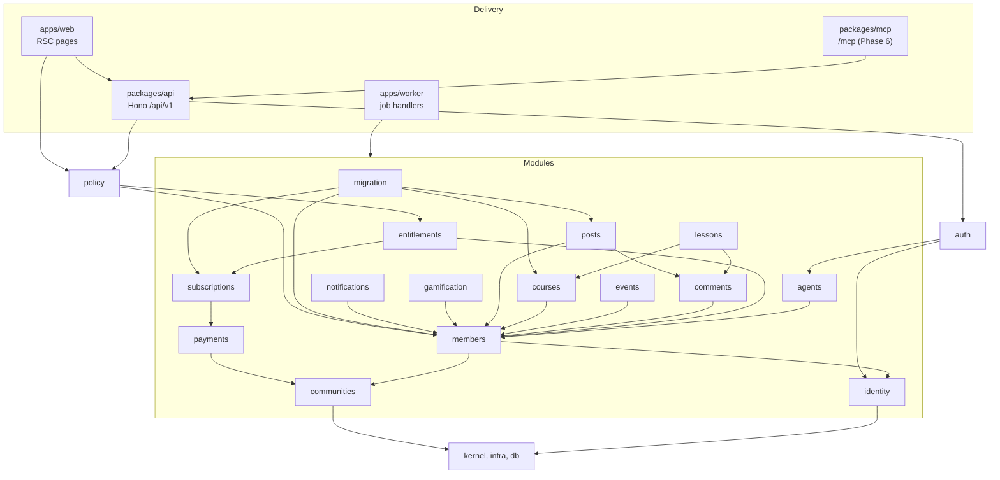
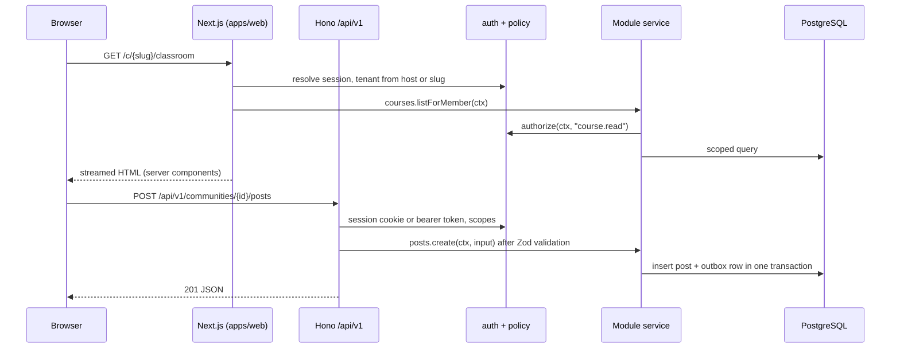

# Architecture overview

How cohory is structured as one deployable system: repository layout, modules and their boundaries, request and job flow, adapters, editions, deployment, observability, testing, and security.

Status: Draft, 2026-10-19

Companion documents: [data-model.md](data-model.md), [payments.md](payments.md), [multi-tenancy.md](multi-tenancy.md), [authorization.md](authorization.md), [agent-integrations.md](agent-integrations.md). Architecture decisions are recorded as ADRs in [../decisions/README.md](../decisions/README.md). Requirement IDs refer to [../foundation/product-requirements.md](../foundation/product-requirements.md). MVP boundaries are in [../product/mvp-scope.md](../product/mvp-scope.md).

## 1. Summary

| Concern | Choice | Label |
|---|---|---|
| Shape | Modular monolith, one codebase, one Docker image, two process roles (web, worker) | Confirmed (monolith), Recommendation (two roles) |
| Language and UI | TypeScript, Next.js App Router, Tailwind CSS, shadcn/ui, Radix, Lucide | Confirmed (initial preference) |
| HTTP API | Hono + Zod + OpenAPI mounted inside Next.js at `/api/v1` | Recommendation |
| Database | PostgreSQL only, Drizzle ORM, forward-only SQL migrations | Confirmed (Postgres, Drizzle), Recommendation (migration rules) |
| Auth | Better Auth for identity and sessions, one policy module for authorization | Confirmed (Better Auth), Recommendation (policy module) |
| Jobs | pg-boss on PostgreSQL (built). BullMQ on Redis when `REDIS_URL` is set is planned, not built | Recommendation (deviates from the founder's Redis + BullMQ default, see ADR 0005) |
| Storage | Local disk by default, S3-compatible adapter | Recommendation |
| Search | PostgreSQL full-text search | Recommendation |
| Monorepo | pnpm workspaces + Turborepo | Confirmed |
| Deployment | Docker Compose for self-hosting, same image on Cloud | Confirmed (Compose), Recommendation (Cloud outline) |

## 2. Why a modular monolith

**Confirmed.** The founder brief asks for a pragmatic modular monolith and no microservices without justification.

Reasons this holds for cohory specifically:

1. **Self-hosting must stay simple.** REQ-NFR-HOST-003 asks for a working install on a 2 vCPU, 4 GB VPS in under 30 minutes. Every extra service is another container, port, secret, and failure mode for a non-specialist operator.
2. **Transactions cross modules.** A paid checkout touches Payments, Subscriptions, Entitlements, Members, and Notifications. In one process with one database these are one transaction plus an outbox, not a distributed saga.
3. **The team is small and the domain is still moving.** Module boundaries will be wrong in places. Moving code between folders is cheap. Moving it between services with separate deployments and data stores is not.
4. **The load profile is modest.** A typical community has hundreds to thousands of members. Cloud scales by running more web and worker replicas against one PostgreSQL primary long before any module needs its own service.
5. **Comparable projects agree.** Twenty and Formbricks ship one image with web and worker roles. See [../research/comparable-projects.md](../research/comparable-projects.md).

Why not microservices: they would add network calls, partial failure handling, per-service schemas, service discovery, and distributed tracing as a requirement rather than an option. None of that buys anything a creator can see.

When a module could be extracted later (**Recommendation**, not planned): only if it has a clearly different scaling or isolation need, for example media processing if video upload is added, or MCP if agent traffic dominates. The module boundary rules below keep that option open without paying for it now.

## 3. Repository layout

**Recommendation.** This refines the founder's original layout and the layout proposed in [../research/comparable-projects.md](../research/comparable-projects.md).

```
cohory/
  apps/
    web/                  Next.js App Router: UI, /api/v1 (Hono), /mcp (Phase 6), auth routes, webhooks
    worker/               Thin entry point that runs job handlers from packages (same image, different command)
    docs/                 Documentation site for /docs and /docs/api (later, can start as static markdown)
  packages/
    config/               tsconfig, lint, Tailwind preset, env schema helpers
    kernel/               Pure primitives: ids, Money, Result, errors, clock, domain event types, tenant context
    db/                   Drizzle client, schema re-exports from modules, migrations folder, seed scripts
    infra/                Adapters: queue (pg-boss, BullMQ), storage (local, S3), email (SMTP, provider), search, logger
    auth/                 Better Auth configuration, session and actor resolution, API token verification
    policy/               Single authorization module: permission matrix and can() / authorize()
    api/                  Hono app, route definitions with Zod, OpenAPI registry, error mapping
    mcp/                  MCP server and tool registry generated from api route metadata (Phase 6)
    ui/                   shadcn/ui based primitives and product components (CommunityPost, LessonPlayer, ...)
    sdk/                  @cohory/sdk: typed API client now, definePlugin later (MIT proposed, ADR 0009)
    modules/
      identity/  communities/  members/  posts/  comments/  courses/  lessons/  events/
      gamification/  payments/  subscriptions/  entitlements/  notifications/  migration/  agents/  reviews/
  docker/
    compose.yml           web, worker, migrate, postgres, optional redis and minio profiles
    Caddyfile.example     reverse proxy example
  docs/                   This documentation
```

What exists for 0.1.0 (2026-10-18): `apps/web`, `apps/worker`, `apps/e2e`, and the packages `api`, `auth`, `authz` (the `policy` role above), `calendar` (the Events module), `communities` (communities, memberships, and the Manage services), `config`, `courses` (courses and lessons), `db`, `email`, `events` (domain event dispatch and the outbox relay), `fair-use`, `gamification`, `members`, `notifications`, `payments` (payments, subscriptions, and entitlements derived on read), `posts` (posts, comments, and categories), `rate-limit`, `search` (community search that groups the module searches), `storage`, and `ui`. Modules are flat packages under `packages/`, not under `packages/modules/`. Later releases added `content` (the rich text format), `migration` (importers and archives), `agents` and `mcp` (0.6.0), `egress`, `webhooks`, and `sdk` (0.6.0), `agent-runner` (the MIT evaluation runner), `reviews` (Step 17), `entitlements` (community access, [0031](../decisions/0031-community-access-module.md)), `identity` (account deletion and data export), and `infra` (the logger, [0044](../decisions/0044-composition-roots-and-shared-infrastructure.md)). As of 0.12.0 there are 32 packages. `kernel`, `policy`, and `apps/docs` do not exist (`infra` holds only the logger); `kernel` duties live in `packages/db` (ids in `src/ids.ts`, tenancy in `src/tenancy`) and the packages that need them. Built entry points live in `packages/db/dist/migrate.js` and `apps/worker/dist/index.js`. The Compose file is `docker-compose.yml` at the repository root (not `docker/compose.yml`), built from the root `Dockerfile`, the production overlay is `docker-compose.prod.yml` at the root, and its Caddy site is `docker/Caddyfile` (not `docker/Caddyfile.example`). Table definitions live in `packages/db/src/schema`, one file per module, and the first repositories in `packages/db/src/repositories`. The unit notes below record what each build step added.

### Storage (`packages/storage`)

File storage lives in `packages/storage` (`@cohory/storage`) rather than `packages/infra`, with a local disk driver (default, `/data/uploads` in Docker) and an S3 compatible driver selected by `STORAGE_DRIVER`, and avatars are served through `apps/web/app/api/uploads/[...key]/route.ts`. Since 2026-10-21, `prepareImage` and `storePreparedImage` store a community cover or gallery image as `{name}.sized.{ext}` with WebP copies `{name}.w160.webp` to `{name}.w1920.webp`. The `sharp` processor decodes the upload once, applies its orientation, re-encodes the original without EXIF or GPS data, and refuses images over 25 megapixels or that take more than 10 seconds (`image_too_large`) and bytes it cannot read (`image_unreadable`). The storage limit counts the original and every copy. `storedImageKeys` lists them for deletion and `@cohory/storage/variants` builds the `srcset` from the public URL. A GIF is stored as uploaded under its plain name.

### Authorization and communities (`packages/authz`, `packages/communities`, `packages/api`)

`packages/authz` holds the permission matrix with `can()` and `assertCan()` (the role of `packages/policy` above), `packages/communities` holds the community and membership services with a Postgres repository over `packages/db`, and `packages/api` serves them under `/api/v1/communities` with session resolution in `src/middleware/session.ts`.

Reconciliation with the founder's layout:

| Founder notes | Here | Why |
|---|---|---|
| `packages/database` | `packages/db` | Shorter import path. Holds the client and migrations. Table definitions live in each module and are re-exported here. |
| `packages/auth` | `packages/auth` + `packages/policy` | Authentication (who you are) and authorization (what you may do) change for different reasons. Policy depends on Members and Entitlements; auth must not. |
| `packages/ui` | `packages/ui` | Same, with the folder split from the notes (`primitives/`, `community/`, `classroom/`, `payments/`). |
| `packages/community` | `modules/communities`, `modules/members`, `modules/posts`, `modules/comments` | The brief lists these as separate modules. Comments are shared by posts and lessons, so they cannot live inside posts. |
| `packages/courses` | `modules/courses`, `modules/lessons` | Same reason: separate modules in the brief. Lessons may start as a subfolder of courses if the split proves artificial (Open question). |
| `packages/gamification` | `modules/gamification` | Same. |
| `packages/payments` | `modules/payments`, `modules/subscriptions`, `modules/entitlements` | Money movement, billing object sync, and access rules have different test and review needs. |
| `packages/shared` | `packages/kernel`, `packages/infra`, `packages/config` | A catch-all "shared" package tends to grow into a second monolith. Splitting pure code from adapters keeps domain code free of I/O imports. |
| (not in notes) | `packages/api`, `packages/mcp`, `packages/sdk`, `apps/worker` | Required by API-first and agent goals, and by background jobs. |

### Email, UI primitives, and auth pages

Since 0.1.0, the repository has `packages/email` (`sendEmail` with `smtp` and `log` drivers plus password reset and verification templates; email stays outside `packages/infra`), shadcn/ui primitives exported from `@cohory/ui`, session helpers in `@cohory/auth/next` and `@cohory/auth/client`, and the `/sign-up`, `/sign-in`, `/forgot-password`, and `/reset-password` pages in `apps/web/app/(auth)`.

### Web app shell

Platform pages live in `apps/web/app/(platform)` (`/communities/new`, `/account`, the legal pages); `/` itself is `apps/web/app/page.tsx` (My communities when signed in, the Cloud landing or the neutral home when signed out), the community shell lives in `apps/web/app/c/[slug]` with the four member tabs and a guarded `(member)` route group, and shared web components live in `apps/web/components`.

### Feed components (`packages/ui/src/community`)

Feed components (`CommunityPost`, `PostComposer`, `CommentThread`, `NotificationBell`, `PostContent`) live in `packages/ui/src/community`, take data and callbacks as props, and render posts from the UI document type in `packages/ui/src/community/content.ts`. That type is flatter than the stored format from [ADR 0012](../decisions/0012-post-content-format.md) (image URLs resolved, embeds tagged with a provider, no nested lists or quotes), so `apps/web/lib/posts/document.ts` converts in both directions and the UI package never depends on the posts backend.

### Content format (`packages/content`)

`packages/content` (`@cohory/content`) holds the rich text document format of [ADR 0012](../decisions/0012-post-content-format.md): the strict Zod schema, `parseContent`, the escaping HTML renderer, plain text and excerpt helpers, the embed allowlist, and (since Step 17) `normalizeVideoLink`, which turns a YouTube, Vimeo, or Loom link into its embed URL, and (since Step 17b) `videoPlayerUrl` for muted autoplay or click to play player URLs and the video poster helpers. It depends only on Zod. Posts and communities both use it (posts for post and comment bodies, communities for the About page detailed description and gallery videos), and `@cohory/posts` re-exports it for older callers. See [ADR 0024](../decisions/0024-shared-content-package.md).

### Posts (`packages/posts`)

`packages/posts` (`@cohory/posts`) holds the posts, comments, and likes services with a Postgres repository over the `posts`, `post_images`, `comments`, and `reactions` tables in `packages/db/src/schema/posts.ts`, stores bodies in the JSON document format from [ADR 0012](../decisions/0012-post-content-format.md), and `packages/api/src/routes/posts.ts` serves them under `/api/v1/communities/{slug}/posts`, `/comments`, and `/uploads/post-image`.

### Community tab pages

The Community tab (`apps/web/app/c/[slug]/page.tsx`) and post details (`apps/web/app/c/[slug]/posts/[postId]`) compose the feed components through client wrappers in `apps/web/components/feed` and server actions in `apps/web/lib/posts`, which run the posts service with the notifications publisher attached (`getPostsService` from `@cohory/api/services`, the same instance the API uses), convert between the UI document type and the stored document, compute item actions from the policy, and back the access checked post image serving in `apps/web/app/api/uploads` (members only for private communities, no session needed for public ones).

### Notifications (`packages/notifications`)

`packages/notifications` (`@cohory/notifications`) owns the `notifications` table in `packages/db/src/schema/notifications.ts`, receives post events through the posts service `onEvents` hook (wired in `packages/api/src/app.ts`) as one pg-boss `notifications.fanout` job per write, which `apps/worker` fans out inside `runInCommunity` (mention beats reply beats comment on post for one recipient, likes create no notification until grouped likes ship, one unread row per recipient, type, subject, and actor), and serves the platform level bell at `/api/v1/notifications` by reading under `app.user_id` with a per user RLS policy instead of looping over communities.

### Member components (`packages/ui/src/members`)

Member and gamification components (`MemberCard`, `MemberSearch`, `LevelFilter`, `MemberList`, `Leaderboard`, `LevelBadge`, `LevelProgress`, `MemberProfileHeader`, `ActivityList`) live in `packages/ui/src/members`, take data and callbacks as props, and hide levels and points when the caller passes the gamification off flag.

### Gamification, members, and domain events

`packages/gamification` (`@cohory/gamification`) owns `points_ledger` and `member_stats` (points from likes, nine fixed levels, 7 day and all time leaderboards), `packages/members` (`@cohory/members`) serves the member directory, profiles, bios, and usernames, `packages/events` (`@cohory/events`) routes post events to one pg-boss queue per consumer ([ADR 0013](../decisions/0013-domain-event-dispatch.md)), and `packages/api/src/routes/members.ts` serves them under `/api/v1/communities/{slug}/members`, `/leaderboard`, and `/api/v1/me`.

### Members tab pages

The Members tab pages (`apps/web/app/c/[slug]/(member)/members` for the directory, `/leaderboard`, and `/[userId]` profiles) and the account username field compose the members components through client wrappers in `apps/web/components/members` and loaders and server actions in `apps/web/lib/members`, which also ask the members service for author levels to put a level badge beside post and comment authors because the posts author summary carries no level.

### Classroom components (`packages/ui/src/classroom`)

Classroom components (`CourseCard`, `CourseHeader`, `CourseOutline`, `LessonPlayer`, and the editor blocks `OutlineEditor`, `LessonForm`, `PublishToggle`) live in `packages/ui/src/classroom`, take data and callbacks as props, reorder outlines by pointer through `@dnd-kit` and by keyboard with an `aria-live` announcer, and play YouTube, Vimeo, Loom, or Wistia links only after a click.

### Classroom pages

The Classroom pages (`apps/web/app/c/[slug]/(member)/classroom` for the course grid, `/new`, `/[courseSlug]` with `?edit=1` for the outline editor, and `/[courseSlug]/[lessonSlug]` with `?edit=1` for the lesson form) compose the classroom components through client wrappers in `apps/web/components/classroom` and loaders and server actions in `apps/web/lib/courses`, the feed shows a Continue learning card from `getContinueLearning`, and `/api/uploads` serves a course attachment only to members who can see the lesson that holds it (drafts stay with admins and owners), as a download named by the name stored on the lesson.

### Courses (`packages/courses`)

`packages/courses` (`@cohory/courses`) holds the courses, modules, lessons, and progress services over the `courses`, `course_modules`, `lessons`, and `lesson_progress` tables in `packages/db/src/schema/courses.ts` (forced RLS where members read published rows, drafts need the `app.course_manager` setting the service sets for admins and owners, and progress rows need the matching `app.user_id`), renders lesson markdown to sanitized HTML with markdown-it, stores attachments under `communities/{id}/courses/{courseId}/attachments`, and `packages/api/src/routes/courses.ts` serves it under `/api/v1/communities/{slug}/courses`, `/lessons`, and `/continue-learning`.

### Calendar components (`packages/ui/src/calendar`)

Calendar components (`EventCard`, `CalendarMonth`, `CalendarViewSwitch`, `EventList`, `EventDetail`, `EventForm`, `SeriesScopeDialog`) live in `packages/ui/src/calendar`, take occurrences and callbacks as props, and format every time with `Intl.DateTimeFormat` in a time zone the caller passes through the helpers in `calendar/time.ts`.

### Calendar pages

The Calendar pages (`apps/web/app/c/[slug]/(member)/calendar` for the month and list views with `?view=` and `?month=YYYY-MM`, `/new`, and `/[eventSlug]/[occurrenceId]` with `?edit=1` for the series form) compose the calendar components through client wrappers in `apps/web/components/calendar` and loaders and server actions in `apps/web/lib/calendar`, format times in the viewer's zone from a `tz` cookie the browser sets (falling back to the event zone, then UTC), and the feed shows an Upcoming events card when the viewer has RSVPs.

### Calendar (`packages/calendar`)

`packages/calendar` (`@cohory/calendar`, because `@cohory/events` is the domain event dispatch package) owns the `events`, `event_occurrences`, and `event_rsvps` tables in `packages/db/src/schema/events.ts` (forced RLS where members read in their community, event and occurrence writes need the `app.calendar_manager` setting the service sets for admins and owners, RSVP writes need the matching `app.user_id`, and the worker's `app.calendar_jobs` setting allows only the cross community occurrence scan and the reminder claim and reset), stores each event as a wall clock start plus an IANA zone and computes UTC per occurrence with `@date-fns/tz` up to the end date or 26 weeks ahead, builds RFC 5545 `.ics` files, runs the `calendar.reminders` (every 5 minutes) and `calendar.extend` (weekly) pg-boss schedules in `apps/worker`, moves occurrences in place when an event's time or zone changes and queues a delayed `calendar.time-change` job after the commit that clears reminders sent before the change for the moved dates and emails people going to moved or removed dates, queues `calendar.notice` jobs for the "New event" notice, RSVP confirmations, and calendar invite updates and cancellations (each job reads the current state and stamps the invite SEQUENCE with that time; reminders and invites go only to members `communityAccessIn` entitles; delivery is at least once), and `packages/api/src/routes/calendar.ts` serves it under `/api/v1/communities/{slug}/calendar`.

### Manage services

`packages/communities` also holds the Manage services (`createManageService` in `src/manage`: settings, overview stats, ownership transfer, archive and delete, appearance with logo and cover uploads under `communities/{id}/branding`, the About page gallery under `communities/{id}/gallery` and the detailed description (since Step 17), people management with bans recorded by email, invite links with a public preview of a link, and the owner only members CSV export) over `communities.appearance`, `appearance_tokens`, `archived_at`, `memberships.banned_email`, and the `invite_links` and append only `audit_log` tables in `packages/db/src/schema/manage.ts` (forced RLS where both tables need the `app.community_manager` setting for reads and redemption reads one link through the matching `app.invite_token`), derives accent tokens with the pure `deriveAccentTokens` and `appearanceToCssVariables` in `src/appearance` (OKLCH math from `culori`), and `packages/api/src/routes/manage.ts` serves it under `/api/v1/communities/{slug}/manage`, `/api/v1/communities/{slug}/appearance`, and `/api/v1/invites/{token}/redeem`.

### Manage pages

`apps/web/app/c/[slug]/manage` holds the Manage pages (Overview, Inbox with join requests, reports, and agent approvals, People, Payments, Appearance, Settings with its sub sections, Migration) over server actions in `apps/web/lib/manage`, `apps/web/app/join/[token]` redeems invite links, and `apps/web/lib/theme` applies a customized appearance on the community root element (accent tokens as inline custom properties mapped in `apps/web/app/globals.css` for light and dark, a heading font class backed by `next/font`, `data-card-style`, and `data-theme` only for an explicit Light or Dark choice), leaving the default appearance markup unchanged.

### Payments (`packages/payments`)

`packages/payments` (`@cohory/payments`) holds the payment engine for the paid membership: the pure fee module `src/fee.ts` (integer basis points, round half up, proportional fee refunds, rate 0 unless `COHORY_EDITION=cloud` with Stripe Connect), environment parsing that refuses live Stripe keys outside production, AES-256-GCM encryption of creators' own keys with `PAYMENTS_ENCRYPTION_KEY`, the status to access mapping in `src/access.ts`, a `StripeGateway` port with the Stripe SDK adapter in `src/stripe-gateway.ts` (Accounts v2 with full Dashboard for Cloud onboarding), and one service for connections, the plan, Checkout, the customer portal, subscription lists, the ledger summary, and webhook processing. Its tables (`payment_connections`, `membership_plans`, `payment_customers`, `subscriptions`, `payments`, the append only `fee_ledger_entries`, and the platform level webhook inbox `provider_events`) live in `packages/db/src/schema/payments.ts` with forced RLS: reads stay in the community, writes need the `app.payments_manager` setting the service sets for owners and admins or for webhook processing, and the `app.payments_webhook` setting allows only the inbox and the lookup of a connection by Stripe account. Webhooks arrive at the Next.js route handlers `apps/web/app/api/webhooks/stripe/route.ts` (Cloud) and `apps/web/app/api/webhooks/stripe/own/[connectionId]/route.ts` (Community Edition), which read the raw body with `request.text()`, verify and record the event, and queue it for the worker ([0030](../decisions/0030-payment-webhooks-in-the-worker.md); `apps/worker/src/jobs/payments-webhooks.ts`). `packages/api/src/routes/payments.ts` serves the service under `/api/v1/communities/{communityId}/payments`, and joining a paid community through the normal join path answers `payment_required` (HTTP 402). Details are in [payments.md](payments.md) section 13.

### Payment components (`packages/ui/src/payments`)

`packages/ui/src/payments` holds the payment components: PricingCard (monthly and yearly choice, free, current, past due, and not available states), PaymentProviderSelector (Stripe Connect on Cloud, the creator's own keys on the Community Edition, never both), PlanForm (prices typed in major units and converted to integer minor units with the currency's own decimals), ConnectionStatus, MembershipStatus, SubscriptionTable, and LedgerSummary, plus money helpers that format with `Intl.NumberFormat`. None of them import Stripe. `apps/web/lib/payments` holds the server actions, which validate with Zod, call `@cohory/payments` (where authorization happens), and redirect only to the http or https Checkout, portal, or onboarding URL the service returns. `/c/{slug}/membership` is the member page (PricingCard, Checkout return states with a 60 second refresh while the webhook lands, membership status, Manage billing). `/c/{slug}/manage/payments` is the creator page (connection, pricing, paid members, totals per currency), and the platform fee copy comes from the service's edition and `PLATFORM_FEE_BPS`, never a literal. When a community has an active plan, the header and About page show "Join for {price}/month" linking to the membership page for anyone without an active staff or member role, and a 402 from the join action redirects there too.

### End to end suite (`apps/e2e`)

`apps/e2e` (`@cohory/e2e`) holds the Playwright end to end suite: 49 specs in `apps/e2e/tests` (journeys 1, 3, 5, 6, 7, 8, 9, and 11, Manage, payments, safe exit, agents, MCP, importers, the About page, Cloud marketing, and more), page objects in `apps/e2e/pages`, axe checks on every visited page in `apps/e2e/support/axe.ts`, and a `mobile` project at 390 pixels wide for the member journeys. It lives under `apps/` because it is a runnable consumer of the built app and the existing workspace glob covers it. `pnpm e2e` runs `scripts/e2e-run.sh`, which starts the production image in an isolated Compose project (`cohorye2e`, web on port 3310, PostgreSQL on `127.0.0.1:55310`, settings from `apps/e2e/compose.e2e.yml`), seeds it, runs the suite, and always tears the project down with its volumes. `scripts/upgrade-check.sh` migrates a database created at an older migration to the current schema and checks the old data through the app. `.github/workflows/e2e.yml` runs both on pull requests and `main`. Details are in [../open-source/testing.md](../open-source/testing.md).

### Rate limiting, outbox, and fair use

Since 0.1.0, hardening provides `packages/rate-limit` (`@cohory/rate-limit`, in memory fixed window counters configured by `RATE_LIMIT_*`, used by the Better Auth route, the posts and calendar services, and the invite routes and actions), the `outbox` table with `appendOutbox` in `@cohory/db` and the relay in `@cohory/events` plus the worker job `outbox.relay` ([ADR 0014](../decisions/0014-transactional-outbox.md)), the read only check `assertCommunityWritable` in `@cohory/communities/archive` that the posts, calendar, courses, and manage services call before writes, and the moderator view of deleted posts and comments (`deleted_by` columns, `DeletedNotice` in `packages/ui/src/community`).

Since 0.2.0, `packages/fair-use` (`@cohory/fair-use`) holds per edition fair use limits read from `COHORY_EDITION` and `FAIR_USE_*`, the typed `LimitReachedError` (API status 409, code `limit_reached`), and the plain messages for it. It has no I/O and no tables. `@cohory/communities/fair-use` wires it to the communities repository (tier) and the storage driver (`usedBytes` on a community prefix). The communities service checks the member limit on join and invite redemption, the posts and courses services check upload size and storage before they store a file, and Manage, Overview shows a Usage card fed by `getUsage` (also `GET /api/v1/communities/{slug}/manage/usage`). Storage used is computed by listing the community prefix on each call, with no counter table.

### Identity (`packages/identity`)

Since 0.3.0, `packages/identity` (`@cohory/identity`) handles account level work that is not Better Auth itself. Its account service checks owned communities, schedules deletion 14 days out (typed email confirmation, all sessions deleted, an `account_audit_log` entry), cancels it, and lists and revokes rows of the Better Auth `sessions` table for Account, Security, with the device described from the user agent. The worker job `identity.account-purge` (hourly) erases accounts past their date: inside each community scope it marks memberships removed and deletes RSVPs, lesson progress, and member stats, then deletes notifications, preferences, sessions, credentials, verifications, and the avatar file, and keeps the `users` row as Former member so authored posts and comments stay. It writes those tables directly in one place instead of through each module, a known exception to the boundary rules that keeps erasure in one auditable unit. Better Auth exposes `deletionScheduledFor` on the session user: `getSession` in `@cohory/auth/next` redirects such a session to `/cancel-deletion`, and the API treats it as signed out. A Better Auth before hook makes every password change revoke the other sessions. `@cohory/notifications` gained preferences (`notification_preferences`, `notification_settings`, `GET` and `PUT /api/v1/notification-preferences`, Account, Notifications), email templates in `@cohory/email`, and two worker jobs: `notifications.email` every minute for types set to right away and `notifications.digest` every 15 minutes, which sends a daily summary when the member's local hour matches. `notification_deliveries` holds one row per notification and channel as the idempotency claim. Unsubscribe links are HMAC signed with a key derived from `BETTER_AUTH_SECRET`, so the worker now needs that variable too (Compose already passes it); they open `/unsubscribe` and also work as one click `POST /api/v1/notification-preferences/unsubscribe`.

Since Step 18, the account service and the purge also refuse an owner whose archived community still bills: `paidCommunityBlockers` from `@cohory/payments/account` returns the communities with an open Stripe connection or a subscription that is active, trialing, past due, or unpaid, so `@cohory/identity` depends on `@cohory/payments` (no cycle; payments does not depend on identity). The same entry point exports `listMyPaidMemberships`, which reads the viewer's own `subscriptions` rows through the `subscriptions_own_rows` policy and the `subscriptions_user_idx` index, then the plan, connection, and support contact per community, for Account, Billing.

### Joining, categories, feed sort, and search

Since 0.3.0, communities have join modes, categories, feed sort, and search. Migration `0013` creates `membership_requests` (pending, approved, or declined requests with answers, decision note, and decider, with RLS for managers and the requester) and `categories` (name, slug, color token, position, staff only flag, tenant RLS), adds `posts.category_id`, `posts.last_activity_at` (backfilled from the latest live comment), and `invite_links.requires_approval`, generated `tsvector` columns with GIN indexes on posts, comments, and lessons, expression GIN indexes for member names and bios, and partial indexes for the Active, Top, and category feeds. Existing private communities with open join move to approval. The communities package owns joining (`requestToJoin`, `getJoinStatus`, and the Manage queue with approve and decline in `src/manage/joining.ts`), the posts package owns categories and the sort aware feed cursor, and each module searches its own tables (`searchPosts`, `searchLessons`, `findMembers`) behind its own access checks. `packages/search` (`@cohory/search`) composes those three calls, drops groups the actor may not see, and applies the `search` rate limit; shared query building and highlight parsing live in `packages/db/src/search.ts`. The web app adds `/c/{slug}/about`, `/c/{slug}/search`, the Requests tab (since the review of 2026-10-21 in Manage, Inbox), and the Joining and Categories cards in Manage, Settings. Notifying the requester and the staff about join requests is part of moderation (see below).

### Moderation

Since 0.3.0, reports, the audit log screen, the community switcher, points reset, and comped access are available, with migration `0014`. The posts package owns `content_reports` (a member reports a post or comment with a reason and an optional note; RLS lets reporters insert and read their own rows and needs `app.community_manager` to read or resolve), the report operations in `src/service/reports.ts`, and the queue grouped per item; when a moderator or above deletes reported content inside `deletePost` or `deleteComment`, the open reports on it close as content removed in the same transaction. Banning from the queue goes through `resolveReportsWithBan`, which receives the manage service's `banMember` as a callback so the posts package never writes memberships. The policy matrix gained `report.create`, `report.review`, and `audit_log.export`. Modules other than communities write `audit_log` through `appendAuditEntry` in `@cohory/db` inside their own transaction (reports, points reset, comped access); communities still owns reading it (`listAuditLog` and the owner only `exportAuditLogCsv` in `src/manage/audit.ts`). The gamification package's `resetPoints` appends one `admin_reset` ledger row per member that cancels their total, zeroes `member_stats`, and the 7 day ranking ignores points from before a member's latest reset. The payments package owns `comped_memberships` (`src/comps`, `src/service/comps.ts`): entitlements treat an open grant like an active subscription (access source `comp`), a subscription that ends no longer removes a comped member, and the worker job `payments.comps-expiry` (hourly) ends expired grants and removes the membership unless the person pays or is staff. `releaseBillingForUser` (`src/service/erasure.ts`) cancels a person's open subscriptions and deletes their Stripe customers; `identity.account-purge` calls it per community through an injected hook and keeps the account scheduled when Stripe fails. Join requests and decisions append `membership.events` rows to the outbox; `@cohory/events` publishes them to `notifications.membership`, and `createMembershipNotifier` in `@cohory/notifications` writes `join_request`, `join_request_approved`, and `join_request_declined` notifications (subject `membership_request`, no post), which the bell and the email jobs link through `notificationPath`. These rows wait for the minute relay sweep instead of an after commit relay. New REST routes: reports under the Moderation tag, `manage/audit-log` and `manage/audit-log.csv`, `manage/requests` with approve and decline, `communities/{slug}/search`, and `payments/comps`. The web app adds the Reports tab (since the review of 2026-10-21 in Manage, Inbox), Manage, Settings, Audit log, the Reset points control in the Points and levels card, the Free access card in Manage, Payments, and the `CommunitySwitcher` in the platform header (`packages/ui/src/community`).

### Migration (`packages/migration`)

Since 0.4.0, `packages/migration` (`@cohory/migration`) is the Migration module. `src/format` defines archive format 1.0.0 ([archive-format.md](archive-format.md)): Zod schemas per JSON lines file, the manifest with sha256 checksums, and `writeArchive` and `readArchive` over `fflate` zips with path and size checks. `src/export/collect.ts` reads one community; `src/import/restore.ts` writes an archive into an empty community in dependency order, in batches of 500, recording every new id in `migration_id_map` so a retried job continues without duplicates. Post and comment bodies are rewritten (mentions, image keys) and then parsed and rendered by the `@cohory/posts` content pipeline; storage keys move to the new community and course ids. Active subscriptions become `comped_memberships`, and the summary lists every subscription with its Stripe ids (`subscriptionLinks`) and the plans for the "Bring your existing subscribers" link step. `src/csv` parses and previews member CSVs and applies them as single use invite links or, on the Community Edition, active memberships. The service in `src/service.ts` checks `migration.export`, `migration.import`, or `migration.import_members` (owner only), the jobs live in `migration_jobs` (migration 0015, forced RLS behind `app.migration_manager`), and the worker runs `migration.export`, `migration.import`, and `migration.members-import` (`apps/worker/src/jobs/migration.ts`), plus the daily `migration.files-expiry`, which deletes previews not confirmed within 7 days and export files 30 days after they finish (`src/lifecycle.ts`). Owners also delete an export (`DELETE .../exports/{jobId}`), discard a preview (`DELETE .../jobs/{jobId}`), and download a CSV report of a finished import (`GET .../jobs/{jobId}/report`, `src/report.ts`). `apps/worker/src/migration-cli.ts` builds to `dist/migration-cli.js` for export and import on the command line. Archives are stored under `migration/<community id>/` (outside the `communities/` prefix, so they do not count toward fair use storage and the uploads route never serves them) and downloaded through `GET /api/v1/communities/{slug}/manage/migration/exports/{jobId}/download`, which checks ownership. Like account erasure, the module reads and writes other modules' tables directly so that a whole community moves in one auditable unit ([ADR 0015](../decisions/0015-migration-module-direct-table-access.md)). The UI is `packages/ui/src/migration` composed by `apps/web/components/migration` on `/c/{slug}/manage/migration`.

### Importers

Since 0.4.0, the Skool and Circle importers live in `packages/migration/src/importers` (REQ-MIG-004). An importer implements `Importer` (`types.ts`): an id, a semver version, accepted file types, `detect(file)` that names the kind of each file from its header or JSON shape, and `parse(files, context)` that returns `ArchiveRecords` plus a report of detected files, warnings, skipped rows, unknown columns, and authors kept as Former member. `index.ts` holds the registry and `detectSource`; `catalog.ts` (also exported as `@cohory/migration/importers`, with no server dependencies) holds the versions, limits, and sources that the published limits pages at `/importers/skool` and `/importers/circle` render. `builder.ts` turns rows into records: members by email, categories capped at 10 with existing categories kept as they are, posts, comments flattened to one level, pins capped at 3, and points with cohory levels. `rich-text.ts` converts imported HTML (parsed with `parse5`, never rendered) and markdown (`markdown-it` with raw HTML off) into the post document format, keeping only paragraphs, breaks, marks, safe links, lists, quotes, code, and supported video embeds; restore then validates and renders it through `@cohory/posts` like any archive. `uploadPlatformImport` in `src/service.ts` (owner only, empty community only) writes the records as a format 1.0.0 archive, validates it with `readArchive`, and creates an ordinary `import` job whose preview carries `source` (importer id, version, report, member limit flag); `confirmImport` refuses importer jobs past the fair use member limit, and `runImportJob` drops the placeholder community record so community settings are untouched. No new table or migration. Routes: `GET /api/v1/communities/{slug}/manage/migration/importers` and `POST .../importers/{importer}/uploads` (multipart `files`, up to 8 files and 25 MB, rate limited by `migrationPreview`, 50 an hour, while confirming an import counts toward `migrationImport`, 10 an hour), then the existing confirm, job, and retry routes. The UI is `PlatformImportCard` in `packages/ui/src/migration`, composed by `apps/web/components/migration/platform-import-section.tsx` inside the Migration page. Limits per source: [skool.md](../operations/importers/skool.md) and [circle.md](../operations/importers/circle.md).

### Bring your existing subscribers

Since 0.4.0, `packages/payments` supports "Bring your existing subscribers" (REQ-SUB-007, REQ-MIG-005 option A). The `StripeGateway` port gained `listSubscriptions` (one page with the customer expanded), `retrieveSubscriptionSummary`, and `setSubscriptionApplicationFee`; `src/linking` holds the pure matcher (`previewSubscriber`, `suggestInterval`), the Zod inputs, the views, and the `subscription_links` store; `src/service/linking.ts` and `src/service/link-apply.ts` hold `discoverSubscriptions`, `linkSubscriptions`, `listSubscriptionLinks` (owner and admins, `payment.link_subscriptions`), and `claimInvitedSubscriptions` (the signed in member). Discovery and confirm both read Stripe outside the database transaction, and confirm fetches and matches every row again before it writes. Linking writes the payment customer, the mirror with `origin = linked_import` and `external_price_id`, the membership, a `subscription_links` row, and an audit entry; the webhook handler keeps the creator's interval and plan mapping on linked mirrors. Migration `0016` adds the table and the column. The web app adds `/c/{slug}/manage/migration/subscribers` (page, `components/payments/subscriber-linker.tsx`, `lib/payments/link-actions.ts`), a card on Manage, Payments, the claim and the "Subscribe again" prompt on `/c/{slug}/membership`, and sends `subscriptionMovedEmail` from `@cohory/email` to invited people, so `@cohory/web` now depends on `@cohory/email`. `ExistingSubscribersCard` and `SubscriberLinkList` live in `packages/ui/src/payments`. Checkout for a member whose linked subscription is ending passes `trial_end` until that end. Details are in [payments.md](payments.md) section 13.9 and [../operations/payment-migration.md](../operations/payment-migration.md).

### Platform billing (`@cohory/payments/billing`)

Since 0.5.0, periodic platform billing for fee ledger balances (payments.md section 9, REQ-PAY-004 for the platform side) lives in `@cohory/payments/billing` (`packages/payments/src/billing`). It has its own port, `BillingGateway`, for the platform Stripe account only (customers, a Checkout setup session, invoices, invoice items, finalize, send, pay, void), an adapter in `stripe-billing-gateway.ts`, a Postgres store, pure helpers for periods (`period.ts`), the minimum (`minimum.ts`), and statuses (`status.ts`), and the service in `service.ts`: `getPlatformFees`, `updateBillingEmail`, `startPaymentMethodSetup`, `completePaymentMethodSetup`, `generateInvoices`, `reconcile`, `voidPlatformInvoice`, `resendPlatformInvoice`, `syncPlatformInvoice`, `handlePlatformBillingWebhook`, and `isBillingSuspended`. Migration `0018` adds `platform_billing_accounts`, `platform_invoices`, `platform_invoice_lines`, and `platform_billing_issues` with forced row level security, plus a read policy on `fee_ledger_entries` for the billing job flag `app.platform_billing`. The worker schedules `billing.invoice` (00:15 UTC on the first day of each month) and `billing.reconcile` (03:30 UTC daily); `pnpm billing` is the operator command. `/api/webhooks/stripe` asks billing first and passes every other event to the payments handler. REST routes live in `packages/api/src/routes/platform-billing.ts`, the page is `/c/{slug}/manage/payments/platform-fees`, and `PlatformFeeBalances`, `PlatformInvoiceTable`, and `PlatformBillingSettings` live in `packages/ui/src/payments`. Owner emails (payment failed and paused signups; Stripe emails the invoice itself) use two templates in `@cohory/email`, so `@cohory/payments` now depends on `@cohory/email`. Operator steps are in [../operations/platform-billing.md](../operations/platform-billing.md).

### Payment providers

Since 0.5.0, every payment provider sits behind one interface in `packages/payments/src/providers` (REQ-PAY-008). `types.ts` holds `PaymentProvider`, the `Connection` it receives (credentials already decrypted), `ProviderCapabilities`, and the `NormalizedEvent` union; `capabilities.ts` holds the reviewed capability record of each provider; `registry.ts` resolves the adapter for a connection. The Stripe Connect and own keys adapter (`stripe/adapter.ts`) wraps the existing `StripeGateway`; the Polar adapter (`polar/`) talks to the Polar API with `fetch` and verifies Standard Webhooks; the in process fake (`fake/`, exported as `@cohory/payments/testing`) backs provider neutral tests; `support/fake-polar/server.mts` stands in for Polar in local and end to end runs through `POLAR_API_BASE_URL`. Services never read provider payloads: `service/webhooks.ts` verifies, claims the inbox row, and asks the adapter to normalize; `service/normalized-events.ts` updates the mirror, payments, ledger, and connection state. When a provider cannot split fees, Cloud writes a `fee_accrued` ledger row per payment for monthly billing. `service/provider-connection.ts` adds `connectProvider`, `saveProviderWebhookSecret`, and `sendTestWebhook`; the web app adds `/api/webhooks/payments/[connectionId]` and the Polar option, webhook setup, and test button in Manage, Payments. Since Step 18 the Polar option appears only when `COHORY_ENABLE_POLAR=true` ([ADR 0027](../decisions/0027-safe-exit-and-2-percent-fee.md)). Migration `0017` adds the `polar` provider value and `payment_connections.last_webhook_at`. No new dependency. Details are in [payments.md](payments.md) sections 8 and 13.13 and [../operations/payment-providers.md](../operations/payment-providers.md).

### Agents and API tokens (`packages/agents`)

Since 0.6.0, `packages/agents` (`@cohory/agents`) is the Agent integrations module and provides bearer token authentication for `/api/v1` ([ADR 0017](../decisions/0017-bearer-api-tokens.md)). Migration `0019` creates `agent_identities` (community, owning human, name, description, granted scopes, status active, suspended, or revoked, community wide flag, last activity) and `api_tokens` (personal or agent, owner, SHA-256 hash, 12 character prefix, scopes, expiry, last use, revocation), both with forced row level security; tokens are found by hash under the `app.api_token_hash` setting and a person lists their own personal tokens under `app.api_token_owner`. It also adds `post_drafts` (posts module, forced RLS), `posts.agent_id` and `comments.agent_id` for the Agent badge, and `audit_log.actor_type`, `via`, `token_id`, and `agent_id`. `src/token.ts` generates and hashes tokens, `src/authenticate.ts` resolves a token on every request (revoked, expired, paused or revoked agent, owner no longer a member), and `src/service.ts` holds token and agent management with audit entries. The policy package (`@cohory/authz`) gained the scope list (`src/scopes.ts`), the `credential` on user actors and `PolicyAction` (`src/types.ts`), the `agent` resource, and the approval classification (`src/credentials.ts`); `can()` and `assertCan()` refuse classified actions to agent credentials and non grantable ones to every token. In `@cohory/api`, `src/route-meta.ts` declares the scope and policy action of every operation as `x-cohory`, and `src/middleware/bearer.ts` runs before all `/api/v1` routes: it authenticates, applies `apiToken`, `agentRequest`, and `agentWrite` limits from `@cohory/rate-limit` with RateLimit headers, checks scope, approval, and community, sets the actor, and wraps the request in `runWithAuditSource` from `@cohory/db` so every audit entry records the source. New routes: `/me/api-tokens`, `/communities/{slug}/agents` (with tokens), and `/communities/{slug}/post-drafts`. The posts service turns `createPost` by an agent into a draft and adds `listDrafts`, `publishDraft`, and `discardDraft`. The web app adds `/account/api-tokens`, `/c/{slug}/manage/settings/agents`, the Who and How audit filters, and `AgentBadge` in `packages/ui/src/community`. The archive format does not carry agents, tokens, drafts, or agent markers. Guide: [../operations/api-tokens.md](../operations/api-tokens.md).

### Webhooks, scheduled posts, and the SDK

Since 0.6.0, outbound webhooks, scheduled posts, inactive member queries, and a typed SDK are available. New packages: `@cohory/egress` (outbound requests with private network blocking, DNS pinning, redirect checks, timeouts, and size limits; no dependencies beyond zod), `@cohory/webhooks` (endpoint service, Standard Webhooks signing, and the `webhooks.fanout`, `webhooks.deliver`, and `webhooks.sweep` jobs), and `@cohory/sdk` (openapi-typescript types plus openapi-fetch). Migration `0020` adds `webhook_endpoints` and `webhook_deliveries` with forced row level security, `posts.scheduled_at` with a scheduler read policy (`app.posts_scheduler`), an index on `memberships (community_id, last_seen_at)`, and triggers that append `member.joined`, `member.removed`, `lesson.completed`, `event.rsvp_changed`, `subscription.activated`, and `subscription.ended` to the outbox as `domain_events` rows and keep `memberships.last_seen_at` current ([ADR 0016](../decisions/0016-database-triggers-append-domain-events.md), Accepted). `@cohory/events` fans every published event type out to webhooks after the topic's own publisher. The posts service schedules, edits, cancels, and publishes posts (`posts.publish-scheduled`, every minute, conditional update so a post publishes once); the manage people service filters by inactivity and the owner export follows the same filters; `members.last-seen-backfill` (daily) fills missing last activity in batches. Routes: `/api/v1/communities/{slug}/manage/webhooks`, `/api/v1/communities/{slug}/scheduled-posts`, and `inactiveDays` on `/manage/people` and `/manage/export/members.csv`. Pages: `/c/{slug}/manage/settings/webhooks` and `/c/{slug}/posts/scheduled`. Details: [agent-integrations.md](agent-integrations.md) sections 6 and 7, [../operations/webhooks.md](../operations/webhooks.md).

### Approval queue

Since 0.6.0, the approval queue exists ([ADR 0018](../decisions/0018-approvals-replay-recorded-requests.md), Accepted). Migration `0021` creates `approval_requests` (forced row level security; jobs use `app.approval_jobs`) and adds the `approval_request` notification type and `notifications.detail`. `@cohory/agents/approvals` (`packages/agents/src/approvals`) holds the service: `propose` (20 pending per agent under an advisory lock), `list`, `pendingCount`, `listForActor`, `get`, `claim` (fresh sign in, decider role, conditional update), `finish`, `reject`, `claimDownload`, `releaseDownload`, and `expireDue`, with audit entries for each step; it depends on `@cohory/notifications` for `createApprovalNotifier`. `@cohory/authz` gained the `approval` resource (`read`, `decide`, `read_own`), `roleMayPerform`, and the `settings` classification of `settings.update` and `appearance.update`. In `@cohory/api`, `src/approvals/gateway.ts` records proposals from the bearer middleware (before the route for classified actions, after it for a service's `ApprovalRequiredError`), and on approval `src/approvals/replay.ts` replays the request through an internal `createApi(..., { internal: true })` instance as the approver; `src/approvals/catalog.ts` names labels, downloads, and unsupported operations, and `src/approvals/describe.ts` builds summaries and diffs by reading as the agent's owner. Routes: `/communities/{slug}/approvals` (agent side) and `/communities/{slug}/manage/approvals` (session). Every classified route documents its 202 answer in OpenAPI. The worker runs `approvals.expiry` every 5 minutes. The web app adds the agent approvals queue (since the review of 2026-10-21 the Agent approvals tab of Manage, Inbox; `/c/{slug}/manage/approvals` redirects there) and the Approvals card on Manage, Overview; server actions call `getApprovalGateway()` from `@cohory/api`.

### MCP server (`packages/mcp`)

Since 0.7.0, `packages/mcp` (`@cohory/mcp`, depends on `@cohory/api`, `@cohory/agents`, `@cohory/authz`, `@cohory/rate-limit`, and `@modelcontextprotocol/sdk` 1.32.1) serves the `/mcp` route in `apps/web/app/mcp/route.ts` ([ADR 0019](../decisions/0019-mcp-dispatch-through-http-handlers.md), Accepted). `src/registry.ts` builds tools from routes whose `x-cohory` carries `mcp` (the table is `packages/api/src/mcp-tools.ts`) and from the OpenAPI document's schemas; `src/visibility.ts` filters `tools/list` with `tokenDecision` and `roleMayPerform`; `src/dispatch.ts` turns a call into the REST request and maps the answer; `src/handler.ts` authenticates, caps the body, applies the agent or token rate limit to non call requests, and runs the SDK's web standard Streamable HTTP transport statelessly. `@cohory/api` exports `operationEntries`, `tokenDecision`, `mcpBindings`, and the route metadata types; the bearer middleware sets `via = mcp` when a request arrives with `mcpBindings`. `@cohory/agents` returns the owner's role from token authentication. `pnpm --filter @cohory/mcp reference` regenerates the tool table in [../operations/mcp.md](../operations/mcp.md) and a unit test fails when it is stale. No migration.

### OAuth authorization server

Since 0.7.0, the OAuth authorization server for MCP clients is built in ([ADR 0020](../decisions/0020-oauth-authorization-server.md), Accepted). Migration `0022` creates `oauth_clients` (global, public client metadata), `oauth_grants`, `oauth_authorization_codes`, and `oauth_refresh_tokens` (forced row level security; lookups by hash under `app.oauth_secret_hash`, own grants under `app.oauth_grant_owner`) and adds `api_tokens.oauth_grant_id`. `@cohory/agents/oauth` (`packages/agents/src/oauth`) holds metadata, registration, the authorization request check, consent (`consentOptions`, `approve`, `deny`), the token endpoint (code exchange with PKCE, refresh rotation with reuse detection), revocation, and connected apps (`listConnectedApps`, `listMyConnectedApps`, `disconnect`); `src/authenticate.ts` intersects the scopes of grant bound tokens with the agent's. `@cohory/api` exports `createOAuthApp` and `oauthApp`, a plain Hono app (not part of `/api/openapi.json`) for `/.well-known/oauth-protected-resource`, `/.well-known/oauth-authorization-server`, `/oauth/register`, `/oauth/token`, and `/oauth/revoke`, with the `oauthRegister` and `oauthToken` limits from `@cohory/rate-limit`. The web app mounts it from route handlers and adds the consent page `/oauth/authorize`, `/account/connected-apps`, and Connected apps on `/c/{slug}/manage/settings/agents`. No new dependency. Guide: [../operations/mcp.md](../operations/mcp.md#signing-in-with-oauth).

### Agent course format

Since 0.8.0, the agent course format 1.0.0 is defined ([agent-course-format.md](agent-course-format.md), [ADR 0021](../decisions/0021-agent-course-format-and-storage.md), Accepted). Migration `0023` creates `lesson_agent_layers` (one staff only draft per lesson) and `course_agent_versions` (immutable snapshots with a SHA-256 checksum, insert only, an update trigger that refuses changes), both with forced row level security. `@cohory/courses` gains the pure subpath `@cohory/courses/agent-format` (zod schemas, JSON Schema meta validation with `ajv` 8.20.0, semver bumps, canonical JSON checksums, Draft from lesson, and the deterministic Agent Skills zip with `fflate`) and the service operations `getAgentAuthoring`, `getLessonAgentLayer`, `saveLessonAgentLayer`, `deleteLessonAgentLayer`, `draftLessonAgentLayer`, `uploadAgentFile`, `publishAgentVersion`, `listAgentVersions`, `exportAgentVersion`, `getAgentMaterial`, `getAgentTask`, and `getAgentMaterialFile`. `@cohory/storage` adds agent file keys under `courses/{course}/agent/`. `@cohory/authz` adds `course.publish_agent_version` (owners and admins, approval category publishing for agents). `@cohory/api` adds twelve routes tagged Agent material in `packages/api/src/routes/agent-material.ts`. The migration archive moves to schema version 1.1.0 with the two new entities. The Classroom UI adds the Agent material section on Course detail and the For agents tab in Edit lesson (`packages/ui/src/classroom/agent-*`).

### Delegated entitlements (`packages/entitlements`)

Since 0.8.0, `packages/entitlements` (`@cohory/entitlements`; since [0031](../decisions/0031-community-access-module.md) it depends only on `@cohory/authz`, `@cohory/db`, and `@cohory/infra`, with agents, notifications, and payments reached through injected ports) is the Entitlements module for delegated course access ([ADR 0022](../decisions/0022-delegated-entitlements.md), Accepted). Migration `0024` creates `course_agent_settings` (allow agent access, license id and text), `course_delegations` (community, course, person, agent, granted, expires after 30 days, renewed, revoked with a reason, expiry notice), and `agent_submissions` (course, lesson id, task id, version, agent, person, run id, JSON payload up to 64 KiB, label `self_reported`, unique per agent, run, and task), all with forced row level security and composite foreign keys to `courses (community_id, id)`; the sweep job reads across communities under `app.delegation_jobs`. `src/access.ts` is the pure rule (`resolveDelegatedAccess`), `src/service/agent-access.ts` answers `agentCourseAccess`, `assertAgentCourseAccess`, and `delegatedCourseIds` for other modules, `src/service/delegations.ts` holds settings and delegation management, `src/service/submissions.ts` results, and `src/service/sweep.ts` the daily `entitlements.delegations_sweep` job. The person's access comes from `getMembershipAccess` in Payments and agent status from new `findAgent` and `agentSummaries` in `@cohory/agents`, so no state is copied. `@cohory/courses` takes an `agentAccess` dependency (injected by each composition root since [0044](../decisions/0044-composition-roots-and-shared-infrastructure.md)) and gates agent reads in `withAccess`, `requireCourse`, `listCourses`, and search. `@cohory/agents` lets members create their own read only agents (`listOwnAgents`, `memberAgentScopes`), and its approvals service adds the `purchase` category, decided only by the agent's person (`listPurchaseRequests`, `claimPurchase`, `rejectPurchase`); the API gateway adds `approvePurchase`, which replays checkout as that person and returns the Checkout URL only to them. `@cohory/authz` adds `course.manage_agent_access`, `agent.create_own`, and the `delegation` and `submission` resources. `@cohory/notifications` adds the `agent_access` type and `createAgentAccessNotifier`. Routes are in `packages/api/src/routes/agent-access.ts`. The web app adds the Agent access card on the course page, `/account/agents`, and license terms on the membership page. Guide: [../operations/agent-courses-delegation.md](../operations/agent-courses-delegation.md).

### Agent access to courses

Since 0.8.0, agents access courses through the API and MCP ([ADR 0023](../decisions/0023-agent-course-delivery.md), Accepted). `packages/api/src/routes/agent-delivery.ts` adds `listMyAgentCourses`, `getAgentMaterialFileContent`, `getAgentSkillExport`, and `downloadAgentFile` (signed links under `/communities/{slug}/agent-downloads/{token}`); `packages/api/src/agent-course-tools.ts` declares the course MCP tools through `routeMeta(...).mcp`, and `packages/mcp` wraps their results with the course material notice. `@cohory/courses` adds `src/service/agent-delivery.ts` (`listAgentCourses`, `getAgentMaterialFileContent`, `getSkillExportLink`, `openAgentDownload`), `src/download-links.ts` (HMAC links keyed from `BETTER_AUTH_SECRET`, 5 minutes), and `src/agent/license.ts`, which maps the course license from `@cohory/entitlements` (new `agentAccessFor` and `courseAgentTerms`) to the manifest. `packages/agents/src/authenticate.ts` returns a `standing`, and `packages/api/src/middleware/bearer.ts` limits lapsed agents to `lapsedOperations`. New private package `packages/agent-runner` (`@cohory/agent-runner`, depends on `ajv` and `zod`) is the reference local evaluation runner ([evaluation-runner.md](evaluation-runner.md)). No migration. Guide: [../operations/agent-courses-delegation.md](../operations/agent-courses-delegation.md).

### Operational hardening

Operational hardening in 0.9.0 adds no new packages. `apps/worker` writes a heartbeat file and ships `dist/healthcheck.js` and `dist/secrets-cli.js`; `@cohory/api` adds `src/readiness.ts` behind `GET /api/v1/health` and the liveness route `/api/v1/health/live`. `apps/web/proxy.ts` sets the nonce based Content Security Policy from `apps/web/lib/content-security-policy.ts`. `@cohory/payments/crypto` stores secrets as `v2.<key id>.…` with a keyring (`PAYMENTS_ENCRYPTION_KEYS`, and `WEBHOOKS_ENCRYPTION_KEYS` in `@cohory/webhooks`), and both packages export a re-encryption sweep run by the `secrets.reencrypt` job. `@cohory/storage` drivers gain `list(prefix)`, used by the `courses.agent-files-gc` job in `@cohory/courses`. `@cohory/posts` exports `stripInvisible`, applied to saved text and to every MCP result. Migration `0025` adds the `app.account_purge` policies used by account erasure, the `report_actioned` and `report_dismissed` notification types fed by the new `report.resolved` post event, and a `reason` in the `member.removed` domain event (set to `left` through `app.member_removal_reason` by `leaveMembership`).

### Reviews (`packages/reviews`)

Added in Step 17 (0.10.0). `packages/reviews` (`@cohory/reviews`, depends on `@cohory/authz`, `@cohory/db`, `@cohory/notifications`, `@cohory/payments`, and `@cohory/rate-limit`) owns member reviews ([ADR 0025](../decisions/0025-reviews-module-boundary.md), Draft). Migration `0027` creates `reviews` (one per member per community, 1 to 5 stars, 20 to 2000 characters, edited, hidden with a reason, removed author, anonymized), `review_replies` (one owner reply per review), and `review_reports`, all with forced row level security, adds `communities.reviews_enabled` (off by default), the `review_created` notification type and `review` subject, and the `cohory_reviews_author_standing` trigger on `memberships`. `src/eligibility.ts` is the pure rule (members who have paid for at least 30 days can leave a review: an active, paid, recurring subscription, not a trial, not past due, no comp or one time purchase; role does not matter) and the read time status label. Subscription facts come from the new Payments operation `listSubscriberTenure`. `src/service.ts` serves the summary, pages of reviews, the viewer's state, writes, owner replies, reports, the reported reviews list, hiding, and dismissing, and appends `review.created`, `review.updated`, `review.deleted`, and `review.hidden` to the outbox. `@cohory/notifications` adds `createReviewNotifier`. `@cohory/authz` adds the `review` resource; its writes are not grantable to tokens. `packages/api/src/routes/reviews.ts` serves `/api/v1/communities/{slug}/reviews`, with MCP tools `list_reviews` and `get_review_summary`. The web app adds `ReviewsSection` and `RatingSummary` (`apps/web/components/reviews`) on the About page, the Reviews card in Manage, Settings, and reported reviews in Manage, Inbox, Reports. The archive format moves to 1.4.0 with `reviews` and `review_replies`.

Rules (**Recommendation**):

- Each module is a workspace package (`@cohory/posts` and so on) with its own `package.json`. Allowed dependencies are declared explicitly, so the package graph itself enforces direction. A lint rule (dependency-cruiser or equivalent) fails CI on imports of another module's internal files.
- Each module exposes exactly one public entry (`src/index.ts`) with its service interface, its domain event types, and its Zod schemas. Everything else is internal.
- Each module owns its Drizzle table definitions in `src/schema.ts`. `packages/db` re-exports them for migrations only.

## 4. Modules

Each module owns its tables, its service, and its events. Paragraphs describe responsibility, not implementation.

**Identity.** People and their credentials. Wraps Better Auth: users, sessions, accounts (password, magic link, OAuth), email verification, profile (name, username, avatar, bio, time zone), personal data export and account deletion. Knows nothing about communities. Emits `user.created`, `user.deleted`.

**Communities.** The tenant. Creates communities with slug, name, privacy, join mode, appearance settings, default categories and level names, custom domain records, archival and deletion. Owns slug redirects. Every other tenant-scoped module references `community_id` from here. Emits `community.created`, `community.deleted`.

**Members.** The relation between a user and a community. Memberships with role (owner, admin, moderator, member), status (pending, active, banned, removed), join requests and answers, invite links, member directory and profiles, ownership transfer, members CSV export. Answers "what role does this user have here" for the policy module. Emits `member.joined`, `member.role_changed`, `member.removed`, `member.banned`.

**Posts.** Community feed content. Categories with posting permissions, posts with sanitized rich text, images, allowlisted video embeds, mentions, pins, follows, reports, and "Email to all members". Owns feed queries and the full-text index on posts. Emits `post.created`, `post.updated`, `post.deleted`, `post.reported`.

**Comments.** Threaded comments (one reply level) attached to a commentable target (post now, lesson post-MVP). Mentions, edits, deletes, reports. Generic over the target type through a small interface, so Posts and Lessons depend on Comments and not the other way round. Emits `comment.created`, `comment.deleted`.

**Courses.** Classroom structure. Courses with title, description, cover, draft or published state, ordering, and modules inside each course. Owns course-level progress aggregation and the "Continue learning" query. Emits `course.published`.

**Lessons.** Lesson content and completion. Markdown body, video URL from the allowlist, attachments, draft or published state, ordering inside a module, lesson progress per member. Emits `lesson.completed`.

**Events.** Calendar. Single and weekly recurring events, occurrence generation 26 weeks ahead, cancellation of one occurrence, RSVPs, reminder scheduling, .ics output. Stores times in UTC with the event's IANA time zone so recurrence survives daylight saving changes. Emits `event.created`, `event.rsvp_changed`.

**Gamification.** Points and levels. Subscribes to reaction events, writes an append-only points ledger, maintains per-member totals and level, serves 7-day and all-time leaderboards, and supports admin reset. Can be switched off per community. Never called synchronously by Posts or Comments.

**Payments.** Money movement with providers. Provider connections (Stripe Connect on Cloud, creator's own Stripe keys on Community Edition, and Polar behind `COHORY_ENABLE_POLAR`), checkout session creation, inbound provider webhooks, charges and refunds mirror, the platform fee calculator, the fee ledger, and reconciliation. The only module that talks to a payment provider API. See [payments.md](payments.md).

**Subscriptions.** Membership plans (free or one paid plan with monthly and optional annual price in MVP) and the mirror of provider subscription objects. Maps provider status to cohory membership access state. Calls Payments for provider operations. Emits `subscription.activated`, `subscription.past_due`, `subscription.ended`.

**Entitlements.** One answer to "can this member access this resource". As built, community access is derived on read, not materialized: `communityAccessIn` from `@cohory/entitlements/access` returns the viewer's role and whether they are entitled, applying the paid access rule (`resolveMembershipAccess`) to the active membership, the subscription mirror, the closed connection date, and open comps. Every module's `withAccess`, the communities service, and the web page loader call it ([0031](../decisions/0031-community-access-module.md)). `@cohory/entitlements` depends only on `authz` and `db`, so every domain package can import it; it also owns agent course delegations (section 4.4 of [authorization.md](authorization.md)), whose default service is built once in each process's composition root (`getEntitlementsService` in `@cohory/api/services` for the web app and the API, `apps/worker/src/services.ts` for the worker, [0044](../decisions/0044-composition-roots-and-shared-infrastructure.md)). Post-MVP purchases and level unlocks, and a materialized `entitlements` table (REQ-ENT-003), are not built. See [authorization.md](authorization.md).

**Reviews.** Member reviews of a community: stars and text from members who have paid for at least 30 days, owner replies, reports, and hiding by the owner. Reads subscription facts from Payments and never computes access. Off by default per community. Emits `review.created`, `review.updated`, `review.deleted`, `review.hidden`. See [ADR 0025](../decisions/0025-reviews-module-boundary.md).

**Notifications.** In-app notifications and email. Subscribes to domain events, applies per-community preferences, groups likes, batches emails (15 minutes, per [../product/information-architecture.md](../product/information-architecture.md)), sends event reminders and announcements through the email adapter in background jobs. Owns no business rules of other modules.

**Migration.** Getting data in and out. The members CSV export (delegated to Members) and, since 0.4.0, the owner only Migration section in Manage with the versioned community archive export and import, the members CSV import, the Skool and Circle importers, and "Bring your existing subscribers" (which calls Subscriptions and Payments). Archive export and import read and write other modules' tables directly, inside row level security, as a recorded boundary exception ([0015](../decisions/0015-migration-module-direct-table-access.md)).

**Agent integrations.** API tokens, agent identities with an owning human, grants (scopes), approval requests, outbound webhooks, and the MCP tool registry. Agent identities, API tokens, MCP with OAuth, and approvals are built (since 0.6.0 and 0.7.0). See [agent-integrations.md](agent-integrations.md).

Cross-cutting: the **audit log** is written through a kernel interface by every module that performs a sensitive action, and stored in one table owned by Agent integrations (it already owns actor and token concepts). **Recommendation:** revisit ownership if it becomes awkward.

## 5. Module boundary rules

**Recommendation.** These rules are enforced by package dependencies, lint, and review.

1. **Services are the only write path.** UI, API routes, MCP tools, jobs, importers, and seeds all call module services. No code outside a module writes its tables.
2. **Explicit interfaces.** A module may call another module only through the other module's exported service functions, which accept a typed context (`ctx` with actor, community scope, transaction handle) and validated input.
3. **No cross-module joins in write paths.** A module's queries touch only its own tables. Reading another module's data goes through that module's service.
4. **Read models are the exception.** For hot read paths (the feed card with author name and level, the member directory with level and plan), a module may join another module's tables only inside a declared read model file (`src/read-models/*.ts`) that is reviewed as a cross-module dependency, or it may maintain its own denormalized projection updated from events. Read models never write.
5. **Domain events for reactions.** When module A needs to react to something in module B (points on a like, a notification on a mention, entitlements on a payment), B emits a domain event and A subscribes. B never imports A.
6. **No cycles.** The dependency graph below is acyclic and CI checks it.
7. **Foreign keys across modules are allowed** (for example `posts.author_id` references `users.id`) because they protect integrity in one database. They do not grant permission to join.
8. **One composition root per process.** Services whose default wiring crosses modules are built once per process in one module: `@cohory/api/services` for the web app and the `/api/v1` app it mounts (`getEntitlementsService`, `getCoursesService`, `getPostsService`, `getSearchService`, and `apiDeps(overrides)` for the routes), and `apps/worker/src/services.ts` for the worker. Domain packages take collaborators by injection (for example `createDefaultCoursesService({ agentAccess })`) and never build another module's default service ([0044](../decisions/0044-composition-roots-and-shared-infrastructure.md)).



Arrows mean "may import the public interface of". Gamification and Notifications receive events from Posts, Comments, Lessons, Events, and Subscriptions without importing them. Content modules call the policy module through the context passed in, not by importing it, so policy can depend on Members and Entitlements without a cycle.

## 6. Request lifecycle

**Recommendation.** Two entry points, one domain layer.



1. **Tenant resolution.** Middleware maps the request host (custom domain) or the `/c/{slug}` path to a `community_id`, and rewrites custom domain paths to `/c/{slug}/...`. See [multi-tenancy.md](multi-tenancy.md).
2. **Actor resolution.** `packages/auth` turns a session cookie, an API token, or (Phase 6) an OAuth access token into an `Actor` (user, agent acting for a user, or system job) with its scopes.
3. **Reads in server components.** Pages call module services directly in process with a context. No HTTP hop. The first page of the feed renders on the server (REQ-POST-002).
4. **Mutations from the client** go through `/api/v1` so the web app uses the same API as agents and the SDK. Server Actions are allowed for forms that must work without JavaScript (sign in, join) and must call the same services.
5. **Validation** happens once, at the edge of the service, with the Zod schema exported by the module. Hono route definitions reuse those schemas, which also produce OpenAPI.
6. **Authorization** happens inside the service, not in the page or route (see [authorization.md](authorization.md)).
7. **Errors** are typed (`NotFound`, `Forbidden`, `Conflict`, `ValidationFailed`, `RateLimited`) and mapped to HTTP status and a stable JSON error body by `packages/api`. Cross-tenant access returns `NotFound`, never `Forbidden`, so existence does not leak.

Mounting (sketch, not final code):

```ts
// apps/web/app/api/[[...route]]/route.ts
import { api } from "@cohory/api";
export const GET = (req: Request) => api.fetch(req);
export const POST = GET; export const PATCH = GET; export const DELETE = GET;
```

API status by phase (**Recommendation**, reconciling REQ-AGT-001 with [../product/mvp-scope.md](../product/mvp-scope.md)): the Hono API exists from Phase 1 and serves the web client with session auth. Its OpenAPI document is generated from day one. Public scoped tokens, the stability promise for `/api/v1`, and MCP arrive in Phase 6 (REQ-AGT-001, 002, aligned with the roadmap and mvp-scope).

## 7. Background jobs

**Recommendation** (ADR 0005). Jobs run in the worker process through a queue interface with two adapters.

| Adapter | When | Why |
|---|---|---|
| pg-boss (PostgreSQL) | Default, no `REDIS_URL` | No extra service for self-hosters. Jobs live in the same database, so enqueueing can share a transaction. Adequate for expected volumes (reminders, emails, webhooks, reconciliation). |
| BullMQ (Redis) | `REDIS_URL` set | Higher throughput, rate-limited queues, familiar dashboards. Matches the founder's original preference. Expected on larger Cloud deployments. Not built. |

```ts
// packages/infra/queue.ts (sketch)
export interface Queue {
  enqueue<T>(name: JobName, payload: T, opts?: { runAt?: Date; key?: string; retry?: RetryPolicy }): Promise<void>;
  schedule(name: JobName, cron: string, payload?: unknown): Promise<void>;
  work<T>(name: JobName, handler: (job: Job<T>) => Promise<void>, opts?: { concurrency?: number }): void;
}
```

Rules:

1. **Every handler is idempotent.** A job may run more than once. Handlers check state before acting (for example "reminder already sent for occurrence X to member Y") or rely on unique constraints.
2. **Singleton keys** (`key`) deduplicate scheduled work such as one reconciliation per community per day.
3. **Payloads carry ids, not objects.** Handlers load current state, because state may have changed since enqueue.
4. **Retries** use exponential backoff with a cap. After the last attempt the job is marked failed, listed in an operator view (REQ-NFR-OBS-004), and can be retried manually.
5. **Every job carries `community_id`** (or `null` for platform jobs) for logs, fair-use limits, and tenant checks.
6. **Long work is chunked** (exports, imports, announcement emails) so one community cannot starve the queue. Per-community concurrency limits apply on Cloud.

As built, each job is one `JobDefinition` exported from its file under `apps/worker/src/jobs` (`definition.ts`): its name, queue and work options, a handler that receives `{ logger, deps, options }`, and either a cron schedule or a Zod `payloadSchema` that parses the ids in the payload. `worker.ts` keeps the list in `jobDefinitions`, and `registerJobs` creates, works, and schedules every queue from it and logs the queue names, so a new job is one definition in one place ([0044](../decisions/0044-composition-roots-and-shared-infrastructure.md)).

Initial job catalog: outbox dispatch, email send and digest (built in 0.3.0 as `notifications.email` and `notifications.digest`), event reminders, occurrence generation, Stripe webhook processing, subscription and entitlement reconciliation, fee ledger reconciliation (Cloud), link preview fetch (post-MVP), export and import (post-MVP), soft-delete purge (built for accounts in 0.3.0 as `identity.account-purge`), membership notifications (`notifications.membership`) and comped access expiry (`payments.comps-expiry`, hourly), both built in 0.3.0, platform billing (`billing.invoice` monthly, `billing.reconcile` daily), built in 0.5.0, and member billing jobs (`payments.holds-expiry` hourly, `payments.renewal-reminders` daily with one `payments.renewal-reminder` job per email).

The welcome email job (`notifications.welcome`) runs two minutes after a non owner `member.joined` event, with one queued job per membership (singleton key `welcome:{community}:{user}`). It locks the membership row, sends only while `welcome_email_sent_at` is empty, and sets that column after the send. Delivery is at least once, not exactly once: a crash or a failed write after the email leaves the column empty, and the retry sends the email again. Members who are not entitled, have an unconfirmed email, or are erased or scheduled for deletion when the job runs are skipped, and the job does not run again for them.

The creators invite job (`communities.creators-invite`, [0048](../decisions/0048-creators-community-invitation.md)) runs only while `CREATORS_COMMUNITY_SLUG` is set. An outbox publisher in `@cohory/events` queues it 3 days after an owner `member.joined` event (singleton key `creators-invite:created:{community}`), and right away after `post.created` or `course.published` (a `course_events` outbox row from `publishCourse`; singleton key `creators-invite:content:{community}`, at most one per hour). The rule is `createCreatorsInviteService` in `@cohory/communities/creators-invite`: it invites the community's owner to the creators community once per person with a single use `invite_links` row whose token is derived from the person's id, and sends the `creators-invite` email inside the transaction that stores the row.

## 8. Domain events and the outbox

**Recommendation.** Domain events are written to an `outbox_events` table in the same transaction as the state change. The worker dispatches them to subscribers as jobs.

Implementation since 0.1.0 ([ADR 0014](../decisions/0014-transactional-outbox.md)): the table is `outbox` (migration 0011, forced row level security). Request code can only append rows (`appendOutbox` in `@cohory/db`). The posts service appends one row per write (topic `post_events`) and returns its id. Since 0.3.0, the communities manage service also appends `membership.events` rows for join requests and decisions, which only the minute sweep relays. The web app and the API relay that row right after commit (`publishPostEventsAfterCommit` in `@cohory/events`), and the worker job `outbox.relay` sweeps pending rows every minute and deletes rows published more than 7 days ago. Jobs use the outbox row id as their pg-boss job id, so relaying a row twice never creates a second job. The sketch below and the `eventId:subscriber` keys are the long term shape, not what is built today.

```ts
// packages/kernel/events.ts (sketch)
type DomainEvent<T extends string, P> = {
  id: string;            // UUIDv7
  type: T;               // "post.created"
  version: 1;            // payload schema version
  communityId: string | null;
  actor: ActorRef;       // user, agent, or system
  occurredAt: string;    // UTC ISO 8601
  payload: P;            // ids and small facts, never full documents
};
```

Flow: service writes rows and outbox row in one transaction, commit, dispatcher polls (or uses LISTEN/NOTIFY with polling fallback), enqueues one job per subscriber with key `eventId:subscriber`, marks the outbox row dispatched. Subscribers are idempotent on `eventId`.

Why an outbox rather than enqueueing directly: it works the same for pg-boss and BullMQ (Redis cannot join a Postgres transaction), it gives an audit trail of what happened, and the same events later feed outbound webhooks (Phase 6) and plugin hooks (Long-term).

Event naming: `<entity>.<past-tense-verb>`, versioned payloads, additive changes only within a version. Dispatched rows are kept for 30 days, then purged (**Recommendation**).

## 9. Adapters chosen by environment

**Recommendation.** One interface per concern in `packages/infra`, selected at boot from environment variables. Every concern has a default that needs no external service.

| Concern | Default | Alternatives | Selector |
|---|---|---|---|
| Queue | pg-boss | BullMQ | `REDIS_URL` present |
| File storage | Local disk volume (`/data/uploads`) | S3-compatible (AWS S3, MinIO, R2) | `STORAGE_DRIVER=local\|s3` |
| Email | SMTP (any server, Mailpit in dev) | One HTTP provider adapter (for example Resend or Postmark), not built yet ([backlog](../product/backlog.md#email)) | `EMAIL_DRIVER=smtp\|<provider>` |
| Search | PostgreSQL full-text (`tsvector`, GIN) | None planned for MVP | n/a |
| Cache | In-process LRU plus PostgreSQL | Redis | `REDIS_URL` present |
| Rate limits | PostgreSQL counters | Redis | `REDIS_URL` present |
| Errors | Logs only | Sentry-compatible DSN | `SENTRY_DSN` |
| Telemetry | Off | OpenTelemetry exporter | `OTEL_EXPORTER_OTLP_ENDPOINT` |

As built in 0.12.0: the queue is pg-boss only (no BullMQ adapter, `REDIS_URL` is not read), storage is `packages/storage` with `STORAGE_DRIVER=local|s3`, email is `packages/email` with `EMAIL_DRIVER=smtp|log`, rate limits are in process memory counters in `@cohory/rate-limit`, and there is no Sentry or OpenTelemetry integration.

Storage serves user uploads from a separate origin or with `Content-Disposition` and safe content type headers (REQ-NFR-SEC-005). Local disk storage is served by the web process through a signed URL route.

## 10. Configuration and environment variables

**Recommendation.**

- One Zod schema in `packages/config` validates all environment variables at boot. The process exits with a clear message listing missing or invalid variables.
- **Built so far** ([0033](../decisions/0033-platform-config-and-neutral-home.md)): `@cohory/config/platform` parses the platform settings once with Zod: `edition` (`COHORY_EDITION`), `appUrl` (`APP_URL`, else `BETTER_AUTH_URL`, else `http://localhost:3000`, without a trailing slash), `instance` (`INSTANCE_NAME`, `INSTANCE_LOGO_URL`), and `homeCommunity` (`HOME_COMMUNITY`). `MARKETING_URL` was removed by [0047](../decisions/0047-cloud-marketing-in-the-app.md): the Cloud marketing pages live in the app. `getPlatformConfig()` caches the result; `parseEdition(env)` and `parseAppUrl(env)` serve packages that parse their own variables. `@cohory/config/edition` holds the `Edition` type for client code. Courses, calendar, agents, MCP, migration, the worker, fair use, and the web app use it. Payments still parses `COHORY_EDITION` and the app URL itself; moving it is a follow up. Other variables are still validated per package.
- Names are upper snake case, grouped by prefix: `DATABASE_URL`, `APP_URL`, `BETTER_AUTH_SECRET`, `STORAGE_*`, `EMAIL_*`, `STRIPE_*`, `OAUTH_<PROVIDER>_*`, `COHORY_*` for product settings.
- Secrets come only from the environment (or files referenced by `*_FILE` variables for Docker secrets). Never from the database, never committed.
- `.env.example` lists every variable with a comment and a safe default. CI fails if the schema and the example drift.
- Instance settings an operator changes at runtime (signups open or closed, default community, SMTP sender name) live in an `instance_settings` table and are editable in an operator screen. Secrets are never stored there.
- Payment secrets that belong to a creator (self-hosted Stripe keys) are stored encrypted with a key from `PAYMENTS_ENCRYPTION_KEY` (a keyring in `PAYMENTS_ENCRYPTION_KEYS` since 0.9.0) (REQ-NFR-SEC-002).

## 11. Edition flags

**Confirmed.** Community Edition is self-hosted, open source, 0% platform fee. Cloud Edition is managed with a 2% platform fee. **Recommendation.** There is no `ee/` folder and no license key. All code is in the public repository: AGPL-3.0 for the core, MIT for the SDK and the agent runner (ADR 0009, [../../LICENSING.md](../../LICENSING.md)).

How Cloud-only behavior is isolated:

1. **One flag, read once.** `COHORY_EDITION=community` (default) or `cloud`. Exposed as `edition` from `packages/config` (`getPlatformConfig().edition`, `parseEdition`, and the `Edition` type). Code never reads the environment variable directly. Payments still has its own parse until it moves to the shared one.
2. **Capabilities, not edition checks scattered in code.** The config module derives a capability set: `platformFee`, `stripeConnect`, `customDomainProvisioning`, `fairUseLimits`, `platformBilling`. Features check capabilities.
3. **Cloud-only code paths are adapters, not forks.** The fee calculator returns a rate of 0 unless `platformFee` is on. The payment provider factory returns the Stripe Connect provider on Cloud and the own-keys Stripe provider on Community Edition. Custom domain provisioning has a `manual` adapter (operator configures DNS and proxy) and an `automatic` adapter (Cloud).
4. **Community Edition stays whole.** Every member and creator feature works without Cloud capabilities. Removing Cloud adapters must not break a build. CI runs the full test suite with `COHORY_EDITION=community`.
5. **Tests guard the money boundary.** A required test asserts that with `COHORY_EDITION=community` no code path creates an application fee or a fee ledger entry above zero.
6. **Cloud operational code that is not product code** (infrastructure as code, billing operations runbooks, abuse tooling specific to our hosting) lives in a separate private operations repository and is never imported by the product. **Open question:** whether to publish it.

## 12. Self-hosting deployment

**Recommendation.** One supported path: Docker Compose (REQ-NFR-HOST-001 to 005).

```yaml
# docker/compose.yml (sketch)
services:
  postgres:
    image: postgres:17.11
    volumes: [pgdata:/var/lib/postgresql/data]
    healthcheck: { test: ["CMD", "pg_isready"], interval: 5s }
  migrate:
    image: ghcr.io/cohory/cohory:${COHORY_VERSION}
    command: ["node", "packages/db/migrate.js"]
    depends_on: { postgres: { condition: service_healthy } }
    restart: "no"
  web:
    image: ghcr.io/cohory/cohory:${COHORY_VERSION}
    command: ["node", "apps/web/server.js"]
    depends_on: { migrate: { condition: service_completed_successfully } }
    volumes: [uploads:/data/uploads]
    ports: ["3000:3000"]
  worker:
    image: ghcr.io/cohory/cohory:${COHORY_VERSION}
    command: ["node", "apps/worker/index.js"]
    depends_on: { migrate: { condition: service_completed_successfully } }
    volumes: [uploads:/data/uploads]
  redis:
    image: redis:7.4.11
    profiles: ["redis"]
  minio:
    image: minio/minio
    profiles: ["s3"]
volumes: { pgdata: {}, uploads: {} }
```

Notes:

- **Same image, three commands.** `web`, `worker`, and `migrate` share one image tag so versions cannot drift.
- **Migrations are a one-shot container.** Web and worker start only after it completes. A failed migration stops the upgrade with the old version still running if the operator follows the documented blue-green steps, or with the stack down otherwise. The web process never runs migrations itself.
- **Redis and MinIO are optional profiles.** pg-boss removes the need for Redis by default (ADR 0005), consistent with [../product/mvp-scope.md](../product/mvp-scope.md) section 2.11 and REQ-NFR-HOST-001.
- **Reverse proxy.** Operators put Caddy, Traefik, or nginx in front for TLS. The repository ships `docker/Caddyfile`, used by `docker-compose.prod.yml`, because Caddy handles certificates automatically. Requirements for any proxy: forward `Host` and `X-Forwarded-*`, allow request bodies up to the attachment limit (25 MB plus overhead), keep connections open for streaming responses, and route custom domains to the same web service.
- **Backups.** Document and script two things: `pg_dump` in custom format on a schedule, and a copy of the uploads volume or bucket. Restore is tested in CI on the reference stack before each release (REQ-NFR-HOST-004).
- **Upgrades.** Change `COHORY_VERSION`, `docker compose pull`, `docker compose up -d`. Release notes list any manual step, and the goal is none.
- **Single-community mode.** `COHORY_DEFAULT_COMMUNITY` serves one community at `/`. As built, `HOME_COMMUNITY` sends signed out visitors who open `/` to that community's About page. See [multi-tenancy.md](multi-tenancy.md).
- **No calls home.** No telemetry or update check is on by default (REQ-NFR-HOST-005).

## 13. Cloud deployment outline

**Recommendation.** Cloud runs the same image with `COHORY_EDITION=cloud`.

- Managed PostgreSQL with point-in-time recovery and a read replica for heavy read models later.
- Web replicas behind a load balancer, worker replicas scaled by queue depth. Redis enabled, so BullMQ is used.
- S3-compatible object storage behind a CDN for media, on a separate origin.
- Custom domains: automatic TLS through an on-demand certificate issuer that asks the app whether a host is a verified community domain before issuing.
- Stripe Connect platform account with platform-level and connected-account webhook endpoints.
- Migrations run as a one-shot job in the deploy pipeline before new replicas start. Expand and contract rules in [data-model.md](data-model.md) make this safe with old and new versions running side by side.
- Regions: **Open question** (REQ-NFR-PRIV-003).

## 14. Observability

**Recommendation.**

- **Logs.** Structured JSON to stdout via one logger. Every line carries `requestId`, `communityId` when known, `actorType`, and `jobId` for jobs. No personal data, tokens, or message bodies in log messages (REQ-NFR-OBS-001). A redaction list covers known sensitive keys. As built, every process logs through `@cohory/infra/logger` ([0044](../decisions/0044-composition-roots-and-shared-infrastructure.md)): one JSON line per entry with `level`, `time`, `service`, `msg`, and the fields, `password`, `token`, `secret`, `authorization`, and `cookie` redacted at any depth, errors serialized, `child` loggers for bound fields, and `LOG_LEVEL` read from the environment. Warnings and errors go to stderr, the rest to stdout. The worker wraps the same logger, and an ESLint `no-console` rule keeps package sources, the web app, and the worker on it. Request and job ids are not added to every line yet.
- **Health.** `GET /api/health/live` (process up) and `GET /api/health/ready` (database reachable, migrations at expected version, queue reachable) for web. The worker exposes the same on a small internal port. Compose healthchecks use them. As built (0.9.0), the web routes are `GET /api/v1/health/live` and `GET /api/v1/health` (readiness), and the worker writes a heartbeat file that `dist/healthcheck.js` checks instead of serving a port.
- **Tracing and metrics.** OpenTelemetry instrumentation for HTTP, database, and jobs, off unless an OTLP endpoint is configured (REQ-NFR-OBS-003).
- **Business alerts (Cloud).** Fee ledger reconciliation mismatches, webhook processing lag over 5 minutes, failed job rate, entitlement reconciliation corrections.
- **Operator view.** Failed jobs with retry, queue depth, last webhook received per provider connection.

## 15. Performance budgets

From REQ-NFR-PERF-001 to 005. **Recommendation** for how to meet them:

| Budget | Approach |
|---|---|
| LCP under 2.5 s on member routes | Server components render the first view. Images resized on upload, served with width hints. No client-side data fetching for the first page. |
| INP under 200 ms, CLS under 0.1 | Optimistic updates for likes and RSVPs. Reserved space for media and embeds. Embeds load on click. |
| Initial JS under 200 KB compressed for member routes | Client components only for interactive islands (composer, player, reactions). Bundle size check in CI per route group. |
| API p95 under 300 ms reads, 500 ms writes | Indexed tenant-scoped queries, cursor pagination, no N+1 (read models for feed cards), side effects moved to jobs. |
| 5,000 members, 100 concurrent users on 2 vCPU, 4 GB | Load test script in the repo, run in Phase 4 against the Compose stack. |

Database rules that support these budgets are in [data-model.md](data-model.md).

## 16. Testing strategy

**Recommendation.** Vitest for unit and integration tests, Playwright for end to end.

| Layer | What | How |
|---|---|---|
| Unit | Domain services and pure logic: fee calculation, rounding, level thresholds, recurrence and time zones, entitlement derivation, status mapping, policy matrix | Vitest, no database, fake clock. Property-based tests (fast-check) for money and recurrence. |
| Integration | Services against real PostgreSQL: tenant scoping, unique constraints, outbox, migrations up from empty and from the previous release | Testcontainers in CI, or the Compose `postgres` service locally. Each test runs in a transaction or a fresh schema. |
| Contract | `/api/v1` responses match the OpenAPI document. The committed `openapi.json` snapshot must match the generated one. | Generated client calls against the integration app. |
| Provider | Stripe flows in test mode: Connect onboarding, Checkout, webhooks, refunds | Stripe CLI fixtures and recorded webhook payloads. A small live test-mode suite runs nightly, not on every PR. |
| End to end | Critical journeys from [../product/user-journeys.md](../product/user-journeys.md): sign up, create community, post, course progress, RSVP, paid join through Stripe Checkout test mode, cancel, self-hosted install | Playwright against the Compose stack. Accessibility checks with axe on each route group (REQ-NFR-A11Y-002). |

Mandatory before merge (**Confirmed** in the brief for financial calculations, auth, permissions, and subscription logic):

- Money: fee calculation and rounding, ledger entries for every webhook type, refund and dispute fee reversal, idempotent replay, zero fee on Community Edition.
- Auth: session revocation, magic link expiry and single use, token scope checks.
- Permissions: the full policy matrix as table-driven tests, plus cross-tenant tests for every route group (see [multi-tenancy.md](multi-tenancy.md)).
- Subscriptions: every provider status to access state transition, out-of-order webhook delivery.

## 17. Security baseline

**Recommendation**, aligned with REQ-NFR-SEC-001 to 006.

- Tenant isolation in one data access layer with cross-tenant tests ([multi-tenancy.md](multi-tenancy.md)).
- Authorization in services through one policy module ([authorization.md](authorization.md)).
- Sessions: HttpOnly, Secure, SameSite=Lax cookies. CSRF protection on cookie-authenticated mutations (origin check plus token). Bearer tokens are never accepted from cookies.
- Passwords hashed by Better Auth defaults. Rate limits on sign in, magic link requests, sign up, invitations, posting, and API tokens.
- Rich text sanitized on the server with an allowlist on write and escaped on render. Video embeds only from the allowlist, rendered in sandboxed iframes after a click.
- Uploads: size and type limits checked by content sniffing, images re-encoded, files served from a separate origin or with `Content-Disposition: attachment`.
- Content Security Policy with nonces, no inline scripts, frame ancestors restricted. Built in 0.9.0 (`apps/web/proxy.ts`).
- Server-side fetches (link previews, imports) go through one egress helper that blocks private network ranges, enforces timeouts and size limits.
- Secrets encrypted at rest where stored (creator Stripe keys, webhook signing secrets). Card data is never handled (Stripe Checkout only).
- Webhook signatures verified on the raw body before parsing.
- Dependency audit, secret scanning, and SAST in CI. Published security policy and disclosure process.
- Audit log for role changes, bans, exports, payment settings, token creation, and every agent action.

## 18. Decisions and open questions

| Label | Item |
|---|---|
| Confirmed | Modular monolith. TypeScript, Next.js, PostgreSQL, Drizzle, Better Auth, Docker Compose, pnpm + Turborepo as initial stack. |
| Confirmed | Community Edition 0% fee, Cloud Edition 2% fee ([ADR 0027](../decisions/0027-safe-exit-and-2-percent-fee.md)), same product. |
| Confirmed | Tests required for financial calculations, auth, permissions, and subscription logic. |
| Recommendation | One image, two process roles (web, worker), plus a one-shot migrate container. |
| Recommendation | Repository layout in section 3, one workspace package per module, explicit dependency graph checked in CI. |
| Recommendation | Hono + Zod API inside Next.js at `/api/v1`, used by the web client from Phase 1. Public tokens in Phase 6. |
| Recommendation | pg-boss default, BullMQ when `REDIS_URL` is set. Redis optional in Compose. |
| Recommendation | Outbox table for domain events. |
| Recommendation | Edition via `COHORY_EDITION` and derived capabilities. No `ee/` folder. |
| Recommendation | Local disk storage, SMTP email, and PostgreSQL search as defaults. |
| Assumption | Expected volumes fit pg-boss on the reference self-hosted footprint. To be confirmed by the Phase 4 load test. |
| Assumption | One PostgreSQL primary is enough for Cloud through the MVP period. |
| Open question | Whether Lessons stays a separate package or merges into Courses. |
| Open question | Cloud hosting regions. |
| Open question | Whether the Cloud operations repository is public. |
