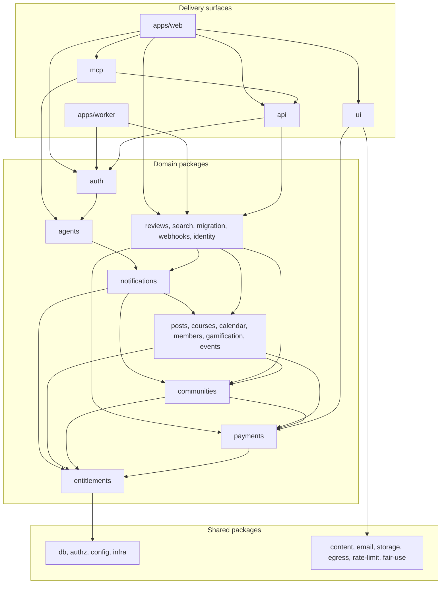
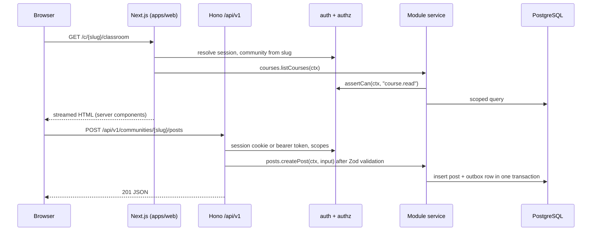

# Architecture overview

How Cohory 0.12.0 is structured as one deployable system: repository layout, modules and their boundaries, request and job flow, adapters, editions, deployment, observability, testing, and security.

Companion documents: [data-model.md](data-model.md), [payments.md](payments.md), [multi-tenancy.md](multi-tenancy.md), [authorization.md](authorization.md), [agent-integrations.md](agent-integrations.md). Architecture decisions are recorded as ADRs in [../decisions/README.md](../decisions/README.md). Requirement IDs refer to [../foundation/product-requirements.md](../foundation/product-requirements.md). MVP boundaries are in [../product/mvp-scope.md](../product/mvp-scope.md). Release history is in the CHANGELOG, not here.

## 1. Summary

| Concern | Choice | Label |
|---|---|---|
| Shape | Modular monolith, one codebase, one Docker image, two process roles (web, worker) | Confirmed (monolith), Recommendation (two roles) |
| Language and UI | TypeScript, Next.js App Router, Tailwind CSS, shadcn/ui, Radix, Lucide | Confirmed (initial preference) |
| HTTP API | Hono + Zod + OpenAPI mounted inside Next.js at `/api/v1` | Recommendation |
| Database | PostgreSQL only, Drizzle ORM, forward-only SQL migrations | Confirmed (Postgres, Drizzle), Recommendation (migration rules) |
| Auth | Better Auth for identity and sessions (`@cohory/auth`), one authorization module (`@cohory/authz`) | Confirmed (Better Auth), Recommendation (one policy module) |
| Jobs | pg-boss on PostgreSQL. BullMQ on Redis when `REDIS_URL` is set is planned, not built | Recommendation (deviates from the founder's Redis + BullMQ default, see ADR 0005) |
| Storage | Local disk by default, S3 compatible adapter | Recommendation |
| Search | PostgreSQL full text search | Recommendation |
| Monorepo | pnpm workspaces + Turborepo | Confirmed |
| Deployment | Docker Compose for self-hosting, same image on Cloud | Confirmed (Compose), Recommendation (Cloud outline) |

## 2. Why a modular monolith

**Confirmed.** The founder brief asks for a pragmatic modular monolith and no microservices without justification.

Reasons this holds for Cohory specifically:

1. **Self-hosting must stay simple.** REQ-NFR-HOST-003 asks for a working install on a 2 vCPU, 4 GB VPS in under 30 minutes. Every extra service is another container, port, secret, and failure mode for a non-specialist operator.
2. **Transactions cross modules.** A paid checkout touches Payments, Entitlements, Members, and Notifications. In one process with one database these are one transaction plus an outbox, not a distributed saga.
3. **The team is small and the domain is still moving.** Module boundaries will be wrong in places. Moving code between packages is cheap. Moving it between services with separate deployments and data stores is not.
4. **The load profile is modest.** A typical community has hundreds to thousands of members. Cloud scales by running more web and worker replicas against one PostgreSQL primary long before any module needs its own service.
5. **Comparable projects agree.** Twenty and Formbricks ship one image with web and worker roles. See [../research/comparable-projects.md](../research/comparable-projects.md).

Why not microservices: they would add network calls, partial failure handling, per service schemas, service discovery, and distributed tracing as a requirement rather than an option. None of that buys anything a creator can see.

When a module could be extracted later (**Recommendation**, not planned): only if it has a clearly different scaling or isolation need, for example media processing if video upload is added, or MCP if agent traffic dominates. The module boundary rules below keep that option open without paying for it now.

## 3. Repository layout

The repository is a pnpm workspace with three apps under `apps/` and 32 packages flat under `packages/`, one per module or shared concern. AGENTS.md section 2 holds the authoritative table; this section explains how the groups fit together.

**Delivery surfaces.** `apps/web` is the Next.js app: the pages, the REST API at `/api/v1` (it mounts `@cohory/api` from `apps/web/app/api/[[...route]]/route.ts`), `/mcp` (`apps/web/app/mcp/route.ts`), the Better Auth routes under `/api/auth`, the OAuth endpoints under `/oauth` with the consent page, the upload route `/api/uploads/[...key]`, the webhook receivers under `/api/webhooks`, the API reference at `/docs/api`, the importer limits pages under `/importers`, and the Cloud marketing pages. `apps/worker` is the pg-boss job runner built from the same image, plus the operator command line tools (`pnpm migration`, `billing`, `secrets`, `accounts`). `apps/e2e` holds the Playwright suite and lives under `apps/` because it is a runnable consumer of the built app. `packages/api` is the Hono app with the Zod schemas, the OpenAPI document, error mapping, the approval gateway, and the shared service wiring in `@cohory/api/services`. `packages/mcp` builds MCP tools from the API's route metadata and dispatches calls through the same HTTP handlers. `packages/ui` holds the shadcn/ui primitives and feature components, grouped by area in `packages/ui/src/{primitives,community,classroom,calendar,members,payments,migration,notifications,account}`; they take data and callbacks as props and never import a backend package.

**Domain modules.** One package per module from the list in section 4: `identity`, `communities`, `members`, `posts` (with comments), `courses` (with lessons), `calendar` (the Events module), `gamification`, `payments` (with subscriptions), `entitlements`, `notifications`, `migration`, `agents`, `reviews`, and `webhooks`. `packages/events` is the domain event outbox relay and job routing, not the Events module. `packages/search` composes the per module searches. `packages/auth` holds the Better Auth configuration, session and actor resolution, and the account forms. Each domain package holds its services, its Zod inputs, and its Postgres store, and exposes only what its `package.json` `exports` field lists.

**Shared infrastructure.** `packages/db` holds the Drizzle client, every table definition (`packages/db/src/schema`, one file per module), the SQL migrations (`packages/db/migrations`, `0000` to `0037` as of 0.12.0), the row level security helpers (`packages/db/src/tenancy`), ids (`src/ids.ts`), the outbox and audit log append helpers, the shared search query builder (`src/search.ts`), the shared repositories of [0031](../decisions/0031-community-access-module.md) (`src/repositories`), and the seed scripts. `packages/authz` is the permission matrix with `can()` and `assertCan()`; it depends on no other workspace package. `packages/config` holds the shared tsconfig, ESLint, Prettier, and Vitest presets and the platform config (`@cohory/config/platform`). `packages/infra` holds the structured logger. `packages/content` is the rich text format, `packages/email` the email drivers and templates, `packages/storage` the file storage drivers and image variants, `packages/egress` safe outbound HTTP, `packages/rate-limit` the in memory counters, and `packages/fair-use` the per edition limits. `packages/sdk` (the typed API client) and `packages/agent-runner` (the local evaluation runner for agent courses) are MIT and depend on no other package.

**Inside the web app.** Route groups under `apps/web/app`: `(auth)` for sign in and password pages, `(platform)` for `/account`, `/communities/new`, and the legal pages, `(marketing)` for the Cloud pages, `(importers)` for the importer limits pages, `c/[slug]` for the community shell with the four member tabs (`(member)` is the guarded route group for Classroom, Calendar, and Members; the Community tab is `c/[slug]/page.tsx`), `c/[slug]/manage` for the Manage area, `c/[slug]/membership` for the paid membership page, and `join/[token]` for invite links. `apps/web/components/<area>` holds the client wrappers that compose `@cohory/ui` components, and `apps/web/lib/<area>` holds the loaders and server actions that call the module services. `apps/web/proxy.ts` sets the nonce based Content Security Policy and redirects moved community slugs.

**Repository root.** `Dockerfile` builds the one image for web, worker, and migrations. `docker-compose.yml` runs it for development and `docker-compose.prod.yml` is the production overlay with Caddy (`docker/Caddyfile`). `scripts/` holds the local workflow scripts (`verify.sh`, `verify-changed.sh`, `e2e-host.sh`, `e2e-run.sh`, `upgrade-check.sh`, `backup.sh`, `restore.sh`), and `scripts/load` the k6 load test.

Rules (**Recommendation**):

- Each module is a workspace package (`@cohory/posts` and so on) with its own `package.json`. Allowed dependencies are declared explicitly, so the package graph itself enforces direction. A lint rule that fails CI on imports of another module's internal files is not built; the `exports` field of each `package.json` is what blocks them today.
- Each module exposes its public surface through the `exports` field (the main entry plus a few named subpaths such as `@cohory/entitlements/access`, `@cohory/payments/fee`, `@cohory/courses/agent-format`, `@cohory/storage/variants`). Everything else is internal.
- Table definitions live in `packages/db/src/schema`, and the owning module is the only one that queries them (AGENTS.md section 2).

## 4. Modules

Each module owns its tables, its service, and its events. Paragraphs describe responsibility, with the package that holds it as built and the durable names other docs do not state.

**Identity** (`@cohory/identity`, with Better Auth in `@cohory/auth`). People and their credentials: users, sessions, accounts (password, magic link), email verification, profile (name, username, avatar, bio, time zone), personal data export, and account deletion scheduled 14 days out. The hourly `identity.account-purge` job erases accounts past their date inside each community scope and keeps the `users` row as Former member so authored content stays; it writes other modules' tables directly, a recorded boundary exception (section 5). Knows nothing about communities.

**Communities** (`@cohory/communities`). The tenant. Creates communities with slug, name, privacy, join mode, appearance, categories and level names, archival and deletion, and owns slug history. As built it also holds memberships and joining (join requests, invite links, bans, ownership transfer, the members CSV export) and the Manage services. Logo and cover uploads live under `communities/{id}/branding/` and gallery images under `communities/{id}/gallery/`; invite redemption reads one link under the `app.invite_token` RLS setting through `POST /api/v1/invites/{token}/redeem`. Every other tenant scoped module references `community_id` from here. Emits `community.created`, `community.deleted`.

**Members** (`@cohory/members`). The member directory, profiles, bios, and usernames, with author levels for the feed. Membership rows themselves are written by Communities and read by other modules through the shared repository in `@cohory/db` ([0031](../decisions/0031-community-access-module.md)). The daily `members.last-seen-backfill` job fills missing last activity in batches. Emits `member.joined`, `member.role_changed`, `member.removed`, `member.banned` (the joined and removed events come from database triggers, [0016](../decisions/0016-database-triggers-append-domain-events.md)).

**Posts** (`@cohory/posts`, including Comments). Community feed content: categories with posting permissions, posts with sanitized rich text, images (uploaded through `POST /api/v1/communities/{slug}/uploads/post-image`), allowlisted video embeds, mentions, pins, follows, reports, scheduled posts (the `posts.publish-scheduled` job runs every minute), agent drafts, and "Email to all members". Comments are one reply level deep and attached to posts. Owns feed queries and the full text index on posts and comments. Emits `post.created`, `post.updated`, `post.deleted`, `comment.created`, `comment.deleted`, `report.resolved`.

**Courses** (`@cohory/courses`, including Lessons). Classroom structure: courses, modules, lessons with markdown bodies, allowlisted video links, attachments (stored under `communities/{id}/courses/{courseId}/attachments/`, 25 MB each), draft or published state, lesson progress, and the "Continue learning" query at `GET /api/v1/communities/{slug}/continue-learning`. The pure subpath `@cohory/courses/agent-format` holds the agent course format ([agent-course-format.md](agent-course-format.md)). Emits `course.published`, `lesson.completed`.

**Events** (`@cohory/calendar`). Single and weekly recurring events, occurrences 26 weeks ahead, cancellation of one occurrence, RSVPs, reminders, and `.ics` output. Stores a wall clock start plus the event's IANA zone and computes UTC per occurrence. Worker jobs: `calendar.reminders` every 5 minutes, `calendar.extend` weekly, `calendar.time-change` after a time or zone change, and `calendar.notice` for new event notices, RSVP confirmations, and invite updates. Emits `event.created`, `event.rsvp_changed`.

**Gamification** (`@cohory/gamification`). Points and levels. Receives like events through the `gamification.points` job, writes an append only points ledger, maintains per member totals and level, serves 7 day and all time leaderboards, awards learning points (`gamification.learning-points`, every 15 minutes), and supports admin reset. Can be switched off per community. Never called synchronously by Posts.

**Payments** (`@cohory/payments`, including Subscriptions). Money movement with providers: connections (Stripe Connect on Cloud, the creator's own Stripe keys on the Community Edition, Polar behind `COHORY_ENABLE_POLAR`), the membership plan, Checkout and the customer portal, the subscription mirror, the status to access mapping, comped access (the hourly `payments.comps-expiry` job ends expired grants), the pure fee module, the fee ledger, platform billing (`@cohory/payments/billing`), and provider webhooks, which the web route stores and the worker processes as `payments.webhook.process` ([0030](../decisions/0030-payment-webhooks-in-the-worker.md)). The only module that talks to a payment provider API. See [payments.md](payments.md).

**Entitlements** (`@cohory/entitlements`). One answer to "can this member access this resource". Community access is derived on read, not materialized: `communityAccessIn` from `@cohory/entitlements/access` returns the viewer's role and whether they are entitled, applying the paid access rule to the active membership, the subscription mirror, the closed connection date, and open comps. Every module's `withAccess`, the communities service, and the web page loader call it ([0031](../decisions/0031-community-access-module.md)). The package depends only on `authz`, `db`, and `infra`, so every domain package can import it; collaborators (agents, notifications, payments) arrive as injected ports from each composition root ([0044](../decisions/0044-composition-roots-and-shared-infrastructure.md)). It also owns agent course delegations (section 4.4 of [authorization.md](authorization.md)). Post-MVP purchases and level unlocks, and a materialized `entitlements` table (REQ-ENT-003), are not built.

**Reviews** (`@cohory/reviews`). Member reviews of a community: stars and text from members who have paid for at least 30 days, owner replies, reports, and hiding by the owner. Reads subscription facts from Payments and never computes access. Off by default per community. Emits `review.created`, `review.updated`, `review.deleted`, `review.hidden`. See [ADR 0025](../decisions/0025-reviews-module-boundary.md).

**Notifications** (`@cohory/notifications`). In app notifications and email. Receives events through the outbox and jobs (`notifications.fanout` for post events, `notifications.membership`, `notifications.domain`, `notifications.paid-membership`), applies per person preferences, and sends email from the worker: `notifications.email` every minute for types set to right away, `notifications.digest` every 15 minutes for the daily summary, `notifications.weekly-digest`, and `notifications.welcome` two minutes after a member joins. Unsubscribe links are HMAC signed and also work as one click `POST /api/v1/notification-preferences/unsubscribe`. Owns no business rules of other modules.

**Migration** (`@cohory/migration`). Getting data in and out: the versioned community archive ([archive-format.md](archive-format.md)), the members CSV import, the Skool and Circle importers, and the owner only Migration section in Manage. Worker jobs: `migration.export`, `migration.import`, `migration.members-import`, and the daily `migration.files-expiry`. Importer uploads go to `POST /api/v1/communities/{slug}/manage/migration/importers/{importer}/uploads` (rate limit `migrationPreview`, 50 an hour; confirming an import counts toward `migrationImport`, 10 an hour), and a finished import has a CSV report at `GET .../migration/jobs/{jobId}/report`. Archive export and import read and write other modules' tables directly, inside row level security, as a recorded boundary exception ([0015](../decisions/0015-migration-module-direct-table-access.md)). "Bring your existing subscribers" lives in Payments.

**Agent integrations** (`@cohory/agents`, `@cohory/api`, `@cohory/mcp`, `@cohory/webhooks`). API tokens, agent identities with an owning human, scopes, the approval queue, the OAuth authorization server for MCP clients, outbound webhooks (`webhooks.fanout`, `webhooks.deliver`, `webhooks.sweep`), and the MCP tool registry. See [agent-integrations.md](agent-integrations.md).

Cross cutting: the **audit log** is one table, `audit_log` in `packages/db/src/schema/manage.ts`. Communities owns reading it (Manage, Settings, Audit log and the CSV export); every other module appends entries through `appendAuditEntry` in `@cohory/db` inside its own transaction, and API requests stamp the actor, token, and agent through `runWithAuditSource`. **Recommendation:** revisit ownership if it becomes awkward.

## 5. Module boundary rules

**Recommendation.** These rules are enforced by package dependencies, the `exports` field, and review.

1. **Services are the only write path.** UI, API routes, MCP tools, jobs, importers, and seeds all call module services. No code outside a module writes its tables. Recorded exceptions: the shared repositories in `@cohory/db` (memberships, subscriptions, the audit log, [0031](../decisions/0031-community-access-module.md)), the Migration module ([0015](../decisions/0015-migration-module-direct-table-access.md)), Identity erasure (section 4), and the database triggers of [0016](../decisions/0016-database-triggers-append-domain-events.md).
2. **Explicit interfaces.** A module may call another module only through the other module's exported service functions, which accept a typed context (actor, community scope, transaction handle) and validated input.
3. **No cross module joins in write paths.** A module's queries touch only its own tables. Reading another module's data goes through that module's service or a shared repository.
4. **Domain events for reactions.** When module A needs to react to something in module B (points on a like, a notification on a mention), B appends an outbox row and A receives a job. B never imports A.
5. **Dependencies point one way.** Delivery surfaces depend on domain packages, domain packages depend on `db`, `authz`, and the shared packages, and a domain package never imports from `apps/*`. The graph is acyclic; each package declares its dependencies in `package.json`. A CI check for cycles is not built.
6. **Foreign keys across modules are allowed** (for example `posts.author_id` references `users.id`) because they protect integrity in one database. They do not grant permission to join.
7. **One composition root per process.** Services whose default wiring crosses modules are built once per process: `@cohory/api/services` for the web app and the `/api/v1` app it mounts (`getEntitlementsService`, `getCoursesService`, `getPostsService`, `getSearchService`, and `apiDeps(overrides)` for the routes), and `apps/worker/src/services.ts` (`defaultJobDeps`) for the worker. Domain packages take collaborators by injection and never build another module's default service ([0044](../decisions/0044-composition-roots-and-shared-infrastructure.md)).

The diagram shows the package dependency graph as built, from the `dependencies` field of each `package.json`, with small packages grouped. An arrow from a group means at least one package in it has that dependency; an arrow into a group means the source imports at least one package in it. Edges from domain packages to the shared packages are left out because every domain package has them.



Notes on the graph: `@cohory/ui` imports only `@cohory/content` and the pure `@cohory/payments/currency` and `@cohory/payments/fee` helpers, never a service. `@cohory/events` sits with the content modules because it imports `communities`, `payments`, and `posts` to publish their outbox rows, while `courses` imports it to publish course events. `@cohory/sdk`, `@cohory/agent-runner`, and `apps/e2e` (which imports the SDK) are outside the graph. Every domain package except `auth` and `events` imports `@cohory/authz` directly, and content modules import `@cohory/entitlements/access` for access checks.

## 6. Request lifecycle

**Recommendation.** Two entry points, one domain layer.



1. **Tenant resolution.** The `/c/{slug}` path names the community and the page loader resolves it to a `community_id`. Custom domains are not built. See [multi-tenancy.md](multi-tenancy.md).
2. **Actor resolution.** `packages/auth` turns a session cookie into a user actor; `packages/agents` turns an API token or an OAuth access token (at `/api/v1` and `/mcp`) into an actor with its scopes, applied by the bearer middleware in `packages/api/src/middleware/bearer.ts`.
3. **Reads in server components.** Pages call module services directly in process with a context. No HTTP hop. The first page of the feed renders on the server (REQ-POST-002).
4. **Mutations.** The web app runs server actions in `apps/web/lib/<area>` that validate with Zod and call the same services the API calls, through the shared composition root. Agents, the SDK, and MCP use `/api/v1`.
5. **Validation** happens once, at the edge of the service, with the Zod schema exported by the module. Hono route definitions reuse those schemas, which also produce OpenAPI.
6. **Authorization** happens inside the service, not in the page or route (see [authorization.md](authorization.md)).
7. **Errors** are typed domain errors with a stable `code`, mapped to HTTP status and a stable JSON error body by `packages/api` ([0032](../decisions/0032-error-catalog-and-list-shape.md)). Cross tenant access returns not found, never forbidden, so existence does not leak.

Mounting, from `apps/web/app/api/[[...route]]/route.ts`:

```ts
import { api } from "@cohory/api";

function handler(request: Request): Response | Promise<Response> {
  return api.fetch(request);
}

export { handler as DELETE, handler as PATCH, handler as POST, handler as PUT };
```

The `GET` export does the same after checking for a notification unsubscribe redirect. The Hono API has served the web client since Phase 1 with session auth; scoped tokens, the `/api/v1` stability promise, and MCP arrived with Phase 6 (REQ-AGT-001, 002).

## 7. Background jobs

**Recommendation** (ADR 0005). Jobs run in the worker process through a queue interface with two adapters.

| Adapter | When | Why |
|---|---|---|
| pg-boss (PostgreSQL) | Default, no `REDIS_URL` | No extra service for self-hosters. Jobs live in the same database, so enqueueing can share a transaction. Adequate for expected volumes (reminders, emails, webhooks, reconciliation). |
| BullMQ (Redis) | `REDIS_URL` set | Higher throughput, rate limited queues, familiar dashboards. Matches the founder's original preference. Expected on larger Cloud deployments. Not built. |

Rules:

1. **Every handler is idempotent.** A job may run more than once. Handlers check state before acting (for example "reminder already sent for occurrence X to member Y") or rely on unique constraints.
2. **Singleton keys** deduplicate scheduled work such as one welcome email per membership.
3. **Payloads carry ids, not objects.** Handlers load current state, because state may have changed since enqueue.
4. **Retries** use backoff with a cap. After the last attempt the job is marked failed and logged. An operator view of failed jobs with manual retry (REQ-NFR-OBS-004) is not built.
5. **Every job carries `community_id`** (or `null` for platform jobs) for logs, fair use limits, and tenant checks.
6. **Long work is chunked** (exports, imports, member emails) so one community cannot starve the queue.

As built, each job is one `JobDefinition` exported from its file under `apps/worker/src/jobs` (`definition.ts`): its name, queue and work options, a handler that receives `{ logger, deps, options }`, and either a cron schedule or a Zod `payloadSchema` that parses the ids in the payload. `worker.ts` keeps the list in `jobDefinitions`, and `registerJobs` creates, works, and schedules every queue from it, so a new job is one definition in one place ([0044](../decisions/0044-composition-roots-and-shared-infrastructure.md)).

The job families as of 0.12.0, by module: `outbox.relay` (every minute, section 8), `email.send`, `notifications.*` (section 4), `calendar.*` (section 4), `posts.publish-scheduled` and `posts.member-email`, `gamification.points` and `gamification.learning-points`, `members.last-seen-backfill`, `communities.purge-deleted` and `communities.creators-invite` ([0048](../decisions/0048-creators-community-invitation.md)), `identity.account-purge`, `payments.*` (webhook processing and the hourly `payments.webhook-sweep`, `payments.comps-expiry`, `payments.holds-expiry`, `payments.renewal-reminders`, `payments.reconcile`, `payments.fee-removal`, `payments.exit-run`, `payments.closed-billing-sweep`, `payments.member-billing-end`, `payments.moves-retention`), `billing.invoice` (00:15 UTC on the first day of each month) and `billing.reconcile` (daily), `migration.*` (section 4), `webhooks.*`, `approvals.expiry` (every 5 minutes), `agents.token_expiry_notice`, `agents.oauth_clients_prune`, `entitlements.delegations_sweep` (daily), `courses.agent-files-gc`, `feedback.moments` and `feedback.retention`, `secrets.reencrypt`, and `health.ping`. The schedules and behavior of the payment jobs are in [payments.md](payments.md), the operator view in [../operations/operator-guide.md](../operations/operator-guide.md).

## 8. Domain events and the outbox

**Recommendation.** Domain events are written to an outbox table in the same transaction as the state change. The worker dispatches them to subscribers as jobs.

As built ([ADR 0014](../decisions/0014-transactional-outbox.md)): the table is `outbox` (`packages/db/src/schema/outbox.ts`, forced row level security) with `id`, `community_id`, `topic`, `payload`, `attempts`, `last_error`, `published_at`, `claimed_until`, and `created_at`. Request code can only append rows (`appendOutbox` in `@cohory/db`). Services append one row per write with a topic such as `post_events`, `membership.events`, `course_events`, or `domain_events`, and database triggers append the member, lesson, RSVP, and subscription events of [0016](../decisions/0016-database-triggers-append-domain-events.md). The web app and the API relay post event rows right after commit (`publishPostEventsAfterCommit` in `@cohory/events`); the worker job `outbox.relay` sweeps pending rows every minute and deletes rows published more than 7 days ago. `@cohory/events` routes each topic to one pg-boss queue per consumer ([0013](../decisions/0013-domain-event-dispatch.md)) and fans every published event type out to outbound webhooks after the topic's own publisher. Jobs use the outbox row id as their pg-boss job id, so relaying a row twice never creates a second job.

Why an outbox rather than enqueueing directly: it works the same for pg-boss and a future BullMQ adapter (Redis cannot join a Postgres transaction), it gives an audit trail of what happened, and the same events feed outbound webhooks and, long term, plugin hooks.

Event naming: `<entity>.<past-tense-verb>`, versioned payloads, additive changes only within a version. A typed event envelope with `eventId:subscriber` job keys and a 30 day retention is the long term shape (**Recommendation**, not built).

## 9. Adapters chosen by environment

**Recommendation.** One package per concern, selected at boot from environment variables. Every concern has a default that needs no external service.

| Concern | Default | Alternatives | Selector |
|---|---|---|---|
| Queue | pg-boss | BullMQ (not built) | `REDIS_URL` present |
| File storage | Local disk volume (`/data/uploads`) | S3 compatible (AWS S3, MinIO, R2) | `STORAGE_DRIVER=local\|s3` |
| Email | SMTP (any server, Mailpit in dev) | One HTTP provider adapter, not built ([backlog](../product/backlog.md#email)) | `EMAIL_DRIVER=smtp\|log` |
| Search | PostgreSQL full text (`tsvector`, GIN) | None planned for MVP | n/a |
| Cache | In process | Redis (not built) | `REDIS_URL` present |
| Rate limits | In process counters | Redis (not built) | `REDIS_URL` present |
| Errors | Logs only | Sentry compatible DSN (not built) | `SENTRY_DSN` |
| Telemetry | Off | OpenTelemetry exporter (not built) | `OTEL_EXPORTER_OTLP_ENDPOINT` |

As built in 0.12.0: the queue is pg-boss only and `REDIS_URL` is not read, storage is `packages/storage` with `STORAGE_DRIVER=local|s3`, email is `packages/email` with `EMAIL_DRIVER=smtp|log`, rate limits are in memory counters in `@cohory/rate-limit` configured by `RATE_LIMIT_*`, and there is no Sentry or OpenTelemetry integration.

Storage serves user uploads through the access checked route `/api/uploads/[...key]` with safe content type headers (REQ-NFR-SEC-005). Community cover and gallery images are stored as `{name}.sized.{ext}` with WebP copies from `{name}.w160.webp` to `{name}.w1920.webp` (`@cohory/storage/variants` builds the `srcset`); the processor re-encodes the original without EXIF or GPS data and refuses images over 25 megapixels or that take more than 10 seconds (`image_too_large`) and bytes it cannot read (`image_unreadable`). The fair use storage limit counts the original and every copy.

## 10. Configuration and environment variables

**Recommendation.**

- One Zod schema validates all environment variables at boot. Built so far ([0033](../decisions/0033-platform-config-and-neutral-home.md)): `@cohory/config/platform` parses the platform settings once with Zod: `edition` (`COHORY_EDITION`), `appUrl` (`APP_URL`, else `BETTER_AUTH_URL`, else `http://localhost:3000`, without a trailing slash), `instance` (`INSTANCE_NAME`, `INSTANCE_LOGO_URL`), and `homeCommunity` (`HOME_COMMUNITY`). `getPlatformConfig()` caches the result; `parseEdition(env)` and `parseAppUrl(env)` serve packages that parse their own variables, and `@cohory/config/edition` holds the `Edition` type for client code. Other variables are validated per package.
- Names are upper snake case, grouped by prefix: `DATABASE_URL`, `APP_URL`, `BETTER_AUTH_SECRET`, `STORAGE_*`, `EMAIL_*`, `STRIPE_*`, `RATE_LIMIT_*`, `FAIR_USE_*`, `COHORY_*` for product settings.
- Secrets come only from the environment. Never from the database, never committed. Reading secrets from files named by `*_FILE` variables (Docker secrets) is not built.
- `.env.example` lists every variable with a comment and a safe default. A CI check that the schemas and the example match is not built.
- Instance settings an operator changes at runtime (signups open or closed, default community) in an `instance_settings` table with an operator screen are not built; as of 0.12.0 they are the environment variables `SIGNUP_MODE`, `HOME_COMMUNITY`, and `COMMUNITY_CREATION` (see [multi-tenancy.md](multi-tenancy.md) section 11).
- Payment secrets that belong to a creator (self-hosted Stripe keys) and webhook signing secrets are stored encrypted with keyrings from `PAYMENTS_ENCRYPTION_KEYS` and `WEBHOOKS_ENCRYPTION_KEYS` (REQ-NFR-SEC-002); the `secrets.reencrypt` job and `pnpm secrets` rotate them ([../operations/operator-guide.md](../operations/operator-guide.md)).

## 11. Edition flags

**Confirmed.** Community Edition is self-hosted, open source, 0% platform fee. Cloud Edition is managed with a 2% platform fee. **Recommendation.** There is no `ee/` folder and no license key. All code is in the public repository: AGPL-3.0 for the core, MIT for the SDK and the agent runner (ADR 0009, [../../LICENSING.md](../../LICENSING.md)).

How Cloud only behavior is isolated:

1. **One flag, read once.** `COHORY_EDITION=community` (default) or `cloud`. Exposed as `edition` from `packages/config` (`getPlatformConfig().edition`, `parseEdition`, and the `Edition` type). Code never reads the environment variable directly.
2. **Capabilities, not edition checks scattered in code.** The config module derives a capability set: `platformFee`, `stripeConnect`, `customDomainProvisioning`, `fairUseLimits`, `platformBilling`. Features check capabilities. Not built: packages read `edition` from the config and branch on it themselves.
3. **Cloud only code paths are adapters, not forks.** The fee module returns a rate of 0 unless the edition is Cloud with Stripe Connect. The provider registry returns the Stripe Connect adapter on Cloud and the own keys Stripe adapter on the Community Edition. Custom domain provisioning is not built.
4. **Community Edition stays whole.** Every member and creator feature works without Cloud capabilities. Removing Cloud adapters must not break a build. CI runs the test suite with `COHORY_EDITION=community`.
5. **Tests guard the money boundary.** A required test asserts that with `COHORY_EDITION=community` no code path creates an application fee or a fee ledger entry above zero.
6. **Cloud operational code that is not product code** (infrastructure as code, billing operations runbooks, abuse tooling specific to our hosting) lives in a separate private operations repository and is never imported by the product. **Open question:** whether to publish it.

## 12. Self-hosting deployment

**Recommendation.** One supported path: Docker Compose (REQ-NFR-HOST-001 to 005). The how-to is in [../self-hosting.md](../self-hosting.md) and [../operations/install.md](../operations/install.md); this section records the shape.

- **One image, three commands.** `docker-compose.yml` at the repository root builds the image from the root `Dockerfile` (or pulls `COHORY_IMAGE:COHORY_VERSION`) and runs it as `migrations` (`node packages/db/dist/migrate.js`), `web` (`node apps/web/server.js`), and `worker` (`node apps/worker/dist/index.js`), so versions cannot drift.
- **Migrations are a one-shot service.** `web` and `worker` start only after `migrations` completes successfully. It takes a PostgreSQL advisory lock so two runs cannot overlap, and the web process never runs migrations itself. The migration runner needs `DATABASE_ADMIN_URL` while the app processes use the less privileged `DATABASE_URL`.
- **PostgreSQL** (`postgres:17.11`) runs in the same Compose project with a `pgdata` volume. Uploads live in the `uploads` volume mounted at `/data/uploads` for web and worker.
- **Optional profiles.** `redis` (nothing reads it yet, see section 9) and `mail` (Mailpit for local email) are profiles in the base file; MinIO is not shipped, an S3 compatible bucket is configured through `STORAGE_*`.
- **Production overlay.** `docker-compose.prod.yml` pins the image to `COHORY_VERSION`, takes PostgreSQL and web off the host network, sets memory limits from REQ-NFR-HOST-002, rotates container logs, adds healthchecks (web on `GET /api/v1/health`, the worker through `healthcheck.js --restart`), and runs Caddy from `docker/Caddyfile` with automatic TLS for `DOMAIN`. The Caddyfile forwards `X-Forwarded-For`, `X-Forwarded-Proto`, and `X-Forwarded-Host`, allows request bodies up to 30 MB (the 25 MB attachment limit plus overhead), and streams responses. Any other proxy must do the same.
- **Backups and upgrades.** `scripts/backup.sh` and `scripts/restore.sh` cover `pg_dump` and the uploads volume; `scripts/upgrade-check.sh` migrates a database from an older release and checks it through the app. Upgrading is `COHORY_VERSION`, `docker compose pull`, `docker compose up -d`, with any manual step in the release notes.
- **Home community.** `HOME_COMMUNITY` sends signed out visitors who open `/` to that community's About page. See [multi-tenancy.md](multi-tenancy.md).
- **No calls home.** No telemetry or update check is on by default (REQ-NFR-HOST-005).

## 13. Cloud deployment outline

**Recommendation.** Cloud runs the same image with `COHORY_EDITION=cloud`.

- Managed PostgreSQL with point in time recovery and a read replica for heavy read models later.
- Web replicas behind a load balancer, worker replicas scaled by queue depth. Redis with BullMQ once that adapter is built.
- S3 compatible object storage behind a CDN for media, on a separate origin.
- Custom domains with automatic TLS are not built.
- Stripe Connect platform account with platform level and connected account webhook endpoints.
- Migrations run as a one-shot job in the deploy pipeline before new replicas start. Expand and contract rules in [data-model.md](data-model.md) make this safe with old and new versions running side by side.
- Regions: **Open question** (REQ-NFR-PRIV-003).

## 14. Observability

**Recommendation.**

- **Logs.** Every process logs through `@cohory/infra/logger` ([0044](../decisions/0044-composition-roots-and-shared-infrastructure.md)): one JSON line per entry with `level`, `time`, `service`, `msg`, and the fields, with `password`, `token`, `secret`, `authorization`, and `cookie` redacted at any depth, errors serialized, `child` loggers for bound fields, and `LOG_LEVEL` read from the environment. Warnings and errors go to stderr, the rest to stdout. An ESLint `no-console` rule keeps package sources, the web app, and the worker on it. No personal data, tokens, or message bodies in log messages (REQ-NFR-OBS-001). Request and job ids on every line are not built.
- **Health.** `GET /api/v1/health/live` (process up) and `GET /api/v1/health` (readiness, `packages/api/src/readiness.ts`). The worker writes a heartbeat file (`WORKER_HEARTBEAT_FILE`) that `apps/worker/dist/healthcheck.js` checks instead of serving a port. Compose healthchecks use both.
- **Tracing and metrics.** OpenTelemetry instrumentation for HTTP, database, and jobs, off unless an OTLP endpoint is configured (REQ-NFR-OBS-003). Not built.
- **Business alerts (Cloud).** Fee ledger reconciliation mismatches, webhook processing lag, failed job rate. The worker logs `payment webhook retries exhausted` and `payment webhook event abandoned` for alerting ([../operations/operator-guide.md](../operations/operator-guide.md)).
- **Operator view.** Failed jobs with retry, queue depth, last webhook received per provider connection. Not built beyond `last_webhook_at` on a connection and the `pnpm billing replay-webhook` command.

## 15. Performance budgets

From REQ-NFR-PERF-001 to 005. **Recommendation** for how to meet them:

| Budget | Approach |
|---|---|
| LCP under 2.5 s on member routes | Server components render the first view. Images resized on upload, served with width hints. No client side data fetching for the first page. |
| INP under 200 ms, CLS under 0.1 | Optimistic updates for likes and RSVPs. Reserved space for media and embeds. Embeds load on click. |
| Initial JS under 200 KB compressed for member routes | Client components only for interactive islands (composer, player, reactions). A bundle size check in CI per route group is not built. |
| API p95 under 300 ms reads, 500 ms writes | Indexed tenant scoped queries, cursor pagination, no N+1, side effects moved to jobs. |
| 5,000 members, 100 concurrent users on 2 vCPU, 4 GB | The k6 script in `scripts/load`, measured in [../operations/load-test.md](../operations/load-test.md). |

Database rules that support these budgets are in [data-model.md](data-model.md).

## 16. Testing strategy

**Recommendation.** Vitest for unit and integration tests, Playwright for end to end. What runs and how is in [../open-source/testing.md](../open-source/testing.md).

| Layer | What | How |
|---|---|---|
| Unit | Domain services and pure logic: fee calculation, rounding, level thresholds, recurrence and time zones, entitlement derivation, status mapping, policy matrix | Vitest, no database, fake clock. |
| Integration | Services against real PostgreSQL: tenant scoping and row level security, unique constraints, outbox, migrations up from empty and from the previous release | The test PostgreSQL from `scripts/testinfra-up.sh`, one schema per run. |
| Contract | `/api/v1` responses match the OpenAPI document, and every route is documented | Tests inside `packages/api` and the generated SDK types. |
| Provider | Stripe flows in test mode: Connect onboarding, Checkout, webhooks, refunds | Recorded webhook payloads and the in process fake provider (`@cohory/payments/testing`). |
| End to end | Critical journeys from [../product/user-journeys.md](../product/user-journeys.md): sign up, create community, post, course progress, RSVP, paid join through Stripe Checkout test mode, cancel, self-hosted install | Playwright against the host build (`pnpm e2e:host`) or the production image (`pnpm e2e`). Accessibility checks with axe on every visited page (REQ-NFR-A11Y-002). |

Mandatory before merge (**Confirmed** in the brief for financial calculations, auth, permissions, and subscription logic):

- Money: fee calculation and rounding, ledger entries for every webhook type, refund and dispute fee reversal, idempotent replay, zero fee on Community Edition.
- Auth: session revocation, magic link expiry and single use, token scope checks.
- Permissions: the full policy matrix as table driven tests, plus cross tenant tests for every route group (see [multi-tenancy.md](multi-tenancy.md)).
- Subscriptions: every provider status to access state transition, out of order webhook delivery.

## 17. Security baseline

**Recommendation**, aligned with REQ-NFR-SEC-001 to 006. The threat model is in [../security/threat-model.md](../security/threat-model.md).

- Tenant isolation in one data access layer with forced row level security and cross tenant tests ([multi-tenancy.md](multi-tenancy.md)).
- Authorization in services through one policy module ([authorization.md](authorization.md)).
- Sessions: HttpOnly, Secure, SameSite=Lax cookies. CSRF protection on cookie authenticated mutations. Bearer tokens are never accepted from cookies.
- Passwords hashed by Better Auth defaults. Rate limits on sign in, magic link requests, sign up, invitations, posting, search, and API tokens.
- Rich text validated against the strict schema on write and escaped on render. Video embeds only from the allowlist, rendered after a click.
- Uploads: size and type limits checked server side, images re-encoded, files served through the access checked uploads route.
- Content Security Policy with nonces (`apps/web/proxy.ts`).
- Server side fetches (webhook deliveries, imports) go through `@cohory/egress`, which blocks private network ranges, pins DNS, checks redirects, and enforces timeouts and size limits.
- Secrets encrypted at rest where stored (creator Stripe keys, webhook signing secrets). Card data is never handled (Stripe Checkout only).
- Webhook signatures verified on the raw body before parsing; each event id stored once.
- Dependency audit, secret scanning, and SAST in CI. Published security policy and disclosure process.
- Audit log for role changes, bans, exports, payment settings, token creation, and every agent action.

## 18. Decisions and open questions

| Label | Item |
|---|---|
| Confirmed | Modular monolith. TypeScript, Next.js, PostgreSQL, Drizzle, Better Auth, Docker Compose, pnpm + Turborepo as initial stack. |
| Confirmed | Community Edition 0% fee, Cloud Edition 2% fee ([ADR 0027](../decisions/0027-safe-exit-and-2-percent-fee.md)), same product. |
| Confirmed | Tests required for financial calculations, auth, permissions, and subscription logic. |
| Recommendation | One image, two process roles (web, worker), plus the one-shot `migrations` service. |
| Recommendation | Repository layout in section 3, one workspace package per module, dependencies declared in `package.json`. A CI check for cycles and internal imports is not built. |
| Recommendation | Hono + Zod API inside Next.js at `/api/v1`, used by the web client since Phase 1 and by tokens, the SDK, and MCP since Phase 6. |
| Recommendation | pg-boss default, BullMQ when `REDIS_URL` is set (not built). Redis optional in Compose. |
| Recommendation | Outbox table for domain events, with triggers for the events of [0016](../decisions/0016-database-triggers-append-domain-events.md). |
| Recommendation | Edition via `COHORY_EDITION`. Derived capabilities are not built. No `ee/` folder. |
| Recommendation | Local disk storage, SMTP email, and PostgreSQL search as defaults. |
| Assumption | Expected volumes fit pg-boss on the reference self-hosted footprint. The 0.2.0 load test is in [../operations/load-test.md](../operations/load-test.md). |
| Assumption | One PostgreSQL primary is enough for Cloud through the MVP period. |
| Resolved | Lessons live in `@cohory/courses`, Comments in `@cohory/posts`, and Subscriptions in `@cohory/payments`; the brief's separate modules did not need separate packages. |
| Open question | Cloud hosting regions. |
| Open question | Whether the Cloud operations repository is public. |
