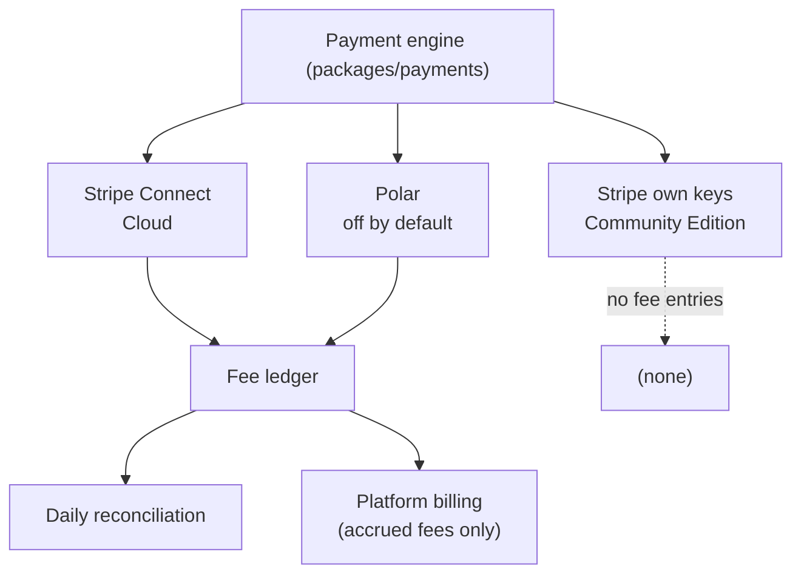

# Payments

How the payment engine is built: Stripe Connect on Cloud, own Stripe keys on the Community Edition, webhooks processed in the worker, subscription sync, refunds and disputes, the fee ledger, the provider abstraction, platform billing, subscription ownership, safe exits, and the testing rules for money code.

Fee rules (base, rounding, refunds, disputes) are defined in [../foundation/business-model.md](../foundation/business-model.md) and repeated here only where the mechanism depends on them. Table shapes are in [data-model.md](data-model.md). How-to steps for operators and creators are in [payment-providers.md](../operations/payment-providers.md), [platform-billing.md](../operations/platform-billing.md), and [payment-migration.md](../operations/payment-migration.md). Nothing here is legal or tax advice.

**How to read the labels.** **Confirmed** means a founder decision or an Accepted decision record. **Recommendation** is our proposal. **Assumption** is believed true but not verified. **Open question** needs a decision. **Verified** means checked against the cited Stripe documentation (2026-10-17 unless dated otherwise) or against a Stripe sandbox run recorded in section 13. **Unverified** Stripe behavior is listed in section 12.

## 1. Scope by edition

| Path | Edition | Platform fee | State |
|---|---|---|---|
| Stripe Connect, direct charges on the creator's account | Cloud | 2%, collected as an application fee at charge time | Built |
| Creator's own Stripe API keys | Community Edition | 0%, no Cohory service in the payment path (REQ-PAY-002) | Built |
| Polar (bring your own provider, REQ-PAY-008) | Both, off unless `COHORY_ENABLE_POLAR=true` | 2% on Cloud, accrued in the ledger and invoiced monthly; 0% on the Community Edition | Built, disabled by default ([0027](../decisions/0027-safe-exit-and-2-percent-fee.md)) |
| Link existing Stripe subscriptions | Community Edition | 0% | Built (10.1, 12.9) |
| Members subscribe again with free time | Both | Per edition | Built ([0042](../decisions/0042-moving-paying-members.md)) |
| One-time purchases | Both | Per edition | Not built |

**Confirmed** ([0007](../decisions/0007-stripe-connect-direct-charges.md), rate in [0027](../decisions/0027-safe-exit-and-2-percent-fee.md)): Cloud uses Stripe Connect with direct charges and a 2% application fee; a provider that cannot split the fee accrues it in the ledger and is invoiced monthly. Self-hosted pays no platform fee. Processing fees are separate.

## 2. Stripe Connect design (Cloud)

### 2.1 Account configuration

**Confirmed** ([0007](../decisions/0007-stripe-connect-direct-charges.md)): the creator owns a full Stripe account with full Dashboard access, pays Stripe's processing fees directly, and Stripe, not Cohory, carries negative balances. Stripe labels the legacy account types (Standard, Express, Custom) as deprecated for new platforms and points to Accounts v2 (**Verified**, https://docs.stripe.com/connect/accounts-v2/connected-account-configuration). Cohory creates Accounts v2 accounts with:

| Property | Value | Effect |
|---|---|---|
| `dashboard` | `full` | The creator manages customers and subscriptions in the full Stripe Dashboard |
| `defaults.responsibilities.fees_collector` | `stripe` | Stripe deducts its processing fee and our application fee from each payment |
| `defaults.responsibilities.losses_collector` | `stripe` | Stripe, not Cohory, carries negative balance liability |
| `configuration.merchant` capability `card_payments` | requested | The account can take card payments |

Responsibilities cannot be changed after the merchant configuration is added (**Verified**, same source). The sandbox refuses Accounts v1 `type` accounts and any account where the platform collects losses, so there is no v1 path (12.7).

### 2.2 Onboarding

"Connect your Stripe account" in Manage, Payments, after the creator accepts the Creator Terms ([0039](../decisions/0039-legal-pages-and-data-rights.md)) and re-authenticates ([authorization.md](authorization.md) section 10):

1. Manage, Payments asks for the country of the business (Stripe's Connect countries, default "Same as this platform"), because Stripe requires `identity.country` before the merchant configuration and the creator cannot change it on the hosted form.
2. Cohory creates the account and an Accounts v2 Account Link (`use_case.type = account_onboarding`) that returns to `/c/{slug}/manage/payments?stripe=return` or `?stripe=refresh`. Links are single use and expire, so every click gets a fresh idempotency key (12.2).
3. On return Cohory fetches the account and reads `charges_enabled` and `details_submitted`; `account.updated` keeps them current. The plan is purchasable only while `charges_enabled` is true.

Cloud onboarding always creates a new connected account. It never attaches an account the creator already owns, so Cloud holds no pre-existing subscriptions to link ([0042](../decisions/0042-moving-paying-members.md)).

### 2.3 Charges: direct, on the connected account

**Confirmed** direct charges ([0007](../decisions/0007-stripe-connect-direct-charges.md)). **Verified** (https://docs.stripe.com/connect/subscriptions): the charge is created on the connected account, refunds and chargebacks debit that account's balance, and direct charges are recommended for accounts with full Dashboard access. **Assumption** (business-model.md): the creator is the merchant of record in the legal sense, subject to legal review.

### 2.4 Checkout for memberships

Stripe Checkout in `subscription` mode, created on the connected account with the `Stripe-Account` header. The session carries the plan Price, `client_reference_id`, and metadata with the community, user, and plan ids on both the session and `subscription_data`; `subscription_data.application_fee_percent = bps / 100` is set only when the effective rate is above zero. Success returns to `/c/{slug}/membership?checkout=success&session_id={CHECKOUT_SESSION_ID}`, cancel to `/c/{slug}/membership?checkout=cancel`. Every click creates a new session and expires the member's other open sessions, so a member who opened the monthly and then the annual tab can pay only the last one (12.2).

**Verified** (https://docs.stripe.com/api/checkout/sessions/create): `application_fee_percent` takes 0 to 100 with at most two decimals (so 2 is valid) and requires the request to be made as the connected account. Products and Prices live on the connected account, which direct charge subscriptions require (**Verified**, https://docs.stripe.com/connect/subscriptions).

Access is granted from webhooks (section 4), never from the success redirect alone. The success page polls Cohory's own state and shows "Finishing up" until the subscription grants access.

### 2.5 The fee on subscriptions and the tax issue

**Verified** (https://docs.stripe.com/connect/subscriptions): `application_fee_percent` is taken each billing period from the final invoice amount (including bundled items, discounts, and balance adjustments) before Stripe fees. It does not apply to invoices created outside the billing period, such as immediately invoiced prorations; those need `application_fee_amount` on the invoice, which overrides the percent and is set from a webhook on `invoice.created`. A platform cannot add `application_fee_amount` to an invoice it did not create.

**Assumption:** "final invoice amount" includes tax when tax is added to the invoice, so the percent alone would charge the fee on tax. The proposed fee base is post-discount and pre-tax (business-model.md, Open question).

**Recommendation**, not built (12.6): keep `application_fee_percent` as the fallback; when an invoice carries tax, an `invoice.created` handler sets `application_fee_amount = round_half_up(total_excluding_tax * 200 / 10000)` on the draft; if the override missed finalization, reconciliation refunds the excess and writes an `adjustment` entry. Communities without tax on invoices (the default) need none of this: the percent is exact.

### 2.6 One-time purchases

Not built. The design is Checkout in `payment` mode on the connected account with `payment_intent_data.application_fee_amount` from the fee module. **Verified** (https://docs.stripe.com/connect/direct-charges): the application fee must be positive and below the charge, carries no extra Stripe fee, and platforms outside Brazil cannot collect it from Brazilian accounts.

### 2.7 Community Edition: own keys

The creator pastes a secret or restricted key and a webhook signing secret for their own Stripe account; both are stored encrypted (12.1). The same subscription code runs without the `Stripe-Account` header and without an application fee: `effectiveFeeBps` in the fee module returns 0 for `stripe_own_keys` and for every provider when `COHORY_EDITION` is not `cloud`, and a unit test asserts it. The webhook URL is `/api/webhooks/stripe/own/{connectionId}`.

## 3. Currency handling

- One currency per community, set when the paid plan first goes on sale and locked while a plan is active. Changing it means archiving the plan.
- Amounts are integers in minor units. `packages/payments/src/currency.ts` (`stripeCurrencies`, `stripeCurrency(code)`) lists the 24 currencies Stripe settles in with `code`, `exponent`, `minimumChargeMinor`, and `zeroDecimal` (JPY is the only zero decimal one), taken from Stripe's [minimum charge amounts](https://docs.stripe.com/currencies#minimum-and-maximum-charge-amounts) and [zero decimal list](https://docs.stripe.com/currencies#zero-decimal) on 2026-10-22. `upsertPlanInputSchema` refuses a currency outside the table and a price below its minimum ("Set a price of at least 0.50 USD. Stripe does not accept smaller charges."), because a currency outside the table has an exchange rate dependent minimum that could fail at renewal. The UI money helpers (`packages/ui/src/payments/money.ts`) read decimals from the same table.
- The platform fee is computed and collected in the charge currency. Cohory never converts currencies. The ledger stores the currency on every entry, and reports never sum across currencies.

## 4. Webhooks

### 4.1 Endpoints

Three Next.js route handlers read the raw body and hand it to one service entry point, `handleWebhook(target, delivery)` (8.1). The Hono API is not used for webhooks.

| Endpoint | Serves | Signing secret |
|---|---|---|
| `/api/webhooks/stripe` | The platform account and every connected account on Cloud. Stripe's "Your account" and "Connected accounts" destinations both point here. Platform billing events (`cohory_platform_invoice_id` or a setup session with `cohory_billing_account_id`) are handled first; every other event goes to the payments handler | `STRIPE_WEBHOOK_SECRET` and `STRIPE_CONNECT_WEBHOOK_SECRET`; either verifies |
| `/api/webhooks/stripe/own/{connectionId}` | A creator's own Stripe account (Community Edition) | The secret stored encrypted on the connection |
| `/api/webhooks/payments/{connectionId}` | A Polar connection | The secret stored encrypted on the connection |

**Verified** (https://docs.stripe.com/connect/webhooks): events from connected accounts carry a top level `account` property, follow up API calls for that object must be made as the connected account, and production Connect endpoints receive both live and test events. Events whose `livemode` does not match the key in use are acknowledged and ignored, as are events from unknown accounts. The Dashboard endpoints must use the pinned API version (12.2).

### 4.2 Events handled

| Event | Action |
|---|---|
| `checkout.session.completed` | Link the Stripe customer and subscription to the member. On the platform account, a `setup` mode session saves the creator's card for platform billing (12.11) |
| `checkout.session.expired` | Release the member's invite hold early (12.19) |
| `customer.subscription.created`, `.updated`, `.deleted` | Fetch the subscription, update the mirror, recompute access, activate or remove the membership (12.4) |
| `invoice.paid` | Record the payment and extend the period end |
| `invoice.payment_failed` | Notify the member (email and in-app for attempts 1 to 3, and whenever Stripe plans no further try) and the owner (in-app, attempt 1); access follows 5.1 ([0034](../decisions/0034-notification-types-and-weekly-digest.md)) |
| `charge.refunded` | Refund the fee share still owed and write `fee_refunded` (12.5) |
| `charge.dispute.created`, `.updated`, `.closed`, `.funds_withdrawn`, `.funds_reinstated` | Fetch the dispute, record its state on the payment, notify the owner once, refund the fee on a lost dispute (section 6, 12.5) |
| `radar.early_fraud_warning.created` | Log the warning with the charge id |
| `application_fee.created` | Write `fee_collected` with Stripe's fee next to the computed one, or refund the fee when the connection is leaving (12.8) |
| `application_fee.refunded` | Record the provider side of a fee refund |
| `account.updated` | Update `charges_enabled`, `details_submitted`, and the status shown in Manage, Payments |
| `account.application.deauthorized` | Close the connection and record the exit (10.4, 12.8) |
| `invoice.finalized`, `.sent`, `.paid`, `.payment_succeeded`, `.payment_failed`, `.voided`, `.marked_uncollectible`, `.overdue` on the platform account | Platform billing: store the invoice status and run dunning (12.11) |

For a `disconnected` connection only the two `application_fee.*` events and `account.application.deauthorized` are processed; anything else answers `ignored`. Not handled: `invoice.created` (the tax override of 2.5) and `invoice.payment_action_required`. Dispute event names and statuses are **Verified** against the pinned SDK types (`stripe` 23.0.0) and the recorded fixtures (section 11). The event list each Stripe destination needs is in [platform-billing.md](../operations/platform-billing.md) and [payment-providers.md](../operations/payment-providers.md).

### 4.3 Processing rules

**Confirmed** ([0030](../decisions/0030-payment-webhooks-in-the-worker.md)). **Verified** (https://docs.stripe.com/webhooks): signature verification needs the raw body and the `Stripe-Signature` header with a 5 minute tolerance, events arrive more than once and out of order, `created` must not order them, retries last up to three days, and handlers should answer 2xx quickly and process asynchronously.

1. The route verifies the signature with the secret for that endpoint and answers 400 on failure.
2. It inserts the event into `provider_events` with a unique `(provider, external_event_id)`, storing the id, type, account, mode, and a SHA-256 hash of the body, never the payload. A duplicate of a processed event answers 200 `duplicate`.
3. It queues `payments.webhook.process` (ids only) and answers 200 `queued`. If the job cannot be queued it answers 500 so Stripe retries.
4. The worker claims the row with a two minute lease, fetches the event from Stripe by id (as the connected account when it came from one), refuses an event whose id or type differs from the row, then fetches the current object and derives state from it, so order does not matter.
5. Side effects use idempotency keys derived from Stripe ids (`fee:collected:{feeId}`, `fee:refunded:{feeRefundId}`), so a reprocessed event is a no-op.
6. A failed job retries 10 times with backoff from 30 seconds. Because the request already answered 200, the hourly `payments.webhook-sweep` job queues again every unprocessed Stripe row older than one hour and younger than three days; after three days the row is marked `abandoned` and logged once. Replay is `pnpm billing replay-webhook <eventId>` ([operator guide](../operations/operator-guide.md#payment-webhooks-that-did-not-process)).
7. `payments.reconcile` runs daily per connection and repairs the mirror and the ledger from the provider's current objects (12.3).

Polar, which has no API to fetch an event by id, and a service built without a queue (tests and scripts) process in the request and answer `processed`, `ignored`, `in_progress` (409), or `failed` (500).

## 5. Subscription lifecycle sync

### 5.1 Status mapping

**Recommendation**, consistent with [../product/mvp-scope.md](../product/mvp-scope.md) section 2.9 (past due keeps access, canceled or unpaid removes it). The mirror stores the result as `access_state` (`none`, `granted`, `grace`, `revoked`).

| Stripe status | Access state | Member sees |
|---|---|---|
| `incomplete` | none | "Payment not completed" with a retry link |
| `incomplete_expired` | none | Join page |
| `trialing` | granted | Normal access |
| `active` | granted | Normal access |
| `active` with `cancel_at_period_end` or a scheduled `cancel_at` | granted until the period end | "Membership ends on {date}" |
| `past_due` | grace (access kept) | Banner: "Update your payment method" with a portal link |
| `unpaid` | revoked | Join page with "Renew" |
| `canceled` | revoked at `ended_at` | Join page with "Rejoin" |
| `paused` (`pause_collection` set) | granted until the paid through date, then revoked | "Payments paused" with "Resume payments" ([0040](../decisions/0040-fair-cancel-and-pause.md)) |

How long `past_due` lasts is set by the creator's Stripe retry and dunning settings. **Recommendation:** onboarding guidance tells creators to set the final action to "cancel subscription" or "mark unpaid", so access eventually ends (REQ-SUB-004). A Cohory side grace period is not built.

### 5.2 Membership linkage

- Checkout carries the community, user, and plan ids in subscription metadata and `client_reference_id`. The webhook handler links on those, never on email. Linked imports are found through `payment_customers` (12.9).
- One member, one paid subscription per community. Checkout refuses a member who already has access; a second paid subscription is detected and refunded by the sync (12.4).
- Comped access is a `comped_memberships` row granted from Manage, Payments, independent of the provider. On Cloud a grant by email writes a `comp_invitations` row and emails an offer the person accepts on `/c/{slug}/membership` with a confirmed matching email; the API exposes the same (`listMyCompOffers`, `acceptCompOffer`, session only). On the Community Edition grants apply at once (founder decision, 2026-10-21).
- Cancel and payment method changes happen in the Stripe customer portal on the connected account (REQ-SUB-003). Since [0040](../decisions/0040-fair-cancel-and-pause.md), "Cancel membership" first opens a Cohory screen with the member's usage, a switch to yearly, and a pause, then the portal's cancel flow (12.19).
- Removing or banning a paying member ends the subscription now, without proration or refund ([0029](../decisions/0029-remove-or-ban-ends-billing.md)). Communities hands `membership.removed_by_staff` to Payments, which queues `payments.member-billing-end` (singleton per member); the worker cancels every granting subscription with key `staff-removal:{subscription id}` and marks the mirror revoked, only while the membership is still banned or removed by staff. Leaving on your own never touches billing (12.17).

## 6. Refunds, disputes, and fee reversal

Rules come from [../foundation/business-model.md](../foundation/business-model.md): proportional fee refund on refunds, fee refund on lost disputes.

**Refunds** are made in the creator's Stripe Dashboard; Cohory has no refund screen (12.6). The adapters implement `refund`, which Cohory calls only to return a duplicate second subscription (12.4). **Verified** (https://docs.stripe.com/connect/direct-charges): application fees are not refunded automatically with a direct charge refund. On `charge.refunded` Cohory computes the fee share still owed with `cumulativeFeeRefundDue` (proportional, round half up, capped at the fee collected) and refunds it through the Application Fee Refunds API; each fee refund becomes a `fee_refunded` entry (12.5). **Verified** in the sandbox (12.7): a refund made outside Cohory returned the fee this way.

**Disputes** ([0028](../decisions/0028-stripe-disputes.md)). **Verified** (https://docs.stripe.com/connect/disputes): for direct charges the disputed amount and the dispute fee are debited from the connected account, and the response is made as the connected account. While a dispute is open nothing changes in the ledger or in access. On a lost dispute Cohory refunds the platform fee on the disputed amount and writes `fee_refunded` with reason `dispute_lost`; on a won dispute nothing changes. The handler computes what is still owed from the fee's current `amount_refunded`, so if Stripe ever returns the fee by itself Cohory records that and refunds nothing more (12.5).

## 7. The fee ledger

**Confirmed** ([0008](../decisions/0008-platform-fee-ledger.md)): every path writes to `fee_ledger_entries`, the single source of truth for what Cohory earned. On Cloud every successful transaction writes an entry, including when the computed fee is zero. The Community Edition writes none. The table is append only: the application role has no update or delete policy, and corrections are new `adjustment` rows.

| Column | Meaning |
|---|---|
| `kind` | `fee_accrued` (no fee split, billed monthly), `fee_collected` (split at charge time), `fee_refunded`, `adjustment`, `invoice_settled` (enum value kept, no rows written; settlement lives on `platform_invoices`) |
| `reason` | `dispute_lost` on a refund entry caused by a lost dispute, else null |
| `provider`, `collection_method` | The provider id and `automatic_split` or `periodic_invoice` |
| `payment_id` | The `payments` row the entry belongs to, when known |
| `base`, `currency` | Fee base in minor units and the charge currency |
| `rate_bps` | The rate of this entry, stored per entry so a rate change never rewrites history ([0027](../decisions/0027-safe-exit-and-2-percent-fee.md)) |
| `computed_fee` | `computeApplicationFee(base, rate_bps)`, integer math, round half up |
| `provider_fee` | The fee as the provider reports it (Stripe `ApplicationFee.amount`), null when accrued |
| `external_ref`, `idempotency_key` | The provider id and a unique key derived from it |
| `occurred_at` | When the provider says the money moved |
| `former_community_id`, `former_community_name` | Set when the community is deleted; the entry survives the deletion (12.15) |

Rules:

1. Stripe's amount is authoritative for money moved; both values are kept and a difference above one minor unit is logged.
2. `packages/payments/src/fee.ts` is the only code that computes fees: `computeApplicationFee`, `cumulativeFeeRefundDue`, `disputeFeeRefundDue`, `allocateFeeRefunds`, `effectiveFeeBps`, `applicationFeePercent`, and `feeBpsFromPercent`. It is pure, has no I/O, and is covered by table and property tests.
3. The rate comes from `PLATFORM_FEE_BPS` (default 200) and is never written anywhere else.
4. Manage, Payments shows the creator gross, processing fee as reported, platform fee, and net per transaction (REQ-PAY-006).

## 8. Payment provider abstraction

One interface, one adapter per provider, and a capability record reviewed before a provider is offered (business-model.md). Domain code consumes normalized events, never provider payloads. Providers are not assumed to share capabilities (**Confirmed** in the brief).

### 8.1 Interface

`packages/payments/src/providers/types.ts` defines `PaymentProvider`: `capabilities`, `getAccountState`, `provisionPlan`, `retirePrice`, `createCheckout` (the request carries the idempotency key and the fee in basis points), `createPortalSession`, `getSubscription`, `cancelSubscription`, `refund`, `deleteCustomer`, `verifyWebhook`, and `normalizeEvent`, which returns `null` for event types the provider does not handle (answered as `ignored`) and an empty list for handled events that change nothing. Stripe only operations (`listSubscriptions`, `getSubscriptionSummary`, `setPlatformFee`, `platformFees`, `renameProduct`, `expireOtherCheckouts`, `paidPaymentRefs`) are optional members. `providers/registry.ts` resolves the adapter for a connection by provider id.

Normalized events: `checkout_completed`, `subscription_changed`, `payment_succeeded`, `payment_refunded`, `platform_fee_reported`, `account_updated`, `account_deauthorized`. `service/webhooks.ts` runs the inbox, and `service/normalized-events.ts` applies them to the mirror, payments, ledger, and account state.

Services never branch on a provider id. Each difference is a member of the adapter:

| Difference | Adapter member | Read by |
|---|---|---|
| How a creator connects: `platform_account` (Stripe Connect), `own_keys` (own Stripe keys), `access_token` (Polar and the fake) | `setup` | Which edition offers it, which webhook route accepts it, whether status waits for a saved webhook secret |
| Whether the fee is split at charge time | `capabilities().supportsFeeSplit` | Fee removal on disconnect, "Add the platform fee" when linking, checkout and fee accrual |
| Events on the shared platform endpoint: readiness, the account an event belongs to, the types still accepted after a disconnect | `platformWebhooks` (Stripe Connect only) | `/api/webhooks/stripe` |
| Whether events must be live | `expectsLiveEvents(conn)` | Every webhook route |
| Platform fee events and refunds after an exit | `platformFees.isFeeEvent`, `.get`, `.refund` | Fee refunds after a disconnect (12.8) |
| Hosted onboarding of a new account | `hostedOnboarding()` | `connectStripe` |
| The application id on subscriptions this platform created | `applicationId` | Subscription linking (12.9) |

The three routes in 4.1 call `handleWebhook(target, delivery)`, where the target names the `setup` the route serves and, on the two per connection routes, the connection id. A connection with another `setup` answers 404 on a per connection route and `unknown_connection` on the platform route; a per connection route answers 503 until both the credential and the webhook secret are stored. `StripeGateway` is used only inside the Stripe adapter. `COHORY_ENABLE_POLAR` is a provider flag in `providers/capabilities.ts` (`isProviderEnabled`).

### 8.2 Capability records

Each record is reviewed against the provider's documentation before the provider is offered. The data lives in `packages/payments/src/providers/capabilities.ts`, and a unit test fails if a record has no sources or if any provider other than Stripe Connect claims a fee split.

| Capability | Stripe Connect (`stripe_connect`) | Stripe own keys (`stripe_own_keys`) | Polar (`polar`) |
|---|---|---|---|
| Fee split at charge time | Yes, application fee on direct charges | No, Cohory is not a platform on the account | No. Polar is the merchant of record and its `platform_fee_amount` is Polar's own fee. Cohory accrues the fee (8.4) |
| Subscriptions | Yes | Yes | Yes |
| Subscription import (list and link) | Not offered: the Cloud account is always new ([0042](../decisions/0042-moving-paying-members.md)) | Yes (12.9) | No |
| Hosted checkout | Yes, Checkout | Yes, Checkout | Yes, Polar Checkout sessions |
| Customer portal | Yes | Yes | Yes, customer sessions |
| Refund API | Yes | Yes | Yes |
| Dispute events | Yes, handled | Yes, handled, no fee to refund | No; Polar handles disputes as merchant of record |
| Currencies | Any Stripe currency | Any Stripe currency | Polar's presentment currencies; Cohory offers its usual list |
| Editions | Cloud | Community Edition | Cloud and Community Edition |
| Reviewed | 2026-10-19 | 2026-10-19 | 2026-10-19 |

### 8.3 First bring your own provider: Polar

**Confirmed** (founder, 2026-10-20, [0027](../decisions/0027-safe-exit-and-2-percent-fee.md)): Polar is disabled by default on both editions, because Polar's [acceptable use policy](https://polar.sh/docs/merchant-of-record/acceptable-use) prohibits marketplaces and "community access". While `COHORY_ENABLE_POLAR` is off, Polar is left out of the provider list and of `capabilityRecords`, `connectProvider` refuses it with `provider_disabled` (HTTP 409), and checkout on an existing Polar connection is refused the same way. Existing Polar connections keep their webhook route and sync, and the overview sets `polarRetired` so Manage, Payments tells the owner to move to Stripe. Removing the code is in the backlog.

**Decided (0.5.0, recorded in [0051](../decisions/0051-payment-provider-decisions-without-records.md)):** Polar was chosen as the first provider named in [comparable-projects.md](../research/comparable-projects.md) that fits memberships and has a public sandbox (`sandbox.polar.sh`, Stripe test cards). The adapter was built against the documented API (version 2026-10, read on 2026-10-19: https://polar.sh/docs/integrate/sandbox, https://polar.sh/docs/integrate/webhooks/delivery, https://polar.sh/docs/api-reference/checkouts/create-session, https://polar.sh/docs/openapi/2026-10.openapi.json) with fixtures and a fake Polar server; a live sandbox run is a human gate.

How the adapter (`packages/payments/src/providers/polar`) maps the interface:

| Interface | Polar call |
|---|---|
| `getAccountState` | `GET /v1/organizations/`; `chargesEnabled` from `capabilities.checkout_payments` |
| `provisionPlan` | One recurring product per interval (`POST /v1/products/`), found again by `metadata[cohory_plan_id]` and `metadata[cohory_interval]` before creating, because Polar documents no idempotency keys |
| `retirePrice` | `PATCH /v1/products/{id}` with `is_archived = true` |
| `createCheckout` | `POST /v1/checkouts/` with the product, `external_customer_id` set to the Cohory user id, the checkout metadata, `allow_trial = false`, and `checkout_id={CHECKOUT_ID}` on the success URL |
| `createPortalSession` | `POST /v1/customer-sessions/`, returns `customer_portal_url` |
| `getSubscription` | `GET /v1/subscriptions/{id}`; `ends_at` wins over `current_period_end` as the access end |
| `cancelSubscription` | `PATCH /v1/subscriptions/{id}` with `cancel_at_period_end = true`, or `revoke = true` to end now |
| `refund` | `POST /v1/refunds/` with `order_id`, `reason = customer_request`, and the amount |
| `deleteCustomer` | `DELETE /v1/customers/{id}` (account erasure) |
| `verifyWebhook` | Standard Webhooks headers, five minute tolerance, the decoded `whsec_` key and the older raw key, as Polar's own SDKs do |

Events: `subscription.*` becomes `subscription_changed`; `order.paid` fetches the order and becomes `subscription_changed` plus `payment_succeeded` (amount `total_amount`, tax `tax_amount`); `order.refunded` fetches the order and becomes `payment_refunded` with `refunded_amount` as the fee base; `checkout.updated` with status `succeeded` becomes `checkout_completed`; `organization.updated` becomes `account_updated`; `cohory.test` (the test button) changes nothing. Other types answer `ignored`. **Assumption:** `refunded_amount` excludes tax, because Polar reports `refunded_tax_amount` separately.

### 8.4 Fee accrual for providers without a fee split

When `supportsFeeSplit` is false and the effective rate is above zero (Cloud only), the `payment_succeeded` handler writes one ledger row in the same transaction as the `payments` row. A payment that does not belong to a subscription mirrored for the community is not recorded, so other sales on the creator's provider account neither show in totals nor carry a fee.

| Column | Value |
|---|---|
| `kind`, `collection_method` | `fee_accrued`, `periodic_invoice` |
| `provider`, `payment_id` | The connection's provider and the `payments` row |
| `currency`, `base` | The payment currency and the amount paid minus tax stated separately |
| `rate_bps`, `computed_fee` | `PLATFORM_FEE_BPS` and `computeApplicationFee(base, rate)` |
| `provider_fee` | null |
| `external_ref`, `idempotency_key` | The provider payment id and `fee:accrued:{provider}:{payment id}` |
| `occurred_at` | When the provider says the payment was made |

A refund writes `fee_refunded` with the same collection method, a negative `computed_fee` equal to the cumulative share still owed back, `base` 0, and key `fee:refunded:{provider}:{payment id}:{cumulative refunded}`. Monthly platform billing (section 9) sums these rows.

**Confirmed** (founder, 2026-10-19): revenue reported by a bring your own provider is verified by signed webhooks, each order fetched from the provider's API, and the daily reconciliation. There is no creator attestation.

## 9. Periodic platform billing for ledger balances

Built in `@cohory/payments/billing` (12.11), Cloud only. The billing period is the calendar month, UTC. On the first of each month `billing.invoice` sums the unbilled `periodic_invoice` entries per community and currency. Below 5 USD or a fixed equivalent per currency the balance carries forward with no limit (**Confirmed**, founder, 2026-10-19). Otherwise Cohory creates a Stripe invoice on its own platform account to the creator as a customer: charged at once with a saved card, else sent by Stripe with 14 days to pay. This is the only place where a creator pays Cohory directly. Reminders before the due date come from Stripe's invoice settings, not from Cohory. After 30 days past due, new paid signups through providers billed this way pause; Stripe Connect checkout stays open because Stripe already took that fee, and existing members keep access. Settlement is recorded on `platform_invoices` and `platform_invoice_lines`; no `invoice_settled` ledger rows are written. What creators see and what operators run is in [platform-billing.md](../operations/platform-billing.md).

## 10. Subscription ownership and portability

**Confirmed.** Subscription ownership is a major differentiator, and portability is implemented and tested, not promised. Data export is not the same as continued payment collection.

| Asset | Where it lives | What we guarantee |
|---|---|---|
| Customers, payment methods, prices, subscriptions | Creator's Stripe account | They stay there whatever happens to Cohory (direct charges create objects on the connected account) |
| Community content and members | Cohory database | Exportable ([archive-format.md](archive-format.md)) |
| Link between members and Stripe ids | Cohory database | Included in every export |
| Platform fee on future invoices | Subscription field on the creator's account | Removed when the creator leaves Cloud (10.3) |

### 10.1 Bringing existing subscribers

**Confirmed** ([0042](../decisions/0042-moving-paying-members.md)). Three options, described for creators in [payment-migration.md](../operations/payment-migration.md):

1. **Link existing subscriptions**, Community Edition only. The creator connects the Stripe account that holds the subscriptions with its own keys. Cohory lists the active, trialing, and past due subscriptions, matches customers to accounts by confirmed email, lets the creator map each one to a monthly or yearly membership, and links them: `payment_customers`, a `subscriptions` mirror with `origin = linked_import`, the membership, and a `subscription_links` row. Unmatched emails are invited and claim their link when they sign up with that email. Subscriptions created by another Connect platform (`application` set) cannot be linked (**Verified**, https://docs.stripe.com/connect/subscriptions: a platform cannot update a subscription another platform created). Cloud refuses discovery and linking with `edition_mismatch`, because its connected account is always new. Details in 12.9.
2. **Stripe account to account copy.** Stripe copies customers and payment methods between accounts on request; the creator recreates the subscriptions and then links them. Not automated by Cohory.
3. **Subscribe again with free time**, Cloud and any source without payment method access. A `subscriber_moves` row per email holds the old renewal date; Checkout for that email starts with `trial_end` at that date (48 hours minimum, Stripe's rule) and is allowed even when the member already has free access. Owners add rows by pasting addresses with dates or from the last Skool, Circle, or archive import (up to 1,000 per paste, 5,000 per community, two years ahead). `claimMoveReminders` hands the app the people to email (at most once a week, claimed with `FOR UPDATE SKIP LOCKED` so two clicks never email twice). The webhook worker marks a move `resubscribed` when it records any subscription for that member. The daily `payments.moves-retention` job deletes rows 90 days after the date or the move, or 120 days after adding without a date; account erasure deletes a person's rows. On the Community Edition a dated row also ends a plain member's free access at that date through a comp.

The platform fee on a linked subscription (Cloud, opt in) is an **Open question** in section 12.

### 10.2 Billing sync

After linking, the same webhook handlers and daily reconciliation apply. Changes the creator makes in the Stripe Dashboard flow back through webhooks. Cohory never silently reprices existing subscribers (REQ-SUB-005).

### 10.3 Offboarding (leaving Cloud)

**Confirmed** order ([0027](../decisions/0027-safe-exit-and-2-percent-fee.md)): remove the application fee from every subscription and verify it, apply the owner's choice for paying members, and only then close the connection.

1. The owner chooses Disconnect Stripe on Manage, Payments. The dialog counts paying members and offers Take my members with me (default: subscriptions keep billing on the creator's account without the fee, and members are told the creator bills them directly) or Wind down (every subscription ends at its period end).
2. The connection becomes `disconnecting`, which closes checkouts. An exit run clears `application_fee_percent` on every mirrored subscription that carries a fee and fetches each one again to verify. **Verified** basis: "Remove the `application_fee_percent` from the Subscription before a connected account disconnects from your platform" (https://docs.stripe.com/connect/subscriptions), confirmed in the sandbox (12.7, 12.16).
3. Only after every update succeeded does the run apply the member choice and mark the connection `disconnected`. If an update keeps failing the connection stays `disconnecting` until the owner retries or chooses Disconnect anyway, and any application fee Stripe reports afterwards is refunded (12.8).
4. Fees on transactions before the offboarding date remain (business-model.md).

### 10.4 Account disconnection constraints

**Verified** (https://docs.stripe.com/connect/subscriptions and https://docs.stripe.com/connect/webhooks): subscriptions are not canceled when an account disconnects; with direct charges they keep running on the connected account, and a subscription that still carries `application_fee_percent` keeps paying the platform; the account can clear the field itself afterwards; `account.application.deauthorized` fires when an account with Dashboard access disconnects.

| Situation | What continues | What Cohory does |
|---|---|---|
| Cohory initiated offboarding | Subscriptions, payouts, portal on the creator's account | Removes fees first, applies the member choice, then closes the connection (10.3) |
| Creator disconnects in Stripe first | Subscriptions, and the fee if still set | On `account.application.deauthorized`: closes the connection, records a disconnect with take members as the implied choice, tells members the creator bills them directly, emails the owner how to clear the fee in the Dashboard, and refunds every application fee received afterwards from the platform account (12.8) |
| Cohory shuts down or the creator self-hosts | Subscriptions on the creator's account | **Recommendation**, not built: a self-hosted instance clears leftover `application_fee_percent` when it connects with the creator's own keys (10.5) |

Platform side deauthorization is documented for OAuth connected accounts (https://docs.stripe.com/connect/oauth-reference); the equivalent for Accounts v2 is **Unverified** (section 13).

### 10.5 Cloud to self-hosted migration

**Recommendation.** The creator exports the archive from Cloud ([archive-format.md](archive-format.md)), runs the Community Edition, imports it, connects their own Stripe account, and links the existing subscriptions by id (10.1 option 1). What is guaranteed today: the export contents, the id mapping, that subscriptions live on the creator's account, and fee removal on Cloud offboarding (10.3). Not built: automatic re-linking by id on import (the archive restores paid members as comped access until the link step replaces it) and detecting leftover `application_fee_percent` on the self-hosted side. Not guaranteed: that the self-hosted instance can make every change to subscriptions the Cloud platform created (**Assumption** that the account owner can, since Stripe documents that the account can clear the fee field), uninterrupted access sync during cutover (reconciliation closes the gap), and anything for subscriptions created by another platform.

## 11. Testing requirements for money code

**Confirmed.** Tests are required for financial calculations and subscription logic, and they are merge blocking.

1. **Fee module:** table tests at several rates (at the Cloud rate, 4900 at 200 bps gives 98), zero decimal currencies, zero amounts, large amounts, and property tests: fee never negative, never above base, monotonic in base, cumulative refunds never exceed the fee.
2. **Edition guard:** with `COHORY_EDITION=community` no Stripe call carries an application fee and no fee entry above zero is written.
3. **Webhook idempotency:** every handled event type processed twice and in shuffled order gives the same final state and ledger.
4. **Signature:** invalid signature, wrong secret, stale timestamp, and modified body are rejected.
5. **Status mapping:** every Stripe status in 5.1, including `cancel_at_period_end`, a scheduled `cancel_at`, and `pause_collection`.
6. **Refunds and disputes:** full, partial, multiple partial, cross currency fee refunds, lost and won disputes, duplicate and out of order dispute events.
7. **Exits:** every subscription loses its fee, verification by re-fetch, a partial failure leaves the connection `disconnecting`, fees after leaving are refunded once.
8. **Reconciliation:** injected mismatches in the mirror and the ledger are repaired.
9. **Platform billing:** minimum and carry forward, one invoice per currency, dunning and suspension, the billing checks.
10. **Sandbox runs** before a release, by hand, as a human gate ([testing.md](../open-source/testing.md#testing-payments-against-stripe-test-mode)); the runs so far are recorded in 12.7, 12.10, 12.12, 12.14, and 12.16.

Recorded Stripe events and objects for every handled type except `checkout.session.completed`, `radar.early_fraud_warning.created`, and `account.application.deauthorized` live in `packages/payments/src/test/fixtures/stripe` (recorded 2026-10-22, API version `2026-09-30.endive`, personal data removed). `webhooks-worker.integration.test.ts` replays them through the worker path; the three missing types keep hand built events. Integration tests run against Postgres with row level security in force. The Playwright suites talk to a fake Stripe server and a fake Polar server; no CI job calls a real provider.

## 12. Implementation

What exists in code today. Anything above that is not here is a design, not a feature.

### 12.1 Packages and tables

| Piece | Where |
|---|---|
| Fee math | `packages/payments/src/fee.ts` (section 7) |
| Environment (`COHORY_EDITION`, `PLATFORM_FEE_BPS`, `STRIPE_SECRET_KEY`, `STRIPE_WEBHOOK_SECRET`, `STRIPE_CONNECT_WEBHOOK_SECRET`, `STRIPE_CONNECT_CLIENT_ID`, `PAYMENTS_ENCRYPTION_KEY` and the rotation list `PAYMENTS_ENCRYPTION_KEYS`, `STRIPE_API_BASE_URL`, `POLAR_API_BASE_URL`, `COHORY_ENABLE_POLAR`) and the live key guard | `packages/payments/src/config.ts` |
| Encryption of stored secrets with key ids (`v2.<key id>.<iv>.<tag>.<body>`), the keyring, and the re-encryption sweep | `packages/payments/src/crypto.ts`, `rotation.ts` |
| Status to access mapping and the access resolver | `packages/payments/src/access.ts`, rule in `@cohory/entitlements/access` |
| Stripe SDK adapter behind the `StripeGateway` port | `packages/payments/src/stripe-gateway.ts` |
| Service (connections, plan, Checkout, portal, reports, webhooks, exits, linking, moves) | `packages/payments/src/service` |
| Platform billing | `packages/payments/src/billing` (`@cohory/payments/billing`) |
| Providers (interface, capability records, registry, Stripe, Polar, fake) | `packages/payments/src/providers` |
| Tables with forced row level security | `packages/db/src/schema/payments.ts` |
| REST routes | `packages/api/src/routes/payments.ts` |
| Webhook routes | `apps/web/app/api/webhooks/stripe/route.ts`, `stripe/own/[connectionId]/route.ts`, `payments/[connectionId]/route.ts` |
| Worker jobs | `apps/worker/src/jobs/payments-*.ts`, `billing.ts`; the operator command line is `apps/worker/src/billing-cli.ts` (`pnpm billing`) |

Tables: `payment_connections`, `membership_plans`, `payment_customers`, `subscriptions`, `payments` (one row per paid invoice), `fee_ledger_entries`, `provider_events`, `comped_memberships`, `comp_invitations`, `subscription_links`, `subscriber_moves`, `membership_holds`, `payment_exit_runs`, `platform_billing_accounts`, `platform_invoices`, `platform_invoice_lines`, and `platform_billing_issues`. The ledger has no update or delete policy, so the application role can only append.

### 12.2 Stripe calls

- **Accounts.** Cloud onboarding creates an Accounts v2 account with the configuration in 2.1 and the country from the request (else the platform account's country, read once per process), then an Account Link (`use_case.type = account_onboarding`). The pinned SDK has no `configurations` field on the onboarding use case.
- **Draft plan** ([0037](../decisions/0037-paid-join-rules.md)). While the connection cannot sell (none, onboarding, restricted), `upsertPlan` saves a draft: a `membership_plans` row with a null `connection_id`, no Stripe call, and no change to `communities.currency`. A draft is never sold; `getDraftPlan` returns it to people who may `edit_plan`, and saving on a ready connection puts the price on sale and archives the draft. A second active plan hits `membership_plans_one_active_per_community` and raises `plan_conflict` (409).
- **Plan.** Saving creates one Product and a monthly (and optional annual) Price on the connected account. Renaming without a price change renames the Product first (`plan:{planId}:rename:{request id}`), then the local plan. A price change archives the plan, creates a new version with new Prices, and deactivates the old ones, so existing subscribers keep their price (REQ-SUB-005). `communities.currency` mirrors the active plan.
- **Checkout.** As in 2.4. Sessions expire after 23 hours 55 minutes (Stripe allows at most 24 hours), carry `custom_text.submit` "Cancel anytime from your membership page in {community}.", and the Product gets the community logo or cover as its image. Other open sessions of the same member are expired with `checkout.sessions.expire`; a refused expiry is logged and the new session still returned, because the duplicate check in 12.4 catches a second payment.
- **Idempotency keys.** `connect:{connectionId}:account`, `connect:{connectionId}:link:{request id}`, `plan:{planId}:product`, `plan:{planId}:price:{interval}`, `plan:{planId}:deactivate:{priceId}`, `checkout:{planId}:{userId}:{interval}:{request id}`, `portal:{connectionId}:{customerId}:{returnTo}:{5 minute bucket}:{request digest}`, `fee-refund:{chargeId}:{amountRefunded}`, `fee-refund:dispute:{disputeId}`, `disconnect:{connectionId}:{subscriptionId}`, `exit:{runId}:{subscriptionId}:period-end` and `:cancel`, `exit-fee-refund:{applicationFeeId}`, `staff-removal:{subscription id}`, `duplicate:{mirror id}:cancel` and `:refund:{paymentIntentId}`, `link:{connectionId}:{subscriptionId}:fee:{bps}`, `billing:{accountId}:customer`, `platform-invoice:{invoiceId}:{step}`. Stripe refuses a key reused with different parameters, so a time bucketed key also carries the first 16 hex characters of a SHA-256 digest of every parameter that can change inside the bucket (`requestKey` in `packages/payments/src/idempotency.ts`). The fake gateways in every suite refuse a reused key the same way.
- **Rejected requests.** `callStripe` logs the Stripe error code, the request id, and the first 200 characters of the message at warn level, then raises `StripeRejectedError`.
- **API version.** The client pins `apiVersion` to `2026-09-30.endive` (`stripeApiVersion` in `stripe-gateway.ts`), the version stripe-node 23.0.0 was built for. A unit test fails when the installed SDK or the recorded fixtures disagree with it. The Dashboard webhook endpoints must use the same version; upgrade both together.
- **Test double override.** `STRIPE_API_BASE_URL` points the client at a stand in such as the end to end fake Stripe. It is refused with `ApiBaseUrlRefusedError` whenever the key is live, for the platform key and for a creator's own key, so a stray value can never send a live key to another host. Live keys (`sk_live_`, `rk_live_`) are refused with `LiveKeyRefusedError` unless `NODE_ENV` is `production`.
- **App URL.** Return, refresh, success, and cancel URLs come from `APP_URL` (fallback `BETTER_AUTH_URL`) through `parseAppUrl` from `@cohory/config/platform`.

### 12.3 Webhooks

- Endpoints, secrets, and the handled events are in 4.1 and 4.2; the request and worker steps in 4.3. The job payload is `webhookEventJobPayloadSchema` (`providerEventId`, `connectionId`); the queue uses the `short` policy, so a redelivery while the job waits adds no second job. A job that finds the row leased by another worker retries; a job for a processed row does nothing. Rows without a connection (platform billing) go to `payments.billing-webhook.process`.
- **Reconciliation.** `payments.reconcile` runs daily at 03:45 UTC and queues `payments.reconcile.connection { connectionId }` (`short` policy, 3 retries) for every `active` or `restricted` connection. `reconcileConnection` lists the provider's subscriptions that are not cancelled and resyncs, through the `subscription_changed` handler, each one whose status, period end, or cancel flag differs from the mirror, plus any that grants access and carries this community's metadata but has no mirror. It then resyncs every mirrored subscription that still grants access but was not listed, which is how a lost cancellation webhook is found. Each run has a 5 minute budget (`reconcileBudgetMs`); a run that runs out logs `complete: false` and the next day's run starts again. On Stripe it then lists the connected account's charges of the last 7 days (`listFeeActivity`) and runs `platform_fee_reported` for each fee and `payment_refunded` for each refunded charge, so a missed refund returns the fee share with the usual key. Ledger keys are the webhook keys, so a clean run writes nothing. Connections that are onboarding, disconnecting, or disconnected are skipped, as is Polar while it is disabled.
- Local webhook forwarding with the Stripe CLI is described in [payment-providers.md](../operations/payment-providers.md#local-development-with-a-stripe-sandbox).

### 12.4 Access and membership

- `cancel_at_period_end` keeps access until `current_period_end`. **Verified** (12.7): with the pinned API version the customer portal cancels by setting `cancel_at` to the period end and leaves `cancel_at_period_end` false, so the adapter treats a scheduled `cancel_at` as cancel at period end and uses the earlier of `cancel_at` and the period end as the access end.
- Entitlements are derived on read from the membership row, the subscription mirror, and whether a plan is active; there is no `entitlements` table. The rule (`resolveMembershipAccess`) lives in `@cohory/entitlements/access`, and every other module reads access through `communityAccessIn` ([0031](../decisions/0031-community-access-module.md)).
- When a subscription starts granting access, the handler activates the buyer's membership (insert, or reactivate a removed or pending row, never a banned one, and never for an account whose email is banned in the community: `memberships.banned_email`, checked with `isEmailBannedIn`). When it stops granting, an active `member` membership becomes `removed`, unless another subscription or an open comp still grants access or a delete exit run is unfinished. Staff memberships never change. The membership change is written in the same transaction as the mirror, after locking the membership row, and removal is decided from the current state, so a partial failure is repaired by the next event. A member who left or was removed by staff (`removal_reason`) is not brought back by a renewal, only by a subscription that starts granting (12.17).
- **Duplicate subscriptions.** A subscription is a duplicate only when Cohory Checkout created it for this member (metadata names this community, the same `cohory_user_id`, and a plan of this community), it grants access and does not end at period end, and the member already has an earlier granting subscription on the same connection that does not end at period end. Dashboard made subscriptions and linked imports are never touched. After fetching the earlier subscription and finding it `active`, the handler cancels the duplicate at once with a Cohory marker in `cancellation_details.comment`, refunds every paid invoice of it in full, marks the mirror revoked, and queues `payments.duplicate_refunded`, which emails the member "We refunded your second payment of {amount}". The refund flows through `charge.refunded`, so the fee share comes back through the fee module. On Polar the duplicate is only logged.
- `getPlan` (REST `getMembershipPlan`) is a public read by design: the About and Membership pages need the price for signed out visitors. It returns the active plan's name, currency, prices, and whether it can be bought, inside the community's row level security context, and nothing else.
- **Join rules** ([0037](../decisions/0037-paid-join-rules.md)). Payment is the approval: putting a plan on sale turns join mode `approval` into `open`. In join mode `invite`, checkout raises `invite_required` (403) unless the person holds a pending or active membership or had a subscription before. Redeeming an invite link to a paid community holds a pending membership (12.19), counts one use of the link, and raises `payment_required` (402): an invite opens the door, it does not waive the price (founder, 2026-10-19). Checkout takes up to three join answers and stores them with the question text in `pending_join_answers`; activation moves them to `memberships.join_answers`. Joining a paid community through the normal join path raises `payment_required` too, and the join page sends the person to `/c/{slug}/membership`.

### 12.5 Ledger

- `application_fee.created` writes one `fee_collected` entry with the charge amount as base, the rate stored on the mirrored subscription the payment belongs to (falling back to the configured rate when the payment is not linked to one), the computed fee, Stripe's fee, and key `fee:collected:{feeId}`. A difference above one minor unit is logged.
- `charge.refunded` on Cloud computes the fee still owed back with `cumulativeFeeRefundDue` and, when above zero, refunds that part of the application fee. Every Stripe fee refund becomes one `fee_refunded` entry with negative amounts, base 0, and key `fee:refunded:{feeRefundId}`.
- **Verified** (12.7): when the platform settles in another currency than the charge (GBP platform, USD membership), the application fee keeps the charge currency but each fee refund object is in the platform currency. The ledger therefore allocates the fee's `amount_refunded` across its refunds (`allocateFeeRefunds`, largest remainder, exact total) instead of copying the refund amount.
- Own keys connections write no ledger entries.
- **Disputes** ([0028](../decisions/0028-stripe-disputes.md)). Every `charge.dispute.*` event fetches the dispute and its charge, so duplicate and out of order events converge on Stripe's state. Statuses map to `payments.dispute_status`: `lost` is `lost`; `won`, `warning_closed`, and `prevented` are `won`; every other status is `open`, and a late `open` never reopens a closed dispute. `payments.disputed_at` is the dispute's creation time. The first time a payment is marked disputed the owner gets `payments.payment_disputed` (in app and email, linking to Stripe's disputes page). A dispute never changes access. On `lost` on Stripe Connect, `disputeFeeRefundDue` computes the fee share of the disputed amount on top of earlier refunds, minus what the fee already returned, and Cohory refunds it with key `fee-refund:dispute:{disputeId}` and metadata `cohory_dispute_id`; the refund becomes `fee_refunded` with `reason = dispute_lost`. A dispute in another currency than its charge is treated as covering the whole charge. A dispute on a payment Cohory never recorded is logged and still refunds the fee when lost. Own keys and Polar have no fee to refund.

### 12.6 Not built yet

The tax override (2.5), refunds started from Cohory, one-time purchases, alerts on reconciliation findings, mirroring `pause_collection.resumes_at`, and the self-hosted fee cleanup (10.5). Daily reconciliation repairs the mirror and ledger but does not compare invoices or report findings.

### 12.7 Stripe test mode verification (2026-10-18)

Journeys 2, 4, and 10 were run against a Stripe sandbox with the Stripe CLI forwarding events (procedure in [testing.md](../open-source/testing.md#testing-payments-against-stripe-test-mode)). Established:

- Connect must be enabled in the sandbox first (`stripe tools enable_connect`); the sandbox refuses Accounts v1 `type` accounts and platform side loss liability, so Accounts v2 is the only path (2.1). The hosted onboarding form sits behind a captcha, so completing it by hand stays part of the release check.
- Stripe test mode lets an account that has not finished onboarding take Checkout payments, so the `purchasable` gate on `charges_enabled` is what stops sales until Stripe reports the account ready.
- Checkout, Connect events, the subscription mirror, the `payments` row, the `fee_collected` entry (29000 base, 290 fee), the return page, and the Paid members table matched. A failed renewal produced `past_due` in Stripe and `grace` in the mirror with access kept. A portal cancellation schedules `cancel_at` instead of setting `cancel_at_period_end` (12.4). Immediate cancellation revoked access, and a full refund produced a 290 fee refund on Stripe and a `fee_refunded` entry, with the cross currency allocation in 12.5.
- Duplicate delivery answered `duplicate`, an old `customer.subscription.created` replayed after cancellation left the mirror canceled, and a wrong signature answered 400. Disconnect removed `application_fee_percent` from the remaining subscription through the worker.

### 12.8 Disconnect

- **Start.** `disconnectStripe(actor, communityId, { memberChoice, includeLinked, portalLoginUrl })` (owner only, `connect` permission, `POST .../payments/disconnect`) refuses while the connection is already `disconnecting` or another exit run is unfinished (409 `exit_in_progress`). It inserts a `disconnect` exit run (12.15) and sets the connection to `disconnecting` in one transaction, then schedules the run. `memberChoice` is `take_members` (default) or `wind_down`; `includeLinked` (default true) applies to wind down; `portalLoginUrl` is accepted only as `https://billing.stripe.com/p/login/...`, so a Cohory email can never carry another site's link.
- **While disconnecting.** The mirror keeps syncing, but the plan is not purchasable and checkout answers 409 `not_connected`. Manage, Payments shows "Disconnecting" with progress.
- **Order inside the run.** (a) Every mirrored subscription with a fee gets `application_fee_percent = ""` with key `disconnect:{connectionId}:{externalSubscriptionId}` and is fetched again to verify; (b) for wind down, every target then gets `cancel_at_period_end` with key `exit:{runId}:{subscriptionId}:period-end`; (c) only when nothing failed does the run close the connection: it archives the plan, clears the community currency, and sets `disconnected` with `disconnected_at`; (d) members whose subscription ends get the `winding_down` notice with their end date, everyone else gets `billed_by_creator` with the owner's account email as the support contact and the portal link when given. A run stops after any step with failures, so no member choice is applied while a fee is still on a subscription.
- **When it cannot finish.** After the exit run's 8 attempts the run is `failed`, the connection stays `disconnecting`, and Manage, Payments names the affected members with Try again (`POST .../payments/exit/retry`) and Disconnect anyway (`forceDisconnect`, `POST .../payments/disconnect/force`, owner only, refused while the run still retries). Disconnect anyway closes the connection, keeps the failed ids on the run, sends the member notices, and emails the owner how to remove the fee in the Stripe Dashboard (`payments.fee_clear_required`).
- **Fees after leaving.** For a connection that is `disconnecting` or `disconnected`, `application_fee.created` and `application_fee.refunded` read the fee from the platform account only (no call as the connected account, which may no longer be allowed), refund `amount` minus `amount_refunded` with key `exit-fee-refund:{applicationFeeId}`, and write a `fee_collected` entry at rate 0 (base 0, computed 0, Stripe's amount) and one `fee_refunded` entry per fee refund. Duplicate and out of order delivery refund once. Every fee Stripe reports after the owner asked to leave is refunded, including one from an invoice finalized just before; Cohory does not compare times.
- **Stripe side deauthorization.** `account.application.deauthorized` marks an unfinished run `failed`, closes the connection, records a `done` disconnect run with `take_members` as the implied choice, sends every paying member `billed_by_creator`, and emails the owner how to clear the fee. No fee removal is attempted because Cohory has no API access. The event for a connection Cohory already closed does nothing more.
- **Own keys and Polar.** Subscriptions without a fee skip step (a); the rest of the order is the same.
- **Paid access after close.** A subscription on a closed connection grants access until the later of its stored `current_period_end` and `disconnected_at` (`accessEndAfterClose`). After that a `member` resolves to `payment_required` with reason `billing_closed`, while staff and members with open free access keep access. `payments.closed-billing-sweep` (every 15 minutes, batches of 200) marks those subscriptions `revoked` and removes the memberships. The membership page then says "Your paid access to {community} ended. Join again from the community page, or contact {support contact}."

### 12.9 Linking existing subscriptions

- **Who and where.** Community Edition only (`PaymentsEnv.subscriptionLinking`, [0042](../decisions/0042-moving-paying-members.md)). Owners and admins (`payment.link_subscriptions`) on `/c/{slug}/manage/migration/subscribers`. Only subscriptions the connected account owns are linked; a subscription whose `application` is set shows as "Created by another platform" and is refused. **Verified** (12.10): a subscription the platform creates on a connected account carries the platform's own `application` (`ca_`); the optional `STRIPE_CONNECT_CLIENT_ID` names that id so such subscriptions count as owned. Subscriptions that Cohory Checkout created (metadata `cohory_community_id`) or that already have a mirror show as already linked.
- **Discovery.** `stripe.subscriptions.list` on the account, 50 per page, `expand = data.customer`, default statuses; Cohory keeps `active`, `trialing`, and `past_due`.
- **Matching.** Customer email, trimmed and lower case, against `users.email` (citext), excluding erased accounts. A confirmed email with an active membership proposes "Link to member"; a confirmed email without one proposes "Link and add member"; no account or an unconfirmed email proposes "Invite by email". Requiring a confirmed email stops someone from registering a subscriber's email to take their access. Banned people, addresses banned in the community, customers without an email, and customers already bound to another member can only be skipped. The preview is the review screen.
- **Plan mapping.** The creator chooses per row whether the subscription counts as monthly or yearly; Cohory suggests one from the plan's price ids or a one month or one year interval. The mirror stores the interval, the active plan id when it belongs to the same connection, and the Stripe price as `external_price_id`. Access follows the Stripe status (5.1), not the price.
- **Linking.** On confirm each row is fetched again and matched again inside the write transaction, then `payment_customers`, the mirror (`origin = linked_import`), a `subscription_links` row (unique per Stripe subscription), and a `subscription.linked` audit entry are written, and the membership is activated like a Checkout purchase. Invites write `subscription_links` with `status = invited` and `subscription.invited`; when that person opens `/c/{slug}/membership` signed in with a confirmed matching email, `claimInvitedSubscriptions` fetches the subscription again and runs the same link (`subscription.claimed`). Banned members and banned emails are never linked, added, or able to claim.
- **Fee.** The Cloud platform fee applies only to subscriptions created through Cohory Checkout. A linked subscription gets `application_fee_bps = 0` unless the creator ticks "Add the platform fee"; Cohory then calls `subscriptions.update` with `application_fee_percent = bps / 100` and key `link:{connectionId}:{subscriptionId}:fee:{bps}` after the link commits and stores the rate Stripe returns (`feeBpsFromPercent`). A failed fee update is logged and leaves the link without a fee. Disconnect removes this fee like any other. Own keys connections never set a fee, so this path is reachable only when linking is enabled on Cloud, which 0042 rules out; it stays for the open question in section 12.
- **Sync.** `customer.subscription.*` and `invoice.*` events find the member through `payment_customers`; the handler keeps the creator's interval and plan on linked mirrors and refreshes `external_price_id`. `findSubscriptionForUser` prefers a subscription that is not set to cancel when two grant access.
- **Subscribe again.** When the member's best subscription is a linked one set to cancel at period end, `getMyMembership` returns `resubscribe.endsAt` and Checkout is allowed despite current access, with `subscription_data.trial_end` at that end when it is more than 48 hours away.
- **API.** `GET /api/v1/communities/{communityId}/payments/subscribers` (`discoverSubscribers`), `POST .../subscribers/link` (`linkSubscribers`), and `GET .../subscribers/links` (`listSubscriptionLinks`) call the same service. They do not send the "Your membership has moved" email; the response lists `invitedEmails`.
- **Not built.** A bulk "link all" across pages, a job for very large accounts, and matching on anything but email.

### 12.10 Linking verification (2026-10-18)

Linking was run against a Stripe sandbox on the Cloud edition (before [0042](../decisions/0042-moving-paying-members.md) limited it to the Community Edition), through the Manage screens and the REST routes. Established: discovery matched an uppercase customer email of a confirmed account and proposed "Invite by email" for an unknown one, suggested monthly from a one month price, and offered the opt in fee; linking wrote the mirror (`origin = linked_import`, fee 0), one `subscription_links` row and audit entry per subscription, and activated the membership; a second link call answered `already_linked`; an invited person who confirmed their email got the membership. **Verified:** subscriptions the platform creates on a connected account carry the platform's `application` id (12.9), and `subscriptions.list` leaves out subscriptions on a test clock unless the request names the clock or the customer. A test clock renewal reached the app as `invoice.paid` and moved the period end. Setting `cancel_at_period_end` offered "Subscribe again" with a free period up to the old end; canceling revoked access and removed the membership.

### 12.11 Platform billing

What creators see, the jobs and commands, and the Stripe events the platform endpoint needs are in [platform-billing.md](../operations/platform-billing.md). Design facts:

- **Scope.** Cloud only with `STRIPE_SECRET_KEY` set. Only ledger entries with `collection_method = periodic_invoice` and kind `fee_accrued`, `fee_refunded`, or `adjustment` are billed, so refunds net against accruals. `fee_collected` entries are never billed again.
- **Billing account.** One `platform_billing_accounts` row per community, created lazily. The platform Stripe customer is created with key `billing:{accountId}:customer` and metadata `cohory_community_id`. The owner (`payment.connect`) sets a billing email (else the owner's email) and saves a card through a Checkout session in `setup` mode (key `billing:{accountId}:setup:{10 minute bucket}:{request digest}`). The return URL and the `checkout.session.completed` platform event both set the customer's default payment method and store a label such as "Visa ending 4242", never card data.
- **Monthly invoice.** `billing.invoice` sums, per community and currency, every unbilled periodic entry that occurred before the end of the closed month. Below the minimum (500 minor units for USD, EUR, and CHF, fixed equivalents for the other plan currencies, 500 for anything else) nothing is created. Otherwise one `platform_invoices` row (unique per community, currency, and period start) and one `platform_invoice_lines` row per ledger entry (unique per entry, so no entry is billed twice) are written in one transaction. **Verified:** a Stripe invoice has one currency, so fees in two currencies give two invoices. The Stripe invoice is created with `pending_invoice_items_behavior = exclude` and one item, then finalized with `auto_advance`: `charge_automatically` with a saved card, else `send_invoice` with 14 days to pay and Stripe's own email and PDF. Keys are `platform-invoice:{invoiceId}` plus `:create`, `:item`, `:finalize`, `:send`, `:pay`, `:void`, and `:resend:{request id}`. A run that stops halfway leaves a `draft` row that the next invoice or reconcile run resumes with the same keys.
- **Webhooks.** Platform billing events are recorded in `provider_events` without a connection and queued as `payments.billing-webhook.process { providerEventId }`; the worker fetches the event from the platform account and the handlers fetch the invoice, so duplicates and out of order delivery are harmless.
- **Dunning.** A failed charge, or an open invoice past its due date, sets `past_due_since`, logs `platform invoice past due`, and emails the owner once. After 30 days the account gets `suspended_at`, the owner is told that new paid signups are paused, and `isBillingSuspended(communityId)` from `@cohory/payments/billing` returns true; `getPaymentsService` passes it to checkout, which refuses with `paid_signups_paused` (409) on providers that accrue the fee. Paying the invoice clears it on the next webhook or reconcile run.
- **Reconciliation.** `billing.reconcile` resyncs every draft or open invoice from Stripe, then for the last three periods compares the ledger sum, the line sum, and the stored amount (`ledger_amount_mismatch`), the Stripe total and currency (`stripe_amount_mismatch`), a missing Stripe invoice after one day (`stripe_invoice_missing`), and, when a `ProviderTotalsSource` returns a number, the provider reported gross against the accrued bases (`provider_total_mismatch`; the default source returns null). Findings go to `platform_billing_issues` and resolve when the next run no longer finds them.
- **Not built.** Tax on the platform fee (deferred until Cloud has revenue, founder, 2026-10-19), credit notes and partial voids, reminders sent by Cohory, and an operator screen. Voiding an invoice waives those fees: its entries stay linked and are not billed again.

### 12.12 Platform billing verification (2026-10-19)

Run against a Stripe sandbox with `fee_accrued` rows in two communities on the non superuser application role, so row level security was in force. Established: `pnpm billing invoice` created one `send_invoice` invoice per community, Stripe finalized and sent them, `invoice.finalized` and `invoice.sent` reached the app; the hosted invoice page sits behind a captcha, so invoices were paid through the API and `invoice.paid` marked them paid; the Checkout setup page saved a card ("Visa ending 4242") and a later month was charged automatically; a failing default card left the invoice open, marked it past due, and sent the owner the payment failed email; `pnpm billing void` showed Canceled and `pnpm billing reconcile` found no mismatch.

### 12.13 Provider abstraction

- **Pieces.** Interface, capability records, and registry in `packages/payments/src/providers`; the Stripe adapter in `providers/stripe/adapter.ts` with the Stripe gateway as its internals; the Polar adapter, client, Standard Webhooks verification, and fixtures in `providers/polar`; an in process fake provider (`providers/fake/adapter.ts`, exported from `@cohory/payments/testing`); a fake Polar HTTP server in `packages/payments/support/fake-polar/server.mts`; the connection flow in `service/provider-connection.ts`.
- **Connecting.** `connectProvider` (owner, `connect` permission) checks the token with `GET /v1/organizations/` before storing anything, encrypts it with the connection id as associated data, and stores the organization id as the external account. The production Polar server is refused unless `NODE_ENV` is `production`. The connection stays `onboarding` until `saveProviderWebhookSecret` stores the signing secret. `sendTestWebhook` signs a `cohory.test` event with that secret and posts it to `APP_URL` plus the webhook path, which proves the public URL and the secret but not the provider's own endpoint settings. Every verified delivery sets `payment_connections.last_webhook_at`.
- **Webhooks.** The route answers 404 for unknown or disconnected connections and for connections of another `setup`, 503 until a secret is saved, 400 for a bad signature, and otherwise runs the same inbox, lease, and duplicate rules as Stripe.
- **Paused signups.** Checkout on a connection that accrues the fee (no fee split and a rate above zero) refuses with `paid_signups_paused` while the community's platform invoice is 30 days past due, before it calls the provider. Stripe Connect and own keys checkouts are not paused (section 13).
- **Members.** Checkout and the portal go through the adapter. The membership page names the provider in the small print, the receipt line, and under Manage billing; `canManageBilling` is false when the provider has no portal.
- **Not built.** Linking existing Polar subscriptions, dispute handling on Polar, trials on Polar checkouts, and token rotation. Live verification against the Polar sandbox is a human gate.

### 12.14 Bring your own provider billing verification (2026-10-19)

Polar fee accrual and platform billing were run end to end on a Cloud stack with the fake Polar server and the Stripe sandbox, with row level security in force. Established: a creator connected Polar in the browser, saved the signing secret, sent a test event, and set a price; a member paid and the order wrote one `fee_accrued` row (round half up of the amount before tax, `periodic_invoice`); `pnpm billing invoice` issued a `send_invoice` invoice on the platform account, paying it marked it paid through `invoice.paid`, and `pnpm billing reconcile` found no mismatch; an invoice 31 days past due made the reconcile run suspend the account, a new member's Join answered "New memberships are paused in this community for now. Try again later." without calling Polar, and the existing member kept access; no token, key, or signing secret appeared in logs. `billing/byo-billing.integration.test.ts` drives the real Polar adapter with signed `order.paid` and `order.refunded` events: an order of 1000.50 USD before tax accrues 1001 cents, a 250.00 refund reverses 250, and the invoice is 7.51 USD.

### 12.15 Leaving safely

Every owner exit is safe for paying members ([0027](../decisions/0027-safe-exit-and-2-percent-fee.md)).

- **Exit runs.** Every exit action that touches subscriptions is a `payment_exit_runs` row (kind `archive`, `disconnect`, or `delete`, plus the owner's choice) and one `payments.exit-run` job (8 retries with backoff, singleton per run). A community has at most one unfinished run; a second request answers 409 `exit_in_progress` and makes no provider call. Without a queue the run executes inline.
- **Which subscriptions.** Only subscriptions Cohory mirrors for the community, in `active`, `trialing`, `past_due`, or `unpaid`. Linked imports are included unless the owner leaves them running. Each one is fetched before acting and skipped when it is no longer in one of those states or already in the target state. Every write is verified by fetching the subscription again, and the mirror is updated from the verified object. Cancel now sends `prorate = false` and `invoice_now = false`.
- **Retries and failure.** Failed subscriptions are kept in `failed_subscription_ids` and the job throws so pg-boss retries. On the eighth attempt the run is `failed`; the owner can retry the latest failed run. A done or failed run delivered again does nothing.
- **Archive.** Archiving commits first, then starts the run with the owner's choice: Stop at period end (default) sets every target to `cancel_at_period_end`; Keep billing finishes with no provider call. Archiving again with no unfinished run starts a new run, which is how an owner switches to Stop at period end. Restoring does not undo anything. In an archived community checkout answers 409 `community_archived` before any provider call, the plan cannot be changed, and the portal still opens.
- **Counts.** `getPaidMembersSummary` (`GET .../payments/paid-members`) returns the connection state, paying members who joined through Cohory, linked imports, how many are set to end, the latest run with the names of members whose subscriptions failed, and `manualCancellation`.
- **Member notices.** When a run finishes, the members it changed get a notice through the outbox topic `paid_membership.events` and the `notifications.paid-membership` job: one in-app notice (`paid_membership_changed`, linking to the membership page) and one transactional email that preferences do not turn off. The notice id is derived from the run and the person, so a job that runs again skips everyone who already has theirs. Members of a community that no longer exists get the email only.
- **Disconnect.** 12.8.
- **Delete.** Only the owner, only an archived community. `deleteCommunity` first asks payments to begin a deletion, which refuses with 409 `exit_in_progress` while any run is unfinished, 409 `deletion_blocked_billing` while a platform invoice is draft or open or the unbilled balance in a currency reaches the invoice minimum, and 409 `manual_cancellation_required` (`details.count`) when subscriptions Cohory still counts as active sit on a closed connection and the owner has not confirmed "I cancelled these subscriptions in my Stripe Dashboard". With an open connection and paying members it starts a `delete` run with choice `cancel_now`; linked imports the owner leaves running keep billing and lose their fee in the same run. The API answers 202 `{ "status": "deleting" }` while the run works and 204 once deleted. The delete transaction checks the run again, writes off an unbilled balance below the minimum with an `adjustment` entry (key `fee:written_off:{communityId}:{currency}`), detaches payments, ledger entries, billing accounts, and platform invoices with the community id and name, and sets `communities.deleted_at`; a row that still fails its check refuses with 409 `deletion_conflict`. The `communities.purge-deleted` job then deletes content in batches and finally the community row. Members whose subscriptions were cancelled get the `community_deleted` notice; these outbox rows have no community, so they survive the deletion. While a delete run is pending, webhooks that end a subscription update the mirror but do not remove the membership; if the run fails, nothing is deleted and the danger zone offers Try again.
- **Transfer.** A connection records the owner who accepted it in `accepted_owner_id`. After `transferOwnership` the owner differs from it, so `isPurchasable` is false, checkouts answer 409 `not_connected`, and saving pricing or opening a new onboarding link answers 409 `payment_account_review_required`, so the previous owner's account is never reused. `getOwnershipReview` (`GET .../payments/ownership-review`) returns the previous owner, the provider, and the counts. `keepPaymentAccount` (`POST .../payments/keep-account`) sets `accepted_owner_id` to the new owner and checkouts resume. "Connect my own Stripe account" is the normal disconnect run on the old connection; members get the take members notice with the previous owner's email as the support contact. Existing subscriptions never move. Both owners get one in-app `ownership_transferred` notice.
- **Account deletion.** Refused while the person owns a community that still bills or has an open connection (`paidCommunityBlockers`). Account, Billing lists every paid membership with Manage billing while the connection is open.

### 12.16 Safe exit verification (2026-10-21)

Run against a Stripe sandbox on the Cloud edition with `PLATFORM_FEE_BPS=200`, the production image, and `stripe listen` forwarding platform and Connect events. Three connected accounts were created through `POST .../payments/connect` and marked charges enabled in the database, as in 12.7; a member paid each one through the hosted Checkout. Established:

- Each subscription carried `application_fee_percent = 2`; the first invoice of 10.00 USD produced an application fee of 20 cents, and the ledger wrote `fee_collected` with base 1000, rate 200, fee 20.
- Take my members with me: one exit run attempt removed the fee (`customer.subscription.updated` with `application_fee_percent` in its previous attributes) and only then set `disconnected_at`; the subscription stayed `active` with no fee, and the member got one notice and one email. Wind down: the fee removal landed one second before `cancel_at_period_end`, and the connection closed one second after that.
- Fee after leaving: an invoice with an application fee paid after the disconnect produced a fee that Cohory refunded in full (`fee_collected` at rate 0 and one `fee_refunded`); `stripe events resend` of that event changed nothing.
- Archive with Stop at period end set `cancel_at_period_end` with the fee unchanged. Delete answered 202; the run cancelled the subscription at once (no proration invoice, no pending items, no credit balance) and the worker deleted the community a second later. The `payments` row and the `fee_collected` entry stayed with `former_community_name`.
- The web and worker logs held no key, signing secret, or card number.

Not covered: hosted onboarding (captcha), transfer of ownership, Disconnect anyway, and a Stripe side deauthorization; the integration and end to end suites cover them.

### 12.17 Leaving a paid community and joining again

Founder decision R1 (2026-10-21, [decisions-log](../product/decisions-log.md)).

- **Leaving keeps billing.** `leaveCommunity` sets the membership to `removed` and never calls the provider. The Leave dialog says so to a member whose access comes from a subscription and links to Account, Billing, which keeps listing it.
- **Why someone was removed.** `memberships.removal_reason` (enum `member_removal_reason`: `left`, `removed`, `hold_expired`) is set by a trigger from the transaction setting `app.member_removal_reason`: `left` from leaving, `removed` from a staff removal, `hold_expired` from an invite hold release (12.19), and empty for system removals (paid access ended, comp expired, billing closed). A check constraint allows it only on `removed` rows.
- **Join again.** `rejoinWithPaidAccess(actor, communityId)` runs the `join` check, refuses a banned person (403) and an archived community (409 `community_archived`), and restores the membership without Checkout only when `removal_reason` is `left` and the access resolver gives member access (subscription `granted` or `grace`, or an open comp). The update is conditional on `status = 'removed'` and `removal_reason = 'left'`, so a ban that lands in between wins. Otherwise it answers `{ restored: false }` and the caller continues to Checkout. The web join paths call it when Communities answers `payment_required`; Communities never reads payment tables. `getMyMembership` returns `canRejoin`.
- **Renewals do not bring members back.** A webhook that keeps a subscription granted does not reactivate a membership whose `removal_reason` is `left` or `removed`; it still activates a new subscription and a member whose paid access had lapsed.

### 12.18 Development setup: the paid test community

Moved to [payment-providers.md](../operations/payment-providers.md#local-development-with-a-stripe-sandbox).

### 12.19 Member billing, holds, and renewal reminders

- **Fair cancel** ([0040](../decisions/0040-fair-cancel-and-pause.md)). `getCancelOverview` (lessons finished, events attended, posts written, access end, price, yearly saving, whether a pause is allowed), `cancelMembership` (optional reason and comment up to 500 characters sent as `cancellation_details`, then a portal session with `flow_data.type = subscription_cancel` returning to the Membership page), `switchToYearly` (portal `subscription_update_confirm` with the yearly price), `pauseMembership` (`months` 1 to 3; `pause_collection.behavior = void`, `resumes_at` the paid through date plus the months, metadata `cohory_paid_through`), and `resumeMembership` (clears both). Write keys carry the subscription row's `updated_at` and a digest (`pause:{row id}:{updated_at}:{digest}`), so pause, resume, and pause again send three different keys while a double click replays one; portal sessions use a 5 minute bucket instead. Each checks the member's own subscription with `payment.read_own` and refuses what the screen does not offer with `membership_change_unavailable` (409). After a pause or resume the service fetches the subscription again and syncs access, the same path a webhook takes.
- **Paused access.** The adapter reads a subscription with `pause_collection` as `paused` and uses `cohory_paid_through` (else the period end) as its period end; `accessStateFor` grants until that date and revokes after.
- **Plan after a price change.** A sync takes the plan from the subscription's Stripe price, not only from the `cohory_plan_id` metadata, because a yearly switch in the portal changes the price but not the metadata. When no plan sells the price, the stored plan stays and `subscription price matches no plan` is logged.
- **Price and yearly.** `getMyMembership` returns `price`, `yearly` (annual price and the exact saving over twelve monthly payments), `suggestYearly` (a monthly member 59 days or more in), and `paused`. A completed Checkout on a test mode connection sets `communities.test_checkout_succeeded_at`.
- **Invite holds.** Redeeming an invite to a paid community writes a `membership_holds` row that expires after 24 hours; each Checkout Session pushes it to the session's `expires_at`. The hourly `payments.holds-expiry` job, and `checkout.session.expired` for one member, release a due hold in one transaction: the pending membership becomes removed with `removal_reason = hold_expired`, the invite's `use_count` drops by one (never below zero), and the hold gets `released_at`. A hold whose member has a granting or in flight subscription is kept. Release locks the hold row, then the membership row, and the webhook and invite redemption take the same order, so none deadlock. Activation deletes the hold; when it was already released it takes the invite use again while below `max_uses`, and a payer past the limit is still let in (`payer admitted past the invite limit` is logged).
- **Renewal reminder.** The daily `payments.renewal-reminders` job lists yearly subscriptions that are active, granted, not ending, and renew seven days ahead, and queues one `payments.renewal-reminder` job each with an id derived from the subscription and renewal date, so a rerun queues nothing new. The payload holds only ids and the date. At send time `prepareRenewalReminder` reads everything again and sends nothing when the subscription no longer qualifies, the connection is closed, or the account was erased.

## 13. Decisions and open questions

| Label | Item |
|---|---|
| Confirmed ([0007](../decisions/0007-stripe-connect-direct-charges.md), rate in [0027](../decisions/0027-safe-exit-and-2-percent-fee.md)) | Stripe Connect with direct charges and a 2% application fee on Cloud. 0% on the Community Edition. Processing fees separate. Existing subscriptions keep the rate they were created with. |
| Confirmed ([0007](../decisions/0007-stripe-connect-direct-charges.md)) | Creator owned account with full Dashboard, Stripe collected processing fees, Stripe loss liability. |
| Confirmed ([0007](../decisions/0007-stripe-connect-direct-charges.md)) | Checkout in subscription mode on the connected account with `subscription_data.application_fee_percent`. |
| Confirmed ([0008](../decisions/0008-platform-fee-ledger.md)) | The fee ledger is the single source of truth for platform revenue; a provider without a fee split accrues the fee for periodic billing. |
| Confirmed ([0027](../decisions/0027-safe-exit-and-2-percent-fee.md)) | Every owner exit removes fees first, then applies the owner's choice, then closes; money records survive community deletion; Polar off by default. |
| Confirmed ([0028](../decisions/0028-stripe-disputes.md)) | Disputes notify the owner, mark the payment, refund the fee on a loss, and never change access. |
| Confirmed ([0029](../decisions/0029-remove-or-ban-ends-billing.md)) | Removing or banning a paying member ends the subscription now, without proration or refund. |
| Confirmed ([0030](../decisions/0030-payment-webhooks-in-the-worker.md)) | Webhook inbox, processing in the worker, fetch the current object, idempotency keys from provider ids, daily reconciliation per connection. |
| Confirmed ([0040](../decisions/0040-fair-cancel-and-pause.md)) | One fair cancel screen with switch to yearly and pause through `pause_collection`. |
| Confirmed ([0042](../decisions/0042-moving-paying-members.md)) | Linking existing subscriptions on the Community Edition only; Cloud offers free time at Checkout until the old renewal date. |
| Confirmed (founder, 2026-10-19) | The platform invoice minimum is 5 USD or a fixed equivalent, with unlimited carry forward; no creator attestation of provider revenue. |
| Recommendation | Past due keeps access, unpaid and canceled revoke (mvp-scope). |
| Recommendation | Per invoice `application_fee_amount` on `invoice.created` when invoices carry tax, percent as fallback, reconciliation refunds the excess. Not built. |
| Recommendation | A self-hosted instance clears leftover `application_fee_percent` after a move from Cloud. Not built. |
| Decided (0.2.0, recorded in [0051](../decisions/0051-payment-provider-decisions-without-records.md)) | Accounts v2 with full dashboard and Stripe as fees and losses collector. The sandbox refuses v1 `type` accounts and platform side loss liability, so there is no v1 path. |
| Decided (0.5.0, recorded in [0051](../decisions/0051-payment-provider-decisions-without-records.md)) | Polar is the first bring your own provider, on both editions (switched off by default by 0027). It cannot split fees, so Cloud accrues the fee as `fee_accrued` rows billed monthly (8.4). |
| Decided (0.5.0, recorded in [0051](../decisions/0051-payment-provider-decisions-without-records.md)) | The accrued fee base is the amount paid minus tax stated separately. Stripe Connect still records `fee_collected` on the charge amount. |
| Decided (0.5.0, recorded in [0051](../decisions/0051-payment-provider-decisions-without-records.md)) | Each bring your own connection has its own webhook URL, `/api/webhooks/payments/{connectionId}`, and its own signing secret, stored encrypted. |
| Decided (0.5.0, recorded in [0051](../decisions/0051-payment-provider-decisions-without-records.md)) | Checkouts on Stripe Connect and own keys are not paused while a platform invoice is past due; only providers whose fee is billed monthly pause ([decisions-log](../product/decisions-log.md) E-20). |
| Assumption | `application_fee_percent` applies to an amount that includes tax. |
| Assumption | The creator is merchant of record under direct charges. |
| Assumption | Invoices of platform created subscriptions count as platform created for `application_fee_amount`. |
| Assumption | Polar's `refunded_amount` excludes tax (8.3). |
| Open question | Platform fee on linked pre-existing subscriptions: the opt in exists (12.9), but whether Stripe accepts it on a subscription the account owner created is unverified. |
| Open question | Fee base and tax treatment of the platform fee itself (business-model.md); tax on platform invoices is deferred until Cloud has revenue (founder, 2026-10-19). |

Stripe behaviors that were unverified when the design was written, and where they stand:

| Behavior | Status |
|---|---|
| `application_fee_percent` and tax inclusion | Still unverified; the tax override is not built (12.6) |
| Account Links shape for Accounts v2 | Verified (12.2, 12.7) |
| Attaching an existing account through onboarding | Still unverified, and no longer needed: Cloud always creates a new account ([0042](../decisions/0042-moving-paying-members.md)) |
| Fee refund after a refund made in the Dashboard | Verified (12.7) |
| Fee refund after the account disconnected | Verified (12.16) |
| Clearing `application_fee_percent` | Verified (12.7, 12.16) |
| Setting `application_fee_percent` on a subscription the account owner created | Still unverified; the sandbox run linked without the fee (12.10) |
| Application fee on a lost dispute | Still unverified whether Stripe returns it by itself; the handler is correct either way (12.5) |
| Dispute event names and statuses | Verified against the SDK types and the recorded fixtures (section 11) |
| Platform side deauthorization for Accounts v2 | Still unverified; a Stripe side deauthorization was not part of 12.16 |
| Currency exception list | Verified against Stripe's currency documentation on 2026-10-22 (section 3) |
