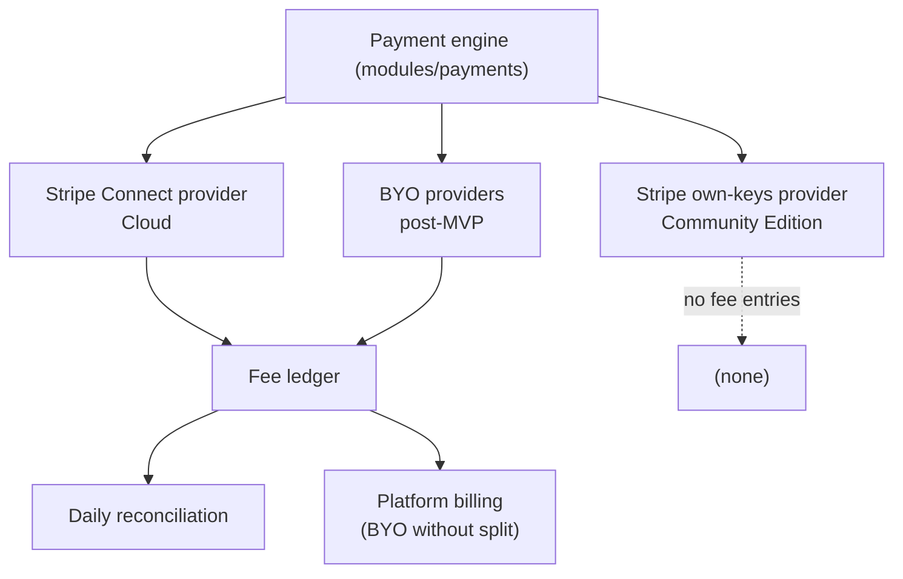

# Payments

The payment engine: Stripe Connect design, webhooks, subscription sync, refunds and disputes, the fee ledger, the provider abstraction, platform billing, subscription ownership and portability, and testing rules for money code.

Status: Draft, 2026-10-19

Fee rules (base, rounding, refunds, disputes) are defined in [../foundation/business-model.md](../foundation/business-model.md) and are not repeated here except where the mechanism depends on them. Tables are sketched in [data-model.md](data-model.md). Nothing here is legal or tax advice.

**How to read the labels.** **Confirmed** means a founder decision from the brief. **Recommendation** is our proposal. **Assumption** is believed true but not verified. **Open question** needs a decision. A statement marked **Verified** was checked against the cited Stripe documentation on 2026-10-17. Stripe behavior marked **Unverified** must be checked before implementation.

## 1. Scope by edition and phase

| Path | Edition | Phase | Platform fee |
|---|---|---|---|
| Stripe Connect, direct charges on the creator's account | Cloud | MVP (Phase 3) | 2%, collected as an application fee |
| Creator's own Stripe API keys | Community Edition | MVP (Phase 3) | 0%, no cohory service in the payment path (REQ-PAY-002) |
| Bring Your Own Payment Provider | Cloud | Post-MVP | 2%, by provider split if supported, else ledger plus periodic billing |
| Bring your existing subscribers (link Stripe subscriptions) | Both | Post-MVP (Phase 5) | Per edition |
| One-time purchases | Both | Post-MVP | Per edition |

**Confirmed.** Cloud payment options are Stripe Connect with direct charges and a 2% application fee, and BYO provider with a ledger and periodic billing when the provider cannot split fees. Self-hosted pays no platform fee. Processing fees are separate.



## 2. Stripe Connect design (Cloud)

### 2.1 Account configuration

**Recommendation** (this replaces the earlier "Standard accounts" wording in other docs): the creator owns a full Stripe account with full Dashboard access, pays Stripe's processing fees directly, and Stripe (not cohory) is responsible for negative balances.

Important update found while verifying: Stripe now labels the legacy account types (Standard, Express, Custom) as a deprecated path for new platforms and points new platforms to Accounts v2 (or Accounts v1 with controller properties). **Verified**, https://docs.stripe.com/connect/standard-accounts and https://docs.stripe.com/connect/accounts-v2/connected-account-configuration. The ownership properties we want are still available. In this document, "Standard" means this configuration:

| Property (Accounts v2) | Value | Effect |
|---|---|---|
| `dashboard` | `full` | Creator logs in to the full Stripe Dashboard and manages their customers and subscriptions |
| `defaults.responsibilities.fees_collector` | `stripe` | Stripe collects processing fees from the creator's account; our application fee is only the 2% |
| `defaults.responsibilities.losses_collector` | `stripe` | Stripe, not cohory, carries negative balance liability |

**Verified** that these properties exist and that responsibilities cannot be changed after the merchant configuration is added, and that with `fees_collector = stripe` "Stripe deducts its processing fee and your application fee from the payment" (same source). **Open question:** Accounts v2 versus Accounts v1 with controller properties for our SDK and API version at implementation time. The rest of this document is independent of that choice.

### 2.2 Onboarding

**Recommendation.** "Connect your Stripe account" in Manage, Payments.

1. Create the connected account with the configuration above, prefilled with the creator's email and country.
2. Create an Account Link (`type = account_onboarding`, `refresh_url`, `return_url`) and redirect the authenticated creator. **Verified** for legacy Standard accounts: links are single use, expire after a few minutes, must not be emailed, and `return_url` does not mean onboarding is complete (https://docs.stripe.com/connect/standard-accounts). **Unverified:** the exact Account Links call shape for Accounts v2.
3. On return, fetch the account and read `charges_enabled` and `details_submitted`. Also listen for `account.updated`. Show plain-language status ("Stripe needs a few more details").
4. Linking an existing Stripe account the creator already owns: **Recommendation** to support it through Connect Onboarding where Stripe allows sign in with an existing account. OAuth is legacy and not recommended for new platforms (**Verified** in research, https://docs.stripe.com/connect/oauth-reference). **Unverified:** whether Accounts v2 onboarding can attach a pre-existing account with its existing customers and subscriptions. This matters for "Bring your existing subscribers" (section 9).

Re-authentication before connecting payments in MVP, and two-factor authentication after MVP: see [authorization.md](authorization.md) section 10.

### 2.3 Charges: direct, on the connected account

**Confirmed** direct charges. **Verified** (https://docs.stripe.com/connect/subscriptions): with direct charges the charge is created on the connected account, which is the merchant of record; refunds and chargebacks debit the connected account's balance; direct charges are recommended for accounts with full Dashboard access.

**Assumption** (business-model.md): the creator is the merchant of record in the legal sense, subject to legal review.

### 2.4 Checkout for memberships

**Recommendation.** Stripe Checkout in `subscription` mode, created on the connected account.

```ts
// modules/payments/stripe-connect/checkout.ts (sketch)
await stripe.checkout.sessions.create({
  mode: "subscription",
  line_items: [{ price: plan.providerMonthlyPriceId, quantity: 1 }],
  customer: existingCustomerId,            // or customer_email for new buyers
  client_reference_id: membershipId,
  subscription_data: {
    application_fee_percent: 2,             // Cloud only; omitted on Community Edition
    metadata: { cohory_community_id, cohory_membership_id, cohory_plan_id },
  },
  success_url: `${appUrl}/c/${slug}/join/complete?session_id={CHECKOUT_SESSION_ID}`,
  cancel_url: `${appUrl}/c/${slug}/join`,
}, { stripeAccount: connection.externalAccountId, idempotencyKey: `checkout:${membershipId}:${attempt}` });
```

**Verified** (https://docs.stripe.com/api/checkout/sessions/create): `subscription_data.application_fee_percent` exists, takes 0 to 100 with at most two decimals (so 1 is valid), and requires the request to be made on behalf of another account with the `Stripe-Account` header. Products and Prices are created on the connected account when the creator saves the plan (**Verified**: the Price must live on the connected account for direct charge subscriptions, https://docs.stripe.com/connect/subscriptions).

Access is granted from webhooks (section 4), never from the success redirect alone. The success page polls our own state for a few seconds and shows "Finishing up" until the entitlement exists.

### 2.5 The fee on subscriptions and the tax issue

**Verified** (https://docs.stripe.com/connect/subscriptions):

- `application_fee_percent` is taken "one time each billing period" from "the final invoice amount, including any bundled invoice items, discounts, or account balance adjustments", before Stripe fees.
- It does not apply to invoices created outside the billing period, such as immediately invoiced prorations. Those need `application_fee_amount` on the invoice.
- `application_fee_amount` set directly on an invoice overrides the percent and is capped at the final charge amount. The documented way to set it automatically is a webhook on `invoice.created`.
- Draft subscription invoices are attempted about one hour after `invoice.created`. If Stripe does not receive a successful response to `invoice.created`, automatic finalization is delayed for up to 72 hours.
- A platform cannot add `application_fee_amount` to an invoice it did not create, or to one with invoice items it did not create.

**Assumption** (unchanged from Wave A): "final invoice amount" includes tax when tax is added to the invoice, so `application_fee_percent` alone would charge the fee on tax. Stripe's wording does not say explicitly. **Unverified.** The proposed fee base is post-discount and pre-tax (business-model.md, Open question).

**Recommendation.** Two-layer mechanism:

1. Always set `application_fee_percent = 2` on Cloud subscriptions as the fallback, so a fee is collected even if our webhook is late.
2. If the invoice carries tax (Stripe Tax enabled or tax rates set), the `invoice.created` handler computes `fee = round_half_up((total_excluding_tax) * 100 / 10000)` and sets `application_fee_amount` on the draft invoice. This also covers proration invoices.
3. If the override was not applied before finalization, the reconciliation job detects that the collected fee exceeds the computed fee and refunds the difference through an application fee refund, writing an `adjustment` ledger entry. **Unverified:** partial application fee refunds on direct charges after the fact (the Application Fee Refunds API exists, behavior for this case needs a test-mode check).
4. For communities without tax on invoices (the MVP default), step 1 alone is exact and no override is needed.

**Assumption** that invoices generated by a subscription our platform created count as invoices "the platform created" for the restriction above. Test before relying on it.

### 2.6 One-time purchases (post-MVP)

Checkout in `payment` mode on the connected account with `payment_intent_data.application_fee_amount` computed by our fee module on the pre-tax amount. **Verified** pattern, https://docs.stripe.com/connect/direct-charges. Also **Verified** there: the application fee must be positive and less than the charge, no additional Stripe fee is charged on the application fee, and platforms outside Brazil cannot collect application fees from Brazilian connected accounts. A computed fee of zero on a tiny charge means the parameter is omitted.

### 2.7 Community Edition: own keys

The creator (or operator) pastes a restricted secret key and a webhook signing secret for their own Stripe account. The same subscription code runs without the `Stripe-Account` header and without any application fee. The fee calculator returns 0 when the `platformFee` capability is off (see [overview.md](overview.md) section 11), and a required test asserts it. Secrets are stored encrypted.

## 3. Currency handling

**Recommendation.**

- One currency per community in MVP, chosen when the paid plan is first saved. Changing it requires archiving the plan (no mixed-currency plans).
- Amounts in integer minor units. The currency table is `packages/payments/src/currency.ts` (`stripeCurrencies`, `stripeCurrency(code)`): one row per currency Stripe settles in, with `code`, `exponent`, `minimumChargeMinor`, and `zeroDecimal`, taken from Stripe's [minimum charge amounts](https://docs.stripe.com/currencies#minimum-and-maximum-charge-amounts) and [zero decimal list](https://docs.stripe.com/currencies#zero-decimal) on 2026-10-22. It has 24 currencies; JPY is the only zero decimal one. `upsertPlanInputSchema` (parsed in the plans service, so the REST API, MCP, and web actions all go through it) refuses a currency outside the table and a monthly or annual price below its minimum ("Set a price of at least 0.50 USD. Stripe does not accept smaller charges."). A currency outside the table is refused because its minimum depends on the exchange rate into the settlement currency, so a plan in it could fail at renewal. The UI money helpers (`packages/ui/src/payments/money.ts`) take the number of decimals from the same table and fall back to the locale data only for other codes.
- The platform fee is calculated and collected in the charge currency. cohory never converts currencies. If the connected account settles in another currency, Stripe's conversion applies on the creator's side (**Assumption**).
- The ledger stores the charge currency on every entry. Reports group by currency and never sum across currencies.

## 4. Webhooks

### 4.1 Endpoints

**Verified** (https://docs.stripe.com/connect/webhooks): Connect platforms register endpoints with two scopes, "Your account" and "Connected accounts". Events from connected accounts carry a top-level `account` property, and follow-up API calls for that object must be made as the connected account.

| Endpoint | Scope | Used for |
|---|---|---|
| `/api/webhooks/stripe/platform` | Your account | `application_fee.created`, `application_fee.refunded`, platform billing invoices (BYO, post-MVP) |
| `/api/webhooks/stripe/connect` | Connected accounts | `account.updated`, `account.application.deauthorized`, Checkout, invoices, subscriptions, charges, refunds, disputes on creators' accounts |
| `/api/webhooks/stripe/own/{connectionId}` | Creator's own account (Community Edition) | Same events as Connect, without the `account` property |

**Verified** (https://docs.stripe.com/connect/webhooks): production Connect endpoints receive both live and test events, so handlers check `livemode` against the environment.

### 4.2 Events handled at launch

| Event | Action |
|---|---|
| `checkout.session.completed` | Link Stripe customer and subscription ids to the membership. Do not grant access yet unless the subscription is `active`. |
| `customer.subscription.created`, `.updated`, `.deleted` | Fetch the subscription, update the mirror, recompute access state |
| `invoice.created` | Cloud with tax: set `application_fee_amount` on the draft (section 2.5) |
| `invoice.paid` | Record payment, write ledger entry (Cloud), grant or extend entitlement |
| `invoice.payment_failed` | While the invoice is still open with an amount due, notify member (email and in-app notice for attempts 1 to 3, and always when `next_payment_attempt` is null because Stripe plans no further try, even after the subscription was canceled) and owner (in-app, attempt 1); access state follows the mapping in 5.1 ([0034](../decisions/0034-notification-types-and-weekly-digest.md)). Creators should turn off Stripe's own failed payment customer email to avoid two emails. |
| `invoice.payment_action_required` | Email the member a link to complete authentication |
| `charge.refunded` | Update payment, write fee refund ledger entry (Cloud) |
| `charge.dispute.created`, `.updated`, `.closed`, `.funds_withdrawn`, `.funds_reinstated` | Fetch the dispute, record its state on the payment, notify the owner once, on a lost dispute refund the fee on the disputed amount (section 6) |
| `radar.early_fraud_warning.created` | Log the warning with the charge id. No other change |
| `application_fee.created` | Attach Stripe's fee id and amount to the ledger entry, compare with computed fee |
| `application_fee.refunded` | Record the provider side of a fee refund |
| `account.updated` | Update `charges_enabled`, requirements, status shown in Manage, Payments |
| `account.application.deauthorized` | Close the connection and record the exit (sections 10.4 and 13.8) |

**Verified** event list basis: https://docs.stripe.com/connect/subscriptions (subscription and Connect events), https://docs.stripe.com/connect/direct-charges (`application_fee.created` is asynchronous). Dispute event names and statuses are **Verified** against the Stripe SDK types pinned in the lockfile (`stripe` 23.0.0, `Dispute.Status`).

### 4.3 Processing rules

**Verified** (https://docs.stripe.com/webhooks): signature verification needs the raw body and the `Stripe-Signature` header, the official libraries use a default 5 minute timestamp tolerance against replay, events may arrive more than once and out of order, `created` must not be used to order events, live mode retries last up to three days with exponential backoff, and handlers should return 2xx quickly and process asynchronously.

**Recommendation.**

1. The route reads the raw body, verifies the signature with the secret for that endpoint (or connection), and rejects with 400 on failure.
2. It inserts into `provider_events` with a unique `(provider, external_event_id)`. A duplicate insert returns 200 immediately.
3. It enqueues `stripe.process_event` with the row id and returns 200. Target under 200 ms.
4. The worker handler loads the event, then **fetches the current object from Stripe** (as the connected account) instead of trusting the payload. State is derived from the object, so order does not matter.
5. Writes are guarded: a subscription mirror update is skipped if the fetched object is not newer than what we stored (compare a monotonic field such as the latest invoice or our stored fetch time).
6. Side effects (ledger entries, entitlements, notifications) use idempotency keys derived from Stripe ids, for example `fee:collected:${chargeId}`, so a reprocessed event is a no-op.
7. Failures retry with backoff. After the last attempt the row is flagged and alerts fire.
8. **Replay.** An operator command re-enqueues stored events by id or time range. Because handlers are idempotent and state-based, replay is always safe. For gaps (endpoint down longer than Stripe retries), a backfill job lists events or objects from Stripe for the affected window.
9. **Reconciliation.** Daily per connection: list active subscriptions and recent invoices on the connected account and compare with the mirror and entitlements. Daily on the platform: list application fees and compare with the ledger (REQ-PAY-004). Mismatches create corrections and alerts.

Steps 1 to 9 are built as described in section 13.3 and [0030](../decisions/0030-payment-webhooks-in-the-worker.md). The job is `payments.webhook.process` (platform billing: `payments.billing-webhook.process`), and reconciliation lists charges on the connected account instead of application fees on the platform.

**Failed events (built).** A job retries 10 times with backoff from 30 seconds; the last failure logs `payment webhook retries exhausted` with the row id. Because the request already answered 200, Stripe does not resend, so the hourly `payments.webhook-sweep` (minute 17) queues again, by id, every Stripe row in `provider_events` that is unprocessed, not under an active lease, older than one hour, and younger than three days; rows without a connection go to the platform billing queue. A row still unprocessed after three days is logged once at error level as `payment webhook event abandoned` with provider, event id, and type, and its `error` is set to `abandoned` so it is not logged again. An operator replays one event with `pnpm billing replay-webhook <eventId>` (or `node apps/worker/dist/billing-cli.js replay-webhook <eventId>` in the worker container), which queues an unprocessed row again and leaves a processed one alone. Alerting on the two log lines is left to the operator ([operator guide](../operations/operator-guide.md#payment-webhooks-that-did-not-process)).

## 5. Subscription lifecycle sync

### 5.1 Status mapping

**Recommendation**, consistent with [../product/mvp-scope.md](../product/mvp-scope.md) section 2.9 (past due keeps access, canceled or unpaid removes it).

| Stripe status | Access state | Member sees |
|---|---|---|
| `incomplete` | none | "Payment not completed" with a retry link |
| `incomplete_expired` | none | Join page |
| `trialing` (post-MVP) | granted | Normal access |
| `active` | granted | Normal access |
| `active` with `cancel_at_period_end` | granted until period end | "Membership ends on {date}" |
| `past_due` | grace (access kept) | Banner: "Update your payment method" with portal link |
| `unpaid` | revoked | Join page with "Renew" |
| `canceled` | revoked at `ended_at` | Join page with "Rejoin" |
| `paused` (`pause_collection` set) | granted until the paid through date, then revoked | "Payments paused" with "Resume payments" ([0040](../decisions/0040-fair-cancel-and-pause.md)) |

How long `past_due` lasts is set by the creator's Stripe retry and dunning settings on their own account (Smart Retries and the action after the final retry). **Recommendation:** onboarding guidance tells creators to set the final action to "cancel subscription" or "mark unpaid", so access eventually ends. This matches REQ-SUB-004. **Recommendation:** a configurable cohory-side grace period (for example revoke after N days of `past_due`) is Post-MVP, added if creators ask.

### 5.2 Membership linkage

- Checkout carries `cohory_membership_id` in subscription metadata and `client_reference_id`. The webhook handler links on those, never on email.
- One member, one active paid subscription per community. A second checkout for an already-active member is blocked before creating the session.
- Comped access (owner grant) is an entitlement with source `comp`, independent of Stripe.
- **Comped access on Cloud (founder decision 2026-10-21).** On the Cloud Edition a grant by email never looks the address up. It writes a `comp_invitations` row (migration 0032: email, note, end date, granted by; one open invitation per community and email) and an audit entry `comp.invited`, and the API answers 202 with the invitation, the same for an address with or without an account. The web form emails the offer (`compInvitationEmail`) with a link to sign in and open `/c/{slug}/membership`. That page shows the offer to a signed in person whose confirmed email matches, with "Accept free access"; accepting writes the comp (`comp.accepted`) and activates the membership. An unconfirmed email sees "Confirm your email to accept free access"; nobody else can accept it, and a banned person is refused. Managers see pending invitations under Free access and can withdraw them (`comp.invitation_withdrawn`, `DELETE .../comps/invitations/{invitationId}`; `GET .../comps/invitations` lists them). Since the security audit run 1 follow up (2026-10-22) the invited person can do the same through the REST API: `GET /communities/{communityId}/payments/comps/offers` (`listMyCompOffers`) lists their pending offers (`{ data: [{ id, expiresAt }], waitingForVerification }`), and `POST .../comps/offers/{invitationId}/accept` (`acceptCompOffer`) accepts one through the same `acceptCompInvitation` service call as the web page, answering 200 with the comp. Both are session only (`scope: null`), so personal and agent tokens get 403 `token_not_allowed`: accepting adds the person to the community, which, like joining, only the person may do, and an agent cannot even propose it. There is no decline, matching the web. Someone else, a wrong community, or an unconfirmed address answers 404 on accept and an empty list on read. On the Community Edition the list is always empty because grants by email apply at once. A grant by user id is allowed only for a member of the community (active, or who left on their own, `removal_reason = left`); anyone else answers 404 like an unknown id. The Community Edition keeps granting by email or id to any existing account at once.
- Cancel and payment method updates happen in the Stripe customer portal created on the connected account (REQ-SUB-003). Cancellation defaults to period end. Since [0040](../decisions/0040-fair-cancel-and-pause.md), "Cancel membership" first opens a cohory screen (13.19) and then the portal on its cancel flow.
- Removing or banning a paying member ends their subscription now ([0029](../decisions/0029-remove-or-ban-ends-billing.md), REQ-MEM-003). After the membership change commits, Communities hands `membership.removed_by_staff { communityId, userId, kind }` (`kind` is `removed` or `banned`) to Payments through `requestBillingEndForRemovedMember`, which queues the pg-boss job `payments.member-billing-end` (Zod payload schema `memberBillingEndJobPayloadSchema`, 8 retries with backoff, singleton key `{communityId}:{userId}`). The worker runs `endBillingForRemovedMember`, which cancels every subscription that still grants access for that member immediately, with `prorate: false` and `invoice_now: false`, the idempotency key `staff-removal:{subscription id}`, and no refund, then marks the mirrored subscription revoked. It acts only while the membership is banned or removed by staff, so a repeated delivery, a member who left on their own, or a member who was let back in changes nothing. The Remove and Ban dialogs in Manage, People and the ban dialog in the report queue read `getMemberBilling` (staff only, `membership.manage`) and say "{name} pays {amount} per {interval}. Their subscription ends now with no refund." before staff confirm. A failed Stripe call fails the job and pg-boss retries it, so no one has to remove or ban again, and the request (including the report queue ban, which runs inside the Posts transaction) only queues the job. Only when the job cannot be queued does the request end billing itself, as the exit runs do. Leaving on your own does not touch billing (founder decision R1).

## 6. Refunds, disputes, and fee reversal

Rules come from [../foundation/business-model.md](../foundation/business-model.md) (proportional fee refund on refunds, fee refund on lost disputes).

**Refunds initiated from cohory** (owner action in Manage, Payments):

- Create the refund on the connected account with `refund_application_fee = true`. **Verified** (https://docs.stripe.com/connect/direct-charges): application fees are not refunded automatically; with `refund_application_fee = true` a full refund returns the full application fee and a partial refund returns a proportional amount.
- Write a `fee_refunded` ledger entry with our own proportional calculation and Stripe's figure. Cumulative fee refunds per charge never exceed the fee collected.

**Refunds initiated in the creator's Stripe Dashboard** (always possible with full Dashboard access): the application fee is not refunded automatically. **Recommendation:** on `charge.refunded` where Stripe did not refund the application fee, cohory refunds the proportional fee itself through the Application Fee Refunds API and writes the ledger entry. **Unverified:** that the platform can create the fee refund after a Dashboard refund on a direct charge. Test mode check required.

**Disputes.** **Verified** (https://docs.stripe.com/connect/disputes): for direct charges the disputed amount is debited from the connected account, the response is made as the connected account, and dispute fees are paid by the connected account for legacy Standard accounts and for `fees_collector = stripe`. **Recommendation:** while open, nothing changes in the ledger. On a lost dispute, refund the platform fee on the disputed amount and write a `fee_refunded` entry with reason `dispute_lost`. On a won dispute, no change. **Unverified:** whether Stripe returns the application fee on a lost dispute by itself. The handler computes the fee still owed back from the fee's current `amount_refunded`, so if Stripe ever does return it, cohory refunds nothing more and only records Stripe's refund. Built since [0028](../decisions/0028-stripe-disputes.md), see section 13.5.

## 7. The fee ledger

**Confirmed.** Every path writes to the fee ledger, and it is the single source of truth for what cohory earned.

**Recommendation.** On Cloud, every successful transaction writes ledger entries regardless of provider, including when the computed fee is zero. On Community Edition no fee entries are written.

| Field | Meaning |
|---|---|
| `kind` | `fee_accrued` (BYO without split), `fee_collected` (automatic split), `fee_refunded`, `adjustment`, `invoice_settled` |
| `base_minor`, `currency` | Fee base per business-model.md (post-discount, pre-tax, pre-processing) |
| `rate_bps` | The rate of the fee being recorded, stored per entry so a rate change never rewrites history (see 13.5) |
| `computed_fee_minor` | `round_half_up(base * rate_bps / 10000)` |
| `provider_fee_minor` | Fee as the provider reports it (Stripe `ApplicationFee.amount`) |
| `collection_method` | `automatic_split` or `periodic_invoice` |
| `external_ref`, `payment_id` | Provider ids for audit |
| `idempotency_key` | Unique, derived from provider ids |

Rules:

1. Append-only. Corrections are new `adjustment` rows linked to the original.
2. When Stripe computes the fee, Stripe's amount is authoritative for money moved, and both values are kept. A difference above one minor unit raises an alert (business-model.md).
3. The fee module is the only code that computes fees. It is a pure function with property-based tests.
4. The ledger is shown to the creator in Manage, Payments as gross, processing fee (as reported), platform fee, and net per transaction (REQ-PAY-006).

```ts
// modules/payments/fee.ts (sketch)
export function platformFee(base: Money, rateBps: number): Money {
  // integer math only: (base * rate + 5000) / 10000 rounds half up for non-negative amounts
  return Money.of((base.minor * BigInt(rateBps) + 5000n) / 10000n, base.currency);
}
```

## 8. Payment provider abstraction (BYO is post-MVP)

**Recommendation.** One interface in `modules/payments`, one implementation per provider. Each provider ships with a capability record reviewed before it is supported (business-model.md).

```ts
// modules/payments/provider.ts (sketch)
export interface ProviderCapabilities {
  supportsFeeSplit: boolean;              // can collect our fee at charge time
  supportsSubscriptions: boolean;
  supportsSubscriptionImport: boolean;    // can list and link existing subscriptions
  supportsHostedCheckout: boolean;
  supportsCustomerPortal: boolean;
  supportsRefundApi: boolean;
  emitsDisputeEvents: boolean;
  currencies: string[] | "any";
}

export interface PaymentProvider {
  id: "stripe_connect" | "stripe_own_keys" | string;
  capabilities(conn: Connection): ProviderCapabilities;
  verifyWebhook(req: RawRequest, conn: Connection | null): Promise<VerifiedEvent>;
  normalizeEvent(e: VerifiedEvent): Promise<NormalizedEvent[]>;   // payment_succeeded, refund, subscription_changed, ...
  createCheckout(input: CheckoutInput, conn: Connection): Promise<{ url: string; externalId: string }>;
  createPortalSession(customer: CustomerRef, conn: Connection): Promise<{ url: string }>;
  getSubscription(id: string, conn: Connection): Promise<ProviderSubscription>;
  listSubscriptions?(conn: Connection, cursor?: string): Promise<Page<ProviderSubscription>>;
  cancelSubscription(id: string, opts: { atPeriodEnd: boolean }, conn: Connection): Promise<void>;
  refund(chargeId: string, amount: Money | "full", conn: Connection): Promise<RefundResult>;
  setPlatformFee?(subscriptionId: string, rateBps: number, conn: Connection): Promise<void>;  // 0 to remove
}
```

Domain modules consume `NormalizedEvent`, never provider payloads. If `supportsFeeSplit` is false, every `payment_succeeded` writes a `fee_accrued` entry for platform billing. We do not assume providers share capabilities (**Confirmed** in the brief).

### 8.1 Interface

The interface lives in `packages/payments/src/providers/types.ts` and differs from the sketch above only in names that follow the code: `Connection` carries the decrypted credentials, `CheckoutRequest` carries the idempotency key and the platform fee in basis points, `provisionPlan` and `retirePrice` replace the Stripe Product and Price calls, and `normalizeEvent` returns `null` for event types the provider does not handle (answered as `ignored`) and an empty list for handled events that change nothing. Stripe only operations (`listSubscriptions`, `getSubscriptionSummary`, `setPlatformFee`, `platformFees`, `renameProduct`, `expireOtherCheckouts`, `paidPaymentRefs`) are optional members. A registry keyed by provider id (`providers/registry.ts`) resolves the adapter for a connection.

Normalized events: `checkout_completed`, `subscription_changed`, `payment_succeeded`, `payment_refunded`, `platform_fee_reported`, `account_updated`, `account_deauthorized`. The webhook handler (`service/webhooks.ts`) and the normalized event handler (`service/normalized-events.ts`) never read provider payloads.

Services never branch on a provider id. Each difference between providers is a property or method of the adapter, and the services read that instead:

| Difference | Adapter member | Read by |
|---|---|---|
| How a creator connects it: `platform_account` (Stripe Connect), `own_keys` (own Stripe keys), `access_token` (Polar and the fake) | `setup` | Which edition offers it (Cloud: `platform_account`, Community Edition: `own_keys`, both: `access_token`), which webhook endpoint accepts it, whether status waits for a saved webhook secret, and whether a refresh takes `livemode` from the account |
| Whether the platform fee is split at charge time | `capabilities().supportsFeeSplit` | Fee removal on disconnect (`removeApplicationFees`), "Add the platform fee" when linking, checkout and fee accrual |
| Events on the shared platform endpoint: readiness, the connected account an event belongs to, the event types still accepted after a disconnect | `platformWebhooks` (Stripe Connect only) | The platform webhook endpoint |
| Whether events must be live | `expectsLiveEvents(conn)` | Every webhook endpoint (Stripe compares the platform or own secret key, Polar the stored server) |
| Platform fee events and refunds after an exit | `platformFees.isFeeEvent`, `platformFees.get`, `platformFees.refund` | Fee refunds for events that arrive after an exit |
| Hosted onboarding of a new account | `hostedOnboarding()` | `connectStripe` |
| The application id on subscriptions this platform created | `applicationId` | Subscription linking |

The three webhook routes (`/api/webhooks/stripe`, `/api/webhooks/stripe/own/{connectionId}`, `/api/webhooks/payments/{connectionId}`) call one service entry point, `handleWebhook(target, delivery)`, where the target names the `setup` the route serves (and the connection id on the two per connection routes) and the delivery carries the raw body and the signature headers. A connection whose provider has another `setup` answers 404 on a per connection route and `unknown_connection` on the platform route. A per connection route answers 503 until both the API credential and the webhook secret are stored. The adapter verifies the signature, and the inbox, lease, and duplicate rules follow. The capability records carry the same `setup`, which decides the webhook path shown in Manage, Payments, and an optional subscription dashboard link (Stripe only). `StripeGateway` is used only inside the Stripe adapter. Enabling Polar with `COHORY_ENABLE_POLAR` stays a provider flag in `providers/capabilities.ts` (`isProviderEnabled`).

### 8.2 Capability records

Each record is reviewed against the provider's own documentation before the provider is offered. The same data lives in `packages/payments/src/providers/capabilities.ts`, and a unit test fails if a record has no sources or if any provider other than Stripe Connect claims a fee split.

| Capability | Stripe Connect (`stripe_connect`) | Stripe own keys (`stripe_own_keys`) | Polar (`polar`) |
|---|---|---|---|
| Fee split at charge time | Yes, application fee on direct charges | No, cohory is not a platform on the account | No. Polar is the merchant of record and its `platform_fee_amount` is Polar's own fee; there is no third party application fee. cohory accrues the fee in the ledger (8.4) |
| Subscriptions | Yes | Yes | Yes |
| Subscription import (list and link) | Not offered on Cloud, whose connected account is always new ([0042](../decisions/0042-moving-paying-members.md)) | Yes (13.9) | Not in cohory. The API lists subscriptions, but linking is built for Stripe only |
| Hosted checkout | Yes, Checkout | Yes, Checkout | Yes, Polar Checkout sessions |
| Customer portal | Yes | Yes | Yes, customer sessions |
| Refund API | Yes | Yes | Yes (`POST /v1/refunds/`) |
| Dispute events | Yes (`charge.dispute.*`, handled) | Yes (`charge.dispute.*`, handled, no fee) | No dispute webhook. Polar handles disputes as merchant of record |
| Currencies | Any Stripe currency | Any Stripe currency | The Polar presentment currencies; cohory offers its usual list |
| Editions | Cloud | Community Edition | Cloud and Community Edition |
| Reviewed | 2026-10-19 | 2026-10-19 | 2026-10-19 |

### 8.3 First bring your own provider: Polar

**Confirmed** (founder, 2026-10-20, [ADR 0027](../decisions/0027-safe-exit-and-2-percent-fee.md)). Polar is disabled by default. Polar's [acceptable use policy](https://polar.sh/docs/merchant-of-record/acceptable-use) prohibits marketplaces and "community access", so cohory does not offer it unless an operator sets `COHORY_ENABLE_POLAR=true` (parsed in `parsePaymentsEnv` as `polarEnabled`). While the flag is off, on both editions: Polar is left out of the provider list in the payments overview and out of `capabilityRecords`, `connectProvider` refuses Polar with `ProviderDisabledError` (`provider_disabled`, HTTP 409), and checkout on an existing Polar connection is refused the same way, with the plan shown as not for sale. Existing Polar connections keep their webhook route and sync, and the overview sets `polarRetired` so Manage, Payments tells the owner to disconnect Polar and connect Stripe. The code stays; removing it is in the backlog.

**Decided (0.5.0).** The selection rule was the first provider named in this section or in [comparable-projects.md](../research/comparable-projects.md) that offers a public sandbox. This section named none besides Stripe. The research doc names PayPal (only as a payout rail in Dub, not for subscriptions) and then Polar (subscription billing in Midday). Polar is the first that fits memberships and has a public sandbox (`sandbox.polar.sh`, `https://sandbox-api.polar.sh`, Stripe test cards). The sandbox needs a free account, and no account existed when it was built, so the adapter is built against the documented API with fixtures and a fake Polar server, and **live sandbox verification is a human gate**.

Documentation read on 2026-10-19:

- https://polar.sh/docs/integrate/sandbox
- https://polar.sh/docs/integrate/webhooks/delivery
- https://polar.sh/docs/api-reference/checkouts/create-session
- https://polar.sh/docs/api-reference/subscriptions/update
- https://polar.sh/docs/api-reference/refunds/create
- https://polar.sh/docs/api-reference/customer-portal/sessions/create
- https://polar.sh/docs/api-reference/products/create
- https://polar.sh/docs/openapi/2026-10.openapi.json (API version 2026-10, used for every request and payload shape)

How the adapter (`packages/payments/src/providers/polar`) maps the interface:

| Interface | Polar call |
|---|---|
| `getAccountState` | `GET /v1/organizations/` with the organization access token; `chargesEnabled` from `capabilities.checkout_payments` |
| `provisionPlan` | One recurring product per interval (`POST /v1/products/`), found again by `metadata[cohory_plan_id]` and `metadata[cohory_interval]` before creating, because Polar documents no idempotency keys. The plan's "price ids" are product ids |
| `retirePrice` | `PATCH /v1/products/{id}` with `is_archived = true` |
| `createCheckout` | `POST /v1/checkouts/` with the product, `external_customer_id` set to the cohory user id, the checkout metadata (copied by Polar to the subscription), `allow_trial = false`, and `checkout_id={CHECKOUT_ID}` on the success URL |
| `createPortalSession` | `POST /v1/customer-sessions/`, returns `customer_portal_url` |
| `getSubscription` | `GET /v1/subscriptions/{id}`; `ends_at` wins over `current_period_end` as the access end |
| `cancelSubscription` | `PATCH /v1/subscriptions/{id}` with `cancel_at_period_end = true`, or `revoke = true` to end now |
| `refund` | `POST /v1/refunds/` with `order_id`, `reason = customer_request`, and the amount (the order's `refundable_amount` for a full refund) |
| `deleteCustomer` | `DELETE /v1/customers/{id}` (account erasure) |
| `verifyWebhook` | Standard Webhooks headers `webhook-id`, `webhook-timestamp`, `webhook-signature`; five minute tolerance; tries the decoded `whsec_` key and the older Polar key (the UTF-8 bytes of the whole secret), as Polar's own SDKs do |

Events: `subscription.*` becomes `subscription_changed`; `order.paid` fetches the order and becomes `subscription_changed` plus `payment_succeeded` (amount `total_amount`, tax `tax_amount`); `order.refunded` fetches the order and becomes `payment_refunded` with `net_amount` and `refunded_amount` as the fee base; `checkout.updated` with status `succeeded` becomes `checkout_completed`; `organization.updated` becomes `account_updated`; `cohory.test` (the test button) is accepted and changes nothing. Other types answer `ignored`.

**Assumption:** `refunded_amount` on an order excludes tax, because Polar reports `refunded_tax_amount` separately. Verify in the sandbox.

### 8.4 Fee accrual for providers without a fee split

When `supportsFeeSplit` is false and the effective rate is above zero (Cloud only; `effectiveFeeBps` now charges every Cloud provider except Stripe own keys), the normalized `payment_succeeded` handler writes one ledger row in the same transaction as the `payments` row. For providers other than Stripe, a payment that does not belong to a subscription mirrored for the community is not recorded at all, so other sales on the creator's provider account neither show in the totals nor carry a fee:

| Column | Value |
|---|---|
| `kind` | `fee_accrued` |
| `provider` | the connection's provider, for example `polar` |
| `collection_method` | `periodic_invoice` |
| `payment_id` | the `payments` row |
| `currency` | the payment currency, lower case |
| `base_minor` | amount paid minus tax stated separately |
| `rate_bps` | `PLATFORM_FEE_BPS` |
| `computed_fee_minor` | `computeApplicationFee(base, rate)`, round half up |
| `provider_fee_minor` | null |
| `external_ref` | the provider payment id (Polar order id) |
| `idempotency_key` | `fee:accrued:{provider}:{payment id}` |
| `occurred_at` | when the provider says the payment was made |

A refund writes `fee_refunded` with the same collection method, a negative `computed_fee_minor` equal to the cumulative share still owed back (`cumulativeFeeRefundDue` against the accrued total and earlier refunds of that payment), `base_minor` 0, and key `fee:refunded:{provider}:{payment id}:{cumulative refunded}`. The Community Edition writes nothing. Monthly platform billing (section 9) sums these rows.

**Confirmed** (founder, 2026-10-19): revenue reported by a BYO provider is verified by signed provider data (webhooks checked with the provider's signature, plus periodic API listing) and the daily reconciliation. There is no creator attestation.

## 9. Periodic platform billing for ledger balances (post-MVP)

**Recommendation** (business-model.md, Wave A decision):

- Billing period is the calendar month, UTC. A job on the first day sums `fee_accrued` minus refunds per community and currency.
- Below the equivalent of $10 the balance rolls over, for up to three periods, then it is invoiced regardless.
- The invoice is a Stripe invoice on cohory's own platform account to the creator as a customer, with a card or bank method on file. This is the only place where the creator pays cohory directly.
- Reminders at 7 and 14 days. After 30 days unpaid, new paid signups are paused for that community. Existing members keep access and exports stay available.
- Settled entries get an `invoice_settled` row referencing the platform invoice.

**Implementation (0.5.0).** Section 13.11 describes what exists. Differences from the list above: the minimum is 5 USD or a fixed equivalent per currency, and a balance below it carries forward with no limit on the number of periods (confirmed by the founder, 2026-10-19); reminders at 7 and 14 days come from Stripe's own invoice reminder settings, not from cohory; settlement is recorded on `platform_invoices` and `platform_invoice_lines`, and no `invoice_settled` ledger rows are written.

## 10. Subscription ownership and portability

**Confirmed.** Subscription ownership is a major differentiator, and portability must be implemented and tested, not promised. **Confirmed.** Data export is not the same as continued payment collection.

What each mechanism gives the creator:

| Asset | Where it lives | What we guarantee |
|---|---|---|
| Customers, payment methods, prices, subscriptions | Creator's Stripe account | They stay there whatever happens to cohory. Verified basis: direct charges create objects on the connected account. |
| Community content and members | cohory database | Exportable (members CSV in MVP, full bundle in Phase 5) |
| Link between members and Stripe ids | cohory database | Included in every export (`memberships_billing.jsonl`, members CSV columns) |
| Platform fee on future invoices | Subscription field on the creator's account | Removed when the creator leaves Cloud (section 10.3) |

### 10.1 Importing existing Stripe subscriptions (Phase 5, "Bring your existing subscribers")

**Recommendation.** Built in 0.4.0 with the differences listed in 13.9. Since [0042](../decisions/0042-moving-paying-members.md) only the Community Edition offers it: Cloud onboarding always creates a new connected account, which holds no existing subscriptions, so the service refuses discovery and linking on Cloud (`edition_mismatch`) and the pages show item 9 instead.

1. The creator connects the Stripe account that already holds their subscriptions (see the onboarding caveat in 2.2).
2. A job lists subscriptions on the connected account (statuses `active`, `trialing`, `past_due`) with their customers and prices.
3. Customers are matched to members by verified email, case insensitive. Unmatched customers get an invitation email that, when accepted, creates the account and the membership. Ambiguous matches go to a review screen.
4. The creator maps each Stripe price to the cohory plan (or to "comped" if it does not fit).
5. Confirmed rows create memberships, `customers`, and `subscriptions` mirror rows with `origin = linked_import`, and entitlements.
6. Platform fee on linked subscriptions (Cloud): **Recommendation** to set `application_fee_percent` to the Cloud rate only with the creator's explicit consent in the same review screen, because these subscriptions predate cohory. **Unverified:** whether a platform may set `application_fee_percent` on a subscription it did not create. Stripe states a platform cannot update or cancel a subscription another platform created (**Verified**, https://docs.stripe.com/connect/subscriptions), but subscriptions created by the account owner directly are a different case. Test before promising fee collection on linked subscriptions.
7. Subscriptions created by another Connect platform cannot be adopted. The Migration Center offers to create a new cohory subscription on the same account with the saved payment method, aligned to the old period end, after which the creator cancels the old one. This is a design proposal, not a documented Stripe recipe (research Appendix C).
8. Moving between two different Stripe accounts needs Stripe's payment data copy, then import. Stripe mediated, not automated by cohory.
9. Sources without payment method access (Skool, Circle, another Stripe account, or any Cloud community): members subscribe again with free time. Built in [0042](../decisions/0042-moving-paying-members.md). A `subscriber_moves` row per email holds the free until date; owners and admins add rows by pasting addresses and dates or from the last Skool, Circle, or archive import (`addSubscriberMoves`, `payment.link_subscriptions`, at most two years ahead). Checkout for a member whose account email has a pending move sends `trial_end` at that date (48 hours minimum, as in 13.9) and is allowed even when the member already has free access; `getMyMembership` returns it as `resubscribe.endsAt`. When the server requires confirmed emails, an unconfirmed account gets no free time. The webhook worker marks the move `resubscribed` with the subscription id when it records any subscription for the member in that community, idempotently. Discovery, linking, and `claimInvitedSubscriptions` refuse with `edition_mismatch` on Cloud. `claimMoveReminders` (owner or admin session only) hands the web app the pending people not emailed in the last 7 days whose free time ended less than 7 days ago (or who were added less than 30 days ago without a date), claiming rows with `FOR UPDATE SKIP LOCKED` and the same conditions in the update so two clicks never email anyone twice; the app sends the `moving-offer` email. A paste holds 1,000 rows and a community 5,000. On the Community Edition a dated row also grants a plain member of a paid community, who has no granting subscription and no comp, a comp ending at the date (at least 7 days ahead). The daily `payments.moves-retention` job (`sweepSubscriberMoves`) deletes rows 90 days after the date or the move, or 120 days after adding without a date, and account erasure (`releaseBillingForUser`) deletes the person's rows and replaces the email on their `subscription_links` in each community they belong to. Members read their own move in a system scope before checkout, because the table is readable only with the payments manager or webhook setting.

### 10.2 Billing sync

After linking, the same webhook handlers and daily reconciliation apply. Changes the creator makes in the Stripe Dashboard (price change, cancellation, refund) flow back through webhooks. cohory never silently reprices existing subscribers (REQ-SUB-005).

### 10.3 Offboarding (leaving Cloud)

**Confirmed** order (Step 18 spec, built in Step 18, details in 13.8): remove the application fee from future invoices of every subscription first, apply the owner's choice for paying members, and only then close the connection.

1. The owner chooses "Disconnect Stripe" on Manage, Payments. The dialog counts paying members and offers Take my members with me (default: subscriptions keep billing on the creator's account without the fee, and members are told the creator bills them directly) or Wind down (every subscription ends at its period end). It says what continues and what stops in plain words.
2. The connection becomes `disconnecting`, which closes checkouts. A job updates every mirrored subscription that carries a fee to remove it, then verifies by fetching it again. **Verified** basis: "Remove the `application_fee_percent` from the Subscription before a connected account disconnects from your platform" (https://docs.stripe.com/connect/subscriptions). The call sends `application_fee_percent=""` (13.7).
3. Only after every update succeeded does cohory apply the member choice and then mark the connection disconnected. If an update keeps failing, the connection stays `disconnecting` until the owner retries or chooses Disconnect anyway, and any application fee received after that is refunded.
4. Fees on transactions before the offboarding date remain (business-model.md).

### 10.4 Account disconnection constraints

**Verified** (https://docs.stripe.com/connect/subscriptions):

- Subscriptions are not canceled automatically when the account disconnects.
- For direct charges, subscriptions continue to run on the connected account, and if they carry `application_fee_percent`, the platform keeps collecting the fee after disconnect.
- After disconnect, the connected account can clear `application_fee_percent` from existing subscriptions through the API.
- `account.application.deauthorized` fires when a connected account with Dashboard access disconnects (https://docs.stripe.com/connect/webhooks).

Consequences and our commitments (**Recommendation**):

| Situation | What continues | What stops | What cohory does |
|---|---|---|---|
| cohory-initiated offboarding | Subscriptions, payouts, customer portal on the creator's account | cohory access sync, cohory application fee, paid access in cohory after each member's period end | Remove fees first, apply the member choice, then close the connection (10.3). Built in Step 18 |
| Creator disconnects in Stripe first | Subscriptions, and the fee if still set | cohory's API access to the account (**Assumption**) | On `account.application.deauthorized`: close the connection, record a disconnect with take members as the implied choice, tell members the creator bills them directly, email the owner how to clear the fee in the Stripe Dashboard, and refund every application fee received afterwards from the platform account. Built in Step 18 (13.8). **Unverified** in a sandbox that the platform can refund fees after disconnect; the refund uses only the platform side fee object |
| cohory shuts down or the creator self-hosts | Subscriptions on the creator's account | Cloud | Self-hosted cohory clears leftover `application_fee_percent` automatically when it connects with the creator's own keys (10.5) |

Platform-side deauthorization through `POST https://connect.stripe.com/oauth/deauthorize` is documented for OAuth-connected Standard accounts (**Verified** in research, https://docs.stripe.com/connect/oauth-reference). **Unverified:** the equivalent for accounts created with Accounts v2.

### 10.5 Cloud to self-hosted migration (Phase 5)

**Recommendation.**

1. Creator exports the community bundle from Cloud. It contains members, content, and the Stripe customer and subscription ids per membership.
2. Creator runs Community Edition and imports the bundle (REQ-MIG-002).
3. Creator connects their own Stripe account to the self-hosted instance with their own restricted key and registers a webhook endpoint on their account for the instance.
4. The importer re-links memberships to the existing Stripe subscriptions by id, fetches each one, and recomputes entitlements.
5. The instance detects subscriptions still carrying cohory's `application_fee_percent` and offers to clear them (default on).
6. Creator completes Cloud offboarding (10.3), then switches DNS for the custom domain.

What is guaranteed: the export contents, the id mapping, the fee removal tooling, and that subscriptions live on the creator's account (Verified basis above). The round trip Cloud to Community Edition is a release gate test (REQ-MIG-002).

What is not guaranteed:

- That a self-hosted instance using the creator's own keys can fully manage (update, cancel, change price on) subscriptions created through the cohory platform. **Assumption** that the account owner can, since Stripe documents that the account can clear the fee field through the API. **Unverified** for other updates.
- Uninterrupted access sync during cutover. Between export and re-link, new payments still succeed on Stripe, but member access changes are applied only after the self-hosted instance processes events. The reconciliation job closes the gap.
- Anything for subscriptions created by another platform, or held by BYO providers.
- Future Stripe policy changes.

## 11. Testing requirements for money code

**Confirmed.** Tests are required for financial calculations and subscription logic. **Recommendation:** these are merge-blocking.

1. **Fee function:** table tests with the business-model.md examples (4900 gives 49, 100 gives 1), zero-decimal currencies, zero amount, large amounts, and property tests: fee never negative, never above base, monotonic in base, partial refunds never exceed the fee in total.
2. **Edition guard:** with `COHORY_EDITION=community`, no Stripe call includes an application fee and no fee entry above zero is written.
3. **Webhook idempotency:** every handled event type processed twice and in shuffled order produces the same final state and the same ledger.
4. **Signature:** invalid signature, wrong endpoint secret, stale timestamp, and modified body are rejected.
5. **Status mapping:** every Stripe status in 5.1 maps to the documented access state, including `cancel_at_period_end`.
6. **Tax override:** invoices with and without tax, with a late override, and the reconciliation adjustment.
7. **Refunds and disputes:** full, partial, multiple partial, Dashboard-initiated, lost and won disputes.
8. **Offboarding:** every subscription loses its fee, verification re-fetch, partial failure leaves the connection active and alerts.
9. **Integration in Stripe test mode** (nightly): Checkout on a connected test account, subscription object belongs to the connected account (REQ-SUB-002), application fee appears on the platform, refund returns the fee.
10. **Reconciliation:** injected mismatches are detected and corrected.

Recorded Stripe test mode events and objects for every handled event type except `checkout.session.completed`, `radar.early_fraud_warning.created`, and `account.application.deauthorized` live in `packages/payments/src/test/fixtures/stripe` (recorded 2026-10-22, API version `2026-09-30.endive`, personal data removed). `webhooks-worker.integration.test.ts` replays them through the worker path and `stripe-gateway.test.ts` feeds them to the invoice, charge, fee, dispute, and subscription mappers. The three missing types need a browser checkout, a raw test card number, or disconnecting the sandbox account, and keep hand built events.

## 12. Decisions and open questions

| Label | Item |
|---|---|
| Confirmed | Stripe Connect with direct charges and a 2% application fee on Cloud ([ADR 0027](../decisions/0027-safe-exit-and-2-percent-fee.md)). 0% on Community Edition. Processing fees separate. |
| Confirmed | BYO provider with ledger and periodic billing when no split is available (post-MVP). |
| Confirmed | Fee ledger as single source of truth for platform revenue. |
| Recommendation | Creator-owned account with full Dashboard, Stripe-collected processing fees, Stripe loss liability ("Standard" configuration through Accounts v2 or controller properties). |
| Recommendation | Checkout in subscription mode on the connected account with `subscription_data.application_fee_percent = 2`. |
| Recommendation | Per-invoice `application_fee_amount` on `invoice.created` when invoices carry tax, percent as fallback, reconciliation refunds any excess. |
| Recommendation | Webhook inbox table, async processing, fetch current object, idempotency keys from Stripe ids, daily reconciliation. |
| Recommendation | Past due keeps access, unpaid and canceled revoke (mvp-scope). |
| Recommendation | Offboarding removes fees before deauthorizing. Self-hosted instance clears leftover fees. |
| Assumption | `application_fee_percent` applies to an amount that includes tax. |
| Assumption | The creator is merchant of record under direct charges. |
| Assumption | Invoices of platform-created subscriptions count as platform-created for `application_fee_amount`. |
| Decided (0.2.0) | Accounts v2 with full dashboard and Stripe as fees and losses collector. The sandbox refuses v1 `type` accounts and platform side loss liability, so there is no v1 path. |
| Decided (0.5.0) | Polar is the first bring your own provider, offered on both editions. It cannot split fees, so Cloud accrues the platform fee as `fee_accrued` ledger rows billed monthly (8.4). |
| Decided (0.5.0) | The accrued fee base is the amount paid minus tax stated separately, per the business model's proposed fee base. Stripe Connect still records `fee_collected` on the charge amount. |
| Decided (0.5.0) | Each BYO connection has its own webhook URL, `/api/webhooks/payments/{connectionId}`, and its own signing secret pasted from the provider dashboard, stored encrypted like own keys. |
| Assumption | Polar's `refunded_amount` excludes tax (8.3). |
| Open question | Platform fee on linked pre-existing subscriptions, and whether Stripe allows setting it. |
| Open question | Verification of BYO provider revenue. Partly answered in 0.5.0: every accrual comes from an order fetched from the provider's API after a signed webhook, never from the webhook body alone. Periodic API listing is not built. |
| Open question | Fee base and tax treatment of the platform fee itself (business-model.md). |

Unverified Stripe behaviors to test in Stripe test mode before Phase 3 ends: application fee percent and tax inclusion, Account Links shape for Accounts v2, attaching an existing account through onboarding, fee refunds after Dashboard refunds and after disconnect, clearing `application_fee_percent`, setting it on owner-created subscriptions, application fee handling on lost disputes, dispute event names, platform deauthorization for Accounts v2, and the currency exception list.

## 13. Implementation

What exists in code as of 0.12.0, with the date or release each part was added. Everything above that is not listed here is still a design, not a feature.

### 13.1 Packages and tables

| Piece | Where |
|---|---|
| Fee math (`computeApplicationFee`, `cumulativeFeeRefundDue`, `effectiveFeeBps`, `applicationFeePercent`) | `packages/payments/src/fee.ts` |
| Environment (`COHORY_EDITION`, `PLATFORM_FEE_BPS`, `STRIPE_*`, `PAYMENTS_ENCRYPTION_KEY` and the rotation list `PAYMENTS_ENCRYPTION_KEYS`, `STRIPE_API_BASE_URL` for a stripe-mock style stand in during test runs, refused next to a live key, `COHORY_ENABLE_POLAR`) and the live key guard | `packages/payments/src/config.ts` |
| Encryption of stored secrets with key ids (`v2.<key id>.<iv>.<tag>.<body>`), the keyring, and the re-encryption sweep | `packages/payments/src/crypto.ts`, `packages/payments/src/rotation.ts` |
| Status to access mapping and the access resolver | `packages/payments/src/access.ts` |
| Stripe SDK adapter behind the `StripeGateway` port | `packages/payments/src/stripe-gateway.ts` |
| Service (connections, plan, Checkout, portal, reports, webhooks) | `packages/payments/src/service` |
| Tables with forced RLS (migration 0010) | `packages/db/src/schema/payments.ts` |
| REST routes | `packages/api/src/routes/payments.ts` |
| Webhook routes | `apps/web/app/api/webhooks/stripe/route.ts`, `apps/web/app/api/webhooks/stripe/own/[connectionId]/route.ts`, `apps/web/app/api/webhooks/payments/[connectionId]/route.ts` (Polar, 13.13) |

Tables: `payment_connections`, `membership_plans`, `payment_customers` (the `customers` table of [data-model.md](data-model.md) section 9), `subscriptions`, `payments` (one row per paid invoice, keyed by invoice id), `fee_ledger_entries`, and `provider_events`. The webhook inbox stores the event id, type, account, mode, and a SHA-256 hash of the body, never the payload. The worker fetches the event from Stripe by id instead (13.3). The ledger has no update or delete policy, so the application role can only append.

### 13.2 Stripe calls

- **Accounts.** Cloud onboarding creates an Accounts v2 connected account with `dashboard = full`, `identity.country` (the request's `country`, else the platform account's country, read once per process), `defaults.responsibilities.fees_collector = stripe`, `losses_collector = stripe`, and the merchant `card_payments` capability requested, then an Accounts v2 Account Link (`use_case.type = account_onboarding`) that returns to `/c/{slug}/manage/payments?stripe=return` or `?stripe=refresh`. This settles the Accounts v2 open question for stripe-node 23.0.0 (API version `2026-09-30.endive`). The pinned SDK has no `configurations` field on the onboarding use case. **Verified** in the sandbox (13.7): Stripe requires `identity.country` before `configuration.merchant`, the sandbox refuses Accounts v1 `type` accounts and any account where the platform is the losses collector, so there is no v1 fallback path. The creator cannot change the country on the hosted form, so Manage, Payments asks for the country of the business before connecting ("Country of your business", Stripe's Connect countries, default "Same as this platform") and sends it as `country` (web action and `POST .../payments/connect`).
- **Draft plan** ([0037](../decisions/0037-paid-join-rules.md)). While the community has no plan on sale and its connection cannot sell (none, onboarding, restricted), `upsertPlan` saves a draft: a `membership_plans` row with a null `connection_id`, no Stripe call, and no change to `communities.currency`. Saving again updates the draft in place. A draft is never sold: `findActivePlan`, `getPlan`, checkout, and the access rule (`hasActivePlanIn`) only see a plan with a connection. `getDraftPlan` returns it to people who may `edit_plan`, and `archivePlan` discards it. A second plan inserted at the same moment hits `membership_plans_one_active_per_community` and raises `PlanConflictError` (`plan_conflict`, HTTP 409). Revenue metrics choose their currency from plans with a connection only. Saving on a ready connection puts the price on sale through the normal plan path and archives the draft.
- **Plan.** Saving the plan creates one Product and a monthly (and optional annual) Price on the connected account. Renaming the plan without a price change renames the Stripe Product first (`products.update` on the connected account, key `plan:{planId}:rename:{request id}`) and only then the local plan, so Checkout, invoices, and the portal show the new name and a refused rename leaves both names as they were. Polar plans are renamed locally only. A price change archives the plan, creates a new version with new Prices, and deactivates the old Prices, so existing subscribers keep their price (REQ-SUB-005). The currency is locked while a plan is active, and `communities.currency` mirrors the active plan.
- **Checkout.** `mode = subscription`, the plan Price, `client_reference_id` and metadata with the community, user, and plan ids on both the session and `subscription_data`, `subscription_data.application_fee_percent = bps / 100` only when the effective rate is above zero, success URL `/c/{slug}/membership?checkout=success&session_id={CHECKOUT_SESSION_ID}`, cancel URL `/c/{slug}/membership?checkout=cancel`. Every click creates a new session (key `checkout:{planId}:{userId}:{interval}:{request id}`), because a replayed response could hand back a session that was expired since. After the session is created, every other open Checkout Session on the account with the same community and user metadata (listed by the Stripe customer when the member has one) is expired (`checkout.sessions.expire`, key `checkout-expire:{new session id}:{old session id}`), so a member who opened the monthly tab, then the annual tab, then monthly again can pay only the last one. A refused expiry is logged at warn level and the new session is still returned, because the webhook check below catches a second payment.
- **Idempotency keys.** `connect:{connectionId}:account`, `connect:{connectionId}:link:{request id}` (a fresh key per click: an Account Link is single use and expires, so replaying an earlier response after `?stripe=refresh` would send the creator to a dead link), `plan:{planId}:product`, `plan:{planId}:price:{interval}`, `plan:{planId}:deactivate:{priceId}`, `checkout:{planId}:{userId}:{interval}:{request id}`, `portal:{connectionId}:{customerId}:{returnTo}:{5 minute bucket}:{request digest}`, `fee-refund:{chargeId}:{amountRefunded}`, `disconnect:{connectionId}:{subscriptionId}`, `exit-fee-refund:{applicationFeeId}`, `duplicate:{subscription mirror id}:refund:{paymentIntentId}` and `duplicate:{subscription mirror id}:cancel` (13.4), `link:{connectionId}:{subscriptionId}:fee:{bps}` (13.9). Stripe refuses a key reused with different parameters ("Keys for idempotent requests can only be used with the same parameters they were first used with"), so a time bucketed key also carries the first 16 hex characters of a SHA-256 digest of every parameter that can change inside the bucket (`requestKey` in `packages/payments/src/idempotency.ts`): the return or success URLs (the community address can be renamed), the customer or email, the price, the trial end, and the fee. Before this, opening Manage billing on the Membership page and then on Account, Billing within 5 minutes failed, because the two portal sessions differ only in `return_url`. The fake gateways in the unit, integration, and end to end suites refuse a reused key with different parameters the same way.
- **Rejected requests.** `callStripe` logs the Stripe error code, the request id, and the first 200 characters of the message at warn level, then raises `StripeRejectedError`. Before 0.2.0 the reason was dropped, which hid the Connect enablement and country errors found in the sandbox run.
- **API version.** The Stripe client pins `apiVersion` to `2026-09-30.endive` (`stripeApiVersion` in `stripe-gateway.ts`), the version stripe-node 23.0.0 was built for, so an SDK upgrade cannot change the API version on its own. A unit test fails when the installed SDK's `Stripe.API_VERSION` or the recorded webhook fixtures disagree with it. The webhook endpoints in the Stripe Dashboard must use the same version; upgrade both together.
- **Test double override.** `STRIPE_API_BASE_URL` points the client at a stand in such as the end to end fake Stripe. It is refused with `ApiBaseUrlRefusedError` whenever the key is live (`sk_live_` or `rk_live_`), both for the platform key at startup and for a creator's own key when its client is built, so a stray value can never send a live key to another host. It stays allowed with a test key in a production build, which is how the end to end stack runs.
- **App URL.** Return, refresh, success, and cancel URLs come from `APP_URL`, with `BETTER_AUTH_URL` as the fallback, read at runtime through `parseAppUrl` from `@cohory/config/platform` (the edition comes from its `parseEdition`). `NEXT_PUBLIC_APP_URL` is no longer read by the payments module.

### 13.3 Webhooks

- One Cloud endpoint, `/api/webhooks/stripe`, accepts the signing secrets in `STRIPE_WEBHOOK_SECRET` and `STRIPE_CONNECT_WEBHOOK_SECRET`, so the platform and connected account destinations can point at the same URL. Section 4.1 proposed two paths; one path with two secrets is equivalent and simpler.
- Community Edition endpoints are `/api/webhooks/stripe/own/{connectionId}` and verify with the connection's own encrypted secret.
- The Next.js route handlers read the raw body with `request.text()` and pass it untouched to `Stripe.webhooks.constructEvent`. The Hono catch all route is not used for webhooks.
- Processing runs in the worker ([0030](../decisions/0030-payment-webhooks-in-the-worker.md)). The request verifies the signature, checks the mode, records the event in `provider_events`, queues `payments.webhook.process` (Zod schema `webhookEventJobPayloadSchema`: `providerEventId` and `connectionId`, ids only), and answers 200 `queued`. A duplicate of a processed event answers 200 `duplicate`. If the job cannot be queued the request answers 500 and Stripe's retry queues it again. The worker claims the row by id with a two minute lease, fetches the event from Stripe by its stored id (with the stored account, so as the connected account when the event came from one), refuses an event whose id or type differs from the row, fetches the current object, writes, and marks the row processed. A failure clears the lease and fails the job, which pg-boss retries 10 times with backoff from 30 seconds; a job that finds the row held by another worker retries too, and a job for a processed row does nothing. The queue uses the `short` policy, so a redelivery while the job waits adds no second job. A payments service built without a queue (tests and scripts), and Polar, which has no API to fetch an event, process in the request and keep the old answers: 200 `processed` or `ignored`, 409 `in_progress`, 500 `failed`.
- Reconciliation. `payments.reconcile` runs daily at 03:45 UTC and queues `payments.reconcile.connection { connectionId }` (`short` policy, 3 retries) for every `active` or `restricted` connection. `reconcileConnection` lists the provider's subscriptions that are not cancelled (Stripe's default listing) and resyncs, through the `subscription_changed` handler, each one whose status, period end, or cancel flag differs from the mirror, plus any that grants access and carries this community's metadata but has no mirror. It then resyncs every mirrored subscription on the connection that still grants access but was not in the listing, which is how a cancellation whose webhook was lost is found; cancelled subscriptions are never listed, so the work is bounded by the active subscriptions. Each connection run has a 5 minute budget (`reconcileBudgetMs`), checked before every resync and fee event; a run that runs out stops, logs a warning with `complete: false`, and the next day's run starts again. The connection queue sets `expireInSeconds` to 15 minutes, above the budget. On Stripe it then lists the connected account's charges created in the last 7 days (`listFeeActivity`) and runs `platform_fee_reported` for each fee that belongs to the account and `payment_refunded` for each refunded charge, so a missed refund returns the fee share with the usual key `fee-refund:{chargeId}:{refundedMinor}`. Ledger keys are the webhook keys, so a clean run writes nothing. Connections that are onboarding, disconnecting, or disconnected are skipped, as is Polar while it is disabled.
- Events whose `livemode` does not match the platform key (or the creator's own key) are acknowledged and ignored. Events from unknown accounts are acknowledged without a row.
- Handled: `checkout.session.completed`, `checkout.session.expired` (releases an invite hold early, 13.19), `customer.subscription.created`, `.updated`, `.deleted`, `invoice.paid`, `invoice.payment_failed`, `application_fee.created`, `application_fee.refunded`, `charge.refunded`, `charge.dispute.*` (13.5), `radar.early_fraud_warning.created` (logged only), `account.updated`, `account.application.deauthorized` (closes the connection, 13.8). For a connection that is `disconnecting` or `disconnected`, `application_fee.created` and `application_fee.refunded` refund the fee instead of recording it (13.8). For a `disconnected` connection only those two events and `account.application.deauthorized` are processed; any other event answers 200 `ignored`. Not yet handled: `invoice.created` (tax override) and `invoice.payment_action_required`. The Connect webhook destination must include the `charge.dispute.*` events, `radar.early_fraud_warning.created`, and `checkout.session.expired`.
- With the Stripe CLI, one `stripe listen` session forwards both platform and Connect events to the same URL with one signing secret, so both secrets hold the same value in development (`scripts/stripe-dev.sh`). The listener must be started after Connect is enabled in the sandbox.

### 13.4 Access and membership

- The subscription mirror stores `access_state` (`none`, `granted`, `grace`, `revoked`) from the table in section 5.1. `cancel_at_period_end` keeps access until `current_period_end`. **Verified** (13.7): with the pinned API version the customer portal cancels by setting `cancel_at` to the period end and leaves `cancel_at_period_end` false, so the adapter treats a scheduled `cancel_at` on a live subscription as cancel at period end and uses the earlier of `cancel_at` and the period end as the access end.
- Entitlements are derived on read (`getMembershipAccess`, `hasActiveMembership`) from the membership row, the subscription mirror, and whether a plan is active. They are not materialized in an `entitlements` table yet ([authorization.md](authorization.md) section 4 recommends rows). The rule (`resolveMembershipAccess`) lives in `@cohory/entitlements/access` and Payments re-exports it; every other module reads access through `communityAccessIn` ([0031](../decisions/0031-community-access-module.md)).
- When a subscription starts granting access, the handler activates the buyer's membership (insert, or reactivate a removed or pending row, never a banned one, and never for an account whose email is banned in the community). Checkout, Join again, and the access resolver treat an account whose email matches a ban in the community (`memberships.banned_email`, checked with `isEmailBannedIn` from `@cohory/db`) like a banned member, so a new account with a banned address cannot buy its way back in (security audit run 1, 2026-10-21). When a subscription stops granting, the handler sets an active `member` membership to `removed`, unless another subscription of the person still grants access, an open comp grants it, or a delete exit run is unfinished. Staff memberships are never changed. Since security audit run 1 (2026-10-21) the membership change is written in the same transaction as the subscription mirror, after locking the membership row, so a failure rolls both back and the provider's retry applies both; and removal is decided from the current state (the subscription is `revoked` now, or was granting before this event), so a member left active by an earlier partial failure is removed by the next event for that subscription. A member who left or was removed by staff (`removal_reason`) is still not brought back by a renewal, only by a subscription that starts granting.
- One paid subscription per member. Checkout refuses a member who already has access, and creating a session expires the member's other open sessions (13.2). If two sessions were still both paid, the subscription sync finds it. A subscription is a duplicate only when cohory Checkout created it for this member (its metadata names this community, the same `cohory_user_id`, and a plan of this community), it grants access and does not end at period end, and the same member already has an earlier granting subscription on the same connection that does not end at period end (ordered by mirror creation time, then id). Subscriptions without that metadata, such as ones the creator made in the Stripe Dashboard, and linked imports are never touched, and a new subscription started while the old one runs out at period end is not a duplicate. Before acting, the handler fetches the earlier subscription from Stripe and goes on only if it is `active` and not set to end. It then cancels the duplicate at once with `cancellation_details.comment` set to a cohory marker (key `duplicate:{mirror id}:cancel`), refunds every paid invoice of it in full (key `duplicate:{mirror id}:refund:{paymentIntentId}`), marks the mirror revoked, and queues the `payments.duplicate_refunded` outbox event, which emails the member "We refunded your second payment of {amount}" with the community's branding and a link to the membership page. If the refund fails after the cancel, the next event for that subscription sees the marker and refunds then. The refund flows through `charge.refunded` like any other, so the platform fee share comes back through the fee module. Polar has no way to list paid invoices yet, so there the duplicate is only logged for review.
- `getPlan` (REST operation `getMembershipPlan`, also used by the About page and the Membership page) is a public read without `assertCan`, by design. It returns only the active plan's name, currency, prices, and whether it can be bought, which signed out visitors need in order to see the price. It still runs inside the community's row level security context and returns no connection details, subscriptions, or ledger data.
- Join rules while a plan is on sale ([0037](../decisions/0037-paid-join-rules.md), product decision P3). Payment is the approval: setting the community currency when a plan goes on sale also turns join mode `approval` into `open` in the same statement, and `updateSettings` saves `approval` as `open` while the community has a currency. In join mode `invite`, checkout raises `InviteRequiredError` (`invite_required`, HTTP 403) unless the person has a pending or active membership or an earlier subscription in the community, and `getMyMembership` returns `inviteRequired`. Redeeming an invite link to a paid community holds a pending membership (a removed one moves back to pending, a banned person or email gets nothing), counts one use of the link, and then raises `PaymentRequiredError`. Checkout takes up to three join answers (`answers`, at most 1000 characters each), refuses an empty required answer with `PaymentsValidationError` (only for newcomers: anyone with a membership other than an invite hold or an earlier subscription is not asked, and `getMyMembership` returns `asksJoinQuestions`), and stores them with the question text in `pending_join_answers`; activating the membership from the subscription moves them to `memberships.join_answers` as `{ question, answer }` pairs.
- Joining a paid community through the normal join path raises `PaymentRequiredError` (`payment_required`, HTTP 402) instead of creating a free membership. Redeeming an invite link to a paid community raises the same error (decided for 0.1.0, confirmed by the founder on 2026-10-19): an invite opens the door to the community, it does not waive the price. Comped access (Manage, Payments, Free access, since 0.3.0) is the way to let someone in for free. The join page sends the person to `/c/{slug}/membership`.

### 13.5 Ledger

- `application_fee.created` writes one `fee_collected` entry with the charge amount as base, the rate stored on the mirrored subscription the payment belongs to (falling back to the effective configured rate when the payment is not linked to one), the computed fee, Stripe's fee, and key `fee:collected:{feeId}`. A difference above one minor unit is logged.
- `charge.refunded` on Cloud computes the fee still owed back with `cumulativeFeeRefundDue` and, when it is above zero, refunds that part of the application fee. Every Stripe fee refund becomes one `fee_refunded` entry with negative amounts and key `fee:refunded:{feeRefundId}`. The base of a refund entry is recorded as 0.
- **Verified** (13.7): when the platform settles in another currency than the charge (GBP platform, USD membership), the application fee keeps the charge currency (`amount` 290 usd) but each fee refund object is denominated in the platform currency (218 gbp). The ledger therefore allocates the fee's `amount_refunded` across its refunds (`allocateFeeRefunds`, largest remainder, exact total) instead of copying the refund amount, which would have recorded 218 for a 290 fee.
- Own keys connections write no ledger entries.
- Disputes ([0028](../decisions/0028-stripe-disputes.md)). Every `charge.dispute.*` event fetches the dispute and its charge, so duplicate and out of order events converge on Stripe's current state. Stripe statuses map to `payments.dispute_status`: `lost` is `lost`; `won`, `warning_closed`, and `prevented` are `won`; every other status is `open`. A late `open` never reopens a closed dispute. `payments.disputed_at` is the dispute's creation time. The first time a payment is marked disputed, the owner gets the `payments.payment_disputed` notice (in app and by email, linking to Stripe's disputes page). A dispute never changes access: the subscription mirror and the membership follow subscription events only. When the status is `lost` on Stripe Connect, `disputeFeeRefundDue` computes the fee share of the disputed amount on top of earlier refunds, minus what the fee already returned, and cohory refunds it with key `fee-refund:dispute:{disputeId}` and metadata `cohory_dispute_id`. The refund becomes a `fee_refunded` entry with `reason = dispute_lost` and key `fee:refunded:{feeRefundId}`, whichever event records it first. A dispute in another currency than its charge is treated as covering the whole charge. A dispute on a payment cohory never recorded is logged and still refunds the fee when lost. Own keys connections and Polar have no fee to refund; Polar emits no dispute events.

### 13.6 Not built yet

The tax override, refunds started from cohory, and alerts on reconciliation findings. Comp grants are built (`comped_memberships`, 0.3.0). Daily reconciliation (REQ-PAY-004) is built (13.3); it repairs the mirror and ledger but does not compare invoices or report findings.

### 13.7 Stripe test mode verification (0.2.0, 2026-10-18)

Journeys 2, 4 and 10 were verified against a Stripe sandbox on 2026-10-18 for 0.2.0, with the Stripe CLI forwarding events (procedure in [testing.md](../open-source/testing.md#testing-payments-against-stripe-test-mode)). Findings that changed code are in 13.2 and 13.5. What this established:

- Connect must be enabled in the sandbox first (`stripe tools enable_connect`); without it Accounts v2 and v1 creation both fail.
- The app creates the Accounts v2 account and the hosted onboarding page loads. The form sits behind an hCaptcha challenge, so automation cannot complete it; completing hosted onboarding by hand stays part of the release check.
- Stripe test mode lets a connected account that has not finished onboarding take Checkout payments, so the `purchasable` gate on `charges_enabled` is what stops sales until Stripe reports the account ready. `account.updated` resets a hand edited status, which is correct.
- Checkout, Connect events, the subscription mirror, the `payments` row, the `fee_collected` entry (29000 base, 290 fee), the return page, and the Paid members table matched.
- A failed renewal produced `past_due` in Stripe and `grace` in the mirror with access kept. With the pinned API version a portal cancellation schedules `cancel_at` at the period end instead of setting `cancel_at_period_end`; the adapter reads both (13.4). Immediate cancellation revoked access, and a full refund produced a 290 fee refund on Stripe and a `fee_refunded` entry.
- Duplicate delivery answered `duplicate`, an old `customer.subscription.created` replayed after cancellation left the mirror canceled, and a wrong signature answered 400.
- Disconnect removed `application_fee_percent` from the remaining subscription through the worker job.

### 13.8 Disconnect

Built in Step 18 in the order 10.3 requires. Before Step 18 the connection closed first and a job removed fees afterwards.

- **Start.** `disconnectStripe(actor, communityId, { memberChoice, includeLinked, portalLoginUrl })` (owner only, `connect` permission, `POST .../payments/disconnect`) refuses while the connection is already `disconnecting` or another exit run is unfinished (409 `exit_in_progress`). It inserts a `disconnect` exit run (13.15) and sets the connection to `disconnecting` in one transaction, then schedules the run. `memberChoice` is `take_members` (default) or `wind_down`; `includeLinked` (default true) applies to wind down; `portalLoginUrl` is optional and accepted only as `https://billing.stripe.com/p/login/...` (no port, no credentials), so a Cohory email can never carry another site's link. The response is the connection as it is now, usually `disconnecting`.
- **While disconnecting.** The connection still counts as open, so the subscription mirror keeps syncing, but it is not `active`, so the plan is not purchasable and checkout answers 409 `not_connected`. Manage, Payments shows "Disconnecting" with progress.
- **Order inside the run.** (a) Every mirrored subscription of the connection that carries a fee gets `application_fee_percent = ""` with key `disconnect:{connectionId}:{externalSubscriptionId}` and is fetched again to verify; (b) for wind down, every target then gets `cancel_at_period_end` with key `exit:{runId}:{subscriptionId}:period-end`; (c) only when nothing failed does the run close the connection: it archives the plan, clears the community currency, and sets `disconnected` with `disconnected_at`; (d) notices: members whose subscription ends get `winding_down` with their end date, everyone else (take members, linked imports left running) gets `billed_by_creator` with the owner's account email as the support contact and the portal link when given. A run stops after any step with failures, so no member choice is applied while a fee is still on a subscription.
- **When it cannot finish.** Failing subscriptions are retried with the exit run's 8 attempts and backoff. After the last attempt the run is `failed`, the connection stays `disconnecting`, and Manage, Payments names the members whose subscriptions failed with Try again (`POST .../payments/exit/retry`, which reruns the latest failed run) and Disconnect anyway (`forceDisconnect`, `POST .../payments/disconnect/force`, owner only, refused with 409 while the run is still retrying). Disconnect anyway closes the connection, keeps the failed ids on the run, sends the member notices from the mirror, and emails the owner how to remove the fee in the Stripe Dashboard (`payments.fee_clear_required`).
- **Fees after leaving.** For a connection that is `disconnecting` or `disconnected`, `application_fee.created` and `application_fee.refunded` read the fee from the platform account only (no call as the connected account, which may no longer be allowed), refund `amount - amount_refunded` with key `exit-fee-refund:{applicationFeeId}`, and write a `fee_collected` entry at rate 0 (base 0, computed 0, Stripe's amount) and one `fee_refunded` entry per fee refund, with the usual keys. Duplicate and out of order delivery refund once. A fee for another account is ignored. Fees that Stripe reports after the owner asked to leave are all refunded, including one from an invoice finalized just before; cohory does not compare times.
- **Stripe side deauthorization.** `account.application.deauthorized` marks an unfinished run of the connection `failed`, closes the connection, records a `done` disconnect run with `take_members` as the implied choice, sends every paying member `billed_by_creator`, and emails the owner how to clear the fee. No fee removal is attempted because cohory has no API access. The event for a connection cohory already closed does nothing more.
- **Own keys and Polar.** Subscriptions without a fee skip step (a); the rest of the order is the same.
- **Old job.** The `payments.fee-removal` queue stays registered so jobs queued before the upgrade still run; nothing new schedules it.
- **Paid access after close.** A subscription on a closed connection grants access until the later of its stored `current_period_end` and `disconnected_at` (`accessEndAfterClose`); past due grace gets no extra time because there is no time bound grace rule. After that a `member` resolves to `payment_required` with reason `billing_closed`, while staff and members with open free access keep access. The `payments.closed-billing-sweep` job (every 15 minutes, one run at a time, batches of 200) marks those subscriptions `revoked` and removes the memberships, except for members with open free access. The membership page then says "Your paid access to {community} ended. Join again from the community page, or contact {support contact}." `MyPaidMembership` carries `supportContact` (the owner's email) only in that case.

### 13.9 Linking existing subscriptions

- **Who and where.** Community Edition only since [0042](../decisions/0042-moving-paying-members.md) (`PaymentsEnv.subscriptionLinking`). Owners and admins (`payment.link_subscriptions`) on `/c/{slug}/manage/migration/subscribers`. The connection must be open and have an account id: a Stripe Connect account (Cloud) or the creator's own keys (Community Edition). Only subscriptions the connected account owns are linked, and a subscription whose `application` is set (another Connect platform created it) is shown as "Created by another platform" and refused. **Verified** in the sandbox (13.10): a subscription the platform creates on a connected account through the API with the `Stripe-Account` header carries the platform's own `application` (`ca_`). The optional `STRIPE_CONNECT_CLIENT_ID` names that id, so such subscriptions count as owned; without it every subscription with an `application` is refused. Subscriptions that cohory Checkout created for this community (metadata `cohory_community_id`) or that already have a mirror show as already linked.
- **Discovery.** `stripe.subscriptions.list` on the account, 50 per page, `expand = data.customer`, default statuses (canceled excluded); cohory keeps `active`, `trialing`, and `past_due`. The cursor is the last subscription id.
- **Matching.** Customer email, trimmed and lower case, against `users.email` (citext), excluding erased accounts. A confirmed email and an active membership proposes "Link to member"; a confirmed email without an active membership (none, removed, pending) proposes "Link and add member"; no account, or an account whose email is not confirmed, proposes "Invite by email". Requiring a confirmed email differs from 10.1 step 3 only in naming: it is the "verified email" rule, and it stops someone from registering a subscriber's email to take their access. Banned people, addresses banned in the community (`memberships.banned_email`, whoever holds the address now), customers without an email, and Stripe customers already bound to another member can only be skipped (A-17). There is no CSV step; 10.1 step 3's review screen is the preview itself.
- **Cloud Edition (founder decision 2026-10-21).** Discovery never says whether an address outside the community has an account. Only active members and banned people are matched; every other address, with or without an account, confirmed or not, shows as "Not a member yet" and proposes "Invite by email", with no user id or name. A `link_and_add` row is recorded as an invite, so the person joins only when they claim it on `/c/{slug}/membership` (see Linking below). Existing members are still linked directly. The Community Edition keeps "Link and add member" for confirmed accounts.
- **Plan mapping.** The creator chooses per row whether the subscription counts as a monthly or yearly membership; cohory suggests one from the plan's own price ids or from a one month or one year Stripe interval. The mirror stores that interval, the active plan id when it belongs to the same connection, and the Stripe price as `external_price_id`. Access follows the Stripe status through the usual mapping (5.1), not the price. "Comped" from 10.1 step 4 is not offered here; comped access stays on Manage, Payments.
- **Linking.** On confirm each row is fetched again (`retrieve` with the customer expanded) and matched again inside the write transaction. Then `payment_customers`, the mirror (`origin = linked_import`), a `subscription_links` row (unique per Stripe subscription id), and a `subscription.linked` audit entry are written, and the membership is activated like a Checkout purchase. Invites write a `subscription_links` row with `status = invited` and `subscription.invited`; the web action emails the person. When that person opens `/c/{slug}/membership` signed in with a confirmed email, `claimInvitedSubscriptions` fetches the subscription again, checks the status and that the customer email still matches, and runs the same link (`subscription.claimed`). The link itself refuses a banned member and an account whose email is banned in the community (`isEmailBannedIn`), so such a person is never linked, added, or able to claim.
- **Fee (10.1 step 6).** Decided for 0.4.0: the Cloud platform fee applies only to new subscriptions created through cohory Checkout. Linked subscriptions get `application_fee_bps = 0` unless the creator ticks "Add the platform fee" on the same screen; cohory then calls `subscriptions.update` with `application_fee_percent = bps / 100` and key `link:{connectionId}:{subscriptionId}:fee:{bps}` after the link commits, and stores the rate Stripe returns (`feeBpsFromPercent` in the fee module turns Stripe's percent back into basis points). The key names the connection and the rate, so linking again after a disconnect and reconnect within Stripe's 24 hour key window sends a new request instead of replaying the old response. A failed fee update is logged and leaves the link in place without a fee. Disconnect removes this fee like any other (13.8). Own keys connections never set a fee.
- **Sync.** `customer.subscription.*` and `invoice.*` events find the member through `payment_customers`, so linked mirrors update like Checkout ones; the handler keeps the creator's interval and plan on linked mirrors and refreshes `external_price_id`. `findSubscriptionForUser` now prefers a subscription that is not set to cancel when two grant access.
- **Subscribe again (REQ-MIG-005 option C).** When the member's best subscription is a linked one set to cancel at period end, `getMyMembership` returns `resubscribe.endsAt` and Checkout is allowed despite current access. The Checkout subscription gets `subscription_data.trial_end` at that end when it is more than 48 hours away (Stripe's minimum), otherwise it starts at once.
- **API.** The same steps exist as REST routes under `/api/v1/communities/{communityId}/payments/subscribers`: `GET /subscribers` (`discoverSubscribers`, one page with the proposed actions), `POST /subscribers/link` (`linkSubscribers`), and `GET /subscribers/links` (`listSubscriptionLinks`, the ledger). The routes call the same service and share its permission check. They do not send the "Your membership has moved" email; the response lists `invitedEmails` so API callers can notify people themselves.
- **Not built.** A bulk "link all" across pages, a job for very large accounts, and matching on anything but email.

### 13.10 Linking verification (0.4.0, 2026-10-18)

Linking was verified against a Stripe sandbox on 2026-10-18 for 0.4.0, on the Cloud edition with a 2% fee, both through the Manage screens and through the REST routes. The connected account was created through "Connect your Stripe account" and marked charges enabled in the database, as in 13.7. What this established:

- Discovery matched an uppercase customer email of a confirmed account and proposed "Invite by email" for an unknown email, suggested monthly from a one month price, and offered the opt in fee. Linking wrote the mirror (`origin = linked_import`, monthly, fee 0), one `subscription_links` row and audit entry per subscription, and activated the membership; a second link call answered `already_linked`. An invited person who confirmed their email got the membership on the membership page.
- **Verified:** subscriptions the platform creates on a connected account carry the platform's `application` id, so `STRIPE_CONNECT_CLIENT_ID` is needed to link them (13.9).
- **Verified:** `subscriptions.list` leaves out subscriptions on a test clock unless the request names the clock or the customer. A test clock renewal linked by id reached the app as `invoice.paid`, moved the mirror's period end, and attached a `payments` row.
- Setting `cancel_at_period_end` offered "Subscribe again", whose Checkout started with a free period up to the old subscription's end. Canceling or deleting a subscription revoked access and removed the membership.
- The subscribers page had no horizontal scroll at 390 pixels wide. All sandbox objects were deleted afterwards.

### 13.11 Platform billing

- **Scope.** Cloud edition only (`COHORY_EDITION=cloud`) with `STRIPE_SECRET_KEY` set. The Community Edition writes no fee entries and the jobs do nothing. Stripe Connect fees are collected at charge time and are never billed again: only ledger entries with `collection_method = periodic_invoice` and kind `fee_accrued`, `fee_refunded`, or `adjustment` are billed, so refunds on a BYO provider net against accruals. `fee_collected` and automatic split refunds stay read only history.
- **Ledger shape.** `fee_ledger_entries.kind` is the Postgres enum `fee_ledger_kind`, and `fee_accrued` has been in it since migration 0010, so billing needs no enum change and reads the provider id, the external payment id (`external_ref`), the amount (`computed_fee_minor`) with its currency, and `occurred_at` from the existing columns. BYO providers write those rows (8.4); tests insert them directly.
- **Billing account.** One `platform_billing_accounts` row per community, created lazily. The platform Stripe customer is created on first need with the key `billing:{accountId}:customer` and metadata `cohory_community_id`. The owner (`payment.connect`) sets a billing email (else the owner's email is used) and saves a card through a Stripe Checkout session in `setup` mode (`allowed_payment_method_types = card`, `currency = usd`, key `billing:{accountId}:setup:{10 minute bucket}:{request digest}`). The return URL and the `checkout.session.completed` platform event both set the customer's `invoice_settings.default_payment_method` and store a label such as "Visa ending 4242", never card data.
- **Monthly invoice.** `billing.invoice` runs at 00:15 UTC on the first of each month for the month that just closed (calendar month, UTC). Per community and currency it sums every unbilled periodic entry that occurred before the end of that month, which includes balances carried forward. Below the minimum (500 minor units for USD, EUR, CHF; fixed equivalents for the other plan currencies; 500 minor units for anything else) nothing is created and the balance carries forward. Otherwise one `platform_invoices` row (unique per community, currency, and period start) and one `platform_invoice_lines` row per ledger entry (unique per entry, so no entry is billed twice) are written in one transaction. **Verified:** a Stripe invoice has one currency, so a community with fees in two currencies gets two invoices. The Stripe invoice is created with `pending_invoice_items_behavior = exclude` and one invoice item, then finalized with `auto_advance`. With a saved card it uses `charge_automatically` and is paid at once; without one it uses `send_invoice` with 14 days to pay and Stripe emails it with the official invoice PDF. cohory sends no copy of its own (founder, 2026-10-22); resending an invoice (`pnpm billing resend`) asks Stripe to send its email again. cohory still emails the owner when a payment fails and when paid signups pause, because Stripe does not explain those; both emails link the hosted invoice and the Platform fees page and carry the community's name, logo, and accent. Keys are `platform-invoice:{invoiceId}` plus `:create`, `:item`, `:finalize`, `:send`, `:pay`, `:void`, and `:resend:{request id}`. A run that stops halfway leaves a `draft` row that the next invoice or reconcile run resumes with the same keys.
- **Webhooks.** `/api/webhooks/stripe` hands the event to platform billing first. Events without `account` whose object carries `cohory_platform_invoice_id` (`invoice.finalized`, `.sent`, `.paid`, `.payment_succeeded`, `.payment_failed`, `.voided`, `.marked_uncollectible`, `.overdue`) or a setup session with `cohory_billing_account_id` are handled there; every other event goes to the payments handler unchanged. Billing events are recorded in `provider_events` without a connection and queued as `payments.billing-webhook.process { providerEventId }` ([0030](../decisions/0030-payment-webhooks-in-the-worker.md)); the worker fetches the event from the platform account and runs the handlers. Handlers fetch the invoice from Stripe and store its status, so duplicates and out of order delivery are harmless.
- **Dunning.** A failed charge, or an open invoice past its due date, sets `past_due_since` (shown as "Past due"), logs `platform invoice past due`, and emails the owner once. After 30 days past due the account gets `suspended_at`, the owner is told that new paid signups are paused, and `isBillingSuspended(communityId)` from `@cohory/payments/billing` returns true. Paying the invoice clears it on the next webhook or reconcile run. Existing members keep access. `getPaymentsService` passes this check to checkout, which refuses new paid signups on providers that accrue the fee (see Paused signups in section 13.13).
- **Reconciliation.** `billing.reconcile` runs daily at 03:30 UTC. It resyncs every draft or open invoice from Stripe (covering missed webhooks, due dates, and suspension), then for invoices of the last three periods compares the ledger sum of the linked entries, the line sum, and the stored amount (`ledger_amount_mismatch`), the Stripe invoice total and currency (`stripe_amount_mismatch`), a missing Stripe invoice after one day (`stripe_invoice_missing`), and, when a `ProviderTotalsSource` returns a number, the provider reported gross for the period against the sum of `base_minor` of the accrued entries (`provider_total_mismatch`). The default source returns null, so no provider comparison runs until a provider implements it. Findings go to `platform_billing_issues` (one open row per community, currency, period, and kind), are logged as `platform billing mismatch`, are shown on the Platform fees page, and are resolved automatically when the next run no longer finds them.
- **Not built.** Tax on the platform fee (deferred until Cloud revenue by founder decision, 2026-10-19), credit notes and partial voids, invoice reminders sent by cohory, and an operator screen; operators use `pnpm billing` ([../operations/platform-billing.md](../operations/platform-billing.md)). Voiding an invoice waives those fees: its ledger entries stay linked and are not billed again.

### 13.12 Platform billing verification (0.5.0, 2026-10-19)

Platform billing was verified against a Stripe sandbox on 2026-10-19 for 0.5.0, with `fee_accrued` rows in two communities and the app on the non superuser application role, so row level security was in force. What this established:

- `pnpm billing invoice` created one `send_invoice` invoice per community; Stripe finalized and sent them, `invoice.finalized` and `invoice.sent` reached the app, and the owner email with the hosted link went out.
- The hosted invoice page's submit sits behind an invisible hCaptcha, like the Connect onboarding form in 13.7, so invoices were paid through the API; `invoice.paid` marked them paid with amount and time.
- The Checkout setup page completed in a browser: the owner saw "Card saved" and "Visa ending 4242", and a later month was charged automatically. With a failing default card the invoice stayed open, was marked past due, and the owner got the payment failed email.
- `pnpm billing void` showed voided invoices as Canceled, and `pnpm billing reconcile` found no mismatch. The page had no horizontal scroll at 390 pixels wide. All sandbox objects were deleted afterwards.

### 13.13 Provider abstraction

| Piece | Where |
|---|---|
| Interface, normalized events, capability records, registry | `packages/payments/src/providers/types.ts`, `capabilities.ts`, `registry.ts` |
| Stripe Connect and own keys adapter (the Stripe gateway stays as its internals) | `packages/payments/src/providers/stripe/adapter.ts` |
| Polar adapter, client, Standard Webhooks verification, fixtures | `packages/payments/src/providers/polar` |
| In process fake provider for tests | `packages/payments/src/providers/fake/adapter.ts`, exported from `@cohory/payments/testing` |
| Fake Polar HTTP server (API, hosted checkout, portal, webhook dashboard, signed deliveries) | `packages/payments/support/fake-polar/server.mts` |
| Normalized event handler (mirror, payments, ledger, account state) | `packages/payments/src/service/normalized-events.ts` |
| BYO connection flow | `packages/payments/src/service/provider-connection.ts` |
| Provider webhook route | `apps/web/app/api/webhooks/payments/[connectionId]/route.ts` |
| Migration 0017 | `payment_provider` gains `polar`; `payment_connections.last_webhook_at`; check `payment_connections_polar_secret` (a token is required on an open Polar connection) |

- **Behavior kept.** Stripe webhooks, Checkout, portal, plan provisioning, disconnect, fee removal, erasure, and linking now go through the adapter, with the same Stripe calls, idempotency keys, outcomes, and ledger rows. The unit, integration, and hermetic end to end suites stayed green without changes to their assertions, except that the Cloud overview now lists `polar` next to `stripe_connect`.
- **Connecting.** `connectProvider` (owner, `connect` permission) checks the token with `GET /v1/organizations/` before storing anything, encrypts it with `PAYMENTS_ENCRYPTION_KEY` and the connection id as associated data, and stores the organization id as the external account. The production server is refused unless `NODE_ENV` is `production`. The connection stays `onboarding` until `saveProviderWebhookSecret` stores the signing secret. `sendTestWebhook` signs a `cohory.test` event with that secret and posts it to `APP_URL` plus the webhook path, which proves the public URL and the secret but not the provider's own endpoint settings. Every verified delivery sets `last_webhook_at`.
- **Webhooks.** The provider route (`handleWebhook` with `setup: "access_token"`) answers 404 for unknown or disconnected connections and for connections whose provider is not connected with an access token (Stripe), 503 until a signing secret is saved, 400 for a bad signature, and otherwise runs the same inbox, lease, and duplicate rules as Stripe (13.3). It shares one pipeline with the two Stripe routes (section 8.1).
- **Paused signups.** `getPaymentsService` wires `isBillingSuspended(communityId)` from `@cohory/payments/billing` (section 9) into checkout. When the connection accrues the platform fee for monthly billing (no fee split and a fee rate above zero, which today means Polar on Cloud), checkout refuses with `paid_signups_paused` (HTTP 409) while the community's platform invoice is 30 days past due, before it calls the provider. Existing members keep access. **Decision (0.5.0):** Stripe Connect and own Stripe keys checkouts are not paused. Stripe Connect collects the fee at charge time, so new signups add no unbilled fees; own keys accrue no fee. The past due invoice itself still follows the dunning steps in section 9. The Community Edition never suspends.
- **Members.** Checkout and the portal go through the adapter. The membership page names the provider in the small print, the receipt line, and a note under Manage billing. `canManageBilling` is false when the provider has no portal.
- **Not built.** Linking existing Polar subscriptions, refunds started from cohory (the adapters implement `refund`, nothing calls it yet), dispute handling, trials on Polar checkouts (resubscribe trials are Stripe only), and token rotation. Live verification against the Polar sandbox is a human gate.

### 13.14 Bring your own provider billing verification (0.5.0, 2026-10-19)

Polar fee accrual and platform billing were verified end to end on 2026-10-19 for 0.5.0, on a Cloud stack with the fake Polar server and the Stripe sandbox, with row level security in force. What this established:

- A creator connected Polar in the browser, saved the signing secret, sent a test event, and set a price of 600 USD a month. A member paid and saw "You're in", and the order wrote one `fee_accrued` row for the platform fee (round half up of the amount before tax), `periodic_invoice`.
- `pnpm billing invoice` issued a `send_invoice` invoice for the accrued fee on the platform account; paying it marked it paid through `invoice.paid`, and `pnpm billing reconcile` found no mismatch.
- An invoice 31 days past due made `pnpm billing reconcile` suspend the account. A new member's Join on the Polar plan answered "New memberships are paused in this community for now. Try again later." without calling Polar, and the existing member kept access.
- The worker registers `billing.invoice` and `billing.reconcile`, and `node apps/worker/dist/billing-cli.js` ships in the image. No token, key, or signing secret appeared in logs; the stored Polar token and signing secret are ciphertext.
- An integration test (`packages/payments/src/billing/byo-billing.integration.test.ts`) drives the real Polar adapter with signed `order.paid` and `order.refunded` events and the invoice run: an order of 1000.50 USD before tax accrues 1001 cents, a 250.00 refund reverses 250, and the October invoice is 7.51 USD.
- All sandbox objects were deleted afterwards; no Stripe Connect account objects were created.
### 13.15 Leaving safely

Step 18 makes owner exit paths safe for paying members ([ADR 0027](../decisions/0027-safe-exit-and-2-percent-fee.md)). What is built so far:

- **Exit runs.** Every exit action that touches subscriptions is a `payment_exit_runs` row (kind `archive`, `disconnect`, or `delete`, plus the owner's choice) and one `payments.exit-run` pg-boss job (8 retries with backoff, singleton per run). A community has at most one unfinished run; a second request answers 409 `exit_in_progress` and makes no Stripe call. When no queue is configured, or scheduling fails, the run executes inline until it is done or failed.
- **Which subscriptions.** Only subscriptions cohory mirrors for the community, in `active`, `trialing`, `past_due`, or `unpaid`. Linked imports are included unless the owner leaves them running. Each one is fetched from Stripe before acting and skipped, counted as done, when it is no longer in one of those states or already in the target state.
- **Steps and keys.** Cancel at period end uses key `exit:{runId}:{subscriptionId}:period-end`, cancel now uses `exit:{runId}:{subscriptionId}:cancel` and sends `prorate=false` and `invoice_now=false` (account deletion cancels without proration too), and fee removal keeps `disconnect:{connectionId}:{externalSubscriptionId}`. Every write is verified by fetching the subscription again; the mirror's `cancel_at_period_end` or `application_fee_bps` is updated from the verified object.
- **Retries and failure.** Subscriptions that fail are kept in `failed_subscription_ids` and the job throws so pg-boss retries. On the eighth attempt the run is `failed`. The owner (`connect` permission) can retry the latest failed run, which resets it to `pending`. A done or failed run that is delivered again does nothing.
- **Archive.** Archiving commits first, then starts the run with the owner's choice. Stop at period end (default) sets every target to `cancel_at_period_end`; Keep billing finishes at once with no Stripe call. Archiving an archived community again with no unfinished run starts a new run, which is how an owner switches Keep billing to Stop at period end. Restoring does not undo anything; the restore dialog says how many subscriptions are set to end and that renewal is turned back on in the Stripe Dashboard. There is no Resume renewals action.
- **Closed checkouts.** In an archived community, checkout answers 409 `community_archived` ("This community is archived, so new memberships are closed.") before any Stripe call, saving or changing the plan is refused the same way, and the plan reads as not purchasable. The customer portal still opens.
- **Counts.** `getPaidMembersSummary` (owners and admins, `read` permission, `GET .../payments/paid-members`) returns the connection state, paying members who joined through cohory, linked imports, how many are set to end, and the latest run with the names of members whose subscriptions failed.
- **Member notices.** When a run finishes, the members it changed get a notice through the outbox topic `paid_membership.events` (at most 100 recipients per event, 20 events per row) and the `notifications.paid-membership` job (5 retries). Each recipient gets one in-app notice (`paid_membership_changed`, subject `community`, linking to the membership page) and one email. The notice id is derived from the run and the person, so a job that runs again after a partial send skips everyone who already has theirs and emails only the rest. A newer notice from the same owner marks the older unread one as read. Emails are transactional: notification preferences do not turn them off, the daily email job does not send them again, erased people are skipped, and each message has one recipient and no other member's name or count. Archive notices say "{community} is archived. Your subscription ends on {date} and will not renew. You can read the community until then." or that the subscription continues and how to stop paying. Members of a community that no longer exists get the email only, and the job is a singleton per outbox row, so delivery there is at least once: a crash in the middle of a job can resend to the recipients before the crash point.
- **Disconnect.** Disconnect is a `disconnect` run: fee removal, then the member choice, then the connection closes; fees received afterwards are refunded, and paid access ends at each member's stored period end (13.8).
- **Delete.** Deleting is allowed only for an archived community, by the owner. `deleteCommunity` first asks payments to begin a deletion, which refuses with 409 `exit_in_progress` while any run is unfinished or the connection is `disconnecting`, with 409 `deletion_blocked_billing` while a Cohory platform invoice is draft or open or the unbilled fee balance in a currency reaches the invoice minimum, and with 409 `manual_cancellation_required` (`details.count`) when subscriptions cohory still counts as active sit on a closed connection and the owner has not confirmed "I cancelled these subscriptions in my Stripe Dashboard". With an open connection and paying members it starts a `delete` run with choice `cancel_now`, which cancels every target immediately without proration (key `exit:{runId}:{subscriptionId}:cancel`) and verifies each one by fetching it again; linked imports the owner leaves running keep billing on the creator's Stripe account, and their Cohory fee is removed in the same run so no fee is collected after the community is gone. The API answers 202 `{ "status": "deleting" }` while the run works and 204 once the community is deleted. Deleting detaches the financial records and sets `communities.deleted_at` in one transaction, so the community is gone for every reader at once. The `communities.purge-deleted` worker job (every minute) then deletes comments, reactions, and posts in batches of 1,000, and finally runs the detach step again and deletes the community row, whose cascade removes the rest. A record that is still attached stops that last step with `deletion_conflict`; the job logs it by community id, moves on to the next deleted community, and retries on the next run. Each run looks at up to 50 deleted communities and stops after 5 purges or 45 seconds. The final delete runs without a statement timeout. A confirmed manual cancellation with no open connection records a `done` run with `manual_cancellation_confirmed_at` and no Stripe call. The manual rule counts every eligible subscription that is not on the open connection, so a closed old connection next to a new open one (after a transfer and "Connect my own Stripe account") also needs the confirmation; `getPaidMembersSummary` returns that count as `manualCancellation` (zero once deletion needs no confirmation), and the danger zone shows the checkbox whenever it is above zero.
- **Delete completes.** When the delete run is done, members whose subscriptions were cancelled, and members on a closed connection whose subscriptions the owner confirmed cancelling in the Stripe Dashboard, get the `community_deleted` notice ("{community} has closed. We cancelled your subscription, so you will not be charged again.") and members whose linked subscriptions keep running get the billed by creator notice. These outbox rows have no community, so they survive the deletion; the email persists and the in-app notice goes with the community. The worker then deletes the community. In the delete transaction, payments checks the run again, writes off an unbilled fee balance below the invoice minimum with an `adjustment` ledger entry (negative amount, `external_ref` `community_deleted_below_minimum`, key `fee:written_off:{communityId}:{currency}`), and detaches payments, ledger entries, billing accounts, and platform invoices with the community id and name. If any financial row still fails its check, the delete is refused with 409 `deletion_conflict` instead of an error.
- **Delete fails.** While a delete run is pending or running, webhooks that end a subscription update the mirror but do not remove the membership, so members keep access until deletion completes. If the run fails after the eighth attempt, nothing is deleted, the community stays archived, those deferred removals are applied, and the danger zone shows "We could not cancel {N} subscriptions. Try again or cancel them in your Stripe Dashboard." with Try again, which starts a new delete run with the same linked import choice.
- **Transfer.** A connection records the owner who accepted it in `accepted_owner_id` (set on every new connection, backfilled by migration 0029). After `transferOwnership` the community owner differs from it, and `isPurchasable(plan, connection, ownerId)` is false, so checkouts answer 409 `not_connected` and the plan reads as not purchasable until the new owner decides. Saving pricing and opening a new onboarding link on that connection answer 409 `payment_account_review_required` ("Choose whether to keep the previous owner's Stripe account before connecting a new one."), so the previous owner's connected account is never reused for the new owner's onboarding. `getOwnershipReview` (owner, `connect` permission, `GET .../payments/ownership-review`) returns the previous owner's name, the provider, and the paying member counts, or null when there is nothing to choose. `keepPaymentAccount` (`POST .../payments/keep-account`) sets `accepted_owner_id` to the new owner: the connection stays the community's only connection, the fee is unchanged, and checkouts resume. "Connect my own Stripe account" is the normal disconnect run on the old connection (fee removal, then "Keep them billed on the previous owner's account" (`take_members`) or Wind down, then close); members get the take members notice with the previous owner's email as the support contact, because paid access here ends at the period end while the previous owner's account keeps billing. After the connection closes the new owner connects their own account and sets a price again. Existing subscriptions never move. The transfer appends `ownership.transferred` to the `membership.events` outbox topic, and the `notifications.membership` job gives the previous owner (now admin) and the new owner one in-app `ownership_transferred` notice each: "{community} has a new owner. If it sells memberships, new checkouts pause until the new owner chooses a Stripe account in Manage, Payments." It links to Manage, Payments; the notice id comes from the event, so a retried job adds nothing.
- **Account deletion and Account, Billing.** Account deletion is refused while the person owns a community that still bills or has an open connection (`paidCommunityBlockers`), and Account, Billing lists every paid membership with Manage billing while the connection is open ([overview](overview.md), section on identity). Manage billing opened there returns to `/account/billing` (since 0.11.0).

### 13.16 Safe exit verification (0.11.0, 2026-10-21)

The Step 18 verifier ran the safe exit paths against a Stripe sandbox on 2026-10-21 for 0.11.0, on the Cloud edition with `PLATFORM_FEE_BPS=200`, the production image in its own Compose project, and `stripe listen` forwarding platform and Connect events (procedure in [testing.md](../open-source/testing.md#testing-payments-against-stripe-test-mode)). Three connected accounts were created through `POST .../payments/connect` (Accounts v2, `dashboard = full`) and marked charges enabled in the database, as in 13.7; a member paid each one through the hosted Checkout with card `4242 4242 4242 4242`. What this established:

- **2% fee.** Each subscription Checkout created carried `application_fee_percent = 2`, the first invoice of 10.00 USD produced an application fee of 20 cents, and the ledger wrote `fee_collected` with base 1000, rate 200, fee 20.
- **Disconnect, Take my members with me.** The response was `disconnecting`; one exit run attempt removed the fee (`customer.subscription.updated` with `application_fee_percent` in its previous attributes) and only then set `disconnected_at`. The subscription stayed `active` with no fee, and the member got one in-app notice and one email.
- **Disconnect, Wind down.** Stripe recorded the fee removal one second before `cancel_at_period_end`, and the connection closed one second after that. The subscription ended up `active`, without a fee, set to cancel at its period end.
- **Fee after leaving.** An invoice with an application fee of 7 cents, paid on the account after it was disconnected, produced a fee that cohory refunded in full on its own (`fee_collected` at rate 0 and one `fee_refunded`). `stripe events resend` of that `application_fee.created` changed neither the ledger nor the refunds.
- **Archive, then delete.** Archive with Stop at period end set `cancel_at_period_end` on the subscription with the fee unchanged. Delete answered 202 `deleting`; the run cancelled the subscription at once (`canceled`, no proration invoice, no pending invoice items, no credit balance transactions), and the worker deleted the community about a second after Stripe ended the subscription. The `payments` row and the `fee_collected` entry stayed with `former_community_name`.
- **Logs.** The web and worker logs held no key, signing secret, or card number.
- **Cleanup.** The three connected accounts were deleted after their subscriptions were cancelled and their products archived. The platform account was left with the same accounts, customers, products, and test clocks as before the run; application fee records cannot be deleted and stay in the sandbox.

Not covered by this run: hosted onboarding (behind a captcha, as in 13.7), transfer of ownership, Disconnect anyway, and a Stripe side deauthorization; the integration and end to end suites cover them.

### 13.17 Leaving a paid community and joining again (founder decision R1, 2026-10-21)

- **Leaving keeps billing.** `leaveCommunity` sets the membership to `removed` and never calls the provider, so the subscription keeps billing and its `access_state` stays as Stripe reports it. The Leave dialog shows this to a member whose access comes from a subscription, with a link to Account, Billing, which keeps listing the subscription.
- **Why someone was removed.** `memberships.removal_reason` (migration 0030, enum `member_removal_reason`: `left`, `removed`, and since migration 0036 `hold_expired`) is set by a `BEFORE INSERT OR UPDATE OF status` trigger from the transaction setting `app.member_removal_reason`: `left` from `leaveMembership`, `removed` from a staff removal, `hold_expired` from an invite hold release (13.19), and empty for system removals (paid access ended, comp expired, billing closed). Any other status clears it, and a check constraint allows it only on `removed` rows. The migration fills in `left` only where the outbox still proves it (the latest `member.joined` or `member.removed` event for the person is `member.removed` with reason `left`, the row has not changed since, and the audit log has no staff action on that person after it); every other existing `removed` row stays empty and counts as removed by staff.
- **Join again.** `rejoinWithPaidAccess(actor, communityId)` in the payments service runs the `join` membership check, refuses a banned person (403) and an archived community (409 `community_archived`), and restores the membership without Checkout only when `removal_reason` is `left` and the access resolver gives member access (subscription `granted` or `grace`, including cancel at period end before the period end, or an open comp). The update is conditional on `status = 'removed'` and `removal_reason = 'left'`, so a ban or removal that lands in between wins. Otherwise it answers `{ restored: false }` and the caller continues to Checkout as before. The web join action, request to join action, and `/c/{slug}/join` call it when Communities answers `payment_required`; Communities never reads payment tables. `getMyMembership` returns `canRejoin`, which the Membership page and the join hero use to show Join again. The REST API join route still answers 402.
- **Renewals do not bring members back.** A webhook that keeps a subscription granted no longer reactivates a membership whose `removal_reason` is `left` or `removed`; it still activates a new subscription and a member whose paid access had lapsed. Rows removed by staff before migration 0030 have no reason and keep the old behavior.

### 13.18 Development setup: the paid test community

`pnpm db:seed` creates the private community Cohory Pro (`/c/cohory-pro`) owned by `owner@cohory.local`, with join mode approval, an invite link (`/join/cohory-pro-invite-link-for-local-paid-tests`), a welcome post, and `member@cohory.local` as an active member without a subscription (an active membership grants access, see 13.4), but without a price or a payment connection, so tests and fresh installs work offline. The paid part is a separate step that needs a Stripe sandbox and is never part of `db:seed` or CI:

```sh
pnpm db:seed
pnpm db:seed:paid
```

`pnpm db:seed:paid` (`packages/payments/src/seed-paid-cli.ts`) reads the root `.env`. It refuses to run when `NODE_ENV` is `production`, when `STRIPE_SECRET_KEY` is not an `sk_test_` key, or when `COHORY_EDITION` is not `cloud`. It retrieves the sandbox connected account named in `PAID_SEED_ACCOUNT_ID` (required) and refuses, with the reason, when the account is live, cannot take charges, or is already connected to another community. It then stores a `stripe_connect` connection for Cohory Pro with the account's state (the same row Cloud onboarding produces) and saves the plan through the payments service's `upsertPlan`, so the Product and the USD 19.00 monthly and USD 190.00 yearly Prices get the production metadata and idempotency keys (13.2). Putting the plan on sale turns the join mode from approval to open ([0037](../decisions/0037-paid-join-rules.md)). Checkout applies the configured platform fee (200 basis points on Cloud). A second run finds the connection and the plan and creates nothing. It prints only ids, never keys, and touches no other object on the account.

Checkout on the local stack also needs webhook forwarding: run `scripts/stripe-dev.sh` (default port 3000), put the `whsec_` value it prints into both `STRIPE_WEBHOOK_SECRET` and `STRIPE_CONNECT_WEBHOOK_SECRET`, and restart the web app and the worker. Then sign in as `user@cohory.local`, open `/c/cohory-pro`, and buy the membership with a Stripe test card.

The end to end stacks (`pnpm e2e:host` and `pnpm e2e`) run the same paid seed against the fake Stripe server, on a connected account the fake creates and passes in `PAID_SEED_ACCOUNT_ID`, so the seeded About page shows the price. `pnpm db:reset:local --yes` runs the paid seed after the seed and only warns when it refuses, for example without a sandbox key.

### 13.19 Member billing, holds, and renewal reminders (2026-10-22)

- **Fair cancel ([0040](../decisions/0040-fair-cancel-and-pause.md)).** `getCancelOverview` (lessons finished, events attended, posts written, access end, price, yearly saving, whether a pause is allowed), `cancelMembership` (optional reason and comment up to 500 characters sent as `cancellation_details` with key `cancel-reason:{subscription row id}:{row updated_at}:{digest}`, then a portal session with `flow_data.type = subscription_cancel` and `after_completion` back to the Membership page), `switchToYearly` (portal `subscription_update_confirm` with the active plan's yearly price), `pauseMembership` (`months` 1 to 3; `pause_collection.behavior = void`, `resumes_at` the paid through date plus the months, metadata `cohory_paid_through`, key `pause:{subscription row id}:{row updated_at}:{digest}`), and `resumeMembership` (clears both, key `resume:{subscription row id}:{row updated_at}:{digest}`). Every sync rewrites `updated_at`, so pause, resume, and pause again within minutes sends three different keys, while a double click on the same state replays one. Portal sessions move no money and expire, so they keep a 5 minute bucket instead (`portal-cancel:{subscription row id}:{5 minute bucket}:{digest}`, same for `portal-yearly`): a member who comes back later gets a new session, not the replayed expired one. Each checks the member's own subscription with `payment.read_own` and refuses what the screen does not offer with `membership_change_unavailable` (HTTP 409). After a pause or resume the service fetches the subscription again and syncs access, the same path a webhook takes.
- **Paused access.** The adapter reads a subscription with `pause_collection` as `paused` and uses `cohory_paid_through` (else the period end) as its period end. `accessStateFor` grants a paused subscription until that date and revokes it after, so the membership is removed and restored like a canceled period.
- **Plan after a price change.** A sync takes the plan from the subscription's Stripe price (`providerMonthlyPriceId` or `providerAnnualPriceId`), not only from the `cohory_plan_id` metadata Checkout wrote, because a yearly switch in the portal changes the price but not the metadata. When no plan sells the price (for example one made in the Stripe dashboard), the plan already stored on the subscription row stays, or none for a new row, and the warning `subscription price matches no plan` is logged with the community, subscription, and price ids. A reminder then shows no amount instead of a wrong one.
- **Price and yearly.** `getMyMembership` returns `price`, `yearly` (annual price and the exact saving over twelve monthly payments), `suggestYearly` (a monthly member 59 days or more after the subscription started), and `paused`.
- **Checkout.** Sessions expire after 23 hours 55 minutes (`expires_at`; Stripe allows at most 24 hours from creation, and the margin covers clock skew) and carry `custom_text.submit` "Cancel anytime from your membership page in {community}."; the Stripe Product gets the community logo, else its cover, as its image. A completed Checkout on a test mode connection sets `communities.test_checkout_succeeded_at`.
- **Invite holds.** Redeeming an invite to a paid community writes a `membership_holds` row that expires after 24 hours; each Checkout Session pushes it to the session's `expires_at`. The hourly `payments.holds-expiry` job, and `checkout.session.expired` for one member, release a due hold in one transaction: the pending membership becomes removed with `removal_reason = hold_expired`, the invite's `use_count` drops by one (never below zero), and the hold gets `released_at`. A hold whose member has a granting or in flight subscription is kept and checked again an hour later. One failing hold is logged, its `expires_at` moves an hour ahead so it leaves the head of the next batch, and the sweep goes on with the rest.
- **Hold and Checkout racing.** Release locks the hold row, then the membership row. The webhook takes the same order: `lockMember` locks the hold row before the membership row, and activation settles the hold first. Redeeming an invite again (`holdMembership` in Communities) also locks an existing hold row before it writes the membership, so none of the three deadlock. Activation deletes the hold; when the hold was already released it takes the invite use again (`use_count + 1` only while below `max_uses`). If the invite was used up in between, the payer is still let in, because they paid, and the warning `payer admitted past the invite limit` is logged with the community, user, and invite ids. `hold_expired` is not a deliberate removal, so a paying subscription always brings such a member in. A new invite redemption resets `released_at`.
- **Renewal reminder.** The daily `payments.renewal-reminders` job lists yearly subscriptions that are active, granted, not ending, and renew on the UTC day seven days ahead, and queues one `payments.renewal-reminder` job each with an id derived from the subscription and renewal date (kept 30 days), so a rerun queues nothing new. The payload holds only `subscriptionId`, `communityId`, and `renewsAt`, no personal data. At send time `prepareRenewalReminder` reads the subscription, plan, connection, and address again and sends nothing when the subscription is no longer active and granted, is set to cancel at period end, renews on another date, the connection is closed, or the account was erased; otherwise the worker renders `renewalReminderEmail` to the current address with the current price.
