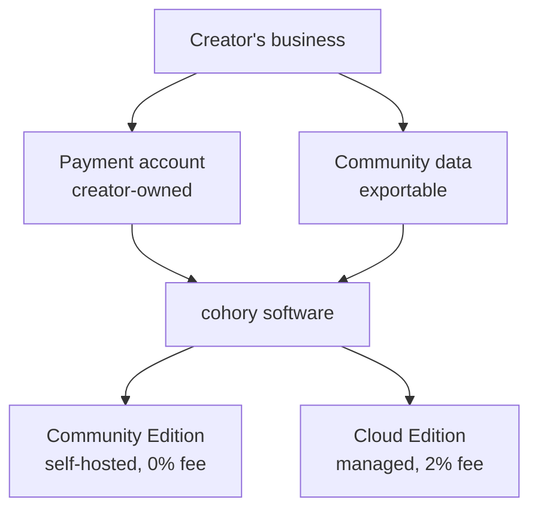
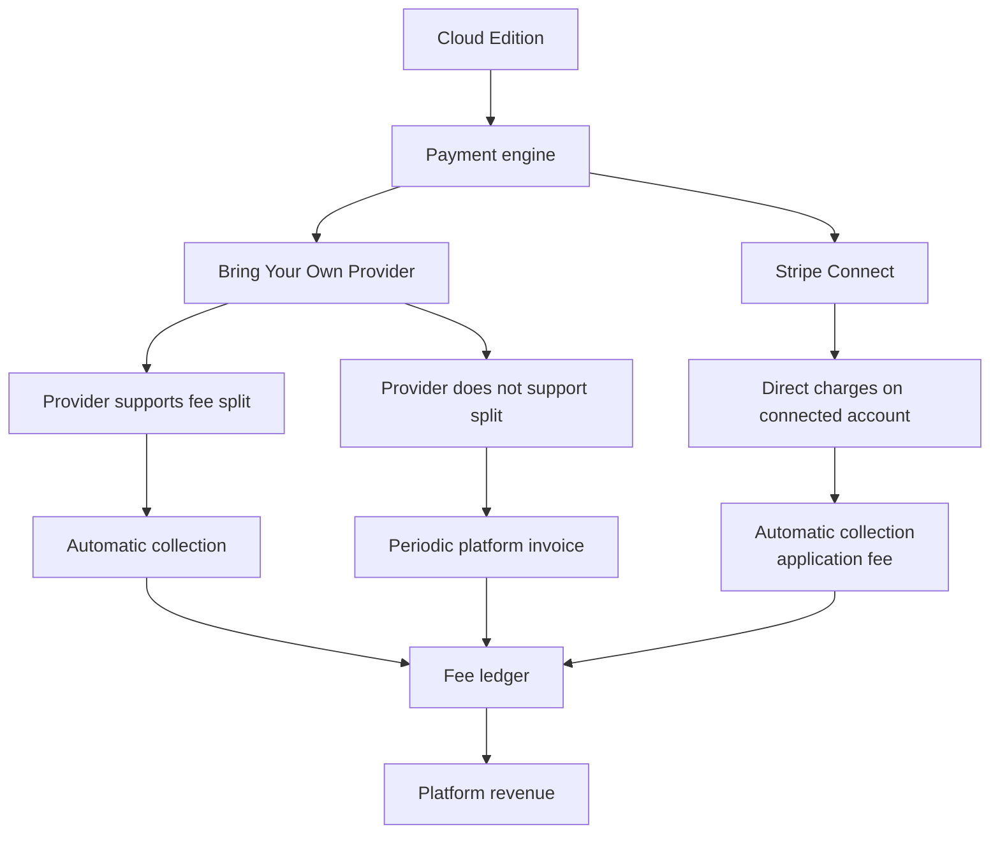
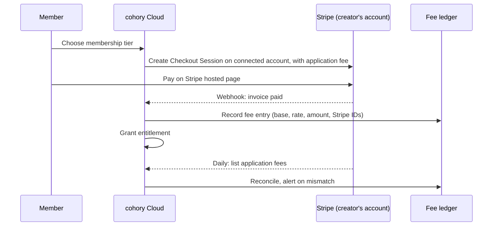
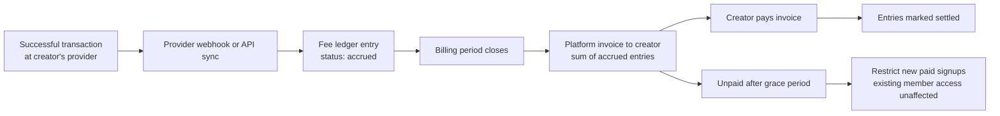

# Business model

How Cohory is offered, how it earns money, what the fee rules are, and what must be settled before charging real customers.

Status: Draft, 2026-10-20

Payment implementation details live in [../architecture/payments.md](../architecture/payments.md). Nothing here is legal or tax advice. Every item marked Open question must be resolved, with legal and accounting input, before the Cloud Edition processes real payments.

## Summary

**Confirmed.**

- **Community Edition.** Open source, self-hosted, free. 0% platform fee. Includes community, courses, gamification, events, member management, payment integrations, API access, and agent integrations as they ship.
- **Cloud Edition.** Managed hosting. No mandatory monthly subscription. 2% platform fee on successful transactions. Payment processing fees are separate and charged by the provider. Creator-owned payment accounts, custom domains, automatic updates, managed infrastructure.

The founder's tagline candidate captures it: "Free to start. Just 2% when you earn. Own your community." Final messaging belongs to [../brand/brand-strategy.md](../brand/brand-strategy.md).

## Editions compared

Adapted from the founder's pricing table.

| | Community Edition | Cloud, Bring Your Own Provider | Cloud, Stripe Connect |
|---|---|---|---|
| Hosting | Creator or operator | Cohory | Cohory |
| Monthly subscription | $0 | $0 | $0 |
| Platform fee | 0% | 2% | 2% |
| Payment processing | Creator pays provider | Creator pays provider | Creator pays Stripe |
| Payment integration | Self-managed | Creator's own provider | Stripe Connect |
| Subscription ownership | Creator | Creator | Creator (connected account) |
| Infrastructure | Self-managed | Managed | Managed |
| Availability | MVP | Post-MVP | MVP |

**Confirmed.** The Cloud Edition sells convenience, not features. **Recommendation.** No core product feature is exclusive to the Cloud Edition. Cloud-only items are operational: managed hosting, automatic updates, managed backups, automatic TLS for custom domains, and the Stripe Connect onboarding flow.

## How money flows

### Payment engine overview

From the founder's notes.

**Confirmed.** Every path writes to the fee ledger. The ledger is the single source of truth for what Cohory earned, whether the money arrived automatically or through an invoice.

### Option A: Stripe Connect (MVP)

**Confirmed.** Direct charges on the creator's connected account where supported, with the 2% collected automatically as an application fee. The creator is the intended merchant of record, subject to legal review and Stripe configuration.

**Recommendation.** Use Stripe Connect connected accounts with full Dashboard access, Stripe as the processing fee and loss collector (the Accounts v2 configuration defined in [../architecture/payments.md](../architecture/payments.md)). The legacy Standard account type is deprecated for new platforms. The creator owns a full Stripe account, sees their customers and subscriptions in their own dashboard, and keeps them if they disconnect from cohory. Express and Custom accounts give the platform more control but weaken ownership and add platform-side costs and liabilities. See [../architecture/payments.md](../architecture/payments.md) for the comparison.

### Option B: Bring Your Own Payment Provider (post-MVP)

**Confirmed.** Supported independent providers. If a provider supports an automatic fee split, use it. If not, record the 2% in the fee ledger and collect through periodic platform billing. We do not assume providers share capabilities.

**Recommendation.** Each provider gets a capability record before it is supported: fee split support, subscription objects, webhooks, refund and dispute events, customer portal, and data export. The record lives in [../architecture/payments.md](../architecture/payments.md).

**Recommendation.** Defaults for ledger billing:

- Billing period: calendar month.
- Minimum invoice (**Confirmed**, founder, 2026-10-19): accrued fees below 5 USD, or a fixed equivalent in the invoice currency, carry forward to the next period with no limit on the number of periods. Nothing is invoiced until the balance reaches the minimum.
- Revenue verification (**Confirmed**, founder, 2026-10-19): no creator revenue attestation. Signed provider data (webhooks and API listings) plus the daily reconciliation are enough.
- Payment: a card or bank method kept on file by Cohory's own billing account (this is the only relationship where the creator pays Cohory directly).
- Non-payment: reminders at 7 and 14 days. After 30 days, new paid signups are paused. Existing members keep access, and exports stay available. We never hold a creator's members hostage over an unpaid fee invoice.

## What "no mandatory monthly subscription" means

**Confirmed.** No creator has to pay a monthly fee to use the Cloud Edition. **Confirmed.** The Cloud Edition must still have sustainable resource limits.

A creator with no revenue generates no fee but still costs storage, bandwidth, email, and compute. Fair-use limits protect the service without becoming a hidden subscription.

**Recommendation.** Initial fair-use limits per community on the Cloud Edition:

| Resource | Community with no paid transactions in the last 90 days | Community with paid transactions in the last 90 days |
|---|---|---|
| Members | 1,000 | No fixed cap. Above 25,000 we contact the creator to plan capacity. |
| File storage (images, attachments, uploaded video) | 5 GB | 50 GB |
| Single uploaded file | 500 MB | 2 GB |
| Monthly media bandwidth | 50 GB | 500 GB |
| Announcement emails to all members | 2 per month | 8 per month |
| API requests per token | 60 per minute | 120 per minute |
| Communities per account | 3 | 10 (more on request) |

Rules that apply to every limit (**Recommendation**):

1. Limits are published, shown in Manage, Overview as plain usage bars, and changed only with 30 days notice.
2. Reaching a limit blocks the specific action (for example, a new upload) with a plain explanation. It never hides content or removes members.
3. Video embeds from external hosts do not count against storage or bandwidth. This is the default recommended path for course video.
4. Creators who need more can request a review, move to the Community Edition, or (Open question) buy an optional usage add-on. An add-on would be optional and only for usage above fair use, never for core features.
5. Free communities with no creator sign-in for 12 months may be archived after two notices sent 30 days apart. Archived communities stay exportable for at least 12 more months.

Since 0.2.0 (Phase 4): members, file storage, and single upload size are enforced at join, invite redemption, and upload, configurable with `FAIR_USE_*` variables, and shown in Manage, Overview. Bandwidth and communities per account are not enforced yet. Announcement emails are limited to one per 24 hours per community, and API tokens to 60 requests per minute (`RATE_LIMIT_API_TOKENS`), on both tiers and both editions rather than by the table above. In these limits, "paid transactions in the last 90 days" means a member payment with a positive amount after refunds, or a collected or accrued platform fee entry on a payment that was not refunded in full, in the last 90 days (founder decision, 2026-10-19). Setting a price alone does not count. See [../self-hosting.md](../self-hosting.md#fair-use-limits).

**Open question.** Are optional usage add-ons consistent with the "no mandatory monthly subscription" promise in how creators will read it? Proposed default: allow them only for storage and bandwidth beyond the paid tier limits, billed by usage, never as a plan.

## Fee rules that must be defined before production

Each item below is an **Open question** with a proposed default. The proposed defaults are **Recommendation** and need legal and accounting review.

### 1. Fee base

Proposed default: the platform fee is 2% of the amount successfully charged to the buyer for a membership or purchase, after discounts and credits, excluding taxes that are collected and stated separately (VAT, GST, sales tax), and before the provider's processing fees.

Note (**Assumption**, verify with current Stripe documentation): a subscription level `application_fee_percent` on Stripe is applied to the invoice total, which may include tax. To exclude tax, the fee may need to be set per invoice as a fixed `application_fee_amount` when the invoice is created. The chosen mechanism is documented in [../architecture/payments.md](../architecture/payments.md).

### 2. Rounding

Proposed default:

- Calculate in integer minor units of the charge currency (cents, or whole units for zero-decimal currencies such as JPY).
- `fee = round_half_up(base_minor_units / 100)`.
- No minimum fee and no maximum fee. A computed fee of zero is recorded as zero.
- The fee is collected in the same currency as the charge. No currency conversion by cohory.
- When Stripe computes the fee itself, Stripe's amount is authoritative and the ledger records both values. Any difference larger than one minor unit raises an alert.

Examples: a $49.00 charge gives 4900 / 100 = 49 cents. A $12.34 charge gives 1234 / 100 = 12.34, rounded to 12 cents. A $0.50 charge gives 0.5, rounded half up to 1 cent.

### 3. Taxes

Proposed default: the creator, as intended merchant of record, is responsible for tax on their sales. Cohory may offer tax calculation through the provider (for example Stripe Tax) as an option the creator enables. The platform fee is calculated on the pre-tax amount. Whether Cohory must charge VAT or sales tax on the platform fee itself, by creator location, is deferred (**Confirmed**, founder, 2026-10-19): no tax is added to platform fee invoices until the Cloud Edition has revenue, and tax registration and the tax treatment of the fee are a pre launch accounting task ([../operations/platform-billing.md](../operations/platform-billing.md#open-questions)).

### 4. Refunds

Proposed default:

- Full refund: the full platform fee is refunded to the creator.
- Partial refund: the platform fee is refunded proportionally, using the same rounding, and cumulative fee refunds never exceed the fee collected on that charge.
- Processing fees are not refunded by cohory. Whether the provider returns them follows the provider's own policy.
- Each fee refund is a new ledger entry, never an edit to the original entry.

### 5. Disputes and chargebacks

Proposed default:

- While a dispute is open, the fee stays recorded.
- If the dispute is lost, the platform fee on the disputed amount is refunded to the creator as a ledger entry.
- If the dispute is won, nothing changes.
- Dispute fees charged by the provider are borne by the creator's account under direct charges (**Assumption**, verify for each account type).

### 6. Other definitions

| Topic | Proposed default |
|---|---|
| "Successful transaction" | A charge that reaches a succeeded or paid state at the provider. Failed, incomplete, and authorization-only attempts carry no fee. |
| Free trials | No fee until the first successful paid charge. |
| Zero-amount invoices (100% coupons) | No fee. |
| Self-hosted instances | Never charged, never metered, never report transactions to cohory. |
| Rate changes | Announced 60 days ahead, apply only to transactions after the effective date. |
| Leaving the Cloud Edition | Application fees removed from all future invoices of active subscriptions as part of offboarding. Fees on transactions before the offboarding date remain. |

## Positioning directions

From the founder's notes. Each direction implies a different primary buyer.

| Direction | Target audience | Differentiation | Recommended timing |
|---|---|---|---|
| Open-source Skool | Creators and coaches | Simplicity and ownership | Lead position for Phases 0 to 4 |
| WordPress for Communities | Developers and agencies | Plugins, themes, extensibility | Post-MVP, once the API is stable and the plugin SDK exists |
| Community Infrastructure | SaaS founders and businesses | APIs, white labeling, custom domain, embeddable components | Long-term |

**Recommendation.** Lead with "Open-source Skool" in all public messaging until the MVP ships. The other two directions are real but require capabilities (plugin SDK, embeddable components, white labeling) that do not exist yet. Presenting them early would promise features we have not built.

## The three main goals

From the founder's notes.

1. **Pure open source.** A completely free, self-hosted Skool alternative, focused on GitHub adoption and community contributions.
2. **Open-source SaaS.** Free self-hosting plus a 2% transaction-based hosted version, with the goal of building a profitable company.
3. **Developer platform.** A highly extensible, white-label community platform that developers and agencies use to build their own products.

**Recommendation.** Treat these as a sequence that reinforces itself, not three separate bets:

- Goal 1 is the distribution engine. A genuinely useful Community Edition earns trust and contributors.
- Goal 2 is the business. Creators who do not want to run servers move to Cloud.
- Goal 3 is the extension. It depends on a stable API and SDK, which goals 1 and 2 force us to build well.

The main conflict between goals: a strong goal 1 reduces goal 2 revenue. This is accepted (see Principle 9 in [principles.md](principles.md)).

**Confirmed** (founder, 2026-10-19). Licensing affects all three goals. The core is AGPL-3.0, which discourages third parties from offering closed hosted forks, and the SDK, generated client, agent runner, and plugin templates are MIT, with a plugin exception whose wording awaits legal review ([ADR 0009](../decisions/0009-license.md), [../../LICENSING.md](../../LICENSING.md)).

## Unit economics sketch

**All numbers in this section are illustrative, chosen only to show the shape of the model. They are not forecasts, targets, or measured costs.**

### Revenue per community (illustrative)

| Example community | Members paying | Price per month | Monthly gross | Platform fee (2%) |
|---|---|---|---|---|
| Small coaching group | 40 | $25 | $1,000 | $20.00 |
| Mid-size membership | 300 | $20 | $6,000 | $120.00 |
| Large membership | 2,000 | $15 | $30,000 | $600.00 |
| Free community | 0 | $0 | $0 | $0 |

Processing fees are separate and paid to the provider. As an illustrative assumption, a card rate of 2.9% plus $0.30 would cost the mid-size example about $264 per month in processing, roughly 2.2 times the platform fee.

### Comparison with a fixed monthly plan (illustrative)

For a creator, a fixed plan priced at P per month costs the same as the 2% fee at a monthly gross of P / 0.02 (50 times P). Using the unverified prices in [target-audience.md](target-audience.md): a $49 plan matches the fee at $2,450 monthly gross, and an $89 plan at $4,450. Creators below that level pay less with Cohory Cloud. Above it, they pay more than a fixed plan, which is when self-hosting becomes attractive. This is intended, and the honest framing is: "Cloud is cheaper while you are growing. Self-hosting is free when you are large."

### Cost side (illustrative)

| Cost item | Illustrative assumption |
|---|---|
| Infrastructure per active community | $1 to $10 per month, driven mostly by storage and media bandwidth |
| Infrastructure per free, inactive community | Under $0.50 per month |
| Fixed team and operations | $30,000 per month |

At those illustrative numbers, covering $30,000 of fixed cost requires $1.5 million of monthly gross processed through Cloud (30,000 / 0.02). The lesson for planning: the fee model only works with a meaningful number of earning communities, so free community costs must stay very low and support must be mostly self-service.

## Risks

| Risk | Effect | Mitigation |
|---|---|---|
| Thin margin per transaction | Revenue requires high gross volume | Keep infrastructure lean, push video to external hosts, self-service support |
| Large creators self-host to avoid the fee | Highest earners leave Cloud | Accepted by design. Compete on convenience. |
| Stripe Connect terms, pricing, or capabilities change | Fee collection or ownership model breaks | Abstract payments behind the payment engine. Track Stripe changes. Keep BYO path. |
| Merchant of record and liability unclear | Legal exposure | Legal review before production. Connected accounts with full Dashboard access keep the creator as the account holder (**Assumption**). |
| BYO ledger invoices go unpaid | Revenue loss on BYO path | Restrict new paid signups after grace period. Prefer providers with fee split. |
| Fee calculation bugs | Loss of trust, possible refunds owed | Single fee module, property-based tests, daily reconciliation, alerts |
| Free communities consume resources | Costs without revenue | Fair-use limits, archival of inactive communities |
| Fraud and abusive communities on Cloud | Provider account risk, reputational harm | Acceptable use policy, Stripe onboarding checks, moderation tools |
| Positioning sprawl across three directions | Unfocused product | Lead with Open-source Skool until MVP ships |

## Decisions and open questions

| Label | Item |
|---|---|
| Confirmed | Community Edition: self-hosted, open source, 0% platform fee. |
| Confirmed | Cloud Edition: no mandatory monthly subscription, 2% on successful transactions, processing fees separate (founder, 2026-10-20, [ADR 0027](../decisions/0027-safe-exit-and-2-percent-fee.md)). Existing subscriptions keep the rate they were created with. |
| Confirmed | Stripe Connect with direct charges and application fee. BYO provider with ledger and periodic billing when no fee split is available. |
| Recommendation | Connected accounts with full Dashboard access (Accounts v2 configuration in payments.md). Legacy Standard type is deprecated for new platforms. |
| Recommendation | Fair-use limits as listed, published and changed with 30 days notice. |
| Recommendation | Fee rounding: integer minor units, round half up, no minimum. |
| Recommendation | Lead positioning: Open-source Skool. |
| Assumption | Creator is merchant of record under direct charges. Dispute fees borne by the connected account. |
| Open question | Fee base (proposed: post-discount, pre-tax, pre-processing amount) and the Stripe mechanism to exclude tax. |
| Confirmed | Billing minimum of 5 USD or a fixed equivalent, carried forward with no period limit (founder, 2026-10-19). |
| Confirmed | No creator revenue attestation; signed provider data plus daily reconciliation (founder, 2026-10-19). |
| Confirmed | Fair use paid tier means paid transactions in the last 90 days (founder, 2026-10-19). |
| Confirmed | Tax on the platform fee itself deferred until Cloud revenue; a pre launch accounting task (founder, 2026-10-19). |
| Open question | Refund and dispute fee treatment (proposed: proportional refund of platform fee, refund on lost disputes). |
| Open question | Optional usage add-ons above fair use. |
| Confirmed | AGPL-3.0 core, MIT SDK and plugin templates, DCO with no CLA ([ADR 0009](../decisions/0009-license.md)). |
