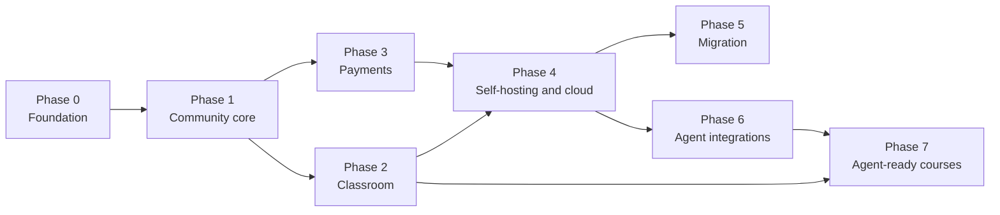

# Roadmap

The eight phases from foundation to agent-ready courses, with scope, dependencies, deliverables, acceptance criteria, and risks for each.

Status: Draft, 2026-10-19, statuses checked against 0.12.0 on 2026-10-24

**Confirmed.** Phases 0 to 7 come from the founder brief. **Confirmed.** No dates are set. Phases end when acceptance criteria are met, not when time runs out. Scope, criteria, and risks below are **Recommendation** unless marked otherwise. Requirement IDs refer to [product-requirements.md](product-requirements.md). The MVP cut is in [../product/mvp-scope.md](../product/mvp-scope.md).

## Overview

| Phase | Name | Release | Status (0.12.0) |
|---|---|---|---|
| 0 | Foundation and design | Internal | Done |
| 1 | Community core | Internal, then early self-hosters | Built (0.1.0) |
| 2 | Classroom and learning | Early self-hosters | Built (0.1.0) |
| 3 | Payments and memberships | Early self-hosters, private Cloud beta | Built (0.1.0), checked against a Stripe sandbox in 0.2.0 |
| 4 | Self-hosting and cloud | **MVP public release** | Built (0.2.0); the external security review is still owed |
| 5 | Migration and portability | Post-MVP | Built (archive and importers in 0.4.0, bring your own provider in 0.5.0) |
| 6 | Agent integrations | Post-MVP | Built (API, agents, and approvals in 0.6.0, MCP in 0.7.0) |
| 7 | Agent-ready courses | Long-term | Built in part (0.8.0), see Phase 7 status |

## Ordering rationale

1. **Foundation before code.** Principles, architecture, tenancy, and authorization rules are cheap to change on paper and expensive in code. Payments and tenant isolation especially must be designed before the first table exists.
2. **Community before Classroom.** The feed, members, and roles are the backbone every other module attaches to (comments are reused by lessons, entitlements gate courses and events).
3. **Classroom before Payments.** Payments only matter once there is something to gate. Building Classroom first also forces the Entitlements interface to exist before money is involved, so it can be tested without payment complexity.
4. **Payments before public release.** Paid memberships are part of the MVP and the core of the business model. A public release without them would attract the wrong early users.
5. **Self-hosting and cloud last in the MVP sequence, but not last in effort.** Docker Compose runs from Phase 1 onward. Phase 4 hardens it (backups, upgrades, load test) and adds Cloud operations.
6. **Migration after MVP.** Importers and the full archive export depend on stable internal models. The MVP ships a members CSV export with Stripe customer and subscription IDs (REQ-MEM-007) so that no early creator is trapped. The full archive export ships in Phase 5.
7. **Agents after the API is proven.** MCP and agent identities wrap the REST API. Building them before the API is stable would double the rework.
8. **Agent-ready courses last.** They depend on structured courses (Phase 2), entitlements and payments (Phase 3), and agent identities with delegation (Phase 6).

## What can run in parallel

- Phase 2 (Classroom) and Phase 3 (Payments) can run in parallel once the Entitlements interface from Phase 1 exists. Phase 3 needs at least one gated resource, which can be a course stub or an event.
- Docker Compose packaging and CI run continuously from Phase 1. Phase 4 is the hardening point, not the start.
- The REST API and OpenAPI document grow with every phase (Principle 4). Phase 6 adds MCP and agent identities on top.
- Phase 5 (Migration) and Phase 6 (Agent integrations) are independent and can run in parallel after Phase 4.
- Design system work from Phase 0 continues as components are needed, but the tokens are fixed before Phase 1 UI work begins.

## Phase 0: Foundation and design

**Goals.** Agree on what we are building and how, before writing application code.

**Scope.** Foundation docs, brand foundation, design tokens and component specs, information architecture, architecture docs (modules, data model, tenancy, authorization, payments, agents), decision records, contribution guidelines, repository skeleton.

**Dependencies.** None.

**Deliverables.**
- This document set under `docs/foundation`, plus [../brand/brand-strategy.md](../brand/brand-strategy.md), [../brand/design-tokens.md](../brand/design-tokens.md), [../product/information-architecture.md](../product/information-architecture.md), [../architecture/overview.md](../architecture/overview.md), [../architecture/payments.md](../architecture/payments.md), and [../decisions/README.md](../decisions/README.md).
- An empty pnpm and Turborepo monorepo with lint, type check, test, and CI wired up.
- A license decision record.

**Acceptance criteria.**
- Every Open question that blocks Phase 1 (tenancy model, authorization model, ID strategy, rich text format) has a decision record.
- A contributor can clone the repository and run lint and tests in under 10 minutes.

**Risks.** Over-documenting and delaying code. Mitigation: Phase 0 ends when blocking questions for Phase 1 are answered. Non-blocking questions stay open.

## Phase 1: Community core

**Goals.** A working community: people sign in, create a community, invite members, post, comment, and like.

**Scope.** Identity (REQ-ID-001, 002, 004 to 007), Communities (REQ-COM-001 to 006, 009), Members (REQ-MEM-001 to 007), Posts (REQ-POST-001 to 008, 011, 012), Comments (REQ-CMT-001 to 003, 005), Notifications basics (REQ-NTF-001 to 003), Gamification (REQ-GAM-001 to 003, 005), the Entitlements interface with free access only, the audit log foundation, and the internal API (Hono, session auth) for these objects.

**Dependencies.** Phase 0 decisions on tenancy, authorization, and data model.

**Deliverables.**
- Member navigation shell with four tabs, mobile bottom navigation, Manage shell with five sections.
- CommunityPost, PostComposer, CommentThread, MemberCard, Leaderboard components.
- Docker Compose file that runs web, worker, PostgreSQL, and a one-shot migrations container locally. Redis is an optional profile.
- OpenAPI document for implemented endpoints.

**Acceptance criteria.**
- A new user creates a community and publishes a first post in under three minutes, unassisted, in a moderated usability check.
- Cross-tenant access tests pass for every endpoint (REQ-NFR-SEC-001).
- Accessibility checks pass with zero serious violations on all Phase 1 screens.
- Performance budgets met on the feed with 10,000 seeded posts.

**Risks.** Scope creep in the feed (reactions, rich embeds, polls). Mitigation: only the listed requirements. Authorization mistakes that are expensive later. Mitigation: authorization tests are a merge requirement.

## Phase 2: Classroom and learning

**Goals.** Creators build courses where content lives. Members learn and resume easily.

**Scope.** Courses (REQ-CRS-001 to 005, with all-members access only), Lessons (REQ-LSN-001 to 003, 005), "Continue" on the Community homepage. Lesson comments and level-gated access (REQ-LSN-004, REQ-GAM-004) are Post-MVP.

**Dependencies.** Phase 1 (identity, communities, comments, entitlements interface).

**Deliverables.** CourseCard, LessonPlayer, lesson sidebar, progress indicator. Course structure stored so it can later export to Markdown with front matter (Phase 5). Attachment upload to S3-compatible storage with a local disk fallback.

**Acceptance criteria.**
- A creator builds a course with three modules and ten lessons without leaving Classroom.
- A member resumes the last incomplete lesson from the Community homepage in one tap.
- Lesson player is fully keyboard operable and shows captions when provided.

**Risks.** Video expectations (creators may expect hosting and transcoding). Mitigation: clear guidance toward external video hosts, upload and transcoding explicitly post-MVP. Course model too rigid for Phase 7. Mitigation: review the lesson structure against the agent course needs in [../architecture/agent-integrations.md](../architecture/agent-integrations.md) before freezing.

## Phase 3: Payments and memberships

**Goals.** Creators earn money with paid tiers, and subscriptions live in the creator's account.

**Scope.** Payments (REQ-PAY-001 to 007, 010), Subscriptions (REQ-SUB-001 to 005), Entitlements (REQ-ENT-001 to 003), fee ledger, PricingCard, PaymentProviderSelector (Stripe only at this stage), Events (REQ-EVT-001 to 003, 005 as .ics download, 006) can land here or in Phase 2 depending on capacity.

**Dependencies.** Phase 1. At least one gated resource from Phase 2 (or events). Phase 0 resolution of fee base, rounding, refunds, and disputes in [business-model.md](business-model.md), at least as accepted defaults for test mode.

**Deliverables.**
- Stripe Connect onboarding for Cloud ("Connect your Stripe account") and API key setup for Community Edition.
- Fee calculation module with unit and property-based tests.
- Webhook handler with idempotency, plus daily reconciliation job.
- Payments view in Manage with gross, processing, platform fee, and net.

**Acceptance criteria.**
- In Stripe test mode, a subscription created through Cohory Cloud belongs to the connected account, carries the correct application fee, and the ledger matches Stripe to the minor unit.
- Refunds (full and partial) and lost disputes produce the correct fee ledger entries.
- Community Edition creates subscriptions with no application fee and no call to any Cohory service.
- Entitlements update within one minute of payment, cancellation, and failed payment events.
- Disconnecting the payment account removes application fees from future invoices in test mode.

**Follow-up (Step 17, 0.10.0).** Member reviews on the About page, limited to members who have paid for at least 30 days ([ADR 0025](../decisions/0025-reviews-module-boundary.md)).

**Risks.** Financial bugs. Mitigation: tests required for every fee path, code review by two people for payment changes. Legal questions unresolved (merchant of record, tax on fees). Mitigation: Cloud stays in test mode or private beta until resolved.

## Phase 4: Self-hosting and cloud

**Goals.** Ship the MVP publicly on both editions.

**Scope.** Production Docker Compose with backup, restore, and upgrade (REQ-NFR-HOST-001 to 005), Cloud operations (tenant provisioning, custom domains with TLS, managed backups, monitoring), fair-use limit enforcement, load testing, security review, public docs site.

**Dependencies.** Phases 1 to 3.

**Deliverables.** Install guide, operator guide, upgrade guide, Cloud signup flow, status page, security policy.

**Acceptance criteria.**
- A clean 2 vCPU, 4 GB VPS reaches a working community in under 30 minutes using only the README.
- Load test meets REQ-NFR-PERF-005 on the reference deployment, or the documented capacity is updated to what was measured.
- Backup and restore tested end to end.
- External security review of auth, tenancy, and payments completed with high and critical findings fixed.
- Fair-use limits shown in Manage, Overview, and enforced as documented.

**Risks.** Operational load on a small team. Mitigation: managed PostgreSQL and object storage for Cloud, minimal custom infrastructure. Self-hosters with very different environments. Mitigation: one supported path (Docker Compose), others community maintained.

## Phase 5: Migration and portability

**Goals.** Make moving in and out real and tested.

**Scope.** Full archive export with a versioned schema (REQ-MIG-001, REQ-CRS-007), import of the Cohory export (REQ-MIG-002), member CSV import (REQ-MIG-003), Skool and Circle importers (REQ-MIG-004), payment migration options A, B, C (REQ-MIG-005), linking existing Stripe subscriptions (REQ-SUB-007), Cloud to self-hosted offboarding (REQ-MIG-006), first Bring Your Own Payment Provider integration (REQ-PAY-008).

**Dependencies.** Phase 4 (stable data model and production payments).

**Deliverables.** Migration section inside Settings ("Bring your existing subscribers"), importer framework with normalization step, offboarding guide, BYO capability record and ledger billing.

**Acceptance criteria.**
- Automated round-trip test: Cloud export imported into a fresh Community Edition instance with content, members, and entitlements matching.
- For each importer, a published limits page states what transfers and what does not.
- Linking an existing Stripe subscription grants the right entitlement without member action when the creator owns the account.
- BYO ledger invoices are generated, paid, and reconciled in test mode.

**Risks.** Source platforms change formats or restrict exports. Mitigation: importers isolated, versioned, and documented as best effort. Expectations of seamless payment migration. Mitigation: plain-language limits on every migration screen.

## Phase 6: Agent integrations

**Goals.** Agents can help creators run a community safely.

**Scope.** Public REST API v1 with OpenAPI (REQ-AGT-001), scoped API tokens (REQ-AGT-002), audit of API and agent actions (REQ-AGT-003), agent identities (REQ-AGT-004), MCP server (REQ-AGT-005), approval queue (REQ-AGT-006), outbound webhooks (REQ-AGT-007), agent capabilities from the founder's list starting with high priority ones (community management, content publishing, member management, community search, event management), scheduled posts (REQ-POST-010), inactive member queries (REQ-MEM-008).

**Dependencies.** Phase 4 (stable REST API and audit log). Independent of Phase 5.

**Deliverables.** MCP server at a documented path, agent management in Manage, Settings, approval queue in Manage, Overview, scope reference, security guidance for agent use.

**Acceptance criteria.**
- Every MCP tool maps to a REST operation with the same authorization.
- An agent cannot perform a money, role, or removal action without human approval, verified by tests.
- Every agent action appears in the audit log with agent identity and owning human.
- Revoking an agent's access takes effect on its next request.

**Risks.** Prompt injection through community content. Mitigation: content returned to agents is marked as untrusted, and tools that write require scopes and approvals. Feature pull toward AI buttons in the UI. Mitigation: Principle 8.

## Phase 7: Agent-ready courses

**Goals.** Courses that both humans and their agents can learn from and be evaluated on.

**Scope.** Agent course format (structured references, executable tasks, templates and code, automated evaluations, verified capability reports), SKILL.md generation and course to skill conversion, delegated entitlements (REQ-ENT-004), agent assignment submissions, purchase approved by the human owner.

**Dependencies.** Phase 2 (course structure), Phase 3 (payments and entitlements), Phase 6 (agent identities, approvals).

**Deliverables.** Format specification, authoring support in Classroom, course API and MCP tools for agents, evaluation runner design (hosted execution remains out of scope).

**Acceptance criteria.**
- A human purchases a course, delegates read access to their agent, and the agent retrieves lessons and exercises through the API or MCP.
- Delegation is revocable and limited to the purchased course.
- Downloaded skills and external course content are never executed with elevated permissions, verified by security review.
- Evaluation results are attributable to a specific agent, course version, and run.

**Status (0.8.0).** Built and checked in the 0.8.0 release verification: the format specification ([../architecture/agent-course-format.md](../architecture/agent-course-format.md)), authoring in Classroom, SKILL.md export validated with `skills-ref`, delegated read access, course API routes and MCP tools for agents, self reported submissions, and the evaluation runner design ([../architecture/evaluation-runner.md](../architecture/evaluation-runner.md)). The four acceptance criteria are covered by integration tests across REST and both MCP protocol paths, a Playwright journey, and an internal security review ([../security/review-agent-courses.md](../security/review-agent-courses.md)). Not built: verified capability reports (results stay self reported) and hosted execution (out of scope). Open items: [../product/backlog.md](../product/backlog.md).

**Risks.** The format becomes obsolete as agent ecosystems change. Mitigation: build on open formats (Markdown, Agent Skills compatibility) and keep the format small. Trust in "verified results". Mitigation: describe exactly what is verified and what is not.

## Decisions and open questions

| Label | Item |
|---|---|
| Confirmed | Phases 0 to 7 as in the brief, with no dates. |
| Recommendation | MVP public release at the end of Phase 4. |
| Recommendation | Phases 2 and 3 can run in parallel after Phase 1. Phases 5 and 6 can run in parallel after Phase 4. |
| Recommendation | Members CSV export in MVP. Full archive export, import, and importers in Phase 5. |
| Recommendation | Cloud stays in private beta until fee base, tax, refunds, and disputes are legally reviewed. |
| Open question | Do Events land in Phase 2 or Phase 3? Proposed default: Phase 2 if Classroom finishes early, otherwise Phase 3. |
| Recommendation | Polar is the first BYO provider in Phase 5 (built in 0.5.0, engineering choice). |
| Open question | Does an external security review happen before or during the private Cloud beta? Proposed default: before any live payments. |
